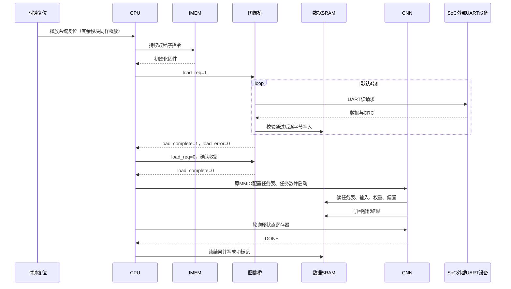

# SoC 三线自动加载 RTL 与上电全流程仿真说明（小白版）

日期：2026-10-08。

**已按 CPU 与图像桥三线直连方案补出独立 RTL，并通过从上电开始的完整小任务仿真。** 数据从外部 UART 进入，CPU 执行 IMEM 中的程序调度真实 CNN，最后读回并检查计算结果。

旧版保留；新入口是 `rtl/soc/autoload/face_soc_autoload_top.sv`，配套清单是 `rtl/filelists/system_autoload.f`。原 Control、生产 Datapath、CNN、datasram、IMEM 和时钟复位代码未改。

## 1. 推荐的简单任务：一张 2×2 的“小图像”

为了让数据能手算，输入用一张只有四个数的单通道特征图：

```text
输入：                每个位置做同一个计算：       输出：
 1  -2                y = x × 2 + 3                5  -1
 3   4                                             9  11
```

这就是一个 **1×1 卷积**：输入通道 1、输出通道 1、步长 1、无填充、权重 2、偏置 3，输入/输出为有符号 INT8。不启用激活和额外量化移位，所以 -1 会保留。

选择它的原因是：结果容易手算，但 CNN 仍要真正读取任务表、输入、权重和偏置，通过计算单元完成乘加，再写回 SRAM。不是用一个延时或假结果代替 CNN。

输出故意从 `0x141` 开始，跨过两个 32 位字。这样还能检查 CNN 写一个字节时，是否保留旁边的数据。

## 2. 图里仍然只画六个模块

| 你画的模块 | 新版实现 | 这次变化 |
|---|---|---|
| CPU | cpu_core_autoload | 封装内部加入加载控制/状态寄存器，原 Control 和 Datapath 不改 |
| CNN | mobilefacenet_accelerator_top | 原 CNN 计算和端口不改 |
| 数据 SRAM | datasram | 原内部仲裁和存储不改 |
| 指令 IMEM | imem_rom | 仍为初始化程序 ROM，未增加下载口 |
| 图像桥 | image_bridge_autoload | 主动向外部 UART 设备读数据，校验后写 SRAM |
| 时钟复位 | clock_unit | 原共享时钟及复位释放逻辑不改 |

CPU 与图像桥只新增以下三根内部线：

```text
CPU.load_req       ──────────────→ 图像桥.load_req
CPU.load_complete  ←────────────── 图像桥.load_complete
CPU.load_error     ←────────────── 图像桥.load_error
```

原来 CPU↔IMEM、CPU↔SRAM、CPU↔CNN、CNN↔SRAM、图像桥↔SRAM，以及公共时钟/复位都按旧图保留。没有第七个选择模块。顶层文件只是把这六个框接起来的代码文件，画图时不需要把文件名再画成一个模块。

外部仍是 `sys_clk / rst_n_in / uart_rx / uart_tx / led_ready / led_busy / led_error` 七个信号。这里的 UART 用于外部数据加载，IMEM 程序仍随工程初始化。

## 3. 从上电开始，一步步发生什么

1. **时钟复位模块工作。** 外部复位释放后，再经三拍同步释放系统复位。六个模块共用同一个时钟，没有新增 CPU 独立时钟。
2. **CPU 向 IMEM 取指。** IMEM 已通过 `program.mem` 初始化。CPU 自己执行程序，清空结果邮箱，然后向内部控制地址 `0x40` 整字写 1，发出 `load_req`。
3. **图像桥主动向外部设备发读命令。** 默认一次要 64 字节，连续四次读取外部地址 0x00、0x40、0x80、0xC0。外部设备收到请求后自动回复，不需要电脑运行时点击发送。
4. **图像桥把数据写进 SRAM。** 每包先核对地址、序号、长度和 CRC，再写 SRAM。256 字节中包含输入、权重、偏置、输出区初值和 CNN 任务表。最后核对整批 CRC。
5. **图像桥通知 CPU。** 桥保持 `load_complete=1`，成功时 `load_error=0`。CPU 从本地 `0x44` 读状态，保存成功/失败结果，再向 `0x40` 写 0 确认；桥随后撤销完成信号。这就是板内固件调度，全程无电脑控制。
6. **CPU 通过原 MMIO 线配置 CNN。** 写任务表地址 `0x1E0`、任务数 1 和启动值。CNN 通过自己直连 SRAM 的端口读取任务表与数据，计算四个输出并写回。输入数据不绕经 CPU。
7. **CPU 确认 CNN 完成并取结果。** CPU 轮询 CNN 原有状态寄存器，读回两个结果字、检查数值和邻接字节，成功时在 SRAM `0x88` 写 `0x0000600D`，最后停在程序循环中。



图中的外部 UART 设备在 SoC 外面，不计入六模块。

## 4. 这次确实补了哪些代码

| 文件 | 作用 |
|---|---|
| `rtl/soc/autoload/cpu_core_autoload.sv` | 两个 CPU 本地寄存器、三线握手；保持原 SRAM 一拍读时序 |
| `rtl/soc/autoload/image_bridge_autoload.sv` | 主动请求、收包校验、写 SRAM、完成保持、超时和错误处理 |
| `rtl/soc/autoload/autoload_uart.sv` | 原 UART 收发器的独立命名副本 |
| `rtl/soc/autoload/face_soc_autoload_top.sv` | 新版六模块连接入口 |
| `rtl/filelists/system_autoload.f` | 新版独立编译清单 |
| `scripts/gen_autoload_demo.py` | 生成 98 条有效指令的 RV32I 程序、外部数据与可读指令清单 |
| `firmware/autoload_demo/program.mem` | IMEM 初始化文件，1024 个 32 位字，不使用下载串口 |
| `firmware/autoload_demo/program.lst` | 程序每条指令与标签，可直接查看实际调度 |
| `firmware/autoload_demo/external.bin` | 外部设备应持有的 256 字节数据 |
| `tb/integration/tb_soc_autoload.sv` | 上电环境、UART 外部设备模型和自动结果检查 |
| `scripts/run_autoload_integration.py` | 一键生成、编译、运行和导出波形 |

CPU 本地寄存器占用数据地址 `0x40..0x47`，并不会再访问物理 SRAM 的这两个字。整字写 1 发起，完成后整字写 0 确认；提前清除、重复置位、SB/SH 都不会误启动或取消加载。

这次提供的是一段实际可执行的小任务固件。因此“需要固件配合”的部分已在这个任务中补齐，不需要你手动在仿真器里替 CPU 发启动信号。

## 5. 演示地址表

指令地址空间和数据地址空间是分开的；表内除 IMEM 项外，均为 CPU 数据地址。

| 地址/范围 | 内容 |
|---|---|
| IMEM 0x0000 起 | 自动加载、启动 CNN、等待完成、核对结果的程序 |
| 0x40 | CPU 内部加载控制：bit0 为请求 |
| 0x44 | CPU 内部加载状态：bit0 完成、bit1 错误 |
| 0x80、0x84 | CPU 读回的两个结果字 |
| 0x88 | 完成标记：成功 0x600D，失败 0xDEAD0001～0xDEAD0004 |
| 0x100～0x103 | 输入字节：01 FE 03 04，即 1、-2、3、4 |
| 0x110 | 权重低字节 02 |
| 0x120～0x123 | 32 位偏置 3 |
| 0x141～0x144 | CNN 输出字节：05 FF 09 0B |
| 0x1E0～0x1FF | 32 字节 CNN 任务描述符 |
| 0x40000000 | CNN 原控制寄存器，启动写 0x3D |
| 0x40000004 | CNN 原状态，bit1 DONE、bit2 ERROR |
| 0x40000008 | CNN 原任务队列地址，写 0x1E0 |
| 0x40000018 | CNN 原任务数，写 1 |

两个输出所在字应是 `0x09FF05A5` 和 `0xA5A5A50B`，A5 为应保留的周边字节。整批加载区为 `0x100..0x1FF`，包含这些区域之间的填充。

## 6. 最简单的运行方法

在本机 PowerShell 中运行：

```powershell
Set-Location D:\cpu_control
python scripts/run_autoload_integration.py
```

脚本复用项目已有 Vivado XSim 环境配置，无需手工组装编译命令。每次生成独立的 `build/runs/时间戳_autoload_integration/`，先输出 `RUN_DIR=...`。

正常结束会显示以下六项 PASS：

```text
PASS power_on_success
PASS packet_crc_failure
PASS timeout_and_late_reply
PASS batch_crc_failure
PASS wrong_response_tag
PASS partial_last_chunk
```

初看只需打开该目录的 `power_on_success.log`，搜索 `FLOW` 和 `RESULT`；它按顺序记录“CPU 请求加载→四次读包→加载完成→CPU 启动 CNN→CPU 完成”。`result.json` 汇总结果和实际编译源码/固件的哈希。

看波形可打开 `power_on_success.vcd`。建议分四组观察：

| 波形组 | 主要信号 | 应看到什么 |
|---|---|---|
| 上电取指 | sys_clk、rst_n_in、dut.rst_n、dut.imem_addr、dut.imem_re | 释放复位后 CPU 开始取程序 |
| 加载握手 | dut.load_req、dut.load_complete、dut.load_error | 请求上升→完成上升→请求下降→完成下降 |
| UART 与落库 | uart_tx、uart_rx、dut.io_mem_req/gnt/addr/wdata/be | FPGA 先发请求，收到数据后按字节写 SRAM |
| CNN 与结果 | dut.cnn_mmio_*、dut.mem_*、dut.dmem_*、finish_value | 加载成功后才启动，CNN 写结果，CPU 最后写 0x600D |

没有波形工具也可以只看日志，脚本已检查结果，不需要肉眼逐位解码 UART。

## 7. 本次实际跑出的结果

本次最终新版运行目录：`build/runs/20261008_230704_371733_autoload_integration/`。

| 仿真 | 实际结论 |
|---|---|
| 正常全程 | PASS；4 次 UART 请求、256 个 SRAM 字节写、1 次 CPU 启动、4 次 CNN 输出写；CPU 核对结果成功 |
| 第二包 CRC 损坏 | PASS；只有第一包的 64 字节写入，CPU 报加载失败，不启动 CNN |
| 回复超时并迟到 | PASS；零字节写入；迟到回复不会重新启动加载 |
| 包 CRC 正确但整批内容不符 | PASS；256 字节已写入，但整批判失败，CNN 不启动 |
| 应答序号错误 | PASS；零字节写入，CNN 不启动 |
| 每包 63 字节 | PASS；5 包，最后一包只有 4 字节，最终计算结果仍正确 |

默认成功任务在仿真时间约 **313.805 微秒**写出成功标记；之后额外观察 200 微秒，检查没有重复请求。这个时间来自加速 UART：测试时钟 100 MHz、每位 8 拍，相当于 12.5 Mbaud，目的只是缩短仿真。它不是板卡 115200 波特率下的耗时承诺。

旧版回归也已通过：`tb_cnn_native_memory / tb_cpu_cnn_integration / tb_soc_uart`，本次目录 `build/runs/20261008_230600_037080_cnn_integration/`。原 UART Python 单元测试 7 项通过；原包源码审计通过。

修改前后还逐文件核对了 64 个既有 RTL/源码清单文件，全部字节不变。记录在新版运行目录的 `original_preservation.json`，同时确认新版顶层为六个直接实例、独立清单为 51 个源文件。

测试台只驱动时钟、复位和 UART 输入，并观察 DUT。外部数据先放在外部设备模型的存储数组中，再逐位通过 UART 发送；没有直接灌入 DUT SRAM，没有强制 CNN 启动，没有把 CNN 换成 stub。IMEM 通过设计原有的初始化接口读取固件文件。

## 8. 用到实际工程时要明确的范围

- **本次完成的是最小全流程闭环，不是完整人脸识别。** 尚未验证真实图像、完整 MobileFaceNet 多层模型、特征比对或上板时序。
- **外部设备必须懂本版协议。** UART 电气兼容只是前提，还要能够接收读请求、按地址返回数据并计算 CRC；详细格式见 [外部存储协议](docs/autoload_uart_protocol.md)。本次提供的是可执行仿真模型，没有替某个尚未确定型号的外部器件开发固件。
- 加载内容和地址为参数固定配置，不是运行时任意选择模型的通用加载器。更换图像/权重/任务表时要同步生成外部数据、整批 CRC、加载范围及对应 CPU 程序。
- 图像桥遇到错误会锁住，CPU 确认后仍需系统复位恢复；不自动回滚已写数据。CPU 只在整批成功后启动 CNN。
- 演示固件是单次顺序流程，不在 CNN 计算时再次加载；未实现多帧队列或双缓冲。三根线本身不是“自动检测所有模块忙闲”的硬件互锁。
- 固件等待循环有计数上限。扩大数据量、降低波特率或增加外部设备响应延迟时，须同时评估并调整固件等待预算与桥超时，不能只改 UART 参数。
- 选择新版顶层时，需要设置 `IMEM_INIT_FILE` 指向 `program.mem`；本演示设 `IMEM_SIZE=4096`、`SRAM_SIZE=4096`，程序与数据均放得下。顶层空初始化文件的默认值不会自动产生应用程序。还未做新版综合、布局布线及开发板验证。
- 原 `face_soc_top.sv` 与 `system_cnn.f` 继续用于旧被动 UART 版本；不要把两个图像桥同时接上同一串口。本次没有恢复已经放弃的可写 IMEM 或程序下载口方案。

建议你先用当前 2×2 任务确认六模块的数据流和波形，再逐步增加图像尺寸与任务数；这样每次扩展都能定位是哪一环出现问题。
