# SoC 六模块真实波形与数据流逐步说明（小白版）

日期：2026-10-08。对应新版三线直连顶层 `face_soc_autoload_top`。

这份说明配有 **1 张全程总览和 10 张局部放大图**，全部读取上一轮通过的 XSim 原始 VCD 生成，没有手工编造信号时序。本轮不修改 RTL，也没有重新运行或冒充新的 RTL 仿真。

**图中的每一行信号都来自六模块接线说明中的线路或外部 IO。** 没有加入 CPU 内部流水线、CNN 内部状态机、乘加器内部信号、测试台计数器，也没有虚构 CNN 的 `done` 引脚。

**本图展示的是之前的 2×2 卷积测试：UART 同时加载输入、权重、偏置和任务表。你后来提出的“外部只送图像、模型内部固定”仍是后续目标，这张旧仿真的真实波形不代表该目标已经实现，更不代表完整人脸识别。**

## 1. 先看全程，再看局部

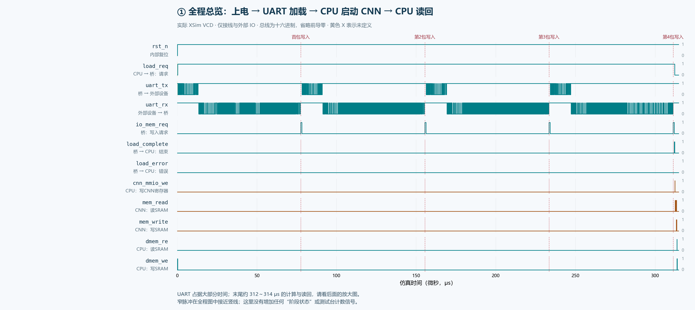

[打开总览 SVG，可放大](docs/figures/soc_autoload_flow/01_overview.svg)

从左往右读这张图：

1. `rst_n` 变高，CPU 开始执行程序。
2. `load_req` 变高，CPU 让图像桥开始加载。
3. `uart_tx` 先跳变，桥向外部设备发请求；`uart_rx` 随后跳变，外部设备回数据。
4. 每收齐一包并校验后，出现一段 `io_mem_req=1`，图像桥将该包写入 SRAM；总共四段。
5. 最后一包写完，`load_complete` 变高；`load_error` 保持 0。
6. CPU 确认加载完成，撤销请求；桥撤销完成状态。
7. `cnn_mmio_we` 出现配置/启动脉冲，随后 `mem_read`、`mem_write` 活动，表示 CNN 自己访问 SRAM。
8. 最后 `dmem_re`、`dmem_we` 活动，CPU 读回结果并保存成功标记。

图的大部分宽度是 UART 传输。末尾约 312～314 μs 的计算和读回很快，所以在总览中挤在右边，必须看后面的放大图。左端也有 CPU 初始化邮箱的 `dmem_we`，不要把所有 CPU 写操作都当成最终结果。

## 2. 读波形先记住四条规则

**第一，地址线和数据线变化，不等于发生了传输。** 必须同时看使能、握手和时钟上升沿。CPU 进行其他计算时，地址线也可能出现数值；没有有效读写使能，就不表示访问了那个地址。

**第二，总线数字都是十六进制，图中省略前导零。** `140` 表示 `0x00000140`；`9FF05A5` 表示 `0x09FF05A5`；`F` 表示二进制 `1111`。一根普通信号的高电平表示 1、低电平表示 0；黄色 X 是尚未定义的初始值，不是假定为 0。

**第三，事务在上升沿采样“沿前”的控制、地址和写数据。** 过了这个沿，发送模块可能立刻把线改成下一笔数值。看红色采样虚线时，通常应读取虚线左侧的请求值。

**第四，CPU 的同步 SRAM 读返回看“沿后”。** 在该上升沿采样地址，沿后 `dmem_rdata` 才更新；CNN 的握手读则在 `mem_read=1 && mem_ready=1` 的上升沿采样沿前返回值。二者完成方式不同。

| 接口 | 怎样认定一次有效传输 |
|---|---|
| CPU → IMEM | `imem_re=1` 的上升沿采样地址，沿后更新指令返回 |
| CPU → SRAM 写 | `dmem_we=1` 的上升沿，采样地址、写数据、`dmem_wstrb` |
| CPU → SRAM 读 | `dmem_re=1` 的上升沿采样地址，沿后看 `dmem_rdata` |
| CPU → CNN MMIO | 上升沿 `cnn_mmio_we/re=1` 且 `cnn_mmio_ready=1` |
| CNN → SRAM | 上升沿 `mem_read/write=1` 且 `mem_ready=1` |
| 图像桥 → SRAM 写 | 上升沿 `io_mem_req=1`、`io_mem_gnt=1`、`io_mem_we=1`，同时要求 `io_mem_error=0` |

全部地址都是**字节地址**。CNN 与图像桥的 SRAM 地址按 4 字节对齐，不是把地址单位改成了“字”。

## 3. 第一步：时钟复位释放，CPU 从 IMEM 取程序

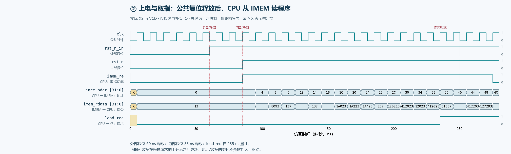

先看 `clk`、`rst_n_in`、`rst_n`：

| 仿真时刻 | 看到什么 | 表示什么 |
|---:|---|---|
| 0～60 ns | 外部复位 `rst_n_in=0` | 系统处于复位阶段 |
| 60 ns | `rst_n_in` 变为 1 | 外部请求释放复位 |
| 65、75、85 ns | 连续三个时钟上升沿 | clock_unit 同步释放复位 |
| 85 ns 沿后 | `rst_n` 变为 1 | 其余模块开始恢复工作 |
| 随后 | `imem_re=1`，`imem_addr` 从 0、4、8…变化 | CPU 向 IMEM 要指令 |
| 各有效取指沿后 | `imem_rdata` 更新 | IMEM 返回程序机器码 |
| 235 ns 沿后 | `load_req` 变为 1 | CPU 已执行到请求加载的指令 |

这一段流动的是**程序指令**，不是图像像素。

CPU 写本地加载控制地址 `0x40` 的动作在 CPU 封装内部完成，对外体现为 `load_req`。它不会形成对 datasram 的有效写入，因此不要期待在 SRAM 写接口上找到一笔“写 0x40 来启动桥”的事务。

CPU 内部寄存器、程序计数器内部节点均没有画出来；取指地址只看接线图里原有的 `imem_addr`。

## 4. 第二步：图像桥通过 UART 请求并接收资料

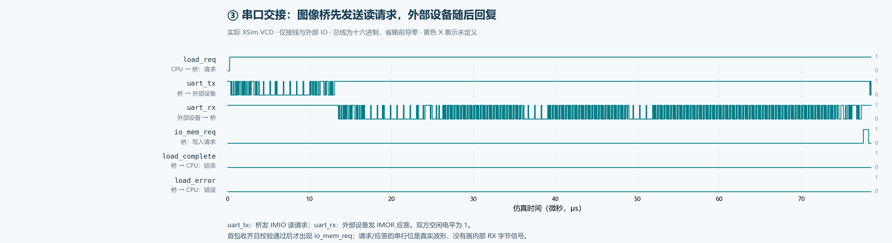

此时 `load_req` 保持 1，`load_complete` 保持 0。

- 385 ns：`uart_tx` 第一次从空闲高电平拉低，开始向外部设备发送读请求。
- 13,535 ns：`uart_rx` 开始接收第一包回复。
- 串口收包期间，`uart_rx` 上反复出现高低变化；这些变化编码包头、载荷和 CRC，不是每次跳变就代表一个完整像素。
- 首包接收校验结束后，`io_mem_req` 才变高，开始写 SRAM。首笔实际写入在 77,545 ns。

`uart_tx` 和 `uart_rx` 的方向是以 FPGA 为准：TX 是 FPGA 发出，RX 是 FPGA 收到。仿真使用 8N1，每位 80 ns；一字节包含起始位、8 位数据和停止位，共 800 ns。

不能把“最后一个串口位收到”直接当作加载完成，因为桥还需要校验和写 SRAM。图中串口回复结束之后才出现的写入区间，就是这一步的证据。

这张图只画串口引脚，不画 UART 模块内部的 `rx_data`、字节计数或 CRC 状态。

## 5. 第三步：第一包的图像字节写进 SRAM

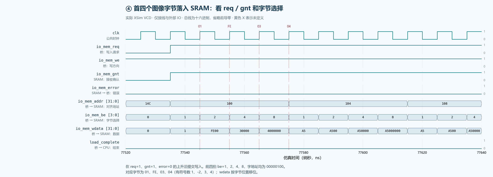

看 `io_mem_req`、`io_mem_gnt`、`io_mem_we` 都为 1，且 `io_mem_error=0` 的上升沿。前四次实际写入如下，表内均为**沿前采样值**：

| 上升沿时刻 ns | io_mem_addr | io_mem_be | io_mem_wdata | 真正写入的字节 |
|---:|---|---|---|---|
| 77,545 | 0x100 | 1 | 0x00000001 | SRAM[0x100] = 01，即 1 |
| 77,555 | 0x100 | 2 | 0x0000FE00 | SRAM[0x101] = FE，即 -2 |
| 77,565 | 0x100 | 4 | 0x00030000 | SRAM[0x102] = 03，即 3 |
| 77,575 | 0x100 | 8 | 0x04000000 | SRAM[0x103] = 04，即 4 |

为什么地址四拍都是 0x100？因为这是一个 32 位字的对齐地址。`be=1、2、4、8` 分别选择其中第 0、1、2、3 个字节，所以实际写入的是四个不同字节。

注意 77,545 ns 的红线：该沿写入的是左侧的 `01`；沿后桥立即准备下一字节，右侧总线已经变成 `FE00`。这不是少写了第一个字节。

`req` 和 `gnt` 在这一段连续为 1，表示每个上升沿都可以提交一笔写，不要求每个字节之间先拉低请求。`io_mem_we` 在此实现中一直表示写方向，**单独看到 we=1 不代表一直在写**，还必须有 req/gnt。

四包首笔写入分别发生在 77,545、155,475、233,405、311,335 ns。256 字节的最后一次写入在 311,965 ns；图中省略的大量中间字节没有丢失，可在原始波形或事务表中查看。

## 6. 第四步：整批完成，CPU 与图像桥交接

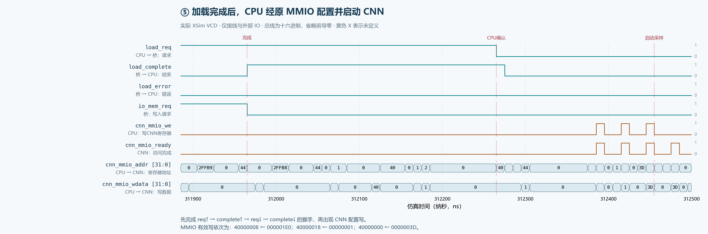

按顺序看三根新线：

| 时刻 ns | 信号变化 | 含义 |
|---:|---|---|
| 311,965 上升沿 | 最后一笔 `io_mem_req && io_mem_gnt` 写入提交 | 本批数据落库完成 |
| 311,965 沿后 | `load_complete: 0→1`，`load_error=0`；`io_mem_req` 撤销 | 桥通知整批加载成功 |
| 312,265 沿后 | `load_req: 1→0` | CPU 已读取并保存结果，确认收到 |
| 312,275 沿后 | `load_complete: 1→0` | 桥撤销完成状态，交接结束 |

最后一次 SRAM 写入与完成信号上升标在同一个仿真时间，是因为写入在上升沿提交，完成信号随后在该沿的更新阶段拉高。没有在最后一次写入之前提前报完成。

`load_complete` 保持约 300 ns，给 CPU 轮询读取的机会，不是一个瞬间就消失的脉冲。成功必须同时满足 `complete=1` 和 `error=0`；这份图是成功用例，所以 `load_error` 始终为 0。

## 7. 第五步：CPU 告诉 CNN“任务表在哪里，然后开始”

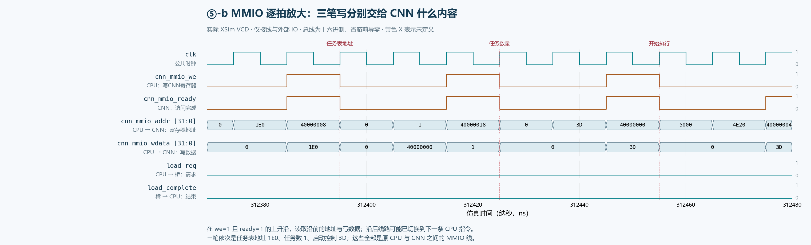

图中的 `cnn_mmio_*` 就是接线说明的 `mmio_*`，只是在顶层增加 `cnn_` 前缀区分名字，不是一组新端口。

在 `cnn_mmio_we=1 && cnn_mmio_ready=1` 的三个上升沿，读出以下值：

| 上升沿时刻 ns | cnn_mmio_addr | cnn_mmio_wdata | CPU 在告诉 CNN 什么 |
|---:|---|---|---|
| 312,395 | 0x40000008 | 0x000001E0 | 任务表在 SRAM 0x1E0 |
| 312,425 | 0x40000018 | 0x00000001 | 本批执行 1 个任务 |
| 312,455 | 0x40000000 | 0x0000003D | 按该控制值启动 |

这三笔访问之前，`load_req` 和 `load_complete` 已经回到 0，所以可以从波形上确认：CPU 没有在加载还未交接完成时启动 CNN。

这里传的是**控制信息和地址**，图像像素仍在 SRAM 里。没有把整张图像通过 MMIO 送给 CNN。

某些空闲时刻 `cnn_mmio_addr` 出现 1E0、1、3D 等其他值，不表示访问了这些 CNN 寄存器；只有与有效读写使能、ready 同时出现的地址才应解释为一次事务。

## 8. 第六步：CNN 自己去 SRAM 读取任务表

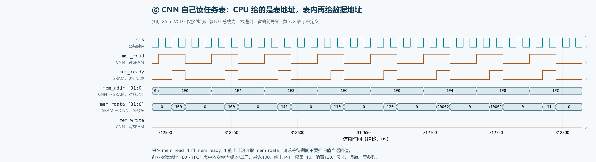

现在看另一组接口：`mem_addr / mem_read / mem_ready / mem_rdata`，它们直接连接 **CNN 与 datasram**，不经过 CPU。

`mem_read` 拉高表示请求读；等到 `mem_ready=1`，CNN 在上升沿采样 `mem_rdata`。前八次返回如下：

| 完成采样时刻 ns | mem_addr | mem_rdata | 含义 |
|---:|---|---|---|
| 312,515 | 0x1E0 | 0x00000100 | 描述符版本/卷积算子字段 |
| 312,555 | 0x1E4 | 0x00000100 | 输入地址 0x100 |
| 312,595 | 0x1E8 | 0x00000141 | 输出地址 0x141 |
| 312,635 | 0x1EC | 0x00000110 | 权重地址 0x110 |
| 312,675 | 0x1F0 | 0x00000120 | 偏置地址 0x120 |
| 312,715 | 0x1F4 | 0x00020002 | 高 2、宽 2 |
| 312,755 | 0x1F8 | 0x00010001 | 输入通道 1、输出通道 1 |
| 312,795 | 0x1FC | 0x00000011 | 本任务核大小/步长等配置 |

这直接回答前面“CNN 的地址从哪里来”的问题：CPU 只给任务表首地址；CNN 通过 `mem_rdata` 读到表中记录的数据地址，再去读实际数据。

## 9. 第七步：CNN 取输入、权重、偏置并写结果

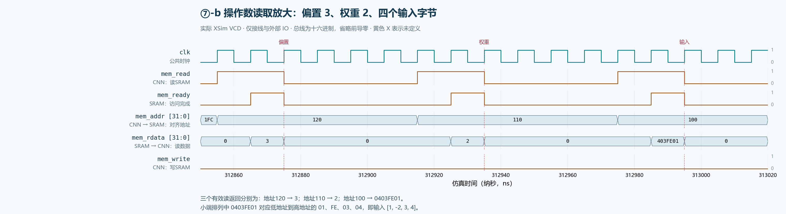

继续看同一组 `mem_*` 信号：

| 完成采样时刻 ns | mem_addr | mem_rdata | 读到了什么 |
|---:|---|---|---|
| 312,875 | 0x120 | 0x00000003 | 偏置 3 |
| 312,935 | 0x110 | 0x00000002 | 权重 2 |
| 312,995 | 0x100 | 0x0403FE01 | 四个输入字节 01、FE、03、04 |

输入这次只需一次 32 位读，就获得四个 INT8 数据，内部再按字节使用。小端排列要从最低字节开始看，所以 `0403FE01` 对应 `[1, -2, 3, 4]`，不是按书写顺序把 04 当作第一个像素。

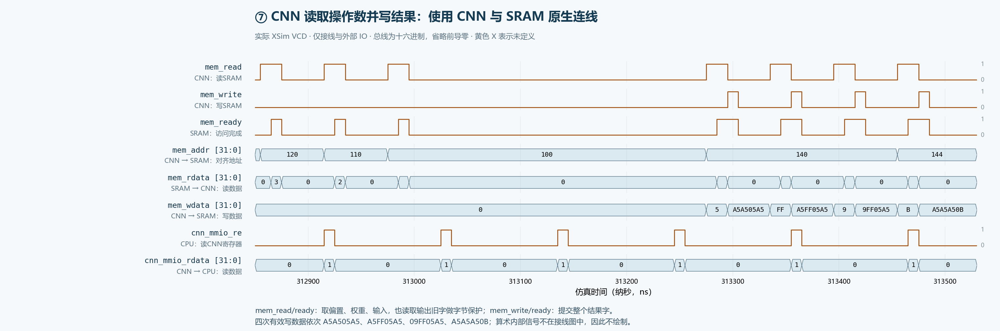

图中中间有一段 `mem_read=0`、`mem_write=0`，这是外部访存口暂时没有事务，**不能仅凭这两根线断言 CNN 已经完成**。CNN 内部计算节点不在接线图里，本图不展示；随后出现的正确输出写回是外部可观察证据。

四次 `mem_write=1 && mem_ready=1` 的上升沿，提交如下结果：

| 完成采样时刻 ns | mem_addr | mem_wdata | 本次更新 |
|---:|---|---|---|
| 313,305 | 0x140 | 0xA5A505A5 | 地址 0x141 的输出变为 05 |
| 313,365 | 0x140 | 0xA5FF05A5 | 地址 0x142 的输出变为 FF，即 -1 |
| 313,425 | 0x140 | 0x09FF05A5 | 地址 0x143 的输出变为 09 |
| 313,485 | 0x144 | 0xA5A5A50B | 地址 0x144 的输出变为 0B，即 11 |

为什么输出一个字节，却在数据线上看到整个 32 位字？CNN 的原生接口没有字节使能线，所以它先读旧字、修改目标字节，再写回整字。因此，每笔输出写之前还能看到一次 `mem_read`，那是保护邻接字节所需的读取，不是重复读取输入图像。

其余 A5 是原来的保护字节。最后提取 0x141～0x144 的四个字节得到 `[5, -1, 9, 11]`，与 `y=2x+3` 一致。

## 10. 第八步：CPU 读到完成状态，再读取结果

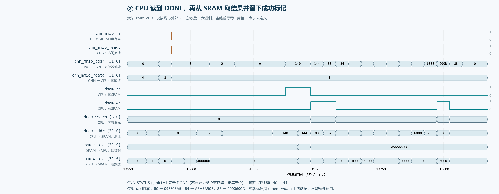

先看原 MMIO 口：313,585 ns 时，`cnn_mmio_re=1`、`cnn_mmio_ready=1`、`cnn_mmio_addr=0x40000004`，返回 `cnn_mmio_rdata=0x00000002`。

这个数的 bit1 为 1，表示 CNN DONE。**完成状态是读数据中的一个位，并没有单独画一根 `cnn_done` 线。**

随后 CPU 使用自己的 SRAM A 口读结果：

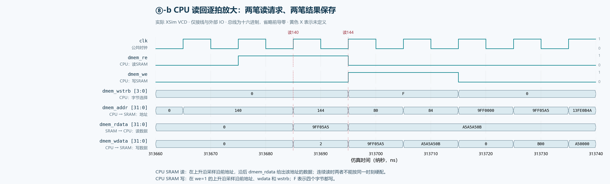

| 时刻 ns | 动作 | 如何对应波形 |
|---:|---|---|
| 313,685 | CPU 读 SRAM 0x140 | 沿前 `dmem_re=1`、`dmem_addr=0x140`；沿后 `dmem_rdata=0x09FF05A5` |
| 313,695 | CPU 读 SRAM 0x144 | 沿前 `dmem_re=1`、`dmem_addr=0x144`；沿后 `dmem_rdata=0xA5A5A50B` |
| 313,705 | CPU 将首个结果字保存到邮箱 0x80 | 沿前 `dmem_we=1`、`dmem_wstrb=F`、写数据 `0x09FF05A5` |
| 313,715 | CPU 将第二个结果字保存到邮箱 0x84 | 沿前 `dmem_we=1`、`dmem_wstrb=F`、写数据 `0xA5A5A50B` |
| 313,805 | CPU 核对结果后，向 0x88 写成功标记 | 沿前 `dmem_we=1`、`dmem_wstrb=F`、写数据 `0x0000600D` |

特别看 313,685 ns：沿后地址线已经切到下一笔的 0x144，但返回数据仍属于刚才采样的 0x140。不能拿该沿后同一竖线上的“新地址”和“当前返回数据”硬配。

`0x600D` 是程序约定的成功值，出现在现有 `dmem_wdata` 上。图中没有使用测试台的 `finish_value` 或 `finished` 作为额外信号。

## 11. 哪些线不是每一步都要变

| 看到的现象 | 正确解释 |
|---|---|
| `load_error` 始终为 0 | 当前选取的是成功用例，不是没有接这根线 |
| CNN 运行时 `load_req=0` | 加载已交接结束，CPU 正在执行后续任务 |
| CPU 等待期间仍有 IMEM 活动 | CPU 正在取轮询和判断的程序指令，不是必须停钟 |
| 地址/写数据变动，但读写使能为 0 | 不是有效总线事务，不应按该值推断数据在流动 |
| `io_mem_we` 始终为 1 | 此主动加载器使用写方向，是否真的写还要看 req/gnt |
| 没有 `io_mem_rvalid` 脉冲 | 本任务中桥只向 SRAM 写入，没有从 SRAM 读回；该线保留在接口中 |
| `mem_ready` 可在读转写之间连续为 1 | 必须结合每拍的 read/write 区分不同事务，不能只数 ready 上升沿 |
| 图像桥忙结束后 CNN 仍在计算 | 原 `led_busy` 表示桥忙，不代表 CNN 或整个系统忙 |

## 12. 与接线说明逐项对照

连线依据是项目根目录 `SoC六模块增线说明_CPU与图像桥三线直连.md` 第 8 节的六组接口，加上 `SoC顶层连线与总体IO说明_小白版.md` 的公共时钟复位和外部 IO。三线增线稿里的“尚未实现”是历史状态；实际实现入口以 `SoC三线自动加载RTL与上电全流程仿真说明_小白版.md` 为准。本文下表已列出所有绘图信号，可直接对照。

| 接线图中的连接 | 本文画出的信号 |
|---|---|
| 时钟复位及外部串口 | clk、rst_n_in、rst_n、uart_tx、uart_rx |
| CPU 与 IMEM | imem_addr、imem_re、imem_rdata |
| CPU 与 datasram | dmem_addr、dmem_wdata、dmem_rdata、dmem_re、dmem_we、dmem_wstrb |
| CPU 与 CNN MMIO | cnn_mmio_addr、cnn_mmio_wdata、cnn_mmio_rdata、cnn_mmio_re、cnn_mmio_we、cnn_mmio_ready |
| CNN 与 datasram | mem_addr、mem_wdata、mem_rdata、mem_read、mem_write、mem_ready |
| 图像桥与 datasram | io_mem_addr、io_mem_wdata、io_mem_req、io_mem_we、io_mem_be、io_mem_gnt、io_mem_error |
| CPU 与图像桥三线 | load_req、load_complete、load_error |

总计 36 个被绘制的信号名。`cnn_mmio_*` 是原 `mmio_*` 的顶层线名；所有行都可在新版 SoC 顶层中找到，不含模块内部私有路径。

## 13. 文件位置、复核与重新出图

所有 PNG 都有同名 SVG，SVG 可以继续放大；本 Markdown 内的图片是相对链接，移动或发给别人时应同时保留 `docs/figures/soc_autoload_flow/` 目录。

- [纯接线信号 VCD](docs/figures/soc_autoload_flow/soc_wires_only.vcd)：保留接线说明中的 46 个信号，去掉测试台变量和参数，原始时间戳及信号值不改；绘图选取其中 36 个。
- [逐笔总线事务 CSV](docs/figures/soc_autoload_flow/transactions.csv)：每笔实际有效访存和 MMIO 的地址、数据及采样时间，方便查表。
- [波形来源和信号审计](docs/figures/soc_autoload_flow/waveform_audit.json)：记录原始 VCD 哈希、信号白名单、各图时间窗和关键时刻。
- 出图脚本：`scripts/plot_soc_autoload_flow.py`。

原始成功仿真来源为：

```text
build/runs/20261008_230704_371733_autoload_integration/power_on_success.vcd
```

重新从这份历史仿真出图：

```powershell
Set-Location D:\cpu_control
python scripts/plot_soc_autoload_flow.py
```

脚本会校验所有图中信号均在接线白名单内，并从 VCD 重新检查 256 次桥写入、3 次 CNN 配置写、8 次任务表读取、4 次 CNN 输出写及 CPU 读回结果。它只解析现有 VCD，不会偷偷重跑 RTL。

时间以 VCD 的实际信号变化和事务采样沿为准。上一轮日志中的某些 `FLOW` 提示由测试台在下一上升沿观察到变化后打印，例如 `load_req` 的波形在 235 ns 上升，而提示在 245 ns 打印；两者相差一拍不代表图错位。原 VCD 时间单位为 1 ps，本说明统一换算为 ns 或 μs，1 μs=1000 ns。

仿真采用 100 MHz 时钟和加速 UART。这些是这次测试的时间，不应当直接作为实际板卡 115200 波特率的性能结论。
