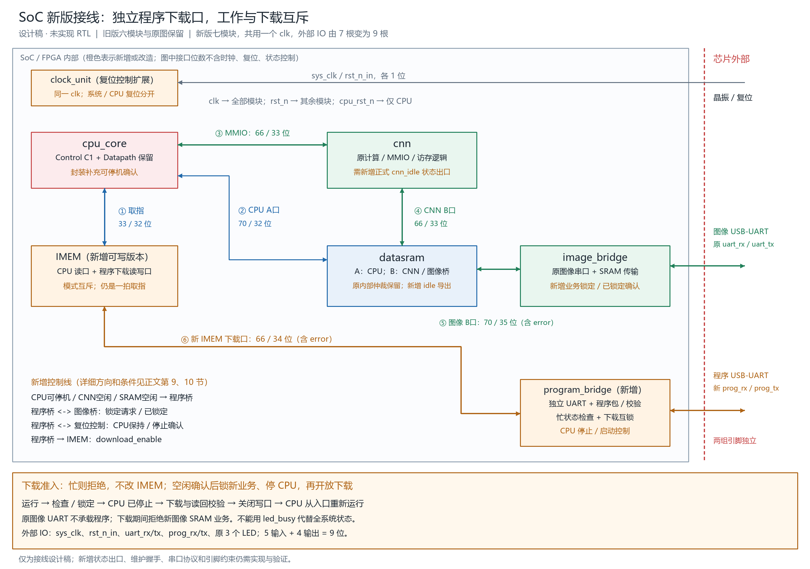

# SoC 顶层连线与总体 I/O 说明（新版：独立程序下载口）

日期：2026-10-08。按旧版的“模块—线组—具体信号—位宽—来源去向”写法编写。

> 2026-10-08 后续决定：用户已放弃本改造，继续使用旧版六模块方案。本文及配图仅作为未实施的历史设计稿保留，不作为当前接线依据。当前流程见 [六模块从上电到图像处理的数据流](SoC六模块从上电到图像处理的数据流_小白版.md)。

**本文是新版接线设计稿，尚未实现为 RTL。旧版文档、旧图和现有 `face_soc_top.sv` 全部保留。** 新增接口名在本文中作为拟议名称，不能拿它们直接连接当前旧模块后就认为能编译。

旧版：[SoC 顶层连线与总体 I/O 说明（小白版）](SoC顶层连线与总体IO说明_小白版.md)。

## 1. 先看结论

新版采用：**独立程序串口 + 工作状态检测 + 下载模式互锁 + CPU 停止/重启 + 可写 IMEM。**

- 原 `uart_rx/uart_tx` 仍属于图像桥，只访问数据 SRAM。
- 新增 `prog_rx/prog_tx`，专门接收 CPU 程序和返回下载状态，不经过原图像 UART。
- CNN、图像传输或其他相关事务正在工作时，拒绝进入下载，不改 IMEM。
- 完成空闲交接后，停止 CPU、锁住新的图像业务，再开放 IMEM 写入。
- 下载校验成功、收到启动命令后，关闭写口，CPU 从 `RESET_PC` 重新向 IMEM 取指。
- 所有模块继续共用一个时钟，不给 CPU 增加独立时钟或 PLL。



[可放大 SVG](docs/figures/soc_prog_io_v2.svg)。图中的新增模块和控制接口均为设计项，不表示当前 RTL 已具备。

旧版六个平级大模块，新版方案增加独立 `program_bridge`，成为七个平级大模块。它是程序通信和下载控制模块，**不是新增 SRAM B 口仲裁器**。

| 图上名称 | 新版拟采用模块 / 实例 | 职责及变化 |
|---|---|---|
| cpu_core | CPU 原核心的新版封装 / u_cpu_core | 内部仍使用原 Control C1 和 Datapath；补充软件可停机状态的导出，复位改接 CPU 专用复位 |
| cnn | CNN 的状态导出版本 / u_cnn | 计算、MMIO 和访存逻辑保持；拟增加一个真正的空闲状态出口，原交付源码保留 |
| datasram | datasram 的状态导出版本 / u_datasram | 保持 A/B 存储和内部仲裁；拟增加“无在途事务”的状态出口 |
| IMEM | imem_programmable / u_imem | 原 CPU 读口保留，增加程序下载读写口；旧 imem_rom 保留 |
| image_bridge | image_bridge 的互锁版本 / u_image_bridge | 保留原图像 UART、CRC32、SRAM 通路；增加禁止新业务及已锁定确认 |
| clock_unit | clock_unit 的复位控制版本 / u_clock_unit | 同一系统时钟；保留系统复位，新增 CPU 专用复位及停止确认 |
| program_bridge | program_bridge / u_program_bridge | 新的独立串口收发、下载校验、状态检测、模式互锁和启动控制 |

可为实现新建 `face_soc_prog_top.sv` 和单独编译清单，避免覆盖旧顶层及旧文件清单。**这些 RTL 文件本次没有创建。**

## 2. 看懂线组及新版变化

地址仍用 32 位字节地址；`[31:0]` 是 32 根内部并行线，没有括号的控制信号是 1 根。串口引脚只有 1 位，按时间顺序传地址、数据和命令。

| 接口 | 旧版 | 新版 |
|---|---|---|
| ① CPU ↔ IMEM | 33 / 32 位同步取指 | 保持 |
| ② CPU ↔ datasram | 70 / 32 位 A 口 | 保持 |
| ③ CPU ↔ CNN | 66 / 33 位 MMIO | 保持 |
| ④ CNN ↔ datasram | 66 / 33 位原生 mem_* | 保持 |
| ⑤ 图像桥 ↔ datasram | 70 / 35 位，保留 error | 保持 |
| ⑥ 程序桥 ↔ IMEM | 无 | 新增 66 / 34 位下载读写接口 |
| 工作状态与互锁线 | 无完整下载控制 | 新增，详见第 9 节 |
| 封装程序下载 IO | 无 | 新增 prog_rx、prog_tx，各 1 位 |

表中的接口位数不重复计算时钟和复位，也不包含另列的模式控制线。

## 3. ① cpu_core 与 IMEM：正式工作仍然读程序

| 线组 | 具体信号 | 位宽 | 来源 → 去向 | 用途 |
|---|---|---:|---|---|
| 地址 | imem_addr[31:0] | 32 | cpu_core → IMEM | 指令字节地址 |
| 数据 | imem_rdata[31:0] | 32 | IMEM → cpu_core | 返回一条 32 位指令 |
| 信号 | imem_re | 1 | cpu_core → IMEM | 读指令使能 |

合计：CPU 发出 33 位，IMEM 返回 32 位。**这一组不增加 ready，不增加等待拍数，不改成从 datasram 取指。**

仍在上升沿接收地址，沿后给出相应指令，原 Datapath 按固定一拍契约接收。CPU 运行时下载写口关闭；程序下载时 CPU 保持复位，不再发取指请求。

新版 IMEM 默认仍为 64 KiB，程序入口默认仍为 `RESET_PC=0`。修改存储内容与修改 CPU 指令集是两回事。

## 4. ② cpu_core 与 datasram：普通数据 A 口

| 线组 | 具体信号 | 位宽 | 来源 → 去向 | 用途 |
|---|---|---:|---|---|
| 地址 | dmem_addr[31:0] | 32 | cpu_core → datasram | 数据地址 |
| 数据 | dmem_wdata[31:0] | 32 | cpu_core → datasram | 待写数据 |
| 数据 | dmem_rdata[31:0] | 32 | datasram → cpu_core | 返回整个 32 位字 |
| 信号 | dmem_re | 1 | cpu_core → datasram | 读使能 |
| 信号 | dmem_we | 1 | cpu_core → datasram | 写使能 |
| 信号 | dmem_wstrb[3:0] | 4 | cpu_core → datasram | 字节写使能 |

合计：70 位请求、32 位返回。仍为 CPU 固定一拍 A 口，不增加 ready/stall。CPU 停止后读写使能均为 0；下载器不占用这个口来写程序。

CPU 停止确认之前已经完成的写入不会回滚，软件必须先到达可停机点。

## 5. ③ cpu_core 与 cnn：MMIO 控制口

| 线组 | 具体信号 | 位宽 | 来源 → 去向 | 用途 |
|---|---|---:|---|---|
| 地址 | mmio_addr[31:0] | 32 | cpu_core → cnn | CNN 寄存器地址 |
| 数据 | mmio_wdata[31:0] | 32 | cpu_core → cnn | 写寄存器数据 |
| 数据 | mmio_rdata[31:0] | 32 | cnn → cpu_core | 读寄存器数据 |
| 信号 | mmio_re | 1 | cpu_core → cnn | 读请求 |
| 信号 | mmio_we | 1 | cpu_core → cnn | 写请求 |
| 信号 | mmio_ready | 1 | cnn → cpu_core | 当拍完成 |

合计：66 / 33 位。顶层仍可命名为 `cnn_mmio_*`，继续使用真实 CNN 寄存器和零等待响应。

默认基址 `0x4000_0000`，QUEUE_BASE=`+0x08`，TASK_COUNT=`+0x18`，STATUS=`+0x04`，队列启动写 CONTROL=`0x3D`。下载桥不成为第二个 MMIO 主设备，不与 CPU 同时驱动这组线。

原 STATUS 仍由软件读取。第 9 节拟新增的 `cnn_idle` 是给系统下载控制用的内部状态线，不是给 Control C1 增加 STATUS/CONTROL 端口。

不能为了互锁直接丢弃 CPU 的某次 MMIO 写入；CPU 没有该接口的等待重试机制。必须先经软件交接，再真正停止 CPU。

## 6. ④ cnn 与 datasram：原生存储 B 口

| 线组 | 具体信号 | 位宽 | 来源 → 去向 | 用途 |
|---|---|---:|---|---|
| 地址 | mem_addr[31:0] | 32 | cnn → datasram | 4 字节对齐地址 |
| 数据 | mem_wdata[31:0] | 32 | cnn → datasram | 待写整个字 |
| 数据 | mem_rdata[31:0] | 32 | datasram → cnn | 返回整个字 |
| 信号 | mem_read | 1 | cnn → datasram | 读请求，保持到完成 |
| 信号 | mem_write | 1 | cnn → datasram | 写请求，保持到完成 |
| 信号 | mem_ready | 1 | datasram → cnn | 读写成功完成 |

合计：66 / 33 位，仍直接连接 datasram，不经过 CPU。不给原生接口增加 gnt/rvalid/be/error。

读接收后，必须等有效数据随 ready 返回，不能提前表示完成；写在采样成功 ready 的上升沿完成。非法地址、对齐或冲突仍按旧版锁存 `cnn_mem_fault`，不能以这个故障造成的停顿冒充“系统空闲”。

新版只会在 CNN 真正空闲时准许下载。下载期间 CPU 停止，图像通路锁定，不会再由这两条路径启动新任务。CNN 不因程序下载而被复位。

## 7. ⑤ image_bridge 与 datasram：图像数据 B 口

| 线组 | 具体信号 | 位宽 | 来源 → 去向 | 用途 |
|---|---|---:|---|---|
| 地址 | io_mem_addr[31:0] | 32 | image_bridge → datasram | 对齐地址 |
| 数据 | io_mem_wdata[31:0] | 32 | image_bridge → datasram | 待写数据 |
| 数据 | io_mem_rdata[31:0] | 32 | datasram → image_bridge | 返回字 |
| 信号 | io_mem_req | 1 | image_bridge → datasram | 请求有效 |
| 信号 | io_mem_we | 1 | image_bridge → datasram | 1 写、0 读 |
| 信号 | io_mem_be[3:0] | 4 | image_bridge → datasram | 写字节使能；读时为 0 |
| 信号 | io_mem_gnt | 1 | datasram → image_bridge | 接受请求 |
| 信号 | io_mem_rvalid | 1 | datasram → image_bridge | 读返回有效 |
| 信号 | io_mem_error | 1 | datasram → image_bridge | 写随 gnt、读随 rvalid 报错 |

合计：70 / 35 位，error 保留。正常工作时保持原 UART 图像协议和访存语义。

下载 IMEM 时图像桥不被系统复位，但收到内部锁定请求后禁止开始新 SRAM 业务。锁定状态下收到新的图像包应明确返回 BUSY/LOCKED，不能假装写成功；这个新增回复状态尚需扩展协议，旧 IMIO v1 文档没有它。

程序串口与图像串口物理独立，但按照本次“工作与下载互斥”的要求，**并不允许两个口同时执行程序写入和图像 SRAM 传输**。两套串口仍可分别提供状态/拒绝回复。

## 8. ⑥ program_bridge 与 IMEM：新增程序下载口

| 线组 | 新信号（拟议） | 位宽 | 来源 → 去向 | 用途 |
|---|---|---:|---|---|
| 地址 | prog_mem_addr[31:0] | 32 | program_bridge → IMEM | IMEM 字节地址 |
| 数据 | prog_mem_wdata[31:0] | 32 | program_bridge → IMEM | 待写 32 位内容 |
| 数据 | prog_mem_rdata[31:0] | 32 | IMEM → program_bridge | 读回校验内容 |
| 信号 | prog_mem_req | 1 | program_bridge → IMEM | 请求有效，保持到完成 |
| 信号 | prog_mem_we | 1 | program_bridge → IMEM | 1 写、0 读 |
| 信号 | prog_mem_ready | 1 | IMEM → program_bridge | 当前请求完成 |
| 信号 | prog_mem_error | 1 | IMEM → program_bridge | 与 ready 同时有效的失败标志 |

合计：32+32+1+1=66 位请求，32+1+1=34 位返回。它是独立 IMEM 接口，不是 CNN 的 mem_*，也不复用图像桥的 io_mem_*。

第一版采用单笔在途、4 字节对齐的整字读写，不增加字节使能。请求地址和数据保持到 `req && ready` 的采样沿；ready 表示完成，读时 rdata 同时有效，error 表示该次失败。一个请求只允许完成一次，不因 req 在等待期间保持而重复写入。

拟议地址范围为默认 IMEM 的 `0x0000_0000`～`0x0000_FFFF`，有效整字起始地址到 `0x0000_FFFC`。长度和溢出检查由下载桥按整包执行，IMEM 再检查单次访问权限、范围及对齐。

另外给 IMEM 一根 `download_enable` 控制线，仅在系统已经锁定、CPU 已停止时开放；不计入上述 66/34 位事务接口。运行模式下收到下载访问应返回失败，不修改内容。

电脑通过 `prog_rx` 发来的串行字节，要先经过独立程序串口的收包、CRC、地址检查和拼字，再产生这里的并行信号。`prog_tx` 用于返回接受/忙/错误/校验/启动状态，不是 IMEM 的 32 位读数据直接引脚输出。

## 9. 新增工作状态、互锁及模式控制线

下表明确区分来源。带“新增”的状态都不是当前旧 RTL 已有的顶层端口，后续必须实际实现。

| 具体信号 | 位宽 | 来源 → 去向 | 定义与变化 |
|---|---:|---|---|
| cpu_update_safe | 1 | CPU 封装 → program_bridge | 新增：软件已进入允许停止的维护点，并承诺不再开启业务；不是“PC不变” |
| cnn_idle | 1 | CNN 状态导出层 → program_bridge | 新增：队列、计算单元、内部仲裁、访存均空闲，无启动/复位过渡 |
| sram_idle | 1 | datasram → program_bridge | 新增：无 A/B 请求、无在途读返回；不能只判断请求线当前为零 |
| bridge_ready / bridge_busy / bridge_error | 各 1 | image_bridge → program_bridge 及原 LED 逻辑 | 复用现有状态；正常可接包、业务忙、故障 |
| cnn_mem_fault | 1 | datasram → program_bridge 及原 LED 逻辑 | 复用：存储故障阻止普通下载准入，按原流程恢复 |
| image_lock_req | 1 | program_bridge → image_bridge | 新增：锁住新的图像 SRAM 业务 |
| image_locked | 1 | image_bridge → program_bridge | 新增：旧包、旧访存及回复均结束，新业务已经被锁住 |
| cpu_hold_req | 1 | program_bridge → clock_unit | 新增：请求 CPU 保持复位；不复位其他模块 |
| cpu_stopped | 1 | clock_unit → program_bridge | 新增：CPU 复位已实际覆盖规定时钟沿；桥还需检查 CPU 请求均为零 |
| imem_re、dmem_re、dmem_we、mmio_re、mmio_we | 各 1，共 5 | CPU 原有请求线 → program_bridge 旁路观察输入 | 原有网络新增接收端，用来核对没有取指/数据/MMIO请求；不增加CPU核心请求端口，不改变原接收方 |
| download_enable | 1 | program_bridge → IMEM | 新增：允许程序读写；进入下载条件不满足时保持 0 |

### CPU 的“允许停止”怎么来

`cpu_update_safe` 是需要软件和封装共同补齐的接口，不是现有 cpu_control 的输出。可采用固件在维护点用现有 SW 写一个约定的维护标记，CPU 封装观察该次合法写入并锁存状态；固件随后停留在不启动业务的等待路径，直到 CPU 重启。Control C1 和生产 Datapath 不增加新的控制端口。

维护标记的地址、令牌、撤销及系统复位行为、电脑怎样请求固件进入维护点，必须在实现前一起定义。**本稿未冻结这些软件协议，也不承诺现有任意程序都能自动停到安全点。** 新版在拿不到可靠确认时必须拒绝下载，不能默认 cpu_update_safe=1。

### CNN 的“空闲”怎么来

当前 CNN 顶层没有 `cnn_idle` 端口。其内部有队列、计算 busy、仲裁 idle、访存 idle 等状态，新版需由 CNN 侧提供正式状态出口或在独立保存的接口版本中导出。不能仅用 mem_read/mem_write=0 代替，也不能把仿真层级引用当成正式连线。

原 CNN 计算算法和原包文件保留；增加状态出口属于待落实的接口改动，不能宣称现有原包插上新线即可工作。还需覆盖同沿 START 被接收的情况：即使此前 idle=1，也不能在 CPU 正发出启动写时准许下载。

### 锁定时序怎样避免“刚检查空闲，下一拍又忙”

准入判断必须在状态机中完成，不能只写一个组合表达式控制 IMEM：

1. 正常工作收到程序串口的下载申请。若 CNN、图像事务、SRAM在途事务或 CPU 维护条件不满足，回复 BUSY/NOT_READY，本次不写 IMEM，不复位正在工作的模块。
2. 条件满足后，申请图像业务锁定。若同沿已有新图像业务获准，必须视为竞争失败并拒绝本次进入；已接受的事务按原协议完成，不能半途砍掉。
3. 图像桥确认锁定，再核对 CPU 维护确认、CNN/SRAM空闲及 CPU 没有同沿数据/MMIO请求；确认后才保持 CPU 复位。软件须在此期间持续遵守维护承诺。
4. 等 CPU 停止确认和请求线清零，再复核空闲状态，进入 DOWNLOAD，开放 IMEM。
5. DOWNLOAD 期间保持 CPU 停止和图像锁定，不接收新业务；所有程序写入都受权限、状态、校验及地址检查限制。
6. 写完并核验实际 IMEM 内容后进入 VERIFIED。只有显式启动命令才关闭下载口、等待最后一笔完成、同步释放 CPU，并解除业务锁定。

这里 `cpu_update_safe` 用于进入时的交接，CPU 复位后该标志可能清零，不能因此错误退出下载；下载期间靠 `cpu_stopped` 和已锁定状态维持互斥。

上电后还没有有效程序，或下载失败后CPU已经被保持复位时，不要求CPU执行固件来报告维护确认：先检查 `cpu_stopped`、请求清零及其他模块空闲，再进入或恢复下载。否则会出现“没有程序就不能下载程序”的死锁。这个例外只适用于已经确认停止的CPU，不能给仍在运行的CPU绕过维护交接。

出现下载错误时停止写入、保持 CPU 停止，返回程序口错误并允许恢复下载；不能启动部分程序。若下载中意外出现业务请求，应关闭写权限并报告互锁异常，不靠丢弃业务事务来假装系统正常。

## 10. 公共时钟、复位与原状态灯

| 具体信号 | 位宽 | 来源 → 去向 | 新版含义 |
|---|---:|---|---|
| clk | 1 | clock_unit → 其余六模块 | 同一个系统时钟，CPU没有独立clk |
| rst_n | 1 | clock_unit → CNN、datasram、IMEM、image_bridge、program_bridge | 原系统复位，仅系统复位时使这些模块复位 |
| cpu_rst_n | 1 | clock_unit → cpu_core | 新增：系统复位或下载保持请求使CPU复位；同步释放 |

IMEM 的存储数组和下载口不接 CPU 专用复位。复位 CPU 只清除其执行状态，不清空程序 RAM；全局复位如何清除下载有效标志需写入新模块规范。

旧 `clock_unit` 不带 PLL、全局复位三拍同步释放的原则保留。新增 CPU 复位也必须有规范时序和停止确认，不能仅用一根未经同步的串口信号直接驱动。

原三根 LED 保留原用途，不把图像 busy 偷换成整个系统 busy。拟议图像桥在锁定期间将 `bridge_ready` 拉低；`bridge_busy` 仍表示实际图像事务，而非程序下载；新增 `image_locked` 承担锁定状态。

原 LED 组合逻辑保持：

```text
led_ready = bridge_ready && !cnn_mem_fault
led_busy  = bridge_busy
led_error = bridge_error || cnn_mem_fault
```

程序下载的 BUSY、LOCKED、校验结果和错误通过独立 `prog_tx` 查询/回复，不必为了新版增加 LED 引脚。下载器忙不能参与“业务正在工作”的自阻塞判断。

## 11. 芯片封装总体 I/O：从 7 根变为 9 根

| 线组 | 顶层引脚 | 位宽 | 来源 → 去向 | 新旧变化 |
|---|---|---:|---|---|
| 信号 | sys_clk | 1 | 板载晶振 → clock_unit | 保留 |
| 信号 | rst_n_in | 1 | 外部复位 → clock_unit | 保留 |
| 信号 | uart_rx | 1 | 图像 USB-UART TX → image_bridge | 保留，只走图像/数据通道 |
| 信号 | uart_tx | 1 | image_bridge → 图像 USB-UART RX | 保留，只回图像/数据响应 |
| 信号 | prog_rx | 1 | 程序 USB-UART TX → program_bridge | **新增，CPU程序专用输入** |
| 信号 | prog_tx | 1 | program_bridge → 程序 USB-UART RX | **新增，程序下载专用回复** |
| 信号 | led_ready | 1 | 顶层 → LED | 保留，图像桥可接包 |
| 信号 | led_busy | 1 | 顶层 → LED | 保留，图像桥事务忙 |
| 信号 | led_error | 1 | 顶层 → LED | 保留，图像桥或CNN存储故障 |

合计：**5 输入 + 4 输出 = 9 根数字信号**，不含电源、地、JTAG等专用配置引脚。内部 prog_mem_* 和状态线不直接引出封装，不把内部32位地址/数据误算成外部引脚。

示意顶层端口如下，仅用于说明，并非本次生成的 RTL：

```systemverilog
input  logic sys_clk, rst_n_in;
input  logic uart_rx;      // 原图像串口
output wire  uart_tx;
input  logic prog_rx;      // 新的独立程序串口
output wire  prog_tx;
output wire  led_ready, led_busy, led_error;
```

两个串口使用两组独立 FPGA 引脚、各自的收发器和数据路径。板上若只有一组USB串口，另一组需可用的独立UART通道或外接USB-UART，不能只在软件里换个COM号就获得第二套物理线。两端需共地并匹配I/O电平，具体管脚号由目标板卡约束决定，本稿不虚构管脚分配。

程序口可设独立参数 `PROG_BAUD`，仍从同一 `clk` 计数生成串口采样时序；波特率不同不代表给CPU新增独立时钟。

## 12. 仲裁、程序内容与下载协议边界

datasram 仍由 CPU A 口和 CNN/图像共享 B 口组成，内部仲裁、读返回归属和碰撞处理保留。程序桥只接 IMEM，不成为数据 SRAM 的第三个 B 口主设备。

IMEM 的 CPU 读和程序读写在模式上互斥，物理上可用带访问选择的RAM或双口RAM实现；选择哪种资源不改变本稿接口。CPU 正常运行时保持一拍取指。

新的程序串口需要定义独立的帧协议，至少含操作类型、地址、长度、序号/会话、数据、校验以及状态回复。其操作包括申请下载、写块、读回/整体验证、启动、查状态；**当前 IMIO 图像命令不能直接当作这些新命令使用。** 本稿定义接线和行为，尚未冻结操作码、包头或超时值。

第一版建议从地址0装载、4字节对齐、长度不超过64 KiB。电脑发CPU支持的机器码，需有正确字节序及链接/启动约定；校验收到的数据还不够，应校验实际IMEM内容和完整覆盖范围。

下载到指令RAM不等于烧入断电保持的Flash。CPU单独复位不清RAM，断电/重新配置不保证保留上次下载内容。本稿新版默认上电/系统复位后清除程序有效标志，程序桥保持CPU停止并等待下载，其他模块正常释放系统复位；不自动执行未确认内容。以后若要支持预装程序自动启动，再补充独立的有效性与启动策略。

## 13. 新旧对照与实现验收

| 项目 | 旧版现状 | 新版设计 |
|---|---|---|
| 平级功能模块 | 六个 | 七个，新增独立program_bridge |
| 外部数字IO | 7根 | 9根，增加prog_rx/prog_tx |
| IMEM | 初始化只读 | 保留取指口，增加受控读写口 |
| 程序通道 | 无在线下载 | 独立串口，不进入原图像UART |
| 工作状态判断 | 不控制IMEM下载 | CPU维护确认 + CNN空闲 + SRAM空闲 + 图像锁定确认 |
| CPU停止 | 共用系统复位 | 新增CPU专用复位，保持统一clk |
| 原生产核心 | Control C1 + Datapath | 保留执行逻辑，新增配套封装/固件握手 |
| 原CNN源码 | 已隔离导入 | 原包保留，新状态接口需正式提供 |
| 验证结论 | 已有旧版RTL测试记录 | 尚未实现，不能沿用旧结果宣称新版通过 |

后续验收应包括：忙时拒绝且IMEM完全不变；同沿启动/新图像包的竞争处理；CPU停止确认；下载中业务互锁；错包/漏包/断线恢复；实际内容校验；两份程序切换运行；原图像口保持原用途；全局与CPU复位分工；源码隔离与旧版回归。

实现前仍需冻结CPU维护握手及其地址/令牌、CNN状态导出版本、程序串口协议和板卡引脚。本稿把这些列为明确待办，不以虚构的现成busy线代替。

旧版编译清单 `rtl/filelists/system_cnn.f` 和测试入口仍只验证旧RTL；本次未改它们。新版落实后应有独立顶层、清单、测试和结果目录，原版继续可以单独编译和回归。
