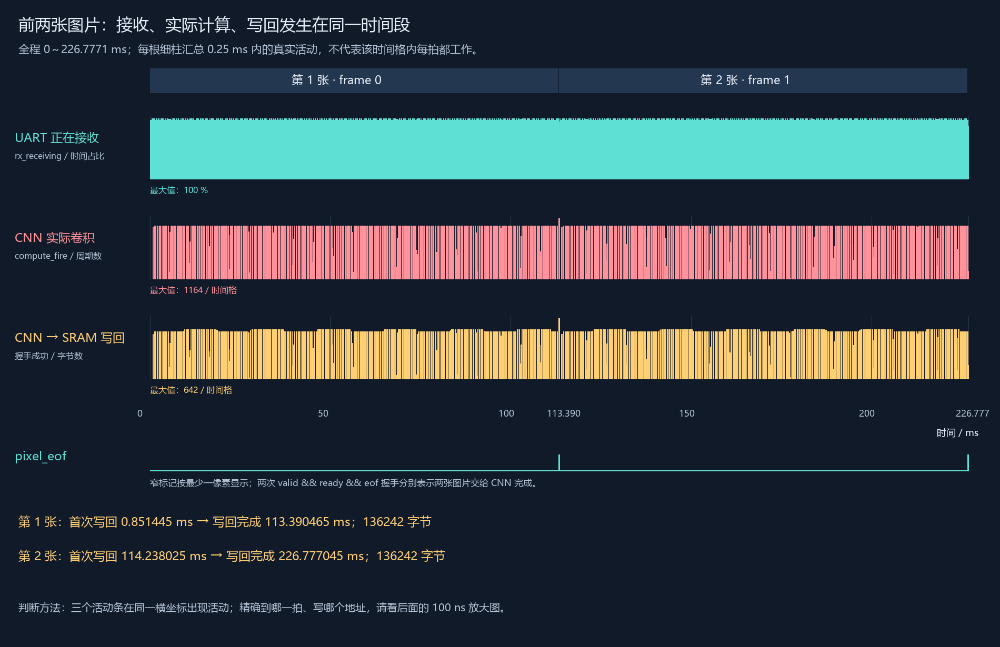
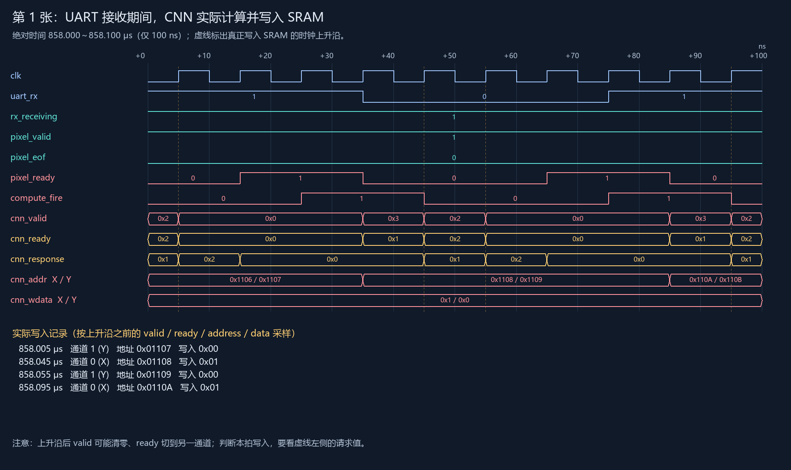
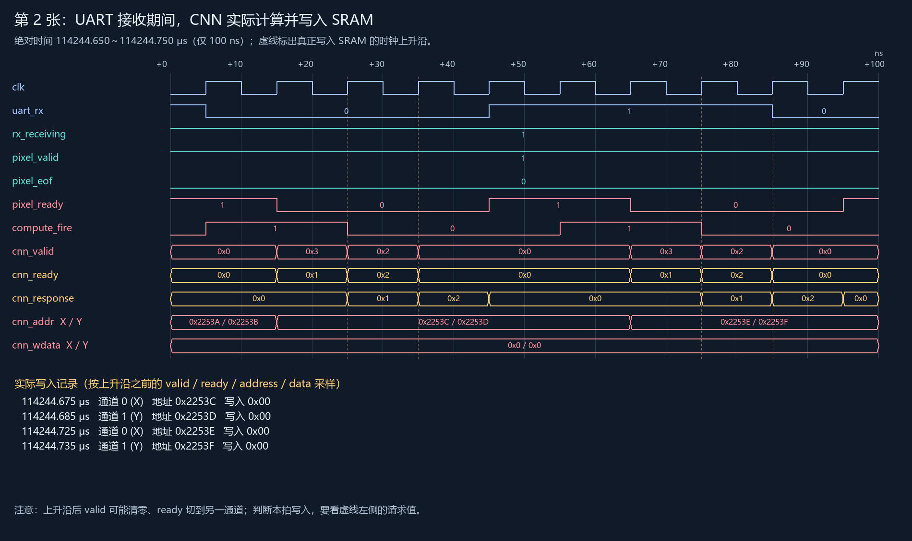

# 前两张图片：看清接收、计算和写回

这份视图专门回答两个问题：UART 接收时 CNN 是否真的计算，以及 CNN 在哪一拍、往哪个地址写回。全部数据来自已经通过验证的六帧完整仿真，这次截取前两帧，没有重新编造波形或更改 RTL。

## 先打开这个 GTKWave 入口

[前两张图片完整波形：open_first_two.cmd](open_first_two.cmd)

范围为 **0～226.7771 ms**，包含第一张和第二张图的接收、卷积及全部结果写回。18 根原始顶层信号按来源模块分组，每根仅出现一次，均属于已有 draw.io 连线。pixel_eof 放在 IMAGE_BRIDGE 分组的 pixel_valid 后面。这个文件可以直接缩放到其中任何时刻；不是以前只有几十 μs 的局部文件。

想直接看到图片输入完成标记，请打开 [第一张图片末尾](open_frame_1_end.cmd) 或 [第二张图片末尾](open_frame_2_end.cmd)。时钟上升沿之前 pixel_eof、pixel_valid、pixel_ready 同时为 1，表示最后一个像素交给 CNN。本次两次握手的绝对时间分别是 **113390.425 μs** 和 **226777.005 μs**；对应的 frame_done 都在 40 ns 后出现。全程图中标记很窄，应放大观察；原先两张计算中途的局部图也已加入 pixel_eof，但那里为 0 是正常现象。

## 1. 前两张图的整体活动

这里是从真实波形汇总的活动图，每根细柱统计 **0.25 ms**：青色为 UART 回复接收时间占比，粉色为实际卷积周期数，黄色为真正接受的 SRAM 写入字节数。三个图共用时间轴。柱子的连续分布说明接收、计算、写回交织进行，不能解读成 CNN 每拍都计算；同一统计格内都有活动也不能单独证明同一拍重叠，精确证据见下面的原始信号放大图。

| 图片 | 首次实际写入 SRAM | 单帧结果全部完成 | 写入字节数 |
|---|---:|---:|---:|
| 第 1 张 | 0.851445 ms | 113.390465 ms | 136242 |
| 第 2 张 | 114.238025 ms | 226.777045 ms | 136242 |

以上是波形绝对时间。完成时刻取 frame_done，不是最后一笔写请求出现的时刻；状态还需要排空完成响应。全部 272484 次写入的地址和数据都已与 actual.bin 核对一致。

## 2. 第一张图：接收时计算，并逐拍写回

[用 GTKWave 打开这个放大位置](open_frame_1_write.cmd)

这个窗口是 **858.000～858.100 μs**，宽度为 100 ns。顶端 +0、+10 等是相对窗口起点的纳秒数。沿同一条竖线对照各行：

- uart_rx 在跳变，rx_receiving 一直为 1：UART 正在收数据。rx_receiving 包括回复的包头、像素和 CRC，本身不区分这些字段。
- compute_fire 在 858.025～858.045 μs、858.075～858.095 μs 为高：CNN 实际执行卷积。高电平持续两个周期代表连续两拍计算，不只是一次事件。
- 金色竖虚线标记 SRAM 真正接受写入的时钟上升沿。
- cnn_valid 和 cnn_ready 为通道位图：0x1 对应 X 通道，0x2 对应 Y 通道，0x3 对应两个通道。判断写入时看上升沿之前两者的相同位是否同时为 1；本版这两个通道的 cnn_write、cnn_byte 均为 1。

| 写入时刻 | 通道 | SRAM 字节地址 | 写入数据 |
|---|---|---|---|
| 858.005 μs | Y | 0x1107 | 0x00 |
| 858.045 μs | X | 0x1108 | 0x01 |
| 858.055 μs | Y | 0x1109 | 0x00 |
| 858.095 μs | X | 0x110A | 0x01 |

例如 858.045 μs 上升沿之前，cnn_valid=0x3、cnn_ready=0x1，表示接受 X 通道；地址取 cnn_addr 的 X 部分 0x1108，数据取 cnn_wdata 的 X 部分 0x01。这个上升沿之后，valid 变成 0x2、ready 切换到 Y，所以不要用右侧新值反过来判断刚刚接受的是哪一通道。

图中的 cnn_addr / cnn_wdata 各自只画一行，显示原打包总线的 **X / Y** 两个有效通道；每个通道为 32 位，其余九个通道本版不使用。cnn_response 为写入接受后给 CNN 的响应。本 SRAM 模型在接受写请求的上升沿更新存储内容，并在沿后置对应 response。

## 3. 第二张图也有同样的重叠

[用 GTKWave 打开第二张图的放大位置](open_frame_2_write.cmd)

窗口为 **114244.650～114244.750 μs**，也就是约 114.245 ms，处于第二张图的输入过程中。可以看到 UART 接收、实际卷积与特征写入再次同时出现。

| 写入时刻 | 通道 | SRAM 字节地址 | 写入数据 |
|---|---|---|---|
| 114244.675 μs | X | 0x2253C | 0x00 |
| 114244.685 μs | Y | 0x2253D | 0x00 |
| 114244.725 μs | X | 0x2253E | 0x00 |
| 114244.735 μs | Y | 0x2253F | 0x00 |

这里写入零是特征值恰好为零，不是没有发生写入。是否写入仍由 valid、ready、write 和时钟上升沿决定。

## 4. 信号去向与查看顺序

| 信号 | 来源 → 去向 | 观察目的 |
|---|---|---|
| clk | CLOCK → 各模块 | 上升沿是握手与写入采样点 |
| uart_rx | 外部数据源 → IMAGE_BRIDGE | 真实串行输入 |
| rx_receiving | IMAGE_BRIDGE → 顶层观察 | 正在接收 UART 回复 |
| pixel_valid / pixel_data / pixel_frame | IMAGE_BRIDGE → CNN | 已校验像素及所属帧号 |
| pixel_eof | IMAGE_BRIDGE → CNN | 当前像素是该帧最后一个；结合 valid && ready 上升沿握手判断一张图输入完成 |
| pixel_ready | CNN → IMAGE_BRIDGE | 像素接收能力；和 valid 同时为 1 才传递 |
| compute_fire | CNN → 顶层观察 | 实际卷积发生，不是 busy 状态 |
| cnn_valid / cnn_write / cnn_byte / cnn_addr / cnn_wdata | CNN → DATASRAM | 写请求、按字节写、地址和结果值 |
| cnn_ready / cnn_response | DATASRAM → CNN | 请求接受与完成响应 |
| frame_done / frames_done | CNN → 顶层观察 | 单帧结果全部完成及完成帧数 |

先在完整视图确定帧号，再缩放观察 compute_fire，最后对照 cnn_valid、cnn_ready、cnn_addr 和 cnn_wdata。不要只看模块状态 WORK，也不要要求每个输入像素都立刻写回：卷积需要 3×3 窗口，后面还有 2×2 最大池化。

原始写回明细保存在 [two_frame_writes.csv](two_frame_writes.csv)，每行记录时间（ps）、帧号、通道、地址（十进制）、数据（十进制）。静态图片是实际数据绘制的可读图，不是 GTKWave 界面截图；原始波形为 [first_two.fst](first_two.fst)。
