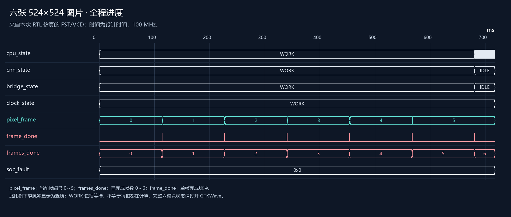
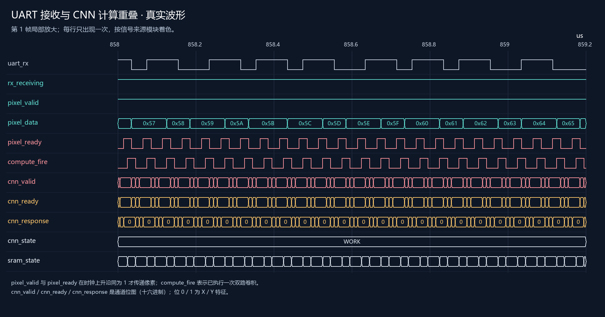

# 六张图片流式仿真：波形阅读指南

想直接观察 UART 输入时的实际计算和写回，请先看 [前两张图片波形说明](前两张图片波形说明.html)，其中有完整前两帧的 GTKWave 入口和每次写入的具体地址。

本次输入是 6 张 524×524、8 位灰度测试图。每张图执行 Sobel X/Y 双路 3×3 卷积、取绝对值除以 4、2×2 最大池化，得到两张 261×261 特征图。实际 SRAM 中的 817452 个输出字节全部与独立参考计算一致。

以下图片由本次真实 FST 转出的 VCD 数据绘制，是静态波形图，不是 GTKWave 界面截图。没有补画信号跳变；太窄的脉冲以至少一像素显示。动态缩放和全部接口仍使用配套 GTKWave 文件。图中的信号均在本版 draw.io 中，每个视图内每根信号只出现一次。

## 1. 先看六帧是否全部完成

横轴单位是 ms，范围约 0～717.109 ms。这是电路的仿真时间，不是电脑运行耗时。

- `pixel_frame`：IMAGE_BRIDGE → CNN，当前像素属于哪一帧，编号 0～5。
- `frame_done`：CNN → 顶层观察，一帧结果全部写回完成后的脉冲。全程比例下脉冲很窄，显示为竖线。
- `frames_done`：CNN → 顶层观察，已经完成几帧，最终应为 6。
- `soc_fault`：顶层汇总六模块故障位，正常全程为 0。
- `cnn_state`、`bridge_state` 等：RESET=0、IDLE=1、WORK=2、FAULT=3。WORK 可能包含等待，不能用它统计实际计算量。

为了静态图易读，全程图只选取部分状态。要查看六个大模块的全部状态，双击 [open_all_frames.cmd](open_all_frames.cmd)。CPU 与 IMEM 在程序结束后仍可能循环取指，因此它们继续显示 WORK 不代表计算未完成。

| 图片 | 首次卷积 / ms | 最后一个 UART 像素 / ms | 结果写回完成 / ms |
|---|---:|---:|---:|
| 第 1 张（帧号 0） | 0.846 | 113.385 | 113.390 |
| 第 2 张（帧号 1） | 114.233 | 226.772 | 226.777 |
| 第 3 张（帧号 2） | 227.619 | 340.158 | 340.164 |
| 第 4 张（帧号 3） | 341.006 | 453.545 | 453.550 |
| 第 5 张（帧号 4） | 454.392 | 566.931 | 566.937 |
| 第 6 张（帧号 5） | 567.779 | 680.318 | 680.323 |

表格根据 events.csv 的周期计数以 100 MHz 换算并四舍五入；与波形绝对时间之间存在复位/计数起点偏移。每张图都在接收结束前开始卷积；最后一个像素送达后约 5.25 μs 完成该帧结果写回。全部结果在约 680.323 ms 就绪，随后 CPU 读回校验，在约 717.109 ms 结束。

## 2. 再看接收和计算是否重叠

横轴单位是 μs，这里放大第一帧中的一小段。按来源着色：外部输入灰白、IMAGE_BRIDGE 青色、CNN 粉红、DATASRAM 橙色。

| 信号 | 从哪里到哪里 | 怎么看 |
|---|---|---|
| uart_rx | 外部数据源 → IMAGE_BRIDGE | 串行输入，25 Mbps、8N1。不是每拍输入一个像素；一字节含起始位和停止位。 |
| rx_receiving | IMAGE_BRIDGE → 顶层观察 | 高表示正在接收一个回复，包括包头、像素和 CRC。 |
| pixel_valid | IMAGE_BRIDGE → CNN | 当前像素有效。 |
| pixel_data | IMAGE_BRIDGE → CNN | 8 位灰度像素；图中显示十六进制。 |
| pixel_ready | CNN → IMAGE_BRIDGE | CNN 可以接收像素。在时钟上升沿 valid 和 ready 同时为 1 才接收一次。 |
| compute_fire | CNN → 顶层观察 | 上一上升沿实际执行了一个位置的两路卷积；持续高可能表示连续多拍计算。 |
| cnn_valid | CNN → DATASRAM | 写回请求位图，bit0/bit1 分别对应 X/Y 特征通道。 |
| cnn_ready | DATASRAM → CNN | 请求接受位图，同一位 valid 和 ready 都为 1 才接受该通道请求。 |
| cnn_response | DATASRAM → CNN | 已接受请求的完成响应位图。 |
| cnn_state / sram_state | 各模块状态观察逻辑 → 顶层 | 展示工作和空闲，不是数据本身。 |

三个判断顺序：先看 uart_rx 和 rx_receiving 确认接收正在进行，再看 compute_fire 确认发生实际计算，最后看 cnn_valid、cnn_ready、cnn_response 确认结果经 SRAM 接口提交。0x3 表示通道 0 和 1 同时置位，0x1 只表示通道 0，0x2 只表示通道 1。

这里的并行来自两个包缓冲：UART 接收后一包时，CNN 消费前一包已经通过 CRC 校验的像素。CNN 还需要凑齐 3×3 窗口，池化后才产生输出，因此无需期待每个 UART 字节都立刻对应一次写回。

不要只用 rx_receiving 与 WORK 同时为高作为加速证据。测试平台另外限定 UART 正在发送像素字段，统计到 **591408 个实际接收与卷积重叠周期**，以及 **276576 次接收像素期间的特征字节写入**。当前没有同负载串行版本的对照测试，因此不报倍数加速。

## 3. 在 GTKWave 里查看全部接口

1. 双击 [open_all_frames.cmd](open_all_frames.cmd)，看全程帧号、完成数和六模块状态。
2. 双击 [open_all_modules.cmd](open_all_modules.cmd)，看约 845.61～881.11 μs 的 64 根顶层信号。同一来源模块集中排列并着色，向下滚动可看完整列表。
3. 双击 [open_power_on.cmd](open_power_on.cmd)，看上电前 1.5 μs 的 CPU 配置和启动过程。
4. 单击波形放置时间游标，左侧数值是该时刻的值；用放大、缩小按钮查看握手细节。数据总线必须结合有效信号阅读，单独看到数据变化不代表发生传输。

完整接口视图中的 `cnn_addr`、`cnn_wdata` 等为 11 通道打包总线，每通道 32 位：通道 i 占 `[32*i+31:32*i]`，本版只使用通道 0 和 1。写回地址从 0x1000 开始，X/Y 字节交错存放；每帧占 136242 字节。具体地址与功能见 [使用说明](使用说明.md) 和 [逐根信号说明](信号说明.md)。

## 4. 配套文件

- [可编辑硬件架构图](soc_architecture.drawio)
- [输入图片与实际特征结果](results.html)
- [64 根信号的位宽、来源、去向和功能](信号说明.md)
- [实现、内存布局及复现方法](使用说明.md)

这版 CNN 是固定流式 Sobel 特征提取器，没有使用旧通用 8×8 脉动阵列，也不是完整人脸识别网络。六张输入为生成的灰度测试图。
