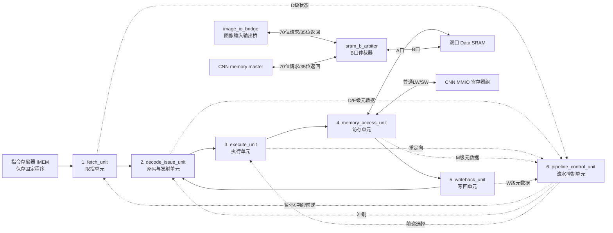

# CPU 六模块综合设计与 ADD 指令信号流程汇报

日期：2026-09-29  
适用对象：课程汇报、设计答辩、第一次接触流水线 CPU 的读者  
工程：32 位 RV32I 五级流水 CPU + Data SRAM + CNN 加速器接口

## 1. 一句话介绍本项目

本项目要实现一个能够在 FPGA 上运行的系统：CPU 执行固定在指令存储器中的程序，通过 Data SRAM 读取图像和普通数据，并通过普通 MMIO（存储器映射输入输出）寄存器配置 CNN 加速器。

CPU 采用：

- 32 位 RISC-V `RV32I` 基础指令集；
- IF、ID、EX、MEM、WB 五级流水线；
- 独立指令存储器和数据存储器，即 Harvard 结构；
- EX/MEM 和 MEM/WB 前递；
- Load-use 暂停；
- EX 级分支与跳转判定；
- 固定一周期同步 IMEM 和 Data SRAM 时序基线。

为了便于画图、接线和讲解，现计划把原来较多的细粒度硬件重新归并为六个功能模块。这个归并只改变模块层次，不改变指令功能、流水级数、寄存器位置、控制编码或存储器时序。

> 重要说明：六模块结构目前是目标重划分方案；真实验证使用的是未修改的生产 `cpu_control` 和生产 `cpu_datapath`。因此可以说“原硬件已经验证，准备按等价方式归并”，不能说“六个新 RTL 模块已经全部实现并上板”。

## 2. 系统总结构



六个 CPU 功能模块之外，还保留一个 `cpu_core` 集成壳。它只负责实例化和接线，不作为第七个功能模块。IMEM、Data SRAM、CNN MMIO、图像桥、B 口仲裁器和 CNN 也都不计入 CPU 六模块。

## 3. 为什么要重新合并模块

原工程按基本器件拆得很细，例如 PC、寄存器堆、立即数生成器、ALU、四组流水寄存器、两个译码器、冒险单元和分支单元都是独立模块。这样便于各自开发和单元测试，但在总图中会出现很多方框和连线。

重新合并后的好处：

1. 每个模块对应一个容易理解的流水职责。
2. 画系统框图时只需要六个 CPU 方框。
3. 汇报时可以按照取指、译码、执行、访存、写回顺序讲解。
4. Data SRAM、CNN MMIO 和控制信号的归属更清楚。
5. 只要四组流水寄存器位置不变，综合后的逻辑可以与原设计等价。

## 4. 六个合并模块分别包含哪些原硬件

### 4.1 `fetch_unit`：取指单元

#### 包含的原硬件

| 原硬件/逻辑 | 原文件或位置 | 合并后作用 |
|---|---|---|
| PC | `pc.sv` | 保存当前取指地址 |
| Fetch Adapter | `fetch_adapter.sv` | 把同步 IMEM 返回的指令与请求地址正确配对 |
| IF/ID 流水寄存器 | `if_id_reg.sv` | 保存即将译码的指令、PC 和 PC+4 |
| PC+4 加法 | 原 `cpu_datapath.sv` 顶层 | 形成顺序下一条地址 |
| Next-PC MUX | 原 `cpu_datapath.sv` 顶层 | 在 PC+4、Branch/JAL 和 JALR 目标之间选择 |

#### 这个模块做什么

`fetch_unit` 可以理解为“取下一张任务单的人”。PC 告诉 IMEM 去哪里取指令；同步 IMEM 不能立刻返回，所以 Fetch Adapter 记住本次请求地址；返回后，IF/ID 把指令保存下来，交给译码单元。

#### 主要信号

| 信号 | 位宽 | 方向 | 作用 |
|---|---:|---|---|
| `imem_addr` | 32 | 输出 | 指令存储器地址 |
| `imem_re` | 1 | 输出 | 指令读取请求 |
| `imem_rdata` | 32 | 输入 | IMEM 返回的机器码 |
| `pc_en` | 1 | 输入 | 是否允许 PC 更新 |
| `if_id_en` | 1 | 输入 | 是否允许 IF/ID 保存新内容 |
| `if_id_flush` | 1 | 输入 | 是否清空错误路线指令 |
| `valid_d` | 1 | 输出 | D 级内容是否有效 |
| `instr_d` | 32 | 输出 | D 级机器码 |
| `pc_d`、`pc4_d` | 各 32 | 输出 | 本条指令地址和地址加 4 |

### 4.2 `decode_issue_unit`：译码、寄存器堆与发射单元

#### 包含的原硬件

| 原硬件/逻辑 | 原文件或位置 | 合并后作用 |
|---|---|---|
| Main Decoder | `main_decoder.sv` | 判断总体指令类型和是否读写寄存器/存储器 |
| ALU Decoder | `alu_decoder.sv` | 根据 opcode、funct3、funct7 决定具体 ALU 运算 |
| 安全译码逻辑 | 原 `cpu_control.sv` | 非法、无效或复位时把控制清零 |
| Register File | `regfile.sv` | 保存 x0～x31，双口读、单口写 |
| Immediate Generator | `imm_gen.sv` | 生成 I/S/B/U/J 型立即数 |
| ID/EX 流水寄存器 | `id_ex_reg.sv` | 把数据和控制一起送入 E 级 |

#### 这个模块做什么

它像“看懂任务单并准备材料的人”。译码器看懂机器码；寄存器堆取出两个源操作数；立即数生成器准备需要的立即数；ID/EX 再把数据、目标编号和控制信号成套保存，防止与下一条指令混在一起。

#### 主要信号

| 信号 | 位宽 | 方向 | 作用 |
|---|---:|---|---|
| `instr_d` | 32 | 输入 | 要解释的机器码 |
| `rs1_d`、`rs2_d` | 各 5 | 输出 | 两个源寄存器编号 |
| `uses_rs1_d`、`uses_rs2_d` | 各 1 | 输出 | 本条指令是否真正使用对应源 |
| `valid_e` | 1 | 输出 | E 级指令是否有效 |
| `rd1_e`、`rd2_e` | 各 32 | 输出 | E 级两个寄存器数据 |
| `rs1_e`、`rs2_e`、`rd_e` | 各 5 | 输出 | E 级源/目标编号 |
| `alu_ctrl_e` | 4 | 输出 | ALU 运算种类 |
| `regwrite_e` | 1 | 输出 | 本条指令以后是否写寄存器 |
| `memread_e`、`memwrite_e` | 各 1 | 输出 | 本条指令是否访问数据存储器 |
| `id_ex_flush` | 1 | 输入 | 清空 ID/EX，插入气泡 |
| `wb_data_w` | 32 | 输入 | W 级写回寄存器的数据 |

### 4.3 `execute_unit`：执行、比较和跳转单元

#### 包含的原硬件

| 原硬件/逻辑 | 原文件或位置 | 合并后作用 |
|---|---|---|
| 三组前递 MUX | 原 `cpu_datapath.sv` | 分别选择 rs1、rs2 和 Store 数据来源 |
| ALU A/B 输入 MUX | 原 `cpu_datapath.sv` | 选择寄存器、PC、0 或立即数 |
| ALU | `alu.sv` | 加减、逻辑、比较和移位 |
| 三类比较器 | 原 `cpu_datapath.sv` | 产生相等、有符号小于、无符号小于 |
| Branch Control | `branch_control.sv` | 判断分支/JAL/JALR 是否重定向 |
| 目标地址逻辑 | 原 `cpu_datapath.sv` | 计算 Branch/JAL 和 JALR 目标 |

#### 这个模块做什么

它是“真正干活的计算工位”。先判断操作数来自寄存器、M 级还是 W 级，然后送入 ALU。对于分支和跳转，它还判断是否换路线，并计算新 PC。

`execute_unit` 不新增流水寄存器，保持组合逻辑。它的计算结果在下一个上升沿由 `memory_access_unit` 中的 EX/MEM 保存。

#### 主要信号

| 信号 | 位宽 | 方向 | 作用 |
|---|---:|---|---|
| `fwd_a`、`fwd_b`、`fwd_store` | 各 2 | 输入 | 前递来源选择 |
| `mem_forward_m` | 32 | 输入 | M 级非 Load 的可前递结果 |
| `wb_data_w` | 32 | 输入 | W 级最终结果 |
| `alu_a_e`、`alu_b_e` | 各 32 | 内部 | ALU 最终看到的两个数 |
| `alu_result_e` | 32 | 输出 | ALU 计算结果 |
| `store_data_e` | 32 | 输出 | Store 最终写数据 |
| `redirect` | 1 | 输出 | 是否更换取指路线 |
| `redirect_sel` | 2 | 输出 | 选择 Branch/JAL 或 JALR 目标 |
| `branch_target_e`、`jalr_target_e` | 各 32 | 输出 | 两类目标地址 |

### 4.4 `memory_access_unit`：Data SRAM 与 CNN MMIO 访存单元

#### 包含的原硬件

| 原硬件/逻辑 | 原文件或位置 | 合并后作用 |
|---|---|---|
| EX/MEM 流水寄存器 | `ex_mem_reg.sv` | 保存 E 级结果和 M 级控制 |
| Address Decoder，E/M 各一实例 | `address_decoder.sv` | 判断地址属于 SRAM、MMIO 还是无效范围 |
| LSU，E/M 各一实例 | `lsu.sv` | Store 字节拼接、Load 抽取和符号扩展 |
| Data SRAM 请求逻辑 | 原 `cpu_datapath.sv` | 产生 `dmem_*` |
| CNN MMIO 路由 | 原 `cpu_datapath.sv` | 产生 `mmio_*` 并选择返回数据 |
| M 级前递值选择 | 原 `cpu_datapath.sv` | ALU/PC+4 可前递，Load 地址不可前递 |

#### 这个模块做什么

它是“决定数据去 SRAM 还是 CNN 寄存器的交通站”。普通 ADD 不访问存储器，只把结果向后传。Load/Store 才会使用 Data SRAM；CPU 配置 CNN 时使用 MMIO。

生产 Datapath 的重要时序是：Data SRAM 请求在 E 级末尾形成并由 EX→MEM 上升沿采样，Load 数据在随后的 M 周期处理；CNN MMIO 在 M 级提交。这两个时点不能混为一谈。

#### Data SRAM A 口

| 方向（相对访存单元） | 信号 | 位宽 | 作用 |
|---|---|---:|---|
| 输出 | `dmem_addr` | 32 | SRAM 字节地址 |
| 输出 | `dmem_wdata` | 32 | SRAM 写数据 |
| 输出 | `dmem_wstrb` | 4 | 四个 byte lane 写使能 |
| 输出 | `dmem_re` | 1 | SRAM 读请求 |
| 输出 | `dmem_we` | 1 | SRAM 写请求 |
| 输入 | `dmem_rdata` | 32 | SRAM 固定一周期读返回 |

Data SRAM A 口直接输出给 CPU 的有效数据线只有 `dmem_rdata[31:0]`，它**只直接进入 `memory_access_unit`**。之后的间接路径是：

```text
Data SRAM a_rdata/dmem_rdata，32 bit
    ↓
memory_access_unit：M级 LSU 抽取和扩展
    ↓ read_data_m，32 bit
writeback_unit：MEM/WB 保存并选择
    ↓ wb_data_w，32 bit
decode_issue_unit：写入寄存器堆
    └──必要时也送到 execute_unit 做 WB 前递
```

所以不能画成 SRAM A 口同时直接连接六个 CPU 模块。

### 4.5 `writeback_unit`：写回单元

#### 包含的原硬件

| 原硬件/逻辑 | 原文件或位置 | 合并后作用 |
|---|---|---|
| MEM/WB 流水寄存器 | `mem_wb_reg.sv` | 保存 W 级候选数据、目标编号和控制 |
| WB MUX | 原 `cpu_datapath.sv` | 在 ALU、Load、PC+4 中选择最终结果 |
| 写使能限定 | 原 `cpu_datapath.sv` | `valid_w && regwrite_w && rd_w != 0` |

#### 这个模块做什么

它是“最终交付结果的人”。ALU 运算、Load 和跳转链接地址都可能写寄存器，所以写回单元先选择正确数据，再确认指令有效、允许写入且目标不是 x0。

#### 主要信号

| 信号 | 位宽 | 方向 | 作用 |
|---|---:|---|---|
| `read_data_m` | 32 | 输入 | Load 返回数据 |
| `alu_result_m` | 32 | 输入 | ALU 结果 |
| `pc4_m` | 32 | 输入 | JAL/JALR 链接地址 |
| `wb_sel_m` | 2 | 输入 | 选择哪一种结果 |
| `rd_w` | 5 | 输出 | 最终目标寄存器编号 |
| `wb_data_w` | 32 | 输出 | 最终写回数据 |
| `rf_we_w` | 1 | 输出 | 寄存器堆实际写使能 |

### 4.6 `pipeline_control_unit`：冒险、前递和流水门控单元

#### 包含的原硬件

| 原硬件/逻辑 | 原文件或位置 | 合并后作用 |
|---|---|---|
| Hazard Unit | `hazard_unit.sv` | 判断前递和 Load-use 相关 |
| Pipeline Control | `pipeline_control.sv` | 产生 PC/流水寄存器使能与冲刷 |
| 前递复位限定 | 原 `cpu_control.sv` | 复位时让前递选择回到安全值 |

#### 这个模块做什么

它像“流水线交通警察”：

- 数据还没准备好时，让后面的指令等一拍；
- 数据已经在 M/W 级时，让执行单元直接拿来使用；
- 分支走新路线时，清掉旧路线上的年轻指令；
- 正常情况下允许各级继续前进。

固定优先级：

```text
reset > EX redirect > load-use > normal
```

#### 主要输出

| 信号 | 位宽 | 去向 | 作用 |
|---|---:|---|---|
| `fwd_a`、`fwd_b` | 各 2 | `execute_unit` | 两个 ALU 源前递选择 |
| `fwd_store` | 2 | `execute_unit` | Store 数据前递选择 |
| `pc_en` | 1 | `fetch_unit` | PC 是否更新 |
| `if_id_en` | 1 | `fetch_unit` | IF/ID 是否更新 |
| `if_id_flush` | 1 | `fetch_unit` | IF/ID 是否清空 |
| `id_ex_flush` | 1 | `decode_issue_unit` | ID/EX 是否清空 |
| `pc_sel` | 2 | `fetch_unit` | 下一 PC 来源 |

## 5. 四组流水寄存器放在哪里

五级流水并不是五个模块各自都必须有寄存器。真正的阶段边界是四组流水寄存器：

| 流水寄存器 | 合并后归属 | 保存什么 |
|---|---|---|
| IF/ID | `fetch_unit` | 指令、PC、PC+4、valid |
| ID/EX | `decode_issue_unit` | 源数据、立即数、寄存器号、控制、valid |
| EX/MEM | `memory_access_unit` | ALU 结果、Store 数据、PC+4、rd、控制、valid |
| MEM/WB | `writeback_unit` | Load/ALU/PC+4 候选、rd、写回控制、valid |

`execute_unit` 和 `pipeline_control_unit` 都保持组合逻辑。这样重组后不会凭空多出一个周期。

## 6. ADD 指令示例

本报告使用已经真实联跑通过的指令：

```text
ADD x6, x1, x2
x1 = 1
x2 = 2
期望：x6 = 3
机器码：0x00208333
```

### 6.1 机器码怎样拆开

| 字段 | 位段 | 数值 | 含义 |
|---|---|---:|---|
| `funct7` | `[31:25]` | `0000000` | 普通 ADD，不是 SUB |
| `rs2` | `[24:20]` | 2 | 第二个源寄存器 x2 |
| `rs1` | `[19:15]` | 1 | 第一个源寄存器 x1 |
| `funct3` | `[14:12]` | `000` | 加/减类运算 |
| `rd` | `[11:7]` | 6 | 目标寄存器 x6 |
| `opcode` | `[6:0]` | `0110011` | RV32I 寄存器—寄存器运算 |

Main Decoder 先确认它是 R 型寄存器运算；ALU Decoder 再根据 `funct7=0`、`funct3=0` 确认是 ADD。

## 7. ADD 的精确信号流程

本节按真实 Control + 生产 Datapath 的波形说明。时钟周期为 10 ns，30 ns 解除复位。同步 IMEM 有初始等待。


### 7.1 第一步：IF 取指，30～45 ns

#### 信号路线

```text
fetch_unit.PC
    ├── pc_q=0x00000000
    ├── imem_addr=0x00000000
    └── imem_re=1
            ↓
同步 IMEM 在35 ns上升沿接受请求
            ↓
imem_rdata=0x00208333
            ↓
Fetch Adapter把指令与请求PC=0配对
            ↓
45 ns上升沿进入IF/ID
```

#### 关键控制

| 信号 | 数值 | 含义 |
|---|---:|---|
| `pc_sel` | `00`=`PC_NEXT` | 继续顺序取指 |
| `pc_en` | 1 | PC 可以更新 |
| `if_id_en` | 1 | IF/ID 可以保存返回指令 |
| `if_id_flush` | 0 | 不清空 |
| `id_ex_flush` | 0 | 不插气泡 |

此时 ADD 还没有做加法，只是把机器码安全送到译码级。

### 7.2 第二步：ID 译码，45～55 ns

45 ns 之后：

```text
valid_d = 1
instr_d = 0x00208333
pc_d    = 0x00000000
```

#### 译码信号路线

```text
instr_d
  ├── opcode/funct → Main Decoder、ALU Decoder
  ├── rs1=1、rs2=2 → Register File读地址
  └── rd=6 → ID/EX目标编号
```

#### Main Decoder 和 ALU Decoder 输出

| 信号 | 位宽 | ADD 数值 | 含义 |
|---|---:|---:|---|
| `uses_rs1_d` | 1 | 1 | 使用 x1 |
| `uses_rs2_d` | 1 | 1 | 使用 x2 |
| `alu_ctrl` | 4 | `0000`=`ALU_ADD` | 做加法 |
| `alu_src_a_sel` | 2 | `00`=`A_REG` | ALU A 取寄存器数据 |
| `alu_src_b_sel` | 2 | `00`=`B_REG` | ALU B 取寄存器数据 |
| `regwrite_d` | 1 | 1 | 最后要写寄存器 |
| `memread_d` | 1 | 0 | 不读 Data SRAM |
| `memwrite_d` | 1 | 0 | 不写 Data SRAM |
| `wb_sel_d` | 2 | `00`=`WB_ALU` | 写回 ALU 结果 |
| `branch_type_d` | 3 | `000`=`BR_NONE` | 不是分支 |
| `jump_d` | 2 | `00`=`J_NONE` | 不是跳转 |

寄存器堆组合读出：

```text
rd1_d = x1 = 1
rd2_d = x2 = 2
```

55 ns 上升沿，ID/EX 把 `1、2、rd=6` 和上述控制一起保存。控制信号必须与数据一起过流水寄存器，不能拿下一条指令的控制去处理本条数据。

#### 第二步是不是同时把数据送给译码单元和流水控制单元

不是把同一整包数据同时送给两个模块，而是按用途分开，并允许一根信号扇出到多个接收者：

```text
fetch_unit
  ├── valid_d ────────────────▶ decode_issue_unit
  ├── valid_d ────────────────▶ pipeline_control_unit
  ├── instr_d、pc_d、pc4_d ───▶ decode_issue_unit
  └── 不把完整指令和PC送给pipeline_control_unit

decode_issue_unit完成组合译码后
  ├── rs1_d、rs2_d、uses_rs1_d、uses_rs2_d ─▶ pipeline_control_unit
  └── 寄存器数据和完整控制 ─────────────────▶ 内部ID/EX，再到execute_unit
```

这里 `valid_d` 是一根信号接到两个模块输入，叫作**扇出**，不是复制出两份硬件，也不是两个模块同时修改它。

流水控制单元不需要知道完整机器码、PC、x1 的数值或 x2 的数值。它在 D 级只需要知道：

| 输入 | 位宽 | 为什么需要 |
|---|---:|---|
| `valid_d` | 1 | D 级是否真的有一条指令 |
| `rs1_d` | 5 | 第一个源寄存器编号 |
| `rs2_d` | 5 | 第二个源寄存器编号 |
| `uses_rs1_d` | 1 | 是否真的读取 rs1 |
| `uses_rs2_d` | 1 | 是否真的读取 rs2 |

这些信息用于把 D 级消费者与 E 级 Load 的 `rd_e` 比较，从而判断是否发生 load-use 冒险。真正的译码、寄存器读取和 ID/EX 保存仍由 `decode_issue_unit` 完成。

#### 为什么流水控制单元回到译码单元的输出只有一个

`pipeline_control_unit` 的输出不止一个，只是分别送到不同模块：

| 去向模块 | 输出信号 | 合计位宽 | 作用 |
|---|---|---:|---|
| `fetch_unit` | `pc_sel[1:0]`、`pc_en`、`if_id_en`、`if_id_flush` | 5 bit | 选择下一 PC，保持或清空取指/译码级 |
| `decode_issue_unit` | `id_ex_flush` | 1 bit | 清空 ID/EX，向执行级插入气泡 |
| `execute_unit` | `fwd_a[1:0]`、`fwd_b[1:0]`、`fwd_store[1:0]` | 6 bit | 选择执行级三个数据来源 |

所以“流水控制单元只给译码单元一根线”是正确设计，不是漏接。原因是：

- D 级需要暂停时，`if_id_en=0` 送给 `fetch_unit`，IF/ID 保持不动，因此当前 D 级指令自然留在原地；
- 同时 `id_ex_flush=1` 送给 `decode_issue_unit` 内部的 ID/EX，让 E 级得到一个 bubble；
- 不需要再增加 `decode_en`，否则会重复表达同一个暂停动作；
- 正常 ADD 中 `id_ex_flush=0`，所以 ID/EX 正常接收已经译码好的 ADD。

以本条 ADD 为例，本周期的关系是：

```text
valid_d=1、rs1_d=1、rs2_d=2、uses_rs1_d=1、uses_rs2_d=1
E级没有需要等待的Load
             ↓
load_use=0
             ↓
if_id_en=1、id_ex_flush=0
             ↓
ADD正常从D级进入E级
```

### 7.3 冒险检查：本条不需要暂停或前递

`pipeline_control_unit` 同时观察 D/E/M/W 的寄存器号、valid 和写回信息。

本例前面没有更老的有效指令要更新 x1 或 x2，所以：

| 信号 | 数值 | 选择 |
|---|---:|---|
| `fwd_a` | `00`=`FWD_REG` | 直接使用 ID/EX 保存的 x1 值 |
| `fwd_b` | `00`=`FWD_REG` | 直接使用 ID/EX 保存的 x2 值 |
| `fwd_store` | `00` | Store 路径也选原值，但本条不用 |
| `load_use` | 0 | 不需要停顿 |

因此 PC 和 IF/ID 正常向前推进，没有气泡。

### 7.4 第三步：EX 执行，55～65 ns

55 ns 之后，ADD 位于执行级：

```text
valid_e = 1
rd_e    = 6
rd1_e   = 1
rd2_e   = 2
```

#### 数据选择路线

```text
rd1_e=1 ──fwd_a=00──▶ src1_fwd_e=1 ──A_REG──▶ alu_a_e=1
rd2_e=2 ──fwd_b=00──▶ src2_fwd_e=2 ──B_REG──▶ alu_b_e=2
alu_ctrl_e=ALU_ADD
                                      ↓
                              ALU：1 + 2
                                      ↓
                              alu_result_e=3
```

#### 分支路线

比较器也会组合产生 `cmp_eq_e/cmp_lt_e/cmp_ltu_e`，但本条：

```text
branch_type_e = BR_NONE
jump_e        = J_NONE
redirect      = 0
```

所以即使比较器输出某些真假值，也不会改变 PC。取指单元继续选择 PC+4。

65 ns 上升沿，`memory_access_unit` 内部 EX/MEM 保存：

```text
valid_m      = 1
alu_result_m = 3
rd_m         = 6
regwrite_m   = 1
memread_m    = 0
memwrite_m   = 0
wb_sel_m     = WB_ALU
```

### 7.5 第四步：MEM 经过访存级，65～75 ns

ADD 经过 MEM 级，但不访问 Data SRAM 或 CNN MMIO。

#### Data SRAM 信号

| 信号 | 数值 | 原因 |
|---|---:|---|
| `dmem_re` | 0 | `memread_e=0` |
| `dmem_we` | 0 | `memwrite_e=0` |
| `dmem_wstrb` | 0 | 没有有效 Store |

#### CNN MMIO 信号

| 信号 | 数值 | 原因 |
|---|---:|---|
| `mmio_re` | 0 | 不是 MMIO Load |
| `mmio_we` | 0 | 不是 MMIO Store |

数据路线只是：

```text
EX/MEM中的 alu_result_m=3
rd_m=6、regwrite_m=1、wb_sel_m=WB_ALU
                ↓
75 ns上升沿进入MEM/WB
```

普通 ADD 也经过 MEM，是因为所有指令使用统一五级流水；“经过访存级”不等于“真的读写存储器”。

### 7.6 第五步：WB 写回，75～85 ns

75 ns 之后：

```text
valid_w      = 1
alu_result_w = 3
rd_w         = 6
regwrite_w   = 1
wb_sel_w     = WB_ALU
```

WB MUX 的三个候选是：

| 编码 | 候选数据 | ADD 是否选择 |
|---|---|---|
| `WB_ALU=00` | ALU 结果 | 是，选择 3 |
| `WB_LOAD=01` | Data SRAM/MMIO 读数据 | 否 |
| `WB_PC4=10` | 跳转链接地址 PC+4 | 否 |

因此：

```text
wb_data_w = 3
rf_we_w   = valid_w && regwrite_w && (rd_w != 0)
          = 1 && 1 && (6 != 0)
          = 1
```

85 ns 上升沿，寄存器堆真正完成：

```text
x6 ← 3
```

75 ns 表示“写回信息已经准备好”，85 ns 才表示“寄存器实际保存完成”。这是写回级的提交边界，不是第六个流水级。

### 7.7 ADD 的时间总表

| 时间 | ADD 所在位置 | 关键值 |
|---:|---|---|
| 30 ns | 复位释放 | CPU 开始正常工作 |
| 35 ns 上升沿 | IMEM 接受取指请求 | 地址 0，`imem_re=1` |
| 45 ns 上升沿 | IF/ID 接收 ADD | `instr_d=0x00208333`、`valid_d=1` |
| 55 ns 上升沿 | ID/EX 接收 ADD | 输入 1、2，目标 x6，加法控制 |
| 55～65 ns | EX 组合计算 | `alu_result_e=3` |
| 65 ns 上升沿 | EX/MEM 接收结果 | `alu_result_m=3`、`rd_m=6` |
| 65～75 ns | MEM | `dmem_re=0`、`dmem_we=0` |
| 75 ns 上升沿 | MEM/WB 接收结果 | `wb_data_w=3`、`rd_w=6`、`rf_we=1` |
| 85 ns 上升沿 | 寄存器堆提交 | `x6=3`，写入计数变为 1 |

原始 trace 在 50、60、70、80、90 ns 的下降沿读取各周期已经稳定的信号，因此与上表按上升沿划分阶段并不冲突。

## 8. ADD 的完整信号链总结

```text
PC=0
 ↓ imem_addr[31:0]、imem_re
IMEM返回0x00208333
 ↓ imem_rdata[31:0]
fetch_unit：IF/ID保存instr_d、pc_d、pc4_d
 ↓
decode_issue_unit：
  rs1=1、rs2=2、rd=6
  regfile读出1和2
  alu_ctrl=ADD、regwrite=1、memread=0、memwrite=0、wb_sel=ALU
 ↓ ID/EX
pipeline_control_unit：fwd_a=00、fwd_b=00、无暂停、无冲刷
 ↓
execute_unit：alu_a=1、alu_b=2、alu_result=3、redirect=0
 ↓ EX/MEM
memory_access_unit：保存结果3，不发Data SRAM/MMIO请求
 ↓ MEM/WB
writeback_unit：选择ALU结果，wb_data=3、rd=6、rf_we=1
 ↓
decode_issue_unit内寄存器堆：x6写入3
```

## 9. ADD 中各部件有没有工作

| 部件 | 本条 ADD 的行为 |
|---|---|
| PC | 从地址 0 开始并继续按 PC+4 顺序取指 |
| IMEM | 返回机器码 `0x00208333` |
| Fetch Adapter | 给同步返回指令配上正确 PC |
| IF/ID | 保存机器码和地址 |
| Main Decoder | 识别 R 型、使用两个源、最终写寄存器 |
| ALU Decoder | 确认具体运算为 ADD |
| Register File | 读 x1=1、x2=2；最后写 x6=3 |
| Immediate Generator | 存在于模块中，但 ADD 不使用立即数 |
| ID/EX | 保存操作数、rd=6 和控制 |
| Hazard Unit | 判断无前递、无 load-use 暂停 |
| Forward MUX | 两路均选择寄存器原值 |
| ALU | 完成 1+2=3 |
| 比较器 | 会产生组合结果，但 ADD 不使用 |
| Branch Control | 输出 `redirect=0` |
| EX/MEM | 保存结果 3、目标 6、写回控制 |
| Address Decoder/LSU | 本条没有有效读写请求 |
| Data SRAM | 不读、不写 |
| CNN MMIO | 不读、不写 |
| MEM/WB | 保存可写回的结果和目标 |
| WB MUX | 选择 ALU 结果 3 |
| Pipeline Control | 正常推进，不保持、不冲刷 |

## 10. Data SRAM A/B 口在整个系统中的作用

### 10.1 A 口：CPU 专用

| 方向 | 信号集合 | 总位宽 | 直接连接模块 |
|---|---|---:|---|
| CPU → SRAM A | `dmem_addr[31:0]`、`dmem_wdata[31:0]`、`dmem_wstrb[3:0]`、`dmem_re`、`dmem_we` | 70 bit | `memory_access_unit` → SRAM A |
| SRAM A → CPU | `dmem_rdata[31:0]` | 32 bit | SRAM A → `memory_access_unit` |

A 口没有 `ready`，必须固定一周期返回，才能保持当前一拍 Load-use 规则。

### 10.2 B 口：图像桥和 CNN 共享

项目已经确认采用仲裁器方案：

```text
image_io_bridge ─┐
                 ├── sram_b_arbiter ── Data SRAM B口
CNN memory master┘
```

| 方向 | 信号 | 总位宽 |
|---|---|---:|
| 主设备 → 仲裁器/SRAM | `req`、`we`、`addr[31:0]`、`wdata[31:0]`、`be[3:0]` | 70 bit |
| SRAM → 仲裁器/主设备 | `gnt`、`rvalid`、`rdata[31:0]`、`error` | 35 bit |

`error` 不能删除。B 口仲裁器、真实双口 SRAM 和 CNN memory master 仍待 Datapath/CNN 负责人交付和验收，不属于已经验证通过的 Control RTL。

### 10.3 FPGA 第一阶段图像输入输出

建议先使用：

```text
64×64×1 灰度图
signed int8
4096字节
输入区：0x00001000～0x00001FFF
结果区：0x00002000～0x0000200F
```

板级最少 I/O：

| 信号 | 方向 | 作用 |
|---|---|---|
| `sys_clk` | 输入 | 板载时钟 |
| `rst_n_in` | 输入 | 复位 |
| `uart_rx` | 输入 | 电脑向 FPGA 发送图片 |
| `uart_tx` | 输出 | FPGA 向电脑发送结果 |
| `led_ready/busy/error` | 输出 | 状态显示 |

这一步先验证图像进入 SRAM、CPU 读取和结果返回，不等同于完整人脸识别。

## 11. 当前已经完成的验证

### 11.1 Control 完整回归

2026-09-28 使用统一入口重新运行：

```powershell
python scripts/run_tests.py --test all --seed 1 --random-cases 1000 --waves --plot
```

结果：

- Vivado XSim 2026.1 编译、展开、仿真和绘图成功；
- 1,244 个场景；
- 30,463 项检查；
- 0 失败；
- 包含 55 条定向译码、1,000 条随机译码和 128 组随机冒险状态；
- 7 个生产 Control/package 文件哈希未变化。

### 11.2 真实 Control + 生产 Datapath

2026-09-17 的两个独立测试通过：

| 测试 | 结果 |
|---|---|
| 单条 ADD | x1=1、x2=2、x6=3；寄存器只写一次；SRAM/MMIO、暂停和重定向均为 0 |
| 混合程序 | 117 周期；1 次 load-use；10 次重定向；17 次数据读；10 次数据写；1 次 MMIO 读、1 次 MMIO 写；检查通过 |

## 12. 当前还没有完成什么

汇报时必须主动说明边界：

- 六模块目标 RTL 尚未实际重构；
- 指令存储器和 Data SRAM 仍是同步仿真模型；
- 实体 FPGA BRAM wrapper 尚未验收；
- `image_io_bridge` 尚未实现；
- `sram_b_arbiter` 尚未实现；
- CNN B 口 memory master 尚未实现；
- CNN MMIO 当前系统验证仍使用 stub；
- 真实 CNN 计算、权重、量化和完整人脸模型尚未联调；
- 未完成 FPGA 综合、时序收敛、管脚约束和上板测试。

因此当前准确结论是：

> Control 已完整回归；真实 Control 与生产 Datapath 的 ADD 和混合程序仿真通过；六模块等价重划分、双口 SRAM B 口系统、真实 CNN 和 FPGA 上板仍属于后续工作。

## 13. 老师可能会问的问题

### 13.1 为什么 ADD 也要经过 MEM 级？

因为这是统一五级流水线。MEM 是“具有访存能力的阶段”，不是“每条指令一定访存”。ADD 在这里不发读写请求，只把结果继续传给 WB。

### 13.2 Control 会不会自己计算 1+2？

不会。Control 只产生 `alu_ctrl=ADD`、输入选择和写回允许。真正计算的是 Datapath 中的 ALU。

### 13.3 为什么写回允许在 ID 阶段就产生？

ID 阶段先生成这条指令的“任务说明”，随后与数据一起经过 ID/EX、EX/MEM、MEM/WB。直到 W 级，`valid_w && regwrite_w && rd_w!=0` 才真正写寄存器。

### 13.4 为什么 75 ns 有写回数据，85 ns 才写入？

75 ns 上升沿后，MEM/WB 的输出才稳定为目标 6、数据 3。寄存器堆在下一个上升沿，也就是 85 ns，采样这些写回信号并完成写入。

### 13.5 为什么要用 valid？

流水线里可能出现复位、气泡或被冲刷的错误路线内容。`valid=0` 表示这个位置没有合法指令，即使其他位线上有数值，也不能产生寄存器写、SRAM 写或跳转副作用。

### 13.6 为什么 M 级 Load 不能直接前递 ALU 结果？

Load 的 ALU 结果是“存储器地址”，不是读出的数据。真实数据要等 SRAM 返回后再进入 WB。若把地址当前值前递，后续指令会拿到错误数据。

### 13.7 为什么 B 口需要仲裁器？

图像桥和 CNN 都可能输出地址和写数据，一根 B 口地址线不能同时表示两个地址。仲裁器每次只选择一个主设备，并记住读请求者，保证返回数据不会送错。

### 13.8 合并模块会不会改变速度或结果？

目标是不改变。只要组合逻辑、四组流水寄存器位置、控制编码和存储边沿都不动，合并只是 RTL 层次变化。实施后仍必须做逐周期 trace 对比或形式等价检查，不能只凭肉眼认为相同。

## 14. 可直接使用的五分钟汇报稿

> 我的项目是一个32位RV32I五级流水CPU，并预留Data SRAM和CNN加速器接口。为了让结构更清楚，我把原来的细粒度硬件按职责重新归并为六个功能模块，但不改变现有硬件行为。
>
> 第一个是取指单元，包含PC、同步取指适配器和IF/ID。第二个是译码与发射单元，包含主译码器、ALU译码器、寄存器堆、立即数生成器和ID/EX。第三个是执行单元，包含前递选择器、ALU、比较器、分支控制和目标地址计算。第四个是访存单元，包含EX/MEM、地址译码、LSU、Data SRAM接口和CNN MMIO路由。第五个是写回单元，包含MEM/WB和写回选择器。第六个是流水控制单元，包含冒险检测和暂停、冲刷、前递控制。
>
> 我用ADD x6、x1、x2说明信号流程。机器码是00208333，x1等于1，x2等于2。取指阶段由PC给出地址0，同步IMEM返回机器码。译码阶段得到rs1等于1、rs2等于2、rd等于6，寄存器堆读出1和2，同时控制器输出ALU加法、允许写回、不读写存储器。执行阶段前递选择都是00，因此直接选择寄存器值，ALU算出1加2等于3。本条不是分支，所以redirect为0。访存阶段memread和memwrite都是0，不访问Data SRAM，只把结果3向后传。写回阶段选择ALU结果，目标是x6，valid和regwrite都为1，所以在85纳秒上升沿把3写入x6。
>
> 实际仿真结果是x6等于3，只写一次，Data SRAM读写为0，暂停和重定向为0。Control完整回归还通过了1244个场景、30463项检查、0失败。需要说明的是，目前真实Control和生产Datapath已经完成有限程序仿真，但双口SRAM仲裁器、真实CNN和FPGA上板还没有完成，所以我不会把当前结果说成完整人脸识别系统已经通过。

## 15. 资料与证据

- [六模块重新划分方案](cpu_module_repartition_proposal.md)
- [六模块硬件 I/O 连接清单](cpu_repartition_hardware_io.md)
- [ADD 新手讲解](ADD_指令逐步硬件讲解_新手报告.md)
- [ADD 最新波形解读](ADD_最新波形简明解读.md)
- [真实 Datapath 对接核查](datapath_connection_review_20260917.md)
- [B1 Control 对齐审计](control_B1_alignment_review_20260928.md)
- [Data SRAM A/B 口新手教程](Data_SRAM_AB口与FPGA联动_新手教程.md)
- [Control 最新验证报告](verification_report.md)
- [ADD 实际信号 trace](../build/runs/20260917_212107_968626_real_datapath_review/add/add_trace.json)
- [ADD 实际仿真日志](../build/runs/20260917_212107_968626_real_datapath_review/add/simulation.log)

## 16. 最后总结

本设计的核心不是把所有功能堆进一个大模块，而是让每个模块职责清楚：

```text
取指单元找指令
译码单元看懂指令并准备数据
执行单元完成计算和跳转判断
访存单元连接Data SRAM与CNN MMIO
写回单元提交最终结果
流水控制单元保证数据和路线正确
```

ADD 的真实波形已经证明：机器码能够从 IMEM 进入流水线，译码得到正确寄存器与控制，ALU 算出 3，访存级不产生错误请求，写回级只把 3 写入 x6 一次。后续工作的重点是按等价原则真正完成六模块 RTL 重组，并实现双口 Data SRAM、B 口仲裁、图像桥、真实 CNN 和 FPGA 上板验证。
