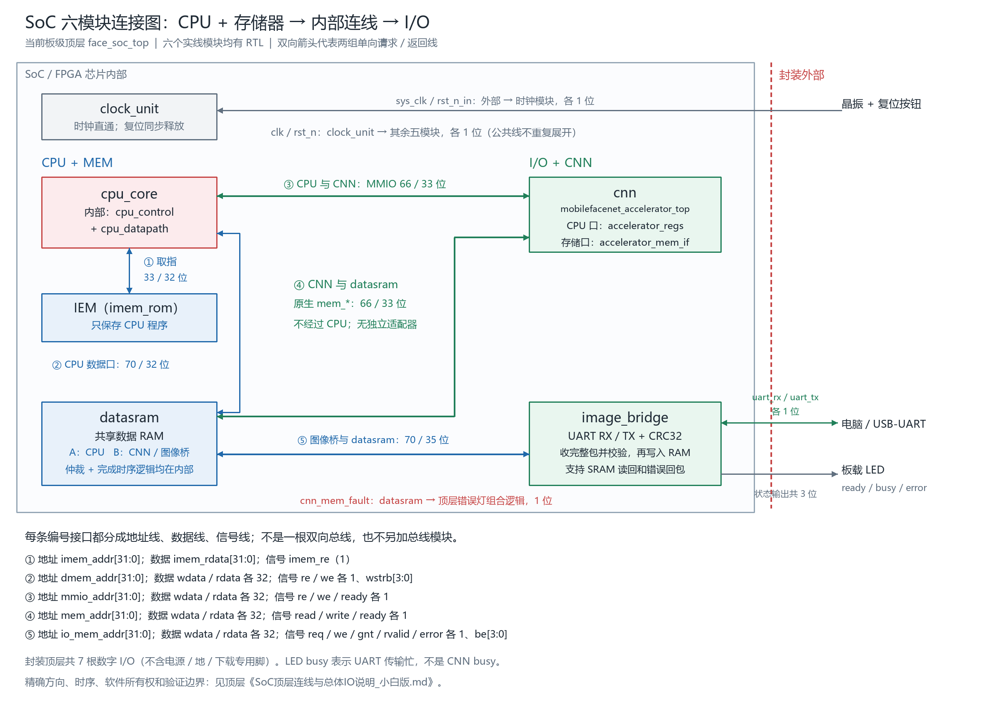

# SoC 芯片封装与内部 I/O 层级连接图

更新：2026-10-08。当前板级顶层 `rtl/soc/face_soc_top.sv` 直接实例化六个大模块，不再使用“CPU 存储子系统”作为图中大模块。

[高清 PNG](figures/soc_cpu_mem_io.png) · [可放大 SVG](figures/soc_cpu_mem_io.svg)

## 图怎么读

左边是 cpu_core、IEM、datasram；右边是 cnn 和 image_bridge；上方是 clock_unit。红色虚线外是板上晶振、按钮、USB-UART 和 LED，不是额外的芯片内 RTL 模块。

- CPU 从 IEM 取指，使用 datasram A 口读写普通数据，通过 MMIO 操作 CNN 自带寄存器。
- CNN 的原生 mem_* 直接接 datasram，不经过 CPU，也没有独立适配器。
- image_bridge 的 io_mem_* 直接接 datasram。CNN 和图像桥共享 B 口，仲裁逻辑已经写在 datasram 内部。
- clock_unit 向其他五模块提供 clk / rst_n；图中公共线用文字统一表示，避免重复横穿。
- 图中 ①..⑤ 对应五条独立接口，不存在另外一个公共总线模块。双向箭头分别代表请求线、返回线，不是双向驱动同一根线。
- 三个 LED 由顶层组合赋值输出；busy 是图像桥忙，不是 CNN 运算忙。cnn_mem_fault 也汇入 error 灯，没有单独状态模块。

cpu_core 内部仍是原 Control + Datapath；CNN 内部仍是实际 FPGA1 原包的模块，图中只展开两个对接接口名。UART 收发器是 image_bridge 内部子模块。六个大模块不是要求整个工程只剩六个 SV 文件。

## 适配器和仲裁器去哪了

不再使用旧“原生 CNN → CPU 存储子系统 → 外部仲裁器 → SRAM”的连接。
现在 `datasram.sv` 同时实现数据数组、A/B 访问、内部 B 口优先选择、读返回归属和 CNN 完成时序，没有实例化独立 adapter 或 sram_b_arbiter。CNN 原有内部 accelerator_mem_arbiter 是 CNN 自己的计算请求仲裁，保留不动。

UART 桥和时钟复位模块本次已经实现，不是虚线规划项。旧 CPU 存储 wrapper、独立仲裁器和模拟 CNN 寄存器文件仅保留给历史回归，不在 `system_cnn.f` 当前路径中。

## 接线与使用依据

全部地址线、数据线、具体信号线、位宽和来源去向见顶层：
[SoC 顶层连线与总体 I/O 说明（小白版）](../SoC顶层连线与总体IO说明_小白版.md)。

[本次修改说明](CNN实际代码整合修改说明_小白版.md) · [UART 协议和命令](uart_image_bridge_protocol.md) · [验证结果与边界](soc_six_module_verification_20261008.md)。

图由 `python scripts/draw_soc_cpu_mem_io.py` 重建，PNG 与 SVG 同源。
