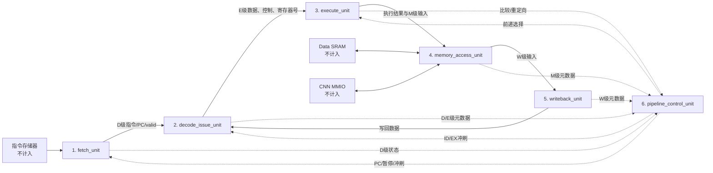

# CPU 内部硬件重新划分方案（不改变现有行为）

日期：2026-09-23  
状态：结构建议稿，不修改现有生产 RTL、C1 接口编码或存储器时序

## 1. 结论

有合理方案。建议把当前 `cpu_control` 与生产 `cpu_datapath` 内部的细粒度模块，按流水职责重新归并为 **6 个 CPU 功能模块**：

1. `fetch_unit`：取指单元；
2. `decode_issue_unit`：译码、寄存器堆与发射单元；
3. `execute_unit`：执行、前递数据选择与跳转判断单元；
4. `memory_access_unit`：SRAM/MMIO 访存单元；
5. `writeback_unit`：写回单元；
6. `pipeline_control_unit`：冒险、前递选择和流水门控单元。

另外保留一个只负责接线和参数传递的 `cpu_core` 集成壳。它不承载独立功能，本文不把它计入六个功能模块。指令存储器、Data SRAM 和 CNN MMIO 均在 CPU 边界之外，也不计入模块数。

这是一种**层次和文件组织重构**，不是微架构修改。五级流水、指令集、C1 编码、寄存器位置、旁路优先级、冲刷/暂停优先级和外部总线时序均保持不变。综合工具展开层次后，目标逻辑应与当前实现等价。

## 2. 推荐的六模块结构



图中的虚线是控制或状态摘要信号，实线是主要数据流。`cpu_core` 只实例化这六个模块并连接三类外部接口，不再保留一套独立的 Control↔Datapath 48 信号顶层边界。

## 3. 每个模块的职责和现有硬件归属

### 3.1 `fetch_unit`

职责：维护 PC、适配固定一周期同步指令存储器、形成 IF/ID 流水输出。

合并的现有内容：

- `pc.sv`；
- `fetch_adapter.sv`；
- `if_id_reg.sv`；
- 当前 `cpu_datapath.sv` 中的 `PC+4`、next-PC 选择逻辑；
- branch/JAL 与 JALR 目标的输入选择，不改变目标值本身。

主要输入：`clk`、`rst_n`、`pc_en`、`if_id_en`、`if_id_flush`、重定向选择及目标地址、`imem_rdata`。  
主要输出：`imem_addr`、`imem_re`、`valid_d`、`instr_d`、`pc_d`、`pc4_d`。

必须保留：同步 IMEM 请求地址配对、暂停时响应缓存、跳转后丢弃旧响应的现有行为。不能把 `fetch_adapter` 简化为组合读。

### 3.2 `decode_issue_unit`

职责：完成 D 级合法性译码、寄存器读取、立即数扩展，并把数据和控制一起锁存到 ID/EX。

合并的现有内容：

- `main_decoder.sv`；
- `alu_decoder.sv`；
- `cpu_control.sv` 中的 `decoded_safe` 安全清零逻辑；
- `regfile.sv`；
- `imm_gen.sv`；
- `id_ex_reg.sv`。

主要输入：D 级指令/PC/valid、`id_ex_flush`、W 级写回端口。  
主要输出：`rs1_d`、`rs2_d`、`uses_rs1_d`、`uses_rs2_d`，以及当前全部 E 级数据、控制和 valid 元数据。

非法指令、无效 D 级和复位期间仍必须产生安全零控制。译码结果仍先进入 ID/EX，不能直接控制其他周期的 E/M 级指令。

### 3.3 `execute_unit`

职责：选择前递操作数、执行 ALU、比较分支条件、计算跳转目标并给出重定向结果。

合并的现有内容：

- `alu.sv`；
- `branch_control.sv`；
- `cpu_datapath.sv` 中的三组前递多路选择器；
- ALU A/B 输入选择器；
- `cmp_eq_e`、`cmp_lt_e`、`cmp_ltu_e`；
- `branch_target` 与 `jalr_target` 计算，其中 JALR bit 0 继续强制清零；
- M 级非 Load 前递值选择逻辑可放在本模块输入端，或由访存单元直接输出统一的 `mem_forward_value`。

主要输入：ID/EX 输出、`fwd_a`、`fwd_b`、`fwd_store`、M/W 两级前递值。  
主要输出：ALU 结果、Store 数据、PC+4、rd 及后续控制，另输出 `redirect`、重定向类型/目标和 E 级比较结果摘要。

该模块不新增寄存器。分支和跳转仍在 E 级判定，错误路径仍只冲刷 IF/ID 与 ID/EX。

### 3.4 `memory_access_unit`

职责：保存 EX/MEM 状态，按现有边沿发出 Data SRAM 请求，在 M 级接收同步读数据，并完成 CNN MMIO 路由。

合并的现有内容：

- `ex_mem_reg.sv`；
- 两个 `address_decoder.sv` 实例；
- 两个 `lsu.sv` 实例；
- E 级 `dmem_addr/dmem_wdata/dmem_wstrb/dmem_re/dmem_we` 生成逻辑；
- M 级 Load 抽取、符号/零扩展和合法性判断；
- M 级 `mmio_addr/mmio_wdata/mmio_re/mmio_we` 及 `mmio_ready` 选择逻辑。

主要输入：E 级执行结果与访存控制、`dmem_rdata`、`mmio_rdata`、`mmio_ready`。  
主要输出：Data SRAM 和 CNN MMIO CPU 侧端口、M 级元数据、M 级前递值、送往写回级的数据。

这是重划分中最需要谨慎的模块。必须保持以下现状：

- Data SRAM 请求在 E 级末尾产生并由同步存储器采样；
- Load 返回值在 M 级处理；
- CNN MMIO 请求在 M 级提交；
- M 级 Load 不能把地址当作可前递结果；
- SRAM 和 MMIO 仍是两条独立外部通路；
- CNN MMIO 仍要求合法请求零等待，本次不增加 ready 型全流水停顿。

### 3.5 `writeback_unit`

职责：保存 MEM/WB 状态，选择最终写回值，同时向寄存器堆和前递网络提供同一个 W 级结果。

合并的现有内容：

- `mem_wb_reg.sv`；
- `cpu_datapath.sv` 中的 `WB_ALU/WB_LOAD/WB_PC4` 选择器；
- `valid_w && regwrite_w && rd_w != 0` 写使能限定。

主要输入：M 级读数据、ALU 结果、PC+4、rd、valid、regwrite 和 `wb_sel`。  
主要输出：`wb_data_w`、`rd_w`、`valid_w`、`regwrite_w`、寄存器堆写使能。

这个模块应只形成一个最终 `wb_data_w`，寄存器写回和 WB→EX 前递都使用它，避免出现两个含义略有差异的写回值。

### 3.6 `pipeline_control_unit`

职责：集中处理所有跨级相关性，输出前递选择、暂停、冲刷与 PC 控制。该模块保持纯组合逻辑。

合并的现有内容：

- `hazard_unit.sv`；
- `pipeline_control.sv`；
- `cpu_control.sv` 中复位时对前递选择的安全限定；
- `branch_control` 的结果只作为本模块输入，不在这里重复比较数据。

主要输入：D/E/M/W 四级 valid、源/目的寄存器号、源使用标志、E/M 级 Load 标志、M/W 写回标志，以及 E 级 `redirect` 和目标类型。  
主要输出：`fwd_a`、`fwd_b`、`fwd_store`、`pc_en`、`if_id_en`、`if_id_flush`、`id_ex_flush` 和 PC 重定向选择。

仲裁优先级必须原样保留：

```text
reset > EX redirect > load-use > normal
```

Load-use 仍只保持 PC 和 IF/ID，并向 ID/EX 插入气泡；M/W 两级继续推进。`operand_unready` 当前不是流水停顿条件，不应在重构时擅自扩展其功能。

## 4. 现有模块到新模块的完整映射

| 现有 RTL/顶层逻辑 | 新归属 | 行为要求 |
|---|---|---|
| `pc`、`fetch_adapter`、`if_id_reg` | `fetch_unit` | 保留同步取指适配和 IF/ID 状态 |
| next-PC mux、`PC+4` | `fetch_unit` | 编码和默认安全值不变 |
| `main_decoder`、`alu_decoder` | `decode_issue_unit` | 支持范围和非法指令处理不变 |
| `decoded_safe` | `decode_issue_unit` | invalid/reset/illegal 输出零控制 |
| `regfile`、`imm_gen`、`id_ex_reg` | `decode_issue_unit` | ID/EX 边界不移动 |
| 前递数据 mux、ALU 输入 mux、`alu` | `execute_unit` | MEM 优先于 WB；M Load 不可前递 |
| 三类比较、`branch_control`、目标计算 | `execute_unit` | E 级决策，JALR bit 0 清零 |
| `ex_mem_reg` | `memory_access_unit` | EX/MEM 边界不移动 |
| E/M 两组 `address_decoder`、`lsu` | `memory_access_unit` | SRAM E 级请求、M 级取数不变 |
| MMIO 路由与 ready 检查 | `memory_access_unit` | M 级、零等待契约不变 |
| `mem_wb_reg`、WB mux | `writeback_unit` | MEM/WB 边界不移动 |
| `hazard_unit`、`pipeline_control` | `pipeline_control_unit` | 纯组合、优先级不变 |
| 原 `cpu_control`/`cpu_datapath` 顶层接线 | `cpu_core` | 仅参数、外部端口和六模块互连 |

## 5. 状态归属

“Control 保持组合逻辑、跨级状态由数据通路保存”的原约定仍然成立，只是数据通路按功能分散到多个模块。建议明确规定如下：

| 状态 | 唯一归属模块 |
|---|---|
| PC、同步取指请求/响应缓存、IF/ID | `fetch_unit` |
| 32×32 寄存器堆、ID/EX | `decode_issue_unit` |
| EX/MEM | `memory_access_unit` |
| MEM/WB | `writeback_unit` |
| 冒险、分支和流水仲裁 | 无状态，组合逻辑 |

`execute_unit` 与 `pipeline_control_unit` 都不应加入时序状态。这样可以避免重构后多出一个周期，或让 flush/stall 作用到错误的寄存器边界。

## 6. 接口组织建议

如果直接把原 48 个 Control↔Datapath 信号改成六模块之间的扁平端口，顶层仍会很拥挤。建议在共享 package 中定义只用于连线的 packed struct，例如：

- `d_stage_t`：`valid/instr/pc/pc4/rs1/rs2`；
- `e_stage_t`：E 级数据、rd、源使用标志及全部随指令流动的控制；
- `m_stage_t`：ALU 结果、Store 数据、PC+4、rd 与 M 级控制；
- `w_stage_t`：Load/ALU/PC+4 候选、rd 与 W 级控制；
- `pipe_action_t`：enable、flush、PC 选择和三组 forwarding 选择。

这些结构体只用于减少接线，不改变任何字段位宽或数值编码。第一版重构也可以继续使用显式端口，等形式等价验证通过后再做结构体封装，以降低一次性改动风险。

CPU 对外端口继续保持为：

```text
clk, rst_n
IMEM:     imem_addr, imem_re, imem_rdata
Data SRAM:dmem_addr, dmem_wdata, dmem_wstrb, dmem_re, dmem_we, dmem_rdata
CNN MMIO: mmio_addr, mmio_wdata, mmio_re, mmio_we, mmio_rdata, mmio_ready
```

指令存储器、Data SRAM 和 CNN MMIO 的实现都不并入 `cpu_core`。

## 7. 五模块备选方案

如果必须压缩为 5 个功能模块，建议只做一处合并：把 `writeback_unit` 并入 `memory_access_unit`，形成 `memory_writeback_unit`。其余四个模块保持不变：

1. `fetch_unit`；
2. `decode_issue_unit`；
3. `execute_unit`；
4. `memory_writeback_unit`；
5. `pipeline_control_unit`。

不建议把控制单元并入执行单元。冒险检测同时观察 D/E/M/W 四级，把它独立出来更容易审查 load-use、MEM/WB 前递优先级和重定向冲刷。也不建议把同步取指适配器并入译码模块，否则 IF 返回缓存、IF/ID 和 ID/EX 三类状态容易混在一起。

六模块方案比五模块方案更清楚，尤其适合报告、波形分组和单元验证；五模块方案文件更少，但 `memory_writeback_unit` 会同时承担 E、M、W 三个时点的部分职责。

## 8. “不改变现有硬件”的判定标准

重构完成后，至少应同时满足下列条件，才能称为只改模块划分：

- 四组流水边界仍是 IF/ID、ID/EX、EX/MEM、MEM/WB，没有新增、删除或移动寄存器；
- Control 相关逻辑仍为组合逻辑；
- C1 所有控制编码和值保持不变；
- RV32I 支持集合、非法指令安全行为和 x0 行为不变；
- reset、redirect、load-use 的优先级及作用范围不变；
- MEM 非 Load 优先于 WB 前递，M 级 Load 遮挡旧 WB 值的行为不变；
- Data SRAM 请求/返回边沿和 CNN MMIO M 级零等待契约不变；
- 外部 IMEM、Data SRAM、CNN MMIO 端口名称、方向、位宽和参数默认值不变；
- 原真实 Control + 生产 Datapath 的 ADD 与混合程序结果逐周期一致；
- 完整 Control 回归仍通过，并新增重构前后关键信号 trace 对比或形式等价检查。

## 9. 推荐实施顺序

1. 先新增 `cpu_core`，仍实例化原 `cpu_control` 和 `cpu_datapath`，固定外部端口基线。
2. 依次抽出 `fetch_unit`、`decode_issue_unit`、`execute_unit`、`memory_access_unit`、`writeback_unit`；每次只移动一组现有逻辑，不同时改信号语义。
3. 最后把原 Hazard/Pipeline Control 接线收口为 `pipeline_control_unit`。
4. 每一步都运行 Control 全回归和真实 Datapath 混合程序，并比较 PC、四级 valid、rd、写回值、SRAM/MMIO 请求序列。
5. 全部通过后再删除旧的细粒度实例层；在此之前保留原实现作为对照版本。

## 10. 最终建议

采用 **六个功能模块 + 一个无功能逻辑的 `cpu_core` 集成壳**。这个方案既符合现有五级流水，又能把当前分散在 Control 顶层、Datapath 顶层和十余个小模块里的逻辑收敛到清晰边界中；同时不会把外部存储器或 CNN MMIO 错算成 CPU 内部模块。

当前阶段建议先把本文作为模块划分基线，不直接改动已经通过联调的生产 RTL。若后续实施，模块重命名和文件合并应视为可验证的等价重构，而不是接口或微架构升级。
