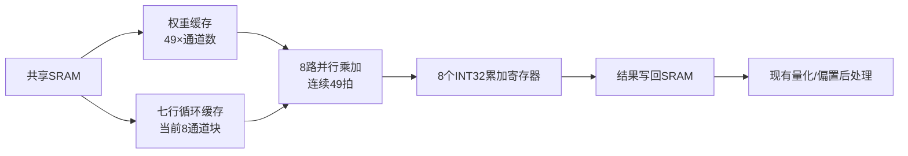

# 带内部复用的7×7逐通道卷积单元

2026-10-22；模块：`rtl/cnn_quant/dw7_cached_engine.sv`。

## 目标和边界

固定MobileFaceNet的 `/Conv_49` 为7×7逐通道卷积、步长1、无padding、通道倍率1，输入7×7×512、输出1×1×512。该层仍有后继投影层；输出512个值不等于已经完成最终人脸特征向量。

本模块为独立CNN内部算子，已与原 `quant_post_engine` 串接测试，**尚未接入多算子调度器或生产SoC**。NEureka继续处理原来的1×1/3×3；本模块补7×7，不重写NEureka。测试结果见 [报告](../deliverables/dw7_cached/README.md)。

## 内部如何复用

- 权重以32位字加载进内部缓存，一次包含4个INT8。计算阶段不再从SRAM重复取权重。下一张图显式请求复用且地址、通道数匹配时，保留权重继续使用。
- 每次处理8个通道，每拍进行8次UINT8×INT8乘加，49拍完成一个空间位置的8个通道。8路是真实独立累加，不是8倍时钟下串行模拟。
- 七行缓存保留当前通道块；同一输出行的相邻窗口共享已载入数据，进入下一输出行只读取新增的一行，最旧的行被替换。
- 当前通道块的所有输出行完成后，再处理下一个8通道块。因此整个任务中每个输入字节恰好读一次，输出仍按HWC地址写入；写出的地址顺序不是完整HWC线性流。
- 累加值留在寄存器中，49次乘加之间不把部分和写回SRAM。只有完整INT32结果才写回。

真实末端7×7→1×1没有相邻输出窗口，每个输入本来就只需用一次。因此此处不能声称行缓存减少了重复输入读取；它做到的是一次读完每个输入、内部保留部分和，以及下一图片复用权重。9×10→3×4的小例才用于验证窗口重叠带来的输入复用。

本版加载、计算和写出按状态轮流进行，尚未做双缓冲DMA/计算重叠；单个32位SRAM客户端也会限制吞吐。它借鉴内部缓存和并行乘加的思路，不代表具有NEureka相同的数据通路或性能。

## 支持配置与数值

| 项目 | 当前契约 |
|---|---|
| 卷积 | 7×7 depthwise、stride=1、dilation=1、valid，无自动padding，通道倍率1 |
| 默认并行度 | 8通道；本轮只验证默认8路配置 |
| 输入 | HWC UINT8，宽7～112，高7～65535；上限是接口约束，不代表所有尺寸已测试 |
| 通道 | 8的整数倍，最大512；本轮验证16、512通道 |
| 权重 | 二补码INT8，按`[ky][kx][channel]`连续排列；不同于NEureka的bit-plane格式 |
| 输出 | HWC INT32，小端，`A=sum(qx*qw)`，未提前重定量或激活 |
| 对齐 | 输入、权重、输出基址均须4字节对齐 |
| 存储保护 | 调用方保证实际地址范围、地址计算不溢出和区域不危险重叠；模块不是地址保护器 |

偏置、激活零点补偿、重定量及夹紧交给原后处理，继续使用 [数值契约](mobilefacenet_quant_contract.md)。真实末端例使用UINT8零点0输入；后处理最终结果用零点128容纳有符号值。两图共用第一图冻结的诊断输出尺度，尚未完成识别准确率校准。

默认权重缓存49×512=25,088字节，行缓存7×112×8=6,272字节，合计31,360字节（约30.63 KiB），另有累加与控制寄存器。若只用于宽7，可在实例化时减小MAX_WIDTH。数组是逻辑RTL存储，尚未综合验证BRAM映射、面积、最高频率或功耗；要实现每拍8路读取，需要相应的bank组织/存储推断约束。

## 接口与缓存有效性

| 信号 | 方向 | 含义 |
|---|---|---|
| start、input_base、weight_base、output_base、width、height、channels | 调度器→算子 | 空闲时脉冲启动并锁存配置；无在线任务队列 |
| reuse_weights | 调度器→算子 | 请求复用；只有内部cache有效且权重基址和通道数相同才命中，否则重新加载 |
| busy / done / error | 算子→调度器 | 运行中；最后输出写响应完成；非法配置。done/error各为一个周期状态，需可靠捕获 |
| valid / ready | 算子→存储 / 存储→算子 | 请求接受握手，反压期间请求字段保持不变 |
| write / byte_access / addr / wdata | 算子→存储 | 读写选择，固定32位整字访问，字节地址和写数据 |
| response / rdata | 存储→算子 | 已接受事务完成，读写都有响应，每次仅一笔在途 |
| clear / cancel | 调度器→算子 / 算子→存储 | 中止并使权重缓存失效；存储方必须取消旧事务，禁止迟到响应混入新任务 |
| cache_hit / weights_cached / mac_fire / phase | 算子→观察端 | 本任务缓存命中、权重完整有效、8路正在执行乘加、状态编码 |

权重基址相同不保证内容没变。调用方修改同地址权重、切换模型或量化版本时，必须置 `reuse_weights=0` 重新加载，或clear/reset。模块不计算权重内容哈希。参数/权重更新不得与正在执行的任务并发。

`done`是一次算子任务结束；`weights_cached=1`不会随done清除，因为后续图还要复用。当前权重缓存只有一份模型/层内容，其他权重任务可替换它，不是多层缓存管理器。

相位：0空闲，1/2权重请求/等响应，3/4输入请求/等响应，5清零累加器，6乘加，7/8结果写请求/等响应，9完成，10配置错误。

## 已验证与接下来怎么接

测试使用独立可反压、可变响应延迟的SRAM模型：真实人脸软件前缀产生的7×7×512特征及真实权重；9×10×16重叠窗口，包含输入255、权重−128/127的边界值。两帧串接原后处理，检查原始INT32和最终UINT8、保护区、每个输入只读一次、第二帧零权重读取、乘加次数、非法配置、取消重启。真实层的浮点局部计算也与ONNX对应输出核对；软件前缀不是RTL全网。

初次失败记录保留在 `build/runs/20261022_171724_dw7_cached`：正向数值检查完成后，测试平台晚一拍检查非法宽度错误脉冲，误报“bad width accepted”。修正TB采样时刻，算子RTL没有因此修改，最终通过记录见报告。禁止把初次运行标成PASS。

下一步在CNN内部扩展任务类型、给此模块分配合法存储客户端与输出区域，将done接入完成掩码，再复用现有后处理与释放管理。当前调度器仅有“NEureka卷积/Add”分类且输出通道上限128，**不能把新模块直接塞进去就认为512通道链路已经集成完成**。CPU、UART和存储顶层本轮均未修改。
