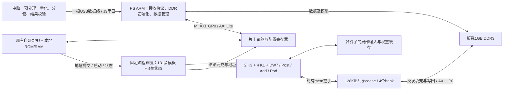

# EES331：DDR3 + 片上缓存 + 电脑输入图片改动方案

日期：2026-10-23。依据：当前 `zhang` 分支提交 `6b281225047fbcd74553b79d86fbf8c1158d3a92`、已通过的四图 MobileFaceNet 仿真、用户提供的 EES331 手册。

**建议首版采用：J3 USB 转 PS 串口收图，PS 将数据写入板载 DDR3，PL 中的 CNN 经 AXI HP 和 128 KiB 片上 cache 访问数据；保留自研 CPU 管理任务，CNN 自主执行固定网络。** 算子维持 K3×2、K1×4、DW7/Post/Add/Pad 各1。先保持数值及网络不变，再根据 DDR 实测决定是否做分块融合。

本文件是待实施方案。本轮没有修改计算 RTL、运行新的仿真或生成上板文件。用户新提供的 1GB DDR3 信息取代此前“只有512 KB、无外部存储”的容量前提。

## 1. 手册确认的硬件条件

下面的页号为 PDF 阅读器页号，括号内为手册印刷页号。

| 项目 | 已核对事实 | 设计影响 |
|---|---|---|
| 芯片 | `xc7z020clg484-1`，Zynq-7000，双核 Cortex-A9；第3页（2） | ARM 为 PS，现有 RTL 在 PL；两者可以协作 |
| DDR3 | 1GB，`MT41K256M16 RE-15E`，接在 **PS DDR 控制器**；第10页（9） | PL 通过 PS 的 `S_AXI_HP0` 访问，不在 PL 给这组 DDR 另建 MIG |
| DDR 配置截图 | 总线32 bit、DDR时钟533.333333MHz、burst length 8；第10页（9） | 这是配置依据；板级走线延迟、完整 preset、初始化参数仍需由板厂工程/原理图和实测确定 |
| J3 | USB接口包含板载下载调试与 **PS UART1**，支持USB供电；第6、15页（5、14） | 首版一根电脑数据线可承担调试和串口收图；传图速度仍受 UART 限制 |
| J8上口 | **PL UART**，CP2103，FPGA RX=A16、TX=A17；第4、18页（3、17） | 需要最大限度复用现有 `image_bridge` 时可选此路 |
| J8下口 | PS UART0，MIO50/51，经CP2103；第4、15页（3、14） | 另一条PS串口路径 |
| J4 | PS USB2.0 OTG PHY，支持Device模式；第13～14页（12～13） | 后续可改为USB Bulk高速收图，需PS USB固件和PC驱动/应用支持 |
| 时钟 | PS外部33.333333MHz；PL外部100MHz，M19；第7页（6） | 当前顶层默认50MHz不能直接套到板卡；须生成并约束实际工作时钟 |

手册标注的J3“USB3.0”不是当前CNN已具有USB3.0高速数据通道。J3串口桥具体型号及可稳定波特率在该手册中未给出，首版从115200开始；921600需验证该口的芯片、驱动和回环。J8的CP2103官方数据表列出了921600，但不能据此推断J3能力，也不规划3M串口。

供电按手册选择：J3支持USB供电，但CNN负载下是否稳定要实测；必要时用板上5V供电，电脑仍只接一根数据线。J4 Device模式按板卡JP6/JP7及其配套接线配置，不把它与J3下载口混用。

## 2. 推荐结构和职责

- **PC**：读PNG/JPEG，裁剪/缩放至112×112，按当前模型相同的RGB归一化与UINT8量化生成输入，上传模型和图片，接收每图128字节结果。首轮直接发送现有 `images.bin`，排除预处理差异。
- **PS ARM**：启动时配置DDR、时钟和PS外设；运行小型裸机程序收包、CRC校验、写DDR、维护缓存可见性与邮箱。首版无需Linux。PS不承担卷积，也不逐算子调度。
- **现有自研CPU**：保留Control/Datapath和本地指令存储，读取邮箱，把已就绪图片地址交给新CNN，处理完成/错误。它的数据口无等待握手，所以保留确定延迟的本地RAM和寄存器访问。
- **CNN**：保留独立固定网络执行能力，知道四图的地址后自行推进。当前每帧同一时刻最多执行一个网络步骤，不同帧可分别占用不同算子；先保持这一已验证行为。
- **SRAM cache**：保存正在访问的数据行；各算子自己的局部输入/权重缓存继续承担MAC复用，两者不是同一份存储。

控制寄存器由PS和自研CPU分工：PS仅在全局空闲期更新模型/模板，运行期间可以对空闲图槽发布收图描述和提交邮箱；CPU是CNN运行控制的唯一发起方。用sequence/ack发布完整描述，避免两方同时写start/clear或读取半写入的地址。CPU侧通过现有零等待MMIO窗口的索引/数据寄存器访问邮箱，不能只扩大地址窗口就假定原Datapath支持。

## 3. DDR存放什么、需要多大

当前四图全网数据已足够小，可原样放入DDR，不必为了容量裁剪网络或把权重改INT4。

| 当前数据 | 字节数 | 位置 |
|---|---:|---|
| INT8权重 | 980,096 | DDR，只读、四帧共享 |
| 量化/偏置参数 | 222,720 | DDR，只读、四帧共享 |
| 四张112×112×3输入 | 150,528 | DDR，每帧37,632 B |
| 四帧中间工作区 | 11,240,448 | DDR，每帧2,810,112 B |
| 前部对齐/保护空间 | 14,720 | 保留现有布局 |
| **原布局合计** | **12,608,512（12.024 MiB）** | 现有16 MiB逻辑窗口足够 |

建议从1GB DDR中先独占预留32 MiB。以下为**拟定地址，不是已经配置好的板级地址**，实施时必须写入PS链接脚本，避开固件、栈、堆和USB缓冲。

| DDR物理范围，左闭右开 | 用途 |
|---|---|
| `0x10000000 .. 0x11000000` | 当前CNN的16 MiB逻辑空间 |
| `0x11000000 .. 0x12000000` | 后续第二批输入、工作区轮转或调试预留；首版CNN不得访问 |

CNN继续使用原 `0x00000000 .. 0x01000000` 逻辑偏移，DDR桥统一做 `physical = 0x10000000 + logical`。模板中的权重/参数地址、四图地址和golden都不必整体改写。当前实际使用区结束于物理 `0x10C06400`，不到第一个16 MiB窗口的末端。

桥必须先检查完整地址及访问长度，再加基址；禁止只截低24位，否则越界地址会别名到窗口开头。权重和参数区在模型加载完成后禁止计算端写入。DDR断电不保存模型，初版由PC每次上电加载一次，运行多个批次时复用；以后可以从板上SD/Flash启动资源加载。

## 4. 把SRAM改成cache，具体要改什么

当前 `self_stream_top.sv` 将10路算子端口直接接到 `datasram_banked`。该模块只有RAM和仲裁，没有tag、miss填充、dirty或写回。`SRAM_SIZE`还同时控制地址范围和数组容量。因此这次需要增加缓存控制器，不能只把16 MiB参数改成512 KiB。

首版建议参数：

| 参数 | 初版建议 | 原因 |
|---|---|---|
| cache数据容量 | 128 KiB | 给算子局部RAM、CPU和调度留空间 |
| 存储组织 | 保留4 bank概念，BRAM同步读写 | 保留多算子命中时的并发机会 |
| cache line | 64 B，2路组相联 | 合并逐字节访问，降低四帧同层地址冲突 |
| DDR端口 | 单个64 bit `S_AXI_HP0` | 先以最小端口配置验证，再按实测扩展 |
| 填充 | 一条64 B line采用8拍×8 B突发 | 不把每个UINT8读操作变成一次DDR事务 |
| 写策略 | write-back + write-allocate，按字节合并 | 保持未写字节并保证后续层读取一致 |
| 并发 | 首个正确性原型允许1笔miss；性能版目标最多4笔独立miss | 一个客户端等待DDR时，其他命中或独立填充可继续 |

缓存行按字节地址管理；在当前四bank字交织组织下，一条64B行可能跨多个bank，需要统一的line锁、填充与替换状态，不能给每个bank各自一套互不知情的tag。对同一行的多次miss合并，对正在写回/填充的行正确阻塞或转发。MSHR记录等待填充的客户端，保持每个算子的返回顺序。

Zynq HP端为AXI3接口；采用AXI4内部主接口时加协议转换。64B突发在64bit端口为8 beats；更长搬运要拆分，满足HP突发长度及AXI 4 KiB边界规则。读、写通道分开处理，`WSTRB`保留字节语义，检查`RRESP/BRESP`；端口位宽和时钟均显式配置。

现有算子可接受可变延迟：`ready`代表请求被接收，`response`代表读取返回/写入已被存储系统接纳并对后继计算有序可见。Post/DW7/Pad不能采用同拍ready+response，至少隔一拍。保留原字节读的符号扩展、32bit字对齐和字节写掩码语义，每个算子至多一笔在途请求。写回cache内部接纳后可结束算子写请求，不必每字等待DDR；但必须保证新消费者能读到该值，并提供显式fence把指定区域全部写到DDR。

**建议先完成透明cache版本，再考虑显式分块DMA。** 当前算子地址流可以直接沿用；如果命中率差或DDR写流量成为瓶颈，再将Conv→Post按tile融合，将INT32块量化后只写UINT8到DDR，或加入权重预取/双缓冲。最大INT32层为1,605,632 B，有DDR后能存下，融合的目的转为减少流量。不能把现有算子内部TILE=2当成已经实现跨层tile流水。

## 5. 512 KiB片上预算：必须同时缩小调度表

目前全网配置内部主数组约342.6 KiB，其中算子缓存约99.0 KiB，控制表约242.7 KiB；此外CPU指令ROM64 KiB，还需CPU数据/栈。大头是1024任务展开表，尤其 `hold[1024][1024]` 单独占128 KiB。

建议新增固定网络的紧凑调度版本：131步模板只存一份，四帧各维护程序计数器、状态、地址；只为10个执行单元保存正在执行的命令。当前网络118个输出各有1个消费者、12个残差输出各有2个、最后输出0个，适合用消费者ID、完成计数和owner替代1024bit消费者位图。生产者完成、残差读者完成和外部结果持有都必须保留，不能只根据“下一层完成”释放。

例如紧凑模板按每步80 B规划，131步为10,480 B；加四帧状态、16槽所有者和在途命令，**以32 KiB为控制存储目标**。这个目标需要新实现和回归，当前代码还没有做到；仅缩小`STEPS`，同时保留524/1024条展开副本，不能达到该目标。

| 片上项目 | 逻辑容量预算 |
|---|---:|
| 共享cache数据 | 128 KiB |
| 算子局部输入、权重、参数等 | 约100 KiB |
| 紧凑调度及模板 | 目标≤32 KiB |
| 自研CPU指令ROM | 建议8 KiB，按最终固件链接结果确认 |
| 自研CPU数据RAM/栈 | 初步16 KiB，按新固件链接映射确认 |
| cache tag、FIFO、写回及跨域缓冲等 | 目标≤32 KiB |
| 小计 | 约316 KiB |
| 距512 KiB预算的余量 | 约196 KiB，供RAM映射取整及其他模块使用 |

这是**逻辑数据预算，不是综合BRAM结果**。已有六卷积核独立综合合计22个BRAM36，而其主要逻辑缓存约54 KiB，表明映射取整/端口组织会扩大物理占用。必须同时修复Post参数RAM推断失败、检查DW7寄存器展开，并报告整机资源。

Z-7020官方规格为140个36 Kbit BRAM（原始位数合计630 KiB，包含相应配置下的数据/校验位资源）；不能全部视为可自由分配的32bit SRAM。这里先继续用用户提出的512 KiB作为设计预算，验收以实际BRAM块数及布局布线为准。若不够，优先把cache降至64 KiB，保留同一功能和算法再测性能；不先减少K1实例。

## 6. 传图、启动和结果回收流程

1. 上电后PS完成DDR初始化、时钟/复位和DDR自检。CNN保持未启动；PS通过邮箱发布`DDR_READY`。DDR不可用时拒绝收图提交和启动。
2. PC读取版本/能力，上传权重、参数及131步模板。复用现有IMIO的地址、长度、序号、CRC32及停止等待机制；PS新写协议服务，PC `uart_image_transfer.py`可复用底层分包。模型只加载一次，完成全区CRC/版本校验后进入只读状态。
3. 预分配四个逻辑图片地址和工作区。每图发送37,632 B，完成全部写入及整图CRC后，PS完成数据cache维护与内存屏障，再发布`FRAME_COMMIT(frame_id, slot, input_offset, workspace_offset, length, model_version)`。
4. 自研CPU把已发布描述提交给CNN。第一张图完成接收即可计算，同时PS接收第2～4图；四个槽均占用时向PC反压，不能覆盖未完成图片。
5. CNN按依赖执行，所有中间完整张量放在DDR逻辑空间，经cache访问。后继算子读到同一cache中的最新数据，无需每完成一层都把全cache写回。
6. 结果算完后，存储桥对该128 B输出区域做fence，等待相关dirty行及AXI写响应完成，再通知PS结果可读。PS处理自己的数据cache后读取、打包，经同一串口返回。
7. PC收到完整结果并确认；PS将ACK写邮箱，CPU核对帧号和批次epoch后，唯一驱动CNN的`result_ready`释放外部持有，防止迟到ACK释放新结果。首版完成四图批次后清理并重新配置下一批，不声称已支持无限循环输入。

新增的是任务层命令/邮箱，如`LOAD_MODEL_END`、`FRAME_COMMIT`、`RESULT_ACK`、`QUERY_STATUS`；现有IMIO读写包格式不必先换。实现时应明确返回状态、长度范围、重复包幂等处理、超时和重试行为，不能把包CRC成功等同于一张图已完整提交。

### 必须保证的可见性和复位语义

- **PS缓存和PL cache是两层不同缓存。** PS写模型/图片后，缓存区flush及屏障完成，再发提交；PL结果写回后，PS读前invalidate。初版可把共享DDR窗口设为PS不可缓存区域来简化，但不能仅依赖C语言`volatile`。
- 写回cache含旧批次dirty行时，不允许PS直接覆盖同一物理区域。先等待旧任务和写回结束，执行区域失效/新epoch，再交还给上传方；输入、结果、模型按cache line边界隔离。
- 上传下一张图只写空闲槽；其他帧缓存不因新帧到达被全局清空。模型更新在所有任务空闲、旧访问排空后统一失效，不能运行中混用权重。
- `cancel/clear/reset`后DDR可能还有旧响应，桥必须排空或按内部epoch丢弃；旧写事务排空前不复用目标区，不能把旧response交给新任务。
- UART ACK、DDR写完成、frame提交、计算完成、结果写回、PC读完是不同事件，需要分别计数和握手。

## 7. 一根线的路线和速度选择

| 路线 | 适用阶段 | 需要增加的工作 |
|---|---|---|
| **J3 → PS UART1 → DDR（推荐首版）** | 尽快跑通单线收图、板载调试和全网 | PS裸机IMIO服务、DDR初始化、PS/PL邮箱；PL现有UART RTL不在此通路 |
| J8上口 → PL UART → cache/DDR | 希望保留并验证当前 `image_bridge` | PL引脚/时钟约束、握手DDR桥和写fence；供电/启动另按板卡安排 |
| **J4 → PS USB Device Bulk → DDR（二期）** | 高频输入或减少模型上传等待 | USB端点/DMA缓冲、PC WinUSB/libusb等接口、Device配置；复用同一图片任务协议 |

四张完整尺寸输入为150,528 B。现IMIO每包256 B，共588包；8N1每字节10 bit，每包请求及回复增加32 B。下表为传输下限，不含USB/主机调度、包间停顿和内存等待。

| UART波特率 | 纯图片数据 | 沿用现IMIO上传 | 上传并逐包读回 |
|---:|---:|---:|---:|
| 115200 | 13.067 s | 14.700 s | 29.400 s |
| 921600（实际链路通过后采用） | 1.633 s | 1.838 s | 3.675 s |

权重+参数1,202,816 B，115200仅纯数据就需约104.4 s，因此模型上电加载和每批图片上传分开计时。J4的USB2.0速率不能直接换算为本项目有效吞吐；后续以真实Bulk实测为准。

当前四图算术RTL是653,428,459拍，在**假设100MHz**下约6.534 s。115200传图本身比这个时间长，因此先预加载四图测计算并行，再测边上传边计算。921600的线上下限短于计算时间，更适合作为后续串口目标，但不能据此保证端到端速度或J3稳定性。

## 8. 具体代码改动位置

以下新文件名为建议实现位置，当前尚未创建。

| 当前位置/拟新增位置 | 改动 |
|---|---|
| `rtl/cnn_stream/self_stream_top.sv` | 抽出内嵌存储实例，新增可选外部存储接口；保留原bai SRAM仿真后端用于比较 |
| `rtl/cnn_stream/bai/datasram_banked.sv` | 参考/复用bank RAM与仲裁思路；新cache另设模块，保留原导入版本及来源记录 |
| 新 `rtl/cnn_ddr/cnn_cache.sv` | cache data/tag、替换、fill/writeback、客户端归属与命中并行 |
| 新 `rtl/cnn_ddr/cnn_ddr_bridge.sv` | 逻辑地址检查/物理基址、AXI突发、并发队列、错误、fence及cancel排空 |
| 新 `rtl/cnn_ddr/fixed_schedule_compact.sv` | 131步模板+四帧PC，消费者计数及owner，替代展开大表；复用原算子派发规则 |
| `rtl/cnn_stream/self_fixed_network_top.sv`及新DDR入口 | 保留帧提交/结果协议；新入口明确2K3/4K1；SRAM容量与逻辑地址窗口分离 |
| 新 `rtl/soc/ees331/face_soc_ees331_top.sv`、`cnn_mailbox.sv` | 连接Zynq PS、原自研CPU、本地RAM、新CNN、邮箱、时钟复位、状态灯/调试 |
| 新 `scripts/create_ees331_bd.tcl`、板级XDC | PS7 DDR/HP0/GP0、互连/协议转换、复位、时钟；导出XSA供PS软件使用 |
| 新 `firmware/ps_image_server/` | UART协议、DDR检查、cache维护、模型/图片/结果管理；初始化代码与硬件XSA匹配 |
| 原自研CPU固件/新驱动 | 邮箱轮询、零等待寄存器命令、frame/result握手，局部数据/栈布局 |
| `scripts/uart_image_transfer.py`与新 `scripts/send_cnn_images.py` | 复用底层IMIO，增加预处理、模型加载、四图commit、收结果和分段计时 |
| 新DDR TB、现 `tb/integration/self_full_main.cpp`的独立变体 | 增加AXI延迟/反压/刷新模型；初始化和保护区回读改走握手口，不再靠CPU固定一拍口访问12.6MiB |

现生产 `face_soc_top.sv` 仍接旧 `mobilefacenet_accelerator_top`，不能只把新存储接在旧顶层就称新CNN已上板。建议新增EES331入口和独立filelist，避免旧CPU/UART回归被新的PS系统顶层影响。

PS生成的FCLK可统一驱动初版PL逻辑/AXI；若另用M19的100MHz，需要明确CDC和复位同步。初版可先以50MHz闭合时序，再尝试100MHz；手册晶振频率不等于CNN已经达到的Fmax。仅下载PL bitstream不足以保证PS DDR可用，还需执行与该硬件导出匹配的PS初始化/FSBL及应用。

## 9. 实施顺序与验收

| 阶段 | 工作 | 通过条件 |
|---|---|---|
| A：PS/DDR/一根线 | 建板级工程，初始化DDR，J3回环与IMIO收发，PS写DDR读回 | 地址边界、跨行、随机数据和CRC均正确；四图150,528 B回读一致；模型加载校验通过 |
| B：PL访问DDR | HP0读写发生器，错误/超时/反压测试，接单算子和小图 | 字节掩码、突发边界、请求返回和写完成正确；PS↔PL读写可见性通过 |
| C：cache与小图 | 从旁路参考到cache，加入miss并发、dirty驱逐、fence、clear | 小图overlap/serial/preloaded/stress全部golden一致；同一行读写、跨行、复用、迟到响应及慢结果回收通过 |
| D：控制容量与综合 | 紧凑调度、Post/DW7 RAM推断、CPU邮箱连接 | 原四图/残差/所有者释放语义不变；综合无大表寄存器展开，资源符合目标器件 |
| E：相同全网仿真 | 固定四张112×112、同模型/参数/2K3/4K1，DDR时序含随机停顿 | 524步骤、4结果和逐值数值全一致；最终512 B SHA为下方基准；无越界/未写先读/提前释放 |
| F：板上四图 | 先DDR预加载四图，再依次上传并提交；至少连续多批 | 真实DDR结果与golden一致；冷/热cache、边收边算、慢ACK等无死锁；报告整机LUT/FF/BRAM/DSP和时序 |

既有基准：最终512字节SHA256为 `80351fb04be5c55bc45d6e6fcadaef6680b20d0532d15f7bb5bf5c661416a44f`，935,241,728次标量MAC，77,349,168个算子输出字节检查。新桥的DDR写回会重复/合并物理写，不把它当作新增的算子输出来计数。最终从DDR真实读回结果，保留原只读区/guard保护检查。

DDR延迟会改变任务顺序和周期，验收要求输出及依赖正确，不要求仍为653,428,459拍；使用已冻结的相同输入、权重、量化参数，不能为了提高DDR版分数改网络。原比较脚本要求受保护RTL哈希相同，不能直接用它宣称这次存储/调度改造满足原“只改算子数量”的比较约束，应另写DDR对照报告。

并行目标另设验收：预加载四图模式须记录峰值四帧在途，并证明至少两帧的真实算子工作/MAC存在重叠；不能只统计四张图已进入队列。同一DDR/cache配置、同一频率和一致的冷/热cache条件下，分别测四图串行和并行周期；报告计算收益及包含上传/回传的端到端收益。若只实现数值正确而无真实重叠，该阶段尚未完成。

## 10. 性能预期与下一步优化依据

DDR首先解决容量，并不自动使当前算术更快。当前1×1占93.42% MAC、仍约两拍一次MAC，四套K1平均busy约85.25%；此前SRAM仲裁等待只占K1 active约0.217%。透明cache的目标是让DDR造成的停顿尽量小，不应先承诺加速倍数。

当前四图在算子接口累计有效读329,803,968 B、写77,349,168 B，共407,153,136 B。以6.534 s换算约62.3 MB/s，这是**算子有效请求量**，不是新DDR总线流量：cache复用会减少DDR读，写分配、无效预取和驱逐可能增加它。单64bit HP口在100MHz时线宽算术上限800 MB/s，也不是实际有效吞吐保证；不能据此证明无瓶颈。

需要新增并分别展示：每算子hit/miss、miss等待拍数、有效字节/突发字节、DDR读写字节与等待、cache替换/写回、同时在途帧数、真正MAC重叠、收图/计算/回传时间。四帧地址是否产生组冲突要由真实地址轨迹检查；2路相联不能保证四帧完全无冲突。

后续优先顺序按数据决定：若DDR等待明显，先调整line/替换/预取和写合并，再研究Conv→Post分块融合；若K1算术仍主导，再做K1 MAC流水和并行lane；若电脑输入成为主导，改J4 USB Bulk。cache容量64/128/256 KiB、1/2/4笔miss可做同输入扫描，最终以综合资源和四图实测选择，不先把512 KiB全部分给cache。

## 11. 2026-10-24补充：cache容量上限与IMEM缩减

本节为用户后续询问后的容量核对，仍未实施RTL修改。推荐先128 KiB cache跑通，完成调度表压缩、RAM推断修复后，以256 KiB为资源/性能评估目标。这个建议不代表256 KiB已经通过整机综合。

Z-7020共有140个BRAM36等效块；按当前32bit数据、不把校验位当数据的RAM组织，每块承载4 KiB有效数据。原始630 KiB位资源不能全部视为这种组织下的有效SRAM；所有块都作32bit数据RAM时合计560 KiB，并且还未分给其他模块。

| cache有效容量 | cache数据估计BRAM36 | 加六个卷积核已有独立综合合计22块 | 设计判断 |
|---|---:|---:|---|
| 128 KiB | 32 | 54 | 适合作为首版，其他模块和映射余量较大 |
| 256 KiB | 64 | 86 | 建议优化后的目标；剩54块需覆盖其他算子、调度、IMEM、CPU数据RAM、tag/FIFO等 |
| 384 KiB | 96 | 118 | 仅余22块给上述全部模块，当前不建议；需要进一步改变存储组织并证明可放下 |
| 512 KiB | 128 | 150 | 按现有卷积核映射，仅这两部分就超过140块 |

表内只计算cache数据和六个卷积核，没有计tag/valid/dirty或其他部件；单核OOC相加也不替代集成综合。若保留原约242.7 KiB控制表而不压缩，不能沿用这里的256 KiB目标。按第5节紧凑调度预算，128 KiB cache的逻辑总量约316 KiB，256 KiB时约444 KiB；384 KiB时约572 KiB，已超过512 KiB设计预算，且都还要考虑物理RAM映射。

已核对的自研CPU程序映像：

| 文件/用途 | 实际指令或映像范围 | 说明 |
|---|---:|---|
| `firmware/autoload_demo/program.lst` | 98条RV32I指令，392 B | 最后指令地址0x184 |
| `firmware/overlap_demo/program.lst` | 67条，268 B | 最后指令地址0x108 |
| 历史hybrid `tiny_chain` CPU映像 | 4,108 B | 来自对应`case.json`的cpu_words，不是新CNN驱动 |
| 历史hybrid `conv_chain` CPU映像 | 4,180 B | 当前检查的这些映像中最大，包含布局间隙 |
| 历史hybrid `pool_parallel` CPU映像 | 1,604 B | 历史控制程序 |

两份demo的`program.mem`均补NOP到1024个32bit字，即4 KiB；文本文件的10,240 B是十六进制字符及换行的磁盘长度，不是CPU指令存储容量。64 KiB则能容纳16,384条RV32I指令，对这些已有程序明显过大。

建议保留IMEM容量参数，初版改用8 KiB（2048条指令）；若最终链接映像/常量超过该范围再升16 KiB。64→8 KiB按32bit BRAM映射从16块降至2块，释放14块，相当于56 KiB cache数据容量；64→16 KiB释放12块。正式修改时须加镜像尺寸/入口和最高地址检查，并同步初始化及顶层参数，不能只根据非NOP指令数量裁切映像。

完整四图仿真目前由C++测试平台配置CNN，并未执行对应的新自研CPU固件；PS收图程序也是待开发的软件。131步网络命令模板与权重属于CNN配置/数据，不等于131条CPU指令，也不应全部塞进IMEM。未来PS程序优先放PS的DDR/OCM程序区域，不占这份PL自研CPU IMEM。

## 参考依据

- 用户提供的 `D:/参考文献EES331_UserManual_v1.0_1220.pdf`：已提取文本并目视核对板卡概览、DDR、USB/UART相关完整页面；方案中的页码见第1节。
- [当前全网算子优化报告](self_cnn_full_optimized.md)、[仓库复现说明](self_cnn_repository.md)、[UART协议](uart_image_bridge_protocol.md)。
- [AMD UG585：AXI HP接口](https://docs.amd.com/r/en-US/ug585-zynq-7000-SoC-TRM/AXI_HP-Interfaces)、[PL通过HP访问存储及GP控制](https://docs.amd.com/r/en-US/ug585-zynq-7000-SoC-TRM/PL-DMA-via-AXI-High-Performance-HP-Interface)。
- [AMD DS190：Zynq-7000器件资源表](https://www.amd.com/content/dam/xilinx/support/documents/data_sheets/ds190-Zynq-7000-Overview.pdf)、[XAPP792：64bit AXI3及突发转换](https://docs.amd.com/api/khub/documents/ASiLExM7IeFBcSm9PQJ9bw/content)。
- [AMD DS190官方文档入口](https://docs.amd.com/api/khub/documents/juMnxca71Tf2gfjmNyjM8A/content)、[RAMB36E1的存储组织](https://docs.amd.com/r/2022.2-English/ug953-vivado-7series-libraries/RAMB36E1)。
- [Silicon Labs CP2103数据表](https://www.silabs.com/documents/public/data-sheets/CP2103.pdf)：J8桥接器UART格式/波特率依据。
- [AMD PS USB Device示例](https://github.com/Xilinx/embeddedsw/blob/master/XilinxProcessorIPLib/drivers/usbps/examples/xusbps_intr_example.c)、[Cortex-A9 cache维护实现](https://github.com/Xilinx/embeddedsw/blob/master/lib/bsp/standalone/src/arm/cortexa9/xil_cache.c)：后续PS实现参考，不代表本板已经通过测试。
