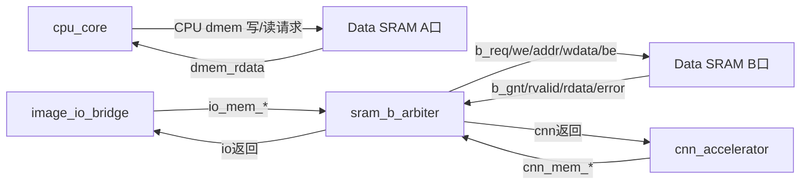

# FPGA Data SRAM 与图像 I/O 接线清单

## 2026-10-08 六模块实际实现更新

当前板级顶层为 `rtl/soc/face_soc_top.sv`：六个平级大模块 `cpu_core / cnn / datasram / IEM / image_bridge / clock_unit`。CNN 的原生 mem_* 直接接 datasram，**不经过 CPU**；B 口仲裁和读写完成时序已写进 datasram 内部，不再实例化旧 CPU 存储子系统、独立适配器或系统 B 仲裁器。CPU A 口保留固定一拍，Control C1 和原 Datapath 计算模块不变。

UART 图像桥和时钟复位模块本次已有实际 RTL。图像桥为 IMIO 分块读写 + CRC32；时钟直通、复位三拍同步释放。封装 7 根数字 I/O，busy 灯是图像桥忙，不是 CNN busy。CNN 自带 MMIO：QUEUE_BASE=+0x08、TASK_COUNT=+0x18、START=0x3D；图像桥 error 保留，CNN 存储错误锁存 cnn_mem_fault，恢复需系统复位。

当前接线以 [顶层三组线小白说明](../SoC顶层连线与总体IO说明_小白版.md) 为准；另见 [六模块图](../docs/SoC芯片封装与内部IO层级连接图.md)、[修改说明](../docs/CNN实际代码整合修改说明_小白版.md)、[UART 协议](../docs/uart_image_bridge_protocol.md)、[本次验证](../docs/soc_six_module_verification_20261008.md)。编译清单 `rtl/filelists/system_cnn.f`；测试 `python scripts/run_cnn_integration.py`。

**下面保留原章节作为注明日期的历史记录。** 其中“CPU 存储子系统”“外置 sram_b_arbiter”“image_io_bridge / clock_reset_unit 待实现”、旧 IMG0 协议草案、旧 stub 和旧逐层 MMIO 不再是当前板级接线依据。CPU C1 基本规则仍适用；历史仿真不代表本次板级上板通过。

## 1. 本文要解决的问题

本文把 Data SRAM 相关 I/O 分成三层：

1. **FPGA 板级 I/O**：真正连接开发板引脚，例如 `uart_rx`、`uart_tx`、时钟、复位和 LED。
2. **系统模块间 I/O**：CPU、图像桥、CNN 和 SRAM B 口仲裁器之间的内部 RTL 信号。
3. **Data SRAM A/B 端口**：最终连接 True Dual-Port Block RAM wrapper 的信号。

外部串口或摄像头不能直接连接 SRAM。外部串行数据必须先由 `image_io_bridge` 接收、校验和打包，再转成 SRAM B 口写事务。

## 2. 推荐硬件清单

| 模块 | 作用 | 当前状态 |
|---|---|---|
| `fpga_face_top` | FPGA 系统顶层和板级引脚边界 | 待实现 |
| `cpu_core` | 固定 IMEM 程序的 RV32I CPU | CPU Control/Datapath 已有，六模块重组尚未实施 |
| `imem_rom` | 保存固定指令 | 待实现 FPGA wrapper |
| `data_sram_tdp` | 256 KiB True Dual-Port Data SRAM | 待实现 FPGA wrapper |
| `image_io_bridge` | UART 收包、CRC、图像写入、结果读出和 UART 发包 | 待实现 |
| `sram_b_arbiter` | 图像桥与 CNN DMA 共享 SRAM B 口 | 待实现 |
| `cnn_mmio_regs` | CPU 配置 CNN 的九寄存器接口 | 当前只有 test-only stub，真实硬件待实现 |
| `cnn_accelerator` | CNN DMA 和计算 | 待 CNN 负责人交付 |

## 3. FPGA 板级顶层 I/O

第一版使用 UART 输入输出，不直接连接摄像头。

### 3.1 必需板级端口

```systemverilog
module fpga_face_top (
    input  logic sys_clk,
    input  logic rst_n_in,
    input  logic uart_rx,
    output logic uart_tx,
    output logic led_ready,
    output logic led_busy,
    output logic led_error
);
```

| 端口 | 方向 | 位宽 | 连接对象 | 含义 |
|---|---|---:|---|---|
| `sys_clk` | 输入 | 1 | 板载晶振 | FPGA 系统参考时钟 |
| `rst_n_in` | 输入 | 1 | 复位按键/芯片 | 板级低有效复位输入；内部应同步释放 |
| `uart_rx` | 输入 | 1 | USB-UART 的 TX | 图像包和测试命令字节流 |
| `uart_tx` | 输出 | 1 | USB-UART 的 RX | 结果包、状态和错误信息字节流 |
| `led_ready` | 输出 | 1 | LED | 1=允许发送下一帧 |
| `led_busy` | 输出 | 1 | LED | 1=正在接收、计算或发送 |
| `led_error` | 输出 | 1 | LED | 1=CRC、越界、协议或 CNN 错误 |

`uart_tx` 是第一版唯一必须的数据输出线。图像、checksum、分类编号或 embedding 都通过它串行输出。LED 只显示状态，不传输结果数据。

### 3.2 可选并行结果端口

若后续需要直接连接 MCU 或另一个 FPGA，可增加：

```systemverilog
    output logic        result_valid,
    input  logic        result_ready,
    output logic [31:0] result_id,
    output logic [31:0] result_score,
    output logic        result_error
```

| 端口 | 方向 | 位宽 | 含义 |
|---|---|---:|---|
| `result_valid` | 输出 | 1 | 结果有效；保持到 `result_ready=1` |
| `result_ready` | 输入 | 1 | 外部模块已经接收本次结果 |
| `result_id` | 输出 | 32 | 分类类别或人员编号 |
| `result_score` | 输出 | 32 | CNN 冻结格式后的定点分数 |
| `result_error` | 输出 | 1 | 当前帧处理失败 |

这组可选端口只传最终短结果，不传整张图像。第一版不必实现。

## 4. Data SRAM 总体结构

推荐容量和组织：

```text
容量：256 KiB
数据宽度：32 bit
字节写使能：4 bit
地址：32-bit 字节地址
内部字地址：addr[17:2]，共 65,536 个 32-bit word
A口：CPU 固定使用
B口：image_io_bridge 与 CNN DMA 经 sram_b_arbiter 共享
读延迟：固定 1 个系统时钟周期
```



## 5. `data_sram_tdp` 完整端口

建议 SRAM wrapper 使用下列目标端口：

```systemverilog
module data_sram_tdp #(
    parameter logic [31:0] SRAM_BASE = 32'h0000_0000,
    parameter logic [31:0] SRAM_SIZE = 32'h0004_0000
) (
    input  logic        clk,
    input  logic        rst_n,

    input  logic [31:0] a_addr,
    input  logic [31:0] a_wdata,
    input  logic [3:0]  a_wstrb,
    input  logic        a_re,
    input  logic        a_we,
    output logic [31:0] a_rdata,

    input  logic        b_req,
    input  logic        b_we,
    input  logic [31:0] b_addr,
    input  logic [31:0] b_wdata,
    input  logic [3:0]  b_be,
    output logic        b_gnt,
    output logic        b_rvalid,
    output logic [31:0] b_rdata,
    output logic        b_error
);
```

`rst_n` 不要求清空 256 KiB 存储阵列，只清除读返回 valid、错误标志等 wrapper 状态。需要初值的权重或数据库应使用 BRAM 初始化文件或专门装载流程。

## 6. Data SRAM A 口：CPU 专用

### 6.1 A 口输入

| SRAM 端口 | 位宽 | 来源 | 现有 CPU 信号 | 含义 |
|---|---:|---|---|---|
| `a_addr` | 32 | `cpu_core` | `dmem_addr` | 字节地址 |
| `a_wdata` | 32 | `cpu_core` | `dmem_wdata` | 写数据，已经按 byte lane 移位 |
| `a_wstrb` | 4 | `cpu_core` | `dmem_wstrb` | 每个字节的写使能 |
| `a_re` | 1 | `cpu_core` | `dmem_re` | SRAM 读请求 |
| `a_we` | 1 | `cpu_core` | `dmem_we` | SRAM 写请求 |

### 6.2 A 口输出

| SRAM 端口 | 位宽 | 去向 | 现有 CPU 信号 | 含义 |
|---|---:|---|---|---|
| `a_rdata` | 32 | `cpu_core` | `dmem_rdata` | 固定一周期同步读返回 |

### 6.3 A 口直接接线

```systemverilog
assign sram_a_addr  = dmem_addr;
assign sram_a_wdata = dmem_wdata;
assign sram_a_wstrb = dmem_wstrb;
assign sram_a_re    = dmem_re;
assign sram_a_we    = dmem_we;
assign dmem_rdata   = sram_a_rdata;
```

不在 CPU 与 SRAM A 口之间增加 `ready`。A 口必须满足当前生产 Datapath 的固定一周期时序。

### 6.4 A 口约束

- `a_re` 与 `a_we` 不得同时为 1。
- `a_we=1` 时 `a_wstrb` 不得为 `4'b0000`。
- `a_addr` 超出 `0x0000_0000～0x0003_FFFF` 时，wrapper 不得写入 BRAM。
- CPU 发出的 LB/LH/LW 和 SB/SH/SW 已由 LSU 形成字节 lane 与 strobe；SRAM wrapper 不再重复做符号扩展。

## 7. Data SRAM B 口：共享主接口

### 7.1 B 口请求输入

| SRAM 端口 | 位宽 | 来源 | 含义 |
|---|---:|---|---|
| `b_req` | 1 | `sram_b_arbiter` | 请求有效；保持到 `b_gnt=1` |
| `b_we` | 1 | `sram_b_arbiter` | 1=写，0=读 |
| `b_addr` | 32 | `sram_b_arbiter` | 4 字节对齐的字节地址 |
| `b_wdata` | 32 | `sram_b_arbiter` | 写入数据 |
| `b_be` | 4 | `sram_b_arbiter` | byte enable |

### 7.2 B 口响应输出

| SRAM 端口 | 位宽 | 去向 | 含义 |
|---|---:|---|---|
| `b_gnt` | 1 | `sram_b_arbiter` | 本周期接受请求 |
| `b_rvalid` | 1 | `sram_b_arbiter` | `b_rdata` 有效 |
| `b_rdata` | 32 | `sram_b_arbiter` | 同步读返回数据 |
| `b_error` | 1 | `sram_b_arbiter` | 越界、未对齐或非法字节使能 |

### 7.3 B 口事务规则

#### 写事务

```text
接受条件 = b_req && b_gnt && b_we
```

在接受沿按 `b_be[3:0]` 写入对应字节。写事务不产生 `b_rvalid`。

#### 读事务

```text
请求接受 = b_req && b_gnt && !b_we
下一周期 b_rvalid=1，b_rdata 为该地址数据
```

第一版只允许一个未完成 B 口读请求。请求被接受后，主设备必须等到 `b_rvalid` 再发下一个读请求。

## 8. `image_io_bridge` 的 SRAM I/O

`image_io_bridge` 把 UART 字节流打包为 32 位 SRAM 请求，也负责从 SRAM 读结果并序列化到 UART TX。

### 8.1 图像桥到仲裁器

| 信号 | 位宽 | 方向（相对图像桥） | 含义 |
|---|---:|---|---|
| `io_mem_req` | 1 | 输出 | SRAM B 口请求 |
| `io_mem_we` | 1 | 输出 | 1=写图像/邮箱，0=读结果 |
| `io_mem_addr` | 32 | 输出 | SRAM 字节地址 |
| `io_mem_wdata` | 32 | 输出 | 四个 UART payload 字节打包值 |
| `io_mem_be` | 4 | 输出 | 有效字节；完整图像字通常为 `4'b1111` |

### 8.2 仲裁器到图像桥

| 信号 | 位宽 | 方向（相对图像桥） | 含义 |
|---|---:|---|---|
| `io_mem_gnt` | 1 | 输入 | 请求已接受 |
| `io_mem_rvalid` | 1 | 输入 | 结果读返回有效 |
| `io_mem_rdata` | 32 | 输入 | 结果读数据 |
| `io_mem_error` | 1 | 输入 | SRAM 请求错误 |

### 8.3 图像桥状态输出

| 信号 | 位宽 | 去向 | 含义 |
|---|---:|---|---|
| `frame_loaded` | 1 | 顶层状态/LED | 完整帧已通过 CRC 并写入 SRAM |
| `io_busy` | 1 | `sram_b_arbiter`、LED | 图像桥有活动事务 |
| `io_error` | 1 | LED/状态锁存 | UART、CRC、长度或 SRAM 错误 |
| `result_sent` | 1 | 顶层状态 | 当前结果包已发完 |

`frame_loaded` 不能代替 SRAM 邮箱中的 `FRAME_READY`。固定 CPU 程序通过 A 口轮询邮箱；`frame_loaded` 只用于硬件状态和调试。

## 9. CNN DMA 的 SRAM I/O

保持项目规格建议的信号名：

### 9.1 CNN 到仲裁器

| 信号 | 位宽 | 方向（相对 CNN） | 含义 |
|---|---:|---|---|
| `cnn_mem_req` | 1 | 输出 | CNN DMA 请求 |
| `cnn_mem_we` | 1 | 输出 | 1=写输出，0=读输入/权重/bias |
| `cnn_mem_addr` | 32 | 输出 | SRAM 字节地址，4 字节对齐 |
| `cnn_mem_wdata` | 32 | 输出 | CNN 输出数据 |
| `cnn_mem_be` | 4 | 输出 | 字节写使能 |

### 9.2 仲裁器到 CNN

| 信号 | 位宽 | 方向（相对 CNN） | 含义 |
|---|---:|---|---|
| `cnn_mem_gnt` | 1 | 输入 | CNN 请求已接受 |
| `cnn_mem_rvalid` | 1 | 输入 | CNN 读返回有效 |
| `cnn_mem_rdata` | 32 | 输入 | CNN 读返回数据 |
| `cnn_mem_error` | 1 | 输入 | 地址或访问错误 |

CNN 必须在 `cnn_mem_gnt=1` 前保持请求、地址和控制稳定。

## 10. `sram_b_arbiter` 完整 I/O

建议仲裁器端口如下：

```systemverilog
module sram_b_arbiter (
    input  logic        clk,
    input  logic        rst_n,

    input  logic        io_mem_req,
    input  logic        io_mem_we,
    input  logic [31:0] io_mem_addr,
    input  logic [31:0] io_mem_wdata,
    input  logic [3:0]  io_mem_be,
    output logic        io_mem_gnt,
    output logic        io_mem_rvalid,
    output logic [31:0] io_mem_rdata,
    output logic        io_mem_error,

    input  logic        cnn_mem_req,
    input  logic        cnn_mem_we,
    input  logic [31:0] cnn_mem_addr,
    input  logic [31:0] cnn_mem_wdata,
    input  logic [3:0]  cnn_mem_be,
    output logic        cnn_mem_gnt,
    output logic        cnn_mem_rvalid,
    output logic [31:0] cnn_mem_rdata,
    output logic        cnn_mem_error,

    output logic        b_req,
    output logic        b_we,
    output logic [31:0] b_addr,
    output logic [31:0] b_wdata,
    output logic [3:0]  b_be,
    input  logic        b_gnt,
    input  logic        b_rvalid,
    input  logic [31:0] b_rdata,
    input  logic        b_error
);
```

### 10.1 仲裁规则

第一版使用 CNN 固定高优先级：

```text
if (存在未完成读请求)
    不接受新请求，等待 b_rvalid，并把返回送给原请求者
else if (cnn_mem_req)
    选择 CNN
else if (io_mem_req)
    选择 image_io_bridge
else
    B口空闲
```

正常工作流程仍应避免竞争：装载和输出阶段只有图像桥请求，CNN 计算阶段只有 CNN 请求。固定优先级只是防止异常同周期请求造成两个主设备同时驱动 SRAM。

### 10.2 返回路由

仲裁器在读请求 `b_req && b_gnt && !b_we` 的接受沿保存一位 `read_owner_q`：

```text
0 = image_io_bridge
1 = cnn_accelerator
```

当 `b_rvalid=1` 时，只向保存的请求者拉高对应的 `*_mem_rvalid`，不能同时向两个主设备返回。

### 10.3 默认安全输出

未被选择的主设备必须看到：

```text
mem_gnt    = 0
mem_rvalid = 0
mem_rdata  = 0
mem_error  = 0
```

复位期间：

```text
b_req = 0
b_we = 0
b_be = 0
两个主设备的 gnt/rvalid = 0
未完成读标志清零
```

## 11. SRAM A/B 口冲突规则

True Dual-Port BRAM 允许 A、B 两口独立访问，但同地址冲突必须由系统避免。

| A 口 | B 口 | 是否允许 | 处理规则 |
|---|---|---|---|
| 读不同地址 | 任意不同地址访问 | 允许 | 正常并行 |
| 写不同地址 | 任意不同地址访问 | 允许 | 正常并行 |
| 读同一地址 | 读同一地址 | 允许但需验证器件模式 | 建议配置 read-first 并在仿真中固定语义 |
| 写同一地址 | 读同一地址 | 禁止 | 上层所有权/邮箱协议避免 |
| 写同一地址 | 写同一地址 | 禁止 | 必须断言报错 |

建议加入仿真断言：

```systemverilog
assert (!(a_we && b_req && b_gnt &&
          (a_addr[31:2] == b_addr[31:2])));
```

如果以后确实需要 CPU 与 CNN 同时访问同一字，必须定义冲突优先级和读写模式后再升级接口，不能依赖 FPGA 原语的未说明结果。

## 12. 图像写入 SRAM 的字节顺序

第一阶段输入为 `64×64×1` signed int8，共 4096 字节，从 `0x0000_1000` 开始。

```text
地址 0x1000: word[7:0]=pixel0,  [15:8]=pixel1,
             word[23:16]=pixel2, [31:24]=pixel3
地址 0x1004: pixel4, pixel5, pixel6, pixel7
...
地址 0x1FFC: 最后四个像素
```

图像桥每收到四个 payload 字节，形成：

```systemverilog
io_mem_wdata = {byte3, byte2, byte1, byte0};
io_mem_be    = 4'b1111;
io_mem_addr  = 32'h0000_1000 + byte_index;
io_mem_we    = 1'b1;
io_mem_req   = 1'b1;
```

如果最后不足四字节，低地址字节仍放低 lane，并按实际字节数产生 `io_mem_be`。64×64×1 和 112×112×3 的长度都能被 4 整除，正常图像帧不会出现尾部不足四字节。

## 13. 从 SRAM 输出什么

### 13.1 当前第一阶段

CPU 通过 A 口读取图像并在 `0x0000_2000` 写入：

| 地址 | 数据 | 位宽 |
|---:|---|---:|
| `0x2000` | `pixel_count` | 32 |
| `0x2004` | `sum` | 32 |
| `0x2008` | `xor_value` | 32 |
| `0x200C` | `status` | 32 |

图像桥通过 B 口读出这 16 字节，再从 `uart_tx` 输出 `RES0` 结果包。

### 13.2 接 CNN 后

| 输出模式 | SRAM 内容 | 板级输出线 |
|---|---|---|
| 分类 | 各类别分数或 CPU 整理后的 `result_id/score` | `uart_tx`，可选并行 `result_*` |
| embedding | N 个 int8/int16 特征元素 | `uart_tx` |
| 图像回读 | 输入或输出缓冲原始字节 | `uart_tx` |

Data SRAM 自身没有“人员编号输出线”。它只输出 `a_rdata` 或 `b_rdata`。人员编号必须由 CPU/CNN 写到结果区，再由输出桥转成 `uart_tx` 或可选 `result_id[31:0]`。

## 14. 全部连接线组

| 组号 | 来源 → 去向 | 总位宽 | 信号 |
|---|---|---:|---|
| 001 | `cpu_core` → `data_sram_tdp.A` | 70 | `dmem_addr/a_addr`、`dmem_wdata/a_wdata`、`dmem_wstrb/a_wstrb`、`dmem_re/a_re`、`dmem_we/a_we` |
| 002 | `data_sram_tdp.A` → `cpu_core` | 32 | `a_rdata/dmem_rdata` |
| 003 | `image_io_bridge` → `sram_b_arbiter` | 70 | `io_mem_req`、`io_mem_we`、`io_mem_addr`、`io_mem_wdata`、`io_mem_be` |
| 004 | `sram_b_arbiter` → `image_io_bridge` | 35 | `io_mem_gnt`、`io_mem_rvalid`、`io_mem_rdata`、`io_mem_error` |
| 005 | `cnn_accelerator` → `sram_b_arbiter` | 70 | `cnn_mem_req`、`cnn_mem_we`、`cnn_mem_addr`、`cnn_mem_wdata`、`cnn_mem_be` |
| 006 | `sram_b_arbiter` → `cnn_accelerator` | 35 | `cnn_mem_gnt`、`cnn_mem_rvalid`、`cnn_mem_rdata`、`cnn_mem_error` |
| 007 | `sram_b_arbiter` → `data_sram_tdp.B` | 70 | `b_req`、`b_we`、`b_addr`、`b_wdata`、`b_be` |
| 008 | `data_sram_tdp.B` → `sram_b_arbiter` | 35 | `b_gnt`、`b_rvalid`、`b_rdata`、`b_error` |
| 009 | USB-UART → `image_io_bridge` | 1 | `uart_rx` |
| 010 | `image_io_bridge` → USB-UART | 1 | `uart_tx` |
| 011 | `image_io_bridge` → 板载 LED | 3 | `led_ready`、`led_busy`、`led_error` |

70 bit 请求线束的计算为 `1+1+32+32+4=70`；35 bit 返回线束为 `1+1+32+1=35`。

## 15. 顶层核心接线示例

下面只展示端口关系，不是完整可综合 RTL：

```systemverilog
cpu_core u_cpu (
    .clk          (clk),
    .rst_n        (rst_n),
    .dmem_addr    (dmem_addr),
    .dmem_wdata   (dmem_wdata),
    .dmem_wstrb   (dmem_wstrb),
    .dmem_re      (dmem_re),
    .dmem_we      (dmem_we),
    .dmem_rdata   (dmem_rdata)
);

data_sram_tdp u_data_sram (
    .clk          (clk),
    .rst_n        (rst_n),
    .a_addr       (dmem_addr),
    .a_wdata      (dmem_wdata),
    .a_wstrb      (dmem_wstrb),
    .a_re         (dmem_re),
    .a_we         (dmem_we),
    .a_rdata      (dmem_rdata),
    .b_req        (b_req),
    .b_we         (b_we),
    .b_addr       (b_addr),
    .b_wdata      (b_wdata),
    .b_be         (b_be),
    .b_gnt        (b_gnt),
    .b_rvalid     (b_rvalid),
    .b_rdata      (b_rdata),
    .b_error      (b_error)
);
```

实际实现还必须连接 IMEM、CNN MMIO、图像桥、仲裁器、时钟复位和 UART；不能把此片段单独视为完整顶层。

## 16. 验收检查

### 16.1 仿真检查

- UART 包 CRC 错误时不产生 SRAM 图像写入完成标志。
- 4096 个图像字节准确落在 `0x1000～0x1FFF`。
- A/B 口写同地址断言从不触发。
- B 口每个读请求只产生一次 `rvalid`。
- 图像桥和 CNN 同时请求时只给 CNN `gnt`。
- 读返回只送给原读请求者。
- CPU checksum 与 PC 参考计算一致。
- `uart_tx` 结果包长度、帧号和 CRC 正确。

### 16.2 FPGA 上板检查

1. ILA 观察 `uart_rx` 收包和 `io_mem_req/gnt`。
2. 抽查 SRAM `0x1000`、中间地址和 `0x1FFC`。
3. 观察 CPU A 口读请求和 `a_rdata`。
4. 观察结果区 `0x2000～0x200C` 写入。
5. 检查 UART 返回值与 PC 参考值一致。
6. 重复发送至少 100 帧，确认不会覆盖未处理帧或错配读返回。

## 17. 仍需板卡信息

本文已经把逻辑 I/O 写清楚，但下列内容必须知道开发板型号后才能确定：

- `sys_clk` 频率和 PLL/MMCM 参数；
- `uart_rx/uart_tx`、复位和 LED 的物理管脚；
- I/O 电压标准；
- FPGA Block RAM 是否足够实现 256 KiB 双口 SRAM和 IMEM；
- 具体器件的 true dual-port BRAM 同地址读写模式。

在这些信息确认前，不应编写最终 XDC/QSF，也不能宣称该 SRAM wrapper 已经在实体 FPGA 上满足一周期读时序。
