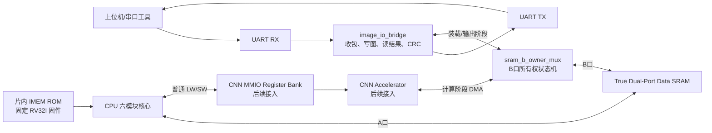

# FPGA 固定固件与 Data SRAM 图像输入输出方案

## 2026-10-08 六模块实际实现更新

当前板级顶层为 `rtl/soc/face_soc_top.sv`：六个平级大模块 `cpu_core / cnn / datasram / IEM / image_bridge / clock_unit`。CNN 的原生 mem_* 直接接 datasram，**不经过 CPU**；B 口仲裁和读写完成时序已写进 datasram 内部，不再实例化旧 CPU 存储子系统、独立适配器或系统 B 仲裁器。CPU A 口保留固定一拍，Control C1 和原 Datapath 计算模块不变。

UART 图像桥和时钟复位模块本次已有实际 RTL。图像桥为 IMIO 分块读写 + CRC32；时钟直通、复位三拍同步释放。封装 7 根数字 I/O，busy 灯是图像桥忙，不是 CNN busy。CNN 自带 MMIO：QUEUE_BASE=+0x08、TASK_COUNT=+0x18、START=0x3D；图像桥 error 保留，CNN 存储错误锁存 cnn_mem_fault，恢复需系统复位。

当前接线以 [顶层三组线小白说明](../SoC顶层连线与总体IO说明_小白版.md) 为准；另见 [六模块图](../docs/SoC芯片封装与内部IO层级连接图.md)、[修改说明](../docs/CNN实际代码整合修改说明_小白版.md)、[UART 协议](../docs/uart_image_bridge_protocol.md)、[本次验证](../docs/soc_six_module_verification_20261008.md)。编译清单 `rtl/filelists/system_cnn.f`；测试 `python scripts/run_cnn_integration.py`。

**下面保留原章节作为注明日期的历史记录。** 其中“CPU 存储子系统”“外置 sram_b_arbiter”“image_io_bridge / clock_reset_unit 待实现”、旧 IMG0 协议草案、旧 stub 和旧逐层 MMIO 不再是当前板级接线依据。CPU C1 基本规则仍适用；历史仿真不代表本次板级上板通过。

## 1. 结论

推荐采用下面的系统结构：

1. CPU 指令预先固化在 FPGA 片内 `IMEM ROM` 中，上电后从地址 0 自动运行，不设置外部指令下载或软件控制端口。
2. 外部图像通过 `UART RX` 进入 `image_io_bridge`，由它写入双口 Data SRAM 的 B 口。
3. CPU 始终使用 Data SRAM A 口。
4. Data SRAM B 口由 `image_io_bridge` 和 CNN DMA 分时使用：装载图像时归输入桥，计算时归 CNN，输出结果时再归输入输出桥。
5. 结果由 `image_io_bridge` 从 Data SRAM B 口读出，并通过 `UART TX` 发送到板外。
6. 第一阶段使用 `64×64×1` 灰度、signed int8 图像，只验证“输入—SRAM—固定程序处理—SRAM—输出”的完整板级链路。
7. `112×112×3`、signed int8 可以作为后续 CNN 目标格式，但当前真实 CNN 和数据格式尚未冻结，不能现在就宣称完整支持该人脸输入。

这里的“不接受软件控制”应理解为：**CPU 不接收外部动态程序，程序在生成 bitstream 时已经固化**。CPU 仍然执行指令，这些指令属于固定固件。如果完全不要任何指令或固件，就应该删除 CPU，改成专用状态机；那会改变当前系统架构，不建议在本阶段这样做。

## 2. 当前工程实际能做到什么

### 2.1 已经具备

- RV32I 五级流水 CPU Control。
- 生产 Datapath。
- CPU 与生产 Datapath 的 ADD 和混合程序 XSim 联调通过。
- Data SRAM CPU 侧地址、写数据、字节使能、读写请求和读返回接口。
- CNN MMIO 地址路由的仿真替身。
- 默认 Data SRAM 地址窗口为 256 KiB：`0x0000_0000～0x0003_FFFF`。

### 2.2 尚未具备

- 可综合的 FPGA 双口 Data SRAM wrapper。
- 外部图像接收模块。
- Data SRAM B 口所有权切换模块。
- 真实 CNN DMA、卷积计算和结果写回。
- 真实 CNN MMIO 寄存器组。
- 已冻结的人脸模型输入尺寸、RGB/BGR/灰度规则和归一化参数。
- 最终输出是分类分数还是 embedding 的共同结论。
- 完整 FPGA 综合、时序收敛、引脚约束和上板验证。

因此，当前最合理的上板目标不是立刻宣称“人脸识别完成”，而是先完成一条可以实际测量的 Data SRAM 图像输入输出通路。

## 3. 推荐的 FPGA 顶层结构



`image_io_bridge`、`sram_b_owner_mux`、真实双口 SRAM wrapper 和 UART 收发器是需要新增的系统集成硬件。它们不改变 CPU 内部 Control/Datapath 行为。

## 4. 固定指令方案

### 4.1 IMEM 实现

将程序编译成 RV32I 机器码，在综合前生成 `.mem` 或 `.coe` 初始化文件，实例化为片上 Block RAM ROM：

```text
复位 PC = 0x0000_0000
IMEM[0]  = 第一条固定指令
IMEM[1]  = 第二条固定指令
...
```

FPGA 上电或复位释放后，CPU 自动执行，不需要 UART、JTAG 或主机向 CPU 写入指令。JTAG 只作为 FPGA 下载 bitstream 和调试手段，不属于 CPU 运行控制接口。

当前 Datapath 的 IMEM 接口是：

| 信号 | 位宽 | 方向（相对 CPU） | 用途 |
|---|---:|---|---|
| `imem_addr` | 32 | 输出 | 指令字节地址 |
| `imem_re` | 1 | 输出 | 指令读取请求 |
| `imem_rdata` | 32 | 输入 | 固定一周期同步返回的指令 |

IMEM wrapper 必须继续满足固定一周期同步返回，不增加 `ready`。

### 4.2 固定固件流程

第一阶段建议固定程序执行以下循环：

```text
等待 SRAM 邮箱 FRAME_READY = 1
读取图像头并检查 width/height/channels/length
读取像素并计算 checksum，或执行简单阈值/拷贝测试
把结果记录写入 RESULT 区
写 RESULT_READY = 1
清 FRAME_READY
等待下一帧
```

接入真实 CNN 后，固定程序改为：

```text
等待 FRAME_READY
检查图像参数
通过 CNN MMIO 写 INPUT_ADDR/OUTPUT_ADDR/WEIGHT_ADDR/BIAS_ADDR
写 IMAGE_SIZE/CHANNELS/CNN_PARAM
最后写 CONTROL.start
轮询 STATUS.done/error
对分类分数执行 argmax，或读取 embedding
把最终结果写入 RESULT 区
写 RESULT_READY
```

这仍是固定固件，不需要板外软件对 CPU 发命令。

## 5. 当前建议输入图像大小

### 5.1 现在上板：`64×64×1` 灰度 signed int8

这是当前阶段最稳妥的板级输入格式：

| 项目 | 建议值 |
|---|---|
| 宽度 | 64 像素 |
| 高度 | 64 像素 |
| 通道数 | 1，灰度 |
| 每像素 | signed int8 |
| 布局 | HWC；单通道时就是逐行连续 |
| 图像数据量 | `64×64×1 = 4096` 字节 |
| SRAM 字数 | 1024 个 32 位字 |
| 地址对齐 | 首地址 4 字节对齐 |

选择 64×64 灰度的原因：

- 4096 字节正好便于计数和检查。
- UART 传输和仿真时间都较短。
- 不依赖尚未冻结的 RGB/BGR 顺序。
- 可以先证明 FPGA 引脚、UART、B 口写入、CPU A 口读取和结果回传全部正确。
- 它只是板级联调格式，不代表最终人脸网络输入规格。

若上位机原图为普通 `0～255` 灰度，建议在发送前转换：

```text
signed_pixel = unsigned_gray - 128
```

然后把有符号 8 位二进制原样发送。四个连续像素按小端顺序打包进一个 32 位 SRAM 字：

```text
word[7:0]   = pixel[n+0]
word[15:8]  = pixel[n+1]
word[23:16] = pixel[n+2]
word[31:24] = pixel[n+3]
```

### 5.2 后续 CNN 目标：`112×112×3` signed int8

如果最终模型采用常见的人脸网络输入，可以考虑：

| 项目 | 候选值 |
|---|---|
| 宽度 | 112 像素 |
| 高度 | 112 像素 |
| 通道数 | 3 |
| 每通道 | signed int8 |
| 布局 | HWC，通道最内层连续 |
| 单帧大小 | `112×112×3 = 37,632 = 0x9300` 字节 |
| 32 位字数 | 9,408 字 |

单帧原始图像可以放入当前默认 256 KiB Data SRAM。但这只能说明“输入缓冲放得下”，不能说明完整 CNN 放得下：权重、bias、两块中间特征图和最终结果也要占用 SRAM，完整模型很可能需要外部 DDR、权重 ROM 或逐层流式装载。

在 CNN 负责人正式冻结以下项目之前，112×112×3 只能作为候选，不能写成已经支持：

- RGB 还是 BGR；
- 每通道零点、缩放系数和归一化公式；
- HWC 是否最终确认；
- 最终模型的每层最大特征图；
- 权重总量和存储位置；
- 输出是类别分数还是 embedding。

### 5.3 当前真正的功能边界

| 阶段 | 可输入大小 | 当前能得到的输出 |
|---|---|---|
| 现有仿真工程 | 没有真实外部图像输入 | CPU 指令执行结果；CNN 仅为 MMIO stub |
| 第一阶段 FPGA SRAM 联调 | 推荐 64×64×1，4096 字节 | SRAM 回读、CRC/checksum、简单阈值或复制结果 |
| 单层 CNN 联调 | 先使用规格中的 4×4×1 手算向量，再扩大 | 单层卷积输出特征图 |
| 完整人脸网络 | 候选 112×112×3 | 分类分数或 embedding，尚待冻结 |

## 6. Data SRAM 容量与地址规划

按生产 Datapath 当前默认参数：

```text
SRAM_BASE = 0x0000_0000
SRAM_SIZE = 0x0004_0000  // 256 KiB
```

### 6.1 第一阶段 64×64 灰度规划

| 地址范围 | 大小 | 用途 | 写入方 | 读取方 |
|---|---:|---|---|---|
| `0x0000_0000～0x0000_00FF` | 256 B | 邮箱与描述符 | 输入桥/CPU | CPU/输入桥 |
| `0x0000_0100～0x0000_0FFF` | 3.75 KiB | CPU 栈和固定固件数据 | CPU | CPU |
| `0x0000_1000～0x0000_1FFF` | 4 KiB | 64×64×1 输入图像 | 输入桥 | CPU/CNN |
| `0x0000_2000～0x0000_2FFF` | 4 KiB | 输出/回读缓冲 | CPU/CNN | 输出桥 |
| `0x0000_3000～0x0003_FFFF` | 244 KiB | 权重、bias、scratch 或后续扩展 | 初始化器/CNN | CNN/CPU |

### 6.2 112×112×3 候选规划

| 地址范围 | 大小 | 用途 |
|---|---:|---|
| `0x0000_0000～0x0000_0FFF` | 4 KiB | 邮箱、CPU 栈和固定数据 |
| `0x0000_1000～0x0000_A2FF` | `0x9300` B | 输入图像 |
| `0x0000_B000～0x0001_42FF` | `0x9300` B | ping/pong 特征缓冲候选区 |
| `0x0001_5000～0x0003_FFFF` | 172 KiB | 权重、bias、其他特征和结果 |

第二张表只是容量预规划。必须拿到真实网络每层 tensor 和权重清单后重新计算峰值，不能直接用它完成完整网络。

## 7. Data SRAM 应该增加哪些接口

推荐使用 FPGA True Dual-Port Block RAM。

### 7.1 A 口：CPU 固定使用

保持现有 Datapath 接口，不修改 CPU：

| 信号 | 位宽 | 方向（相对 SRAM） | 连接对象 |
|---|---:|---|---|
| `a_addr` | 32 | 输入 | CPU `dmem_addr` |
| `a_wdata` | 32 | 输入 | CPU `dmem_wdata` |
| `a_be` | 4 | 输入 | CPU `dmem_wstrb` |
| `a_re` | 1 | 输入 | CPU `dmem_re` |
| `a_we` | 1 | 输入 | CPU `dmem_we` |
| `a_rdata` | 32 | 输出 | CPU `dmem_rdata` |

CPU 使用字节地址。BRAM wrapper 内部通常用 `addr[17:2]` 选择 256 KiB 中的 32 位字，并用 `addr[1:0]` 配合字节使能。

### 7.2 B 口：输入桥/CNN/输出桥分时使用

沿用项目规格中的主接口：

#### 主设备到 SRAM B 口

| 信号 | 位宽 | 用途 |
|---|---:|---|
| `b_req` | 1 | 发起访问并保持到接受 |
| `b_we` | 1 | 1=写，0=读 |
| `b_addr` | 32 | 字节地址，4 字节对齐 |
| `b_wdata` | 32 | 写数据 |
| `b_be` | 4 | 字节写使能 |

#### SRAM B 口到主设备

| 信号 | 位宽 | 用途 |
|---|---:|---|
| `b_gnt` | 1 | 本周期接受请求 |
| `b_rvalid` | 1 | 读返回有效 |
| `b_rdata` | 32 | 读返回数据 |
| `b_error` | 1 | 越界或冲突错误；第一版可固定为 0，但建议实现越界检查 |

`image_io_bridge` 和 CNN DMA 都使用这一套接口，通过 `sram_b_owner_mux` 选择当前所有者，不把两个主设备直接并联。

### 7.3 B 口所有权状态

| 状态 | B 口所有者 | 允许行为 |
|---|---|---|
| `LOAD` | `image_io_bridge` | 写图像和描述符 |
| `READY` | 无或输入桥 | 等待 CPU 确认；不允许覆盖输入缓冲 |
| `PROCESS` | CNN DMA | 读取图像/权重并写输出 |
| `DUMP` | `image_io_bridge` | 读取结果并通过 UART 发送 |
| `ERROR` | 无 | 禁止写 SRAM，等待全局复位或明确恢复 |

所有权只允许在没有未完成 B 口读请求时切换。第一版限制最多一个未完成读请求，能显著简化状态机。

## 8. FPGA 板级输入 I/O

在尚未指定 FPGA 板卡和摄像头型号的情况下，第一版推荐 UART，而不是直接接摄像头。UART 几乎所有开发板都能实现，容易用 PC 文件作为精确测试向量。

### 8.1 第一版最少板级引脚

| 顶层端口 | 方向（相对 FPGA） | 位宽 | 连接对象 | 用途 |
|---|---|---:|---|---|
| `sys_clk` | 输入 | 1 | 板载晶振 | 系统时钟 |
| `rst_n` | 输入 | 1 | 按键/复位芯片 | 全局低有效复位 |
| `uart_rx` | 输入 | 1 | USB-UART TX | 图像包输入 |
| `uart_tx` | 输出 | 1 | USB-UART RX | 结果包输出 |
| `led_ready` | 输出 | 1 | LED | 可接收下一帧 |
| `led_busy` | 输出 | 1 | LED | 正在装载或处理 |
| `led_error` | 输出 | 1 | LED | CRC、越界或 CNN 错误 |

真正连接 Data SRAM 的不是 `uart_rx` 引脚，而是 `image_io_bridge` 解析串口后形成的 B 口请求。不要把异步串口信号直接接到 BRAM 数据端口。

### 8.2 UART 输入包

推荐包格式：

| 字段 | 字节数 | 建议值/含义 |
|---|---:|---|
| `magic` | 4 | 固定 `IMG0` |
| `frame_id` | 4 | 帧编号 |
| `width` | 2 | 第一阶段为 64 |
| `height` | 2 | 第一阶段为 64 |
| `channels` | 1 | 第一阶段为 1 |
| `format` | 1 | 0=`S8_GRAY`，后续可定义 RGB |
| `reserved` | 2 | 写 0 |
| `payload_bytes` | 4 | 第一阶段为 4096 |
| `payload` | 可变 | 图像字节 |
| `crc32` | 4 | 从头部到 payload 的 CRC32 |

输入桥只有在 magic、长度、尺寸和 CRC 全部正确后，才置 `FRAME_READY=1`。错误包不得启动 CPU/CNN 处理。

### 8.3 传输时间估算

UART 通常每字节包含起始位和停止位，按 10 bit/byte 粗略计算：

| 波特率 | 64×64×1，4096 B | 112×112×3，37,632 B |
|---:|---:|---:|
| 115200 | 约 0.36 s | 约 3.27 s |
| 921600 | 约 0.045 s | 约 0.41 s |

这里未计入包头、CRC和主机间隔。第一版使用 921600 baud 比较合适，但最终值要结合板载时钟的分频误差确认。

### 8.4 后续直接摄像头输入

若以后接 DVP 摄像头，典型板级输入为：

| 信号 | 方向（相对 FPGA） | 典型位宽 | 用途 |
|---|---|---:|---|
| `cam_pclk` | 输入 | 1 | 像素时钟 |
| `cam_vsync` | 输入 | 1 | 帧同步 |
| `cam_href` | 输入 | 1 | 行/像素有效 |
| `cam_data` | 输入 | 8 | 像素数据 |
| `cam_xclk` | 输出 | 1 | 摄像头参考时钟 |
| `cam_scl` | 双向/输出 | 1 | 摄像头配置时钟 |
| `cam_sda` | 双向 | 1 | 摄像头配置数据 |

摄像头像素时钟通常与 CPU 时钟不同，必须增加异步 FIFO 或双时钟帧缓存，并完成裁剪、缩放、RGB/YUV 转换和 int8 量化。它不适合作为第一次 SRAM 上板测试。

## 9. 输出是什么线、输出什么数据

### 9.1 第一阶段输出

第一阶段建议输出到 `uart_tx`，不要先做 VGA/HDMI。输出内容不是完整处理后图像，而是固定长度结果记录：

| 字段 | 字节数 | 含义 |
|---|---:|---|
| `magic` | 4 | 固定 `RES0` |
| `frame_id` | 4 | 对应输入帧 |
| `status` | 4 | 0=成功，其他=错误码 |
| `result_type` | 4 | 0=checksum，1=分类，2=embedding，3=图像回读 |
| `payload_bytes` | 4 | 后续 payload 长度 |
| `payload` | 可变 | checksum、类别分数、embedding 或回读图像 |
| `crc32` | 4 | 输出记录 CRC32 |

最开始的 `payload` 建议只放：

```text
pixel_count : 32 bit
sum         : 32 bit
xor_value   : 32 bit
```

这样最容易证明每个像素确实进入 SRAM 并被 CPU 读取，而不是仅证明 UART 收到了数据。

### 9.2 接入 CNN 后的输出

有两种合理模式：

#### 闭集分类模式（建议先做）

Data SRAM 的 `OUTPUT_ADDR` 保存每个类别的分数。固定 CPU 程序执行 argmax，向 UART 输出：

```text
frame_id
result_id      // 识别类别/人员编号，建议 32 bit
best_score     // 分数的实际定点格式由 CNN 冻结
status
```

这种模式输出短、无需 CPU 做大量乘法，适合当前 RV32I。

#### embedding 模式（后续）

Data SRAM 的 `OUTPUT_ADDR` 保存 N 维 int8/int16 embedding，输出桥通过 UART 发出完整向量，或 CPU 与数据库匹配后只输出人员编号。当前 N、定点格式、归一化和相似度算法均未冻结，不能现在定义具体线宽。

### 9.3 可选并行结果端口

如果系统外部不是 PC，而是另一个 FPGA/MCU，可以在顶层增加简单结果握手：

| 信号 | 方向（相对 FPGA） | 位宽 | 含义 |
|---|---|---:|---|
| `result_valid` | 输出 | 1 | 结果有效并保持 |
| `result_ready` | 输入 | 1 | 外部接收结果 |
| `result_id` | 输出 | 32 | 类别/人员编号 |
| `result_score` | 输出 | 32 | 定点分数 |
| `result_error` | 输出 | 1 | 本帧处理失败 |

这组端口只适用于最终结果，不用于传整张图像。第一版只用 UART 可以减少引脚和协议工作量。

## 10. SRAM 邮箱定义

建议在 SRAM 前 256 字节放置硬件桥和固定固件共享的邮箱：

| 偏移 | 名称 | 写入方 | 含义 |
|---:|---|---|---|
| `0x00` | `FRAME_READY` | 输入桥/CPU 清除 | 1=完整有效帧已写入 |
| `0x04` | `FRAME_ID` | 输入桥 | 帧编号 |
| `0x08` | `IMAGE_ADDR` | 输入桥 | 默认 `0x00001000` |
| `0x0C` | `WIDTH_HEIGHT` | 输入桥 | `[31:16]=height`，`[15:0]=width` |
| `0x10` | `CHANNEL_FORMAT` | 输入桥 | 通道数和格式编码 |
| `0x14` | `PAYLOAD_BYTES` | 输入桥 | 图像字节数 |
| `0x18` | `INPUT_CRC32` | 输入桥 | 已验证的输入 CRC |
| `0x20` | `RESULT_READY` | CPU/CNN 流程 | 1=结果可读取 |
| `0x24` | `RESULT_ADDR` | CPU | 默认 `0x00002000` |
| `0x28` | `RESULT_BYTES` | CPU | 结果长度 |
| `0x2C` | `RESULT_TYPE` | CPU | checksum/分类/embedding/回读 |
| `0x30` | `RESULT_STATUS` | CPU | 成功或错误码 |

必须规定每个字段只有一个写入者。输入桥不能在 `FRAME_READY=1` 且尚未被 CPU 清除时覆盖输入区。

## 11. 时钟、复位和跨时钟域

- CPU、IMEM、Data SRAM、CNN 和 SRAM B 口仲裁器优先使用同一系统时钟。
- UART RX 必须经过同步器和波特率采样逻辑，不能直接进入系统状态机。
- 如果摄像头使用独立 `cam_pclk`，必须使用异步 FIFO/双时钟缓冲。
- 外部按键复位需要消抖；异步输入复位建议异步拉低、同步释放后再送入现有同步复位逻辑。
- Data SRAM A/B 口同地址同时写的行为依赖 FPGA BRAM 配置，第一版必须通过所有权和地址区间避免这种冲突，不能依赖器件未定义行为。

## 12. 推荐实施步骤

### 阶段 A：只验证固定 IMEM

1. 把已经通过仿真的 ADD/混合程序转成 IMEM 初始化文件。
2. 实例化同步 BRAM ROM，确认 CPU 上电自动运行。
3. 用 LED 或 ILA 观察完成标志。

### 阶段 B：验证 Data SRAM A 口

1. 实例化 256 KiB True Dual-Port BRAM wrapper。
2. CPU A 口连接现有 `dmem_*`。
3. 固定程序完成 SRAM walking-1、地址和字节写使能测试。

### 阶段 C：加入 UART 图像输入输出

1. 实现 UART RX/TX、输入包解析和 CRC。
2. 输入桥通过 B 口写入 64×64 灰度图。
3. CPU 固定程序计算 sum/xor/checksum 并写结果区。
4. 输入输出桥读取结果并通过 UART TX 返回。
5. 对比 PC 端原图计算结果与 FPGA 返回值。

### 阶段 D：接 CNN stub

1. 增加 B 口所有权切换。
2. CNN stub 从输入区读若干字并向输出区写可预测结果。
3. CPU 通过真实 MMIO 寄存器组启动、轮询和读取结果。

### 阶段 E：接真实 CNN

1. 先运行规格中的 4×4×1 手算卷积向量。
2. 冻结真实模型输入、权重和输出格式。
3. 统计每层峰值 SRAM 占用。
4. 再决定使用 64×64×1、112×112×3，或增加外部 DDR。
5. 完成系统仿真、综合、时序分析、ILA 抓取和多帧上板测试。

## 13. 上板前必须补齐的信息

以下信息与具体 FPGA 板卡有关，拿到板卡型号后才能生成最终 XDC/QSF 引脚约束：

- FPGA 开发板型号和器件型号；
- 板载晶振频率；
- 可用 Block RAM 总容量；
- USB-UART 芯片及对应 FPGA 管脚；
- I/O 电压标准；
- 是否带摄像头接口、外部 DDR、VGA 或 HDMI；
- 目标系统时钟和 UART 波特率。

如果板上 BRAM 小于 256 KiB，必须缩小 Data SRAM 参数或使用外部存储器；这会影响现有地址窗口和存储时序，需要重新验证，不能只改综合约束。

## 14. 最终建议

当前立即实施的版本应定为：

```text
固定 RV32I IMEM ROM
+ 256 KiB True Dual-Port Data SRAM
+ CPU A口
+ UART图像桥/CNN分时B口
+ 64×64灰度signed-int8输入
+ UART结果输出
```

第一版输出 checksum 和 SRAM 回读，证明 FPGA 数据链闭环。随后接 CNN stub，再接真实单层 CNN。只有在真实 CNN、权重、量化和最终输出格式冻结并通过验证后，才把输入升级为正式人脸图像尺寸并宣称人脸识别功能。
