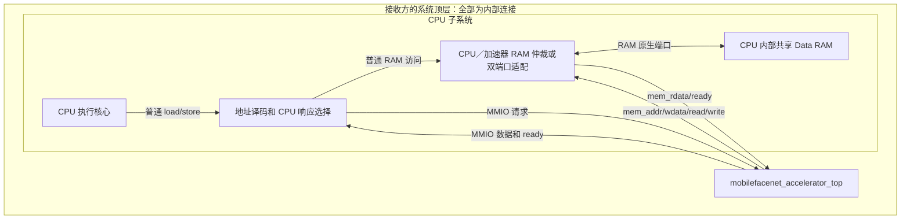

# CPU 内部 RAM 与加速器对接及代码交付说明

适用版本：当前 FPGA1 任务队列、多算子、共享 8×8 脉动阵列版本。核对日期：2026-10-06。

本文面向接收本项目代码、负责 CPU 集成的同学。当前尚未提供目标 CPU 的 RTL、总线协议和 RAM 型号，因此本文定义连接契约和集成步骤；示例连线需要在接收方 CPU 工程中适配，不表示已完成具体 CPU 联调。

## 1. 本次集成的边界

**CPU 内部的 Data RAM 同时保存任务描述符、输入、权重、参数和结果。加速器通过系统内部连线访问这块 RAM，不需要连接板外存储器，也不需要额外的数据引脚。**

原文档中的“外部 RAM”是指“在加速器模块边界之外”，并不要求它位于芯片外部。RAM 可以保留在 CPU 子系统内部。

加速器顶层有两组功能接口：

- **MMIO 从接口**：CPU 向加速器下发队列地址、任务数和启动命令，并读取状态。
- **Memory Master 接口**：加速器主动访问 CPU 子系统里的共享 RAM。

因此只有 MMIO 接线是不够的。若 CPU 目前把 RAM 完全封装在内部、没有第二访问入口，需要由 CPU 侧增加内部 RAM 访问端口，或修改 RAM 前面的访问选择逻辑。

这里的“增加端口”指 HDL 模块端口和系统内部连线，不是要求添加芯片外部管脚。CPU 不需要新增指令集，已有的普通内存读写指令即可操作 MMIO。

## 2. 推荐层次与双方负责的工作



图中 MMIO 和加速器访存是两条用途不同的路径。CPU 读 STATUS 时，不能被错误地当成 Data RAM 访问。

| 项目 | 本项目已提供 | CPU 集成方需要提供 |
| --- | --- | --- |
| 任务读取、依赖检查、执行调度 | 已提供 | 按约定准备 RAM 中的任务表 |
| 阵列和六个独立算子 | 已提供 | 不需要改成 CPU 指令 |
| 加速器内部九路访存仲裁 | 已提供 | 它不含 CPU 的访存请求 |
| 加速器简单 RAM 主接口 | 已提供 | 接入 CPU 内部 RAM，并正确返回完成信号 |
| CPU 地址译码、MMIO 总线适配 | 未提供目标 CPU 版本 | 由 CPU 方实现 |
| CPU 与加速器共享 RAM 的仲裁／双端口适配 | 未提供目标 RAM 版本 | 由 CPU 方实现 |
| CPU 程序、链接脚本、缓存处理 | 未提供目标 CPU 版本 | 由 CPU 方实现 |
| 仿真 RAM 和 MMIO 测试程序 | `tb/` 中已提供 | 可参考，不作为真实 CPU 或综合 RAM 使用 |

加速器与 CPU 可实例化在共同的系统顶层；也可以把加速器作为 CPU 子系统的子模块。选择哪种层次不影响协议，但所有 RAM 访问必须有实际连线，不能只在两个模块里声明相同信号名。

## 3. 别人拿到代码后放在哪里

建议保留完整 FPGA1 目录，作为接收方工程的一个 IP 子目录：

```text
接收方工程/
├─ rtl/
│  ├─ system_top.sv                 接收方系统顶层
│  └─ cpu_subsystem/               原 CPU、RAM 和新增适配逻辑
├─ ip/
│  └─ FPGA1/
│     ├─ rtl/                      本项目的可综合硬件
│     ├─ tb/                       本项目独立测试与仿真 RAM
│     ├─ scripts/                  验证、参考模型和任务生成
│     ├─ examples/                 可修改的测试输入
│     ├─ docs/                     包含本文及任务协议
│     ├─ requirements.txt
│     └─ README.md
└─ software/                       接收方 CPU 程序
```

### 3.1 硬件工程中加入什么

1. 加入 `FPGA1/rtl/files.f` 列出的 **25 个 SystemVerilog 文件**，按 SystemVerilog 模式编译。
2. 在接收方系统顶层实例化 **`mobilefacenet_accelerator_top`**。
3. 接收方工程的综合顶层仍然是自己的 `system_top`，不是本项目的 Testbench。
4. 不要加入其他历史版本的同名模块，避免重复定义。

`rtl/files.f` 中的路径以 **FPGA1 根目录**为基准，例如 `rtl/accelerator_regs.sv`。从接收方工程根目录编译时，要给这些路径加 `ip/FPGA1/` 前缀，或使用工具的文件路径配置。不能假定所有工具都会自动相对于 `files.f` 所在目录解析路径。

生产清单包含一些工具模块，综合工具会处理未被顶层使用的模块。接收方先完整使用清单，不需要为了删文件而重新梳理依赖。

### 3.2 不要加入综合的内容

- `tb/`、`tb/support/`：测试平台、仿真 RAM 和独立阵列教学模块。
- `scripts/`：主机上运行的 Python 工具，不是 CPU 固件或 FPGA RTL。
- `build/`：可再生成的 VVP、VCD、日志、测试数据和备份。
- `.git/`、`.deps/`：不作为硬件源码交付依赖；接收方按环境安装 Python 依赖。

交付时保留上述 `rtl/tb/scripts/examples/docs`、`requirements.txt` 和 `README.md` 即可支持源码阅读和重新验证。旧的 `docs/integration/` 是历史资料，**本次 CPU 接口以本文和 `heterogeneous_ops.md` 为准**。

## 4. 顶层端口应该接到谁

端口方向相对于加速器。

| 端口 | 方向／位宽 | 接收方连接位置 | 含义 |
| --- | --- | --- | --- |
| `clk` | 输入 1 | 系统计算时钟 | 第一版建议 CPU 总线适配、加速器和 RAM 适配同一时钟域 |
| `rst_n` | 输入 1 | 系统低有效复位 | 同时协调 RAM 适配与仲裁状态复位 |
| `mmio_addr` | 输入 32 | CPU 译码／总线桥输出 | 完整 MMIO 字节地址 |
| `mmio_wdata` | 输入 32 | CPU 写数据 | 控制寄存器写入值 |
| `mmio_we` | 输入 1 | CPU 总线桥的有效写请求 | 仅访问本加速器地址时产生 |
| `mmio_re` | 输入 1 | CPU 总线桥的有效读请求 | 仅访问本加速器地址时产生 |
| `mmio_rdata` | 输出 32 | CPU 读数据选择器／总线桥 | 配置或 STATUS 读回内容 |
| `mmio_ready` | 输出 1 | CPU 总线桥／等待控制 | 本次 MMIO 请求可以接受 |
| `mem_addr` | 输出 32 | CPU 子系统的加速器 RAM 入口 | RAM 字节地址，实际外部请求为 4 字节对齐 |
| `mem_wdata` | 输出 32 | 同一 RAM 入口的写数据 | 写入一个完整的 32 位字 |
| `mem_read` | 输出 1 | 同一 RAM 入口的读请求 | 请求读取 RAM |
| `mem_write` | 输出 1 | 同一 RAM 入口的写请求 | 请求写入 RAM |
| `mem_rdata` | 输入 32 | RAM 适配器返回数据 | 已完成的 RAM 读取结果 |
| `mem_ready` | 输入 1 | RAM 适配器完成通知 | 当前 RAM 读／写在本次握手上升沿完成 |

没有单独的外部 `start/done/irq` 引脚，也没有直接输出特征向量的端口。CPU 通过 MMIO 启动和查询；结果位于共享 RAM。

### 顶层实例化模板

下面是连接模板，`cpu_acc_*` 和 `acc_ram_*` 必须由接收方的总线／RAM 适配逻辑实际驱动或接收；它不是一个可独立运行的完整系统。

```systemverilog
mobilefacenet_accelerator_top #(
    .BASE_ADDR(32'h4000_0000),
    .TASK_PREFETCH_DEPTH(4)
) u_accelerator (
    .clk         (sys_clk),
    .rst_n       (sys_rst_n),
    .mmio_addr   (cpu_acc_addr),
    .mmio_wdata  (cpu_acc_wdata),
    .mmio_we     (cpu_acc_we),
    .mmio_re     (cpu_acc_re),
    .mmio_rdata  (cpu_acc_rdata),
    .mmio_ready  (cpu_acc_ready),
    .mem_addr    (acc_ram_addr),
    .mem_wdata   (acc_ram_wdata),
    .mem_read    (acc_ram_read),
    .mem_write   (acc_ram_write),
    .mem_rdata   (acc_ram_rdata),
    .mem_ready   (acc_ram_ready)
);
```

若 CPU 数据总线、RAM 或加速器不在同一时钟域，接收方必须增加跨时钟请求／响应桥，不能直接连接这些多位信号。当前顶层不含跨时钟桥。

## 5. CPU 侧 MMIO 怎么接

CPU 执行普通 load/store 后，由地址译码选择 RAM 或加速器。加速器默认响应 `0x4000_0000` 到 `0x4000_0020` 内的 4 字节对齐地址。

| 地址 | 名称 | 软件用途 |
| --- | --- | --- |
| `0x4000_0000` | CONTROL | 写 `0x3D` 启动队列；写 `0x02` 软件复位 |
| `0x4000_0004` | STATUS | bit0 BUSY，bit1 DONE，bit2 ERROR |
| `0x4000_0008` | QUEUE_BASE | RAM 中任务表的起始字节地址 |
| `0x4000_0018` | TASK_COUNT | 队列条数，必须大于零 |
| 其他五个原地址槽位 | 保留 | 读零、写忽略，不用来配置层参数 |

RTL 仍将 QUEUE_BASE 命名为 `input_addr`，将 TASK_COUNT 命名为 `feature_size`。这两个旧名称不影响当前队列协议。

对接约定：

- MMIO 使用对齐的 32 位整字访问，无字节写使能；不要用 CPU 的 byte/halfword store 配置这些寄存器。
- `mmio_addr` 给完整地址；若总线桥只输出偏移，需要先加回基地址。也可以统一修改 `BASE_ADDR` 和 CPU 地址译码／程序。
- `mmio_we` 与 `mmio_re` 不同时置 1。
- `mmio_ready` 是地址命中且有读／写请求时的组合响应。在上升沿请求与 ready 同时有效时，写入被接受。
- **同一个 CPU 事务只允许被接受一次。**如果 CPU 总线请求跨多个时钟持续有效，总线桥要记住已经完成，不能让 `mmio_we && mmio_ready` 连续多个上升沿成立。否则同一条 START 会被重复写入，可能触发忙时启动错误。
- CPU 的读数据和 ready 只选择当前目标，不能直接把 RAM 与加速器的响应混接。
- 当前没有中断，软件轮询 STATUS。新一批任务必须等待 BUSY 清零；忙时 START 会置 ERROR，忙时队列配置写入被忽略。

若 CPU 使用 AXI/APB 等协议，接收方总线桥转换成上述接口即可；无需为了该 CPU 改写加速器内部所有模块。

## 6. CPU 内部 RAM 应怎么共享

### 6.1 单端口 RAM

需要在 CPU 访存端和加速器 `mem_*` 之间增加**系统侧仲裁／选择器**：

```text
CPU 普通 RAM 请求 ───┐
                    ├─ 系统侧仲裁／RAM 适配 ── CPU 内部单端口 Data RAM
加速器 mem_* 请求 ──┘
```

本项目的 `accelerator_mem_arbiter` 只仲裁“任务读取器＋八个执行位置”，不包含 CPU 请求，不能替代上图的系统侧仲裁。

第一版可采用按请求轮转仲裁：

1. 选择一个请求，锁存所有者、地址、读写类型和写数据。
2. 根据 RAM 的实际读写延迟完成访问。
3. 将完成通知及读数据只返回给原请求者；未选中者等待。
4. 一次事务完成后，再接受下一次。即使下一拍请求仍然为高，也必须按协议识别后续事务，不能要求请求一定先变低。

CPU 自身必须能等待 RAM。若原 CPU 默认所有 load/store 都一拍完成，需要增加等待控制，使未完成时 CPU 不错误推进或重复写入。

也可以整批把 Data RAM 交给加速器，但需要独立处理 CPU 的取指、栈和数据访问：如果指令也在同一 RAM，简单“加速器忙就停 CPU 的 RAM”可能让 CPU 连轮询程序都无法执行。整批占用时应由系统适配器明确管理所有权和事务收尾，不能仅用一个未经锁存的 BUSY 信号直接切换 RAM 输入。

### 6.2 真双端口 RAM

可让 CPU 使用端口 A，加速器经适配器使用端口 B：

```text
CPU ────────────────────── RAM 端口 A
加速器 mem_* ── 时序适配 ── RAM 端口 B
```

两端口需要访问同一份存储内容。适配器仍需把 RAM 原生读写时序转换成 `mem_ready/mem_rdata`，不能因双端口就省去完成时序处理。

双端口不消除同地址冲突。CPU 不得在任务运行期间修改其描述符、输入、权重和参数，也不得提前读取尚未完成的输出。尤其不能同时写加速器正在更新的 32 位字。

### 6.3 字节写的特殊要求

加速器外部接口没有 `wstrb`。写一个 INT8 时，内部接口执行：

```text
读旧 32 位字 → 替换其中一个字节 → 写回整个 32 位字
```

CPU 若在这两步之间修改同一字的其他字节，可能被加速器写回的旧副本覆盖。当前接口也没有向系统侧输出读改写锁信号。

因此本版集成规则是：**任务在运行期间，其输出按 4 字节向外对齐后的整个 RAM 区域由加速器独占写入。CPU 和其他主设备不能修改同一 32 位字的任何字节。**任务输入、权重、参数、队列也应保持不变；当前任务相关区域最好整体保留，等该批结束再由 CPU 使用。

CPU 可以使用独立且不重叠的 RAM 区域做其他事情或准备下一批任务。加速器调度器只能检查本队列的任务间冲突，**看不到 CPU 同时在写哪里**，CPU 与加速器的区域约束需由系统和软件保证。

## 7. RAM 时序协议：最容易接错的地方

### 7.1 请求和完成

- `mem_read=1`：有一个读请求；`mem_write=1`：有一个写请求，两者不会同时有效。
- 等待 `mem_ready` 期间，加速器保持请求、地址及写数据稳定。
- 上升沿 `mem_read && mem_ready`：读传输完成，此时 `mem_rdata` 必须是正确且已稳定的返回数据。
- 上升沿 `mem_write && mem_ready`：写传输完成，写入必须已在该完成边沿生效。
- 不应先“确认接单”就置 `mem_ready`，然后过几拍才给读数据。这个外部接口没有独立的后续 read-valid 信号。

同步 RAM 通常要先给地址，再等数据有效；适配器必须按其延迟产生 ready。不要在同步读数据尚未出来时把 ready 固定为 1。对于真正满足同拍数据时序的接口，才可使用零等待完成。

### 7.2 连续请求

字节写内部的读完成后，下一拍可以直接变成写请求，中间未必有 `mem_read || mem_write` 全零的间隔。**RAM 适配器不能在完成后一直等待请求降为零才允许下一笔事务。**应在握手完成后根据下一周期的请求重新接受。

同一请求等待多拍时，也不能每拍重复提交一次原生 RAM 操作。应记录正在执行的请求，直到交付一次完成响应。

### 7.3 地址单位与字节顺序

加速器地址是 **32 位字节地址**。若 CPU RAM 接口使用字索引：

```text
RAM 字索引 = (mem_addr - RAM_BASE) >> 2
```

先检查地址在真实 RAM 范围内，再计算索引；不能简单截断高地址而让越界访问绕回低地址。若 RAM 地址从零开始，可使用 `mem_addr >> 2`，但仍要检查容量。

RAM 的 32 位字采用小端布局：

```text
mem_rdata[ 7: 0] = RAM[mem_addr + 0]
mem_rdata[15: 8] = RAM[mem_addr + 1]
mem_rdata[23:16] = RAM[mem_addr + 2]
mem_rdata[31:24] = RAM[mem_addr + 3]
```

若 CPU 的数据布局不是小端，桥接和软件打包都要统一转换。任务描述符里的地址必须是加速器可见的 RAM 地址，不是主机 Python 地址或未转换的 CPU 虚拟地址。

当前加速器端口没有访存错误信号，ERROR 也不会自动检测 RAM 未返回或物理容量越界。集成方应限制共享 RAM 范围，CPU 程序设置等待超时，系统仿真对越界直接报错；不能把一笔非法请求永远挂起后当作正常系统。

## 8. CPU 程序如何使用

程序运行流程：

1. 为输入、权重、Bias、参数、中间结果、输出和队列划定 RAM 区域，避开 CPU 程序、栈、堆及其他外设区域。
2. 写好输入和任务描述符；固定模型的权重可预加载后重复使用。
3. 确保前面的 RAM 写入对加速器可见，再写 QUEUE_BASE、TASK_COUNT 和 START。
4. 轮询 STATUS，判断完成、错误或超时。
5. 确认 BUSY=0 且 DONE=1 且 ERROR=0，再读取最终结果。
6. 更新输入或队列后，可以启动下一批。加速器运行期间不支持向本批动态追加任务。

下面是调用顺序伪代码；`read32/write32` 需要由接收方用自己的 CPU 普通内存访问实现，不是本项目已经提供的 CPU 驱动。

```c
/* 必须配置有限的 timeout；这里只表示逻辑顺序。 */
wait_until_busy_is_zero_with_timeout();

prepare_input_weights_bias_and_descriptors_in_shared_ram();
make_ram_writes_visible_to_accelerator();

write32(0x40000008, queue_base);
write32(0x40000018, task_count);
write32(0x40000000, 0x0000003D);

for (;;) {
    uint32_t s = read32(0x40000004);
    if (s & 4) {
        /* 失败：停止使用本批输出，按需要复位并等待 BUSY 清零。 */
        handle_error();
        break;
    }
    if ((s & 3) == 2) {  /* DONE=1 且 BUSY=0 */
        make_accelerator_writes_visible_to_cpu();
        consume_output_from_shared_ram();
        break;
    }
    if (timeout_expired()) {
        handle_timeout();
        break;
    }
}
```

无缓存、按顺序访存的简单 CPU，只需按其总线约定保证写入已经完成。若存在写缓冲、缓存或乱序访存，应将共享区设为适当的非缓存区，或在启动前清理相关缓存并执行内存屏障，完成后处理输出缓存再读取。`volatile` 只能约束编译器，不能替代硬件缓存与访存顺序处理。具体操作由 CPU 架构决定，本项目没有缓存一致性协议。

发生错误或软件复位后，已完成的 RAM 写入不回滚。软件复位可能还需要等待已发出的 RAM 事务结束，故写 `CONTROL=2` 后仍要等待 BUSY=0 再复用相关区域。

## 9. 任务表怎么准备

队列起始地址必须 **32 字节对齐**，每条任务固定 32 字节，共 8 个小端 32 位字。

| 字偏移 | 内容 |
| --- | --- |
| `+0x00` | `0x00000100 OR opcode`：版本为 1，低 8 位是算子编号 |
| `+0x04` | INPUT_ADDR |
| `+0x08` | OUTPUT_ADDR |
| `+0x0C` | WEIGHT_ADDR；ADD 时为第二输入，MatMul 时为矩阵 A |
| `+0x10` | BIAS_ADDR；独立算子时为参数表地址，允许默认参数的算子可填 0 |
| `+0x14` | `(height << 16) OR width` |
| `+0x18` | `(output_channels << 16) OR input_channels` |
| `+0x1C` | LAYER_PARAM |

算子编号：0 Conv，1 Depthwise，2 ReLU6，3 ADD，6 ReLU，7 PReLU，8 MaxPool，9 MatMul，10 Requant。4、5 当前不支持。

特征布局为 CHW；普通权重按 `[输出通道][输入通道][核行][核列]`，Depthwise 按 `[通道][核行][核列]`。INT8 采用有符号二进制补码；Bias 使用小端 INT32。输出区域不能与当前任务的输入、权重、参数或任务队列重叠。

完整位定义、标量参数表、量化规则和 MatMul 布局见 [多算子与任务协议](heterogeneous_ops.md)。不能沿用旧版“通过 MMIO 写每层七个参数”的方式，也不能把旧的融合激活标志当作本版参数。

## 10. 第一次联调：一个能手算的任务

先不跑完整模型，使用现有 `tb/tb_queue_only.sv` 中同样的一条 1×1 卷积任务：

```text
输入 = 7，权重 = 2，Bias = 3，quant_shift = 0
正确输出 = 7 × 2 + 3 = 17 = 0x11
```

下面地址假定 RAM 从 0 开始，至少覆盖到 `0x81F`。这是独立测试布局；真实 CPU 系统应重定位到保留区，不能覆盖代码和栈。若使用不同 RAM 基地址，所有描述符中的地址和 QUEUE_BASE 都要同步调整。

| RAM 字节地址 | 预先写入内容 |
| --- | --- |
| `0x0100` | INT8 输入 `0x07` |
| `0x0200` | INT8 权重 `0x02` |
| `0x0300` | INT32 Bias `0x00000003` |
| `0x0400～0x0403` | 四个哨兵字节 `A5 A5 A5 A5`；结果只应替换 `0x0401` |

在 `0x0800` 写以下 8 个 32 位字：

| 描述符地址 | 写入值 | 解释 |
| --- | --- | --- |
| `0x0800` | `0x00000100` | 版本 1，普通卷积 |
| `0x0804` | `0x00000100` | 输入位于 `0x0100` |
| `0x0808` | `0x00000401` | 输出位于 `0x0401`，故意测试非整字对齐 INT8 |
| `0x080C` | `0x00000200` | 权重地址 |
| `0x0810` | `0x00000300` | Bias 地址 |
| `0x0814` | `0x00010001` | 高和宽均为 1 |
| `0x0818` | `0x00010001` | 输入、输出通道均为 1 |
| `0x081C` | `0x00000011` | kernel=1、stride=1、padding=0、quant_shift=0 |

CPU 接着执行三次 MMIO 整字写：

```text
QUEUE_BASE = 0x00000800
TASK_COUNT = 1
CONTROL    = 0x0000003D
```

完成后的预期值：

- STATUS 最终为 `0x00000002`：BUSY=0、DONE=1、ERROR=0。
- RAM `0x0400～0x0403` 为 `A5 11 A5 A5`。
- CPU 小端 32 位读取地址 `0x0400` 应得到 **`0xA5A511A5`**。
- 修改输入为 8，再启动同一队列，结果字节应变为 19，即 `0x13`，整字变为 `0xA5A513A5`。

这个例子同时验证 MMIO、队列读取、地址单位、权重和 Bias 读取、阵列计算、INT8 写回、邻近字节保护、完成状态与重复启动。

## 11. 拿到代码后先怎么运行

所有命令均在交付目录 `ip/FPGA1` 内执行，而不是接收方工程根目录。

环境：Python 3.9+、Icarus Verilog 的 `iverilog` 和 `vvp`；完整参考模型测试需要 NumPy，完整结构检查需要 Yosys，查看波形需要 GTKWave。ONNX 导出另按 `requirements.txt` 安装依赖。不要依赖原开发电脑上的绝对工具路径；将工具加入 PATH，或向测试脚本传 `--iverilog`、`--vvp`。

先验证现有独立接口和上述手算示例：

```text
python scripts/run_tests.py accelerator_mem_if queue_only
```

成功时应出现：

```text
PASS tb_accelerator_mem_if ...
PASS tb_queue_only ...
PASS: 2 testbench(es)
```

需要查看完整多算子并发波形：

```text
python scripts/operator_wave.py --open
```

波形和讲解位于 `build/operator_vectors/operators.gtkw`、`operators.vcd`、`guide.md`。VVP 是仿真可执行文件，不是波形文件。

完整现有回归：

```text
python scripts/verify_all.py
```

这些测试确认加速器与模拟 RAM 的行为；**它们不自动证明接收方新接入的 CPU、总线桥和实际 RAM 正确**。

本次文档交付时（2026-10-06）已重新运行 `accelerator_mem_if` 和 `queue_only` 两个测试，结果均为 PASS。其中队列测试实际检查了输出 17、相邻哨兵字节保持不变，以及修改输入后再次运行得到 19。此次未修改生产 RTL。

## 12. 接收方需要完成的集成验证

按以下顺序联调，每一步先确认通过，再加入下一层复杂度：

| 步骤 | 做什么 | 通过条件 |
| --- | --- | --- |
| 1 | 编译全部生产 RTL，实例化顶层 | 无缺模块、重复模块、端口位宽错误 |
| 2 | CPU 只读写 QUEUE_BASE／TASK_COUNT，不启动 | 读回值一致，MMIO 不误写 RAM，单次写只接受一次 |
| 3 | 运行第 10 节的一条任务 | STATUS=2，结果和哨兵字节完全一致 |
| 4 | RAM 加入等待周期 | 结果不变，请求保持稳定，无重复接受或丢响应 |
| 5 | CPU 在不相关区域访问 RAM，同时加速器运行 | 两侧均能完成，各自数据正确，仲裁无饥饿或死锁 |
| 6 | 修改输入并重复启动 | 输出从 17 变 19，无旧缓存或旧 DONE 误判 |
| 7 | 提交 Conv → ReLU 等依赖链和独立 ADD | 依赖任务读取新结果，独立任务可并发 |
| 8 | 测试非法描述符、忙时重复启动、软复位 | ERROR 和复位收尾符合协议，不能把残留输出当成功结果 |
| 9 | 接入真实模型数据 | 逐层与整数参考结果比较，再验证模型级输出 |

关键观察信号：CPU 实际 MMIO 请求、加速器 `mmio_ready`，外部 `mem_addr/read/write/wdata/rdata/ready`，系统 RAM 所有者，以及内部 `unit_start/unit_done/dispatch_id`。

当前未完成：目标 CPU 总线桥的实现与仿真、实际 CPU 内部 RAM 共享联调、目标 FPGA 器件映射和布局布线。文档中实例化片段与软件流程是对接说明，不是已经验证过的完整 SoC。

## 13. 交给对方时需要先确认的六件事

1. CPU 的普通数据访问接口是什么，能否等待多拍？
2. RAM 是单端口还是真双端口，同步读延迟是多少，是否与取指共用？
3. RAM 的基地址、容量，以及地址端口是字节地址还是字索引？
4. MMIO `0x4000_0000～0x4000_0020` 是否可用，是否需要改基地址？
5. CPU 是否有缓存／写缓冲，CPU、加速器和 RAM 是否同一时钟域？
6. 软件能够独占使用哪些 RAM 区域，怎样避免与代码、栈、堆和其他主设备冲突？

确定这些条件后，对方主要修改自己的系统顶层、MMIO 译码／总线桥和 RAM 共享适配，再编写 CPU 调用程序。加速器内部计算和任务格式可保持不变。

相关资料：[模块接口说明](module_interfaces.md)、[完整任务与算子协议](heterogeneous_ops.md)、[生产 RTL 清单](../rtl/files.f)、[队列示例测试](../tb/tb_queue_only.sv)。
