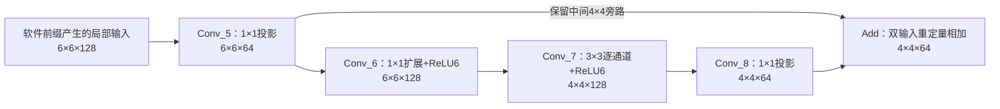

# 真实残差块：任务汇合与数据生命周期

## 目的与范围

本阶段将三槽直线流水扩展为有旁路的任务图。隔离入口是 `rtl/cnn_quant/quant_residual_scheduler.sv`，两个真实 NEureka、一个原有 `quant_post_engine`，三块 INT32 临时槽。生产六模块顶层、CPU、UART 均未修改。实际 PASS 状态及运行耗时以 `deliverables/mobilefacenet_residual/README.md` 和对应 `result.json` 为准。

验证固定 MobileFaceNet 模型的首个 Add 残差块，包含前一块的投影 Conv_5，目的是让旁路也由真实 RTL 产生：

空间坐标是完整模型内部位置：Conv_5/6 的 `[2:8,2:8]`，Conv_7/8/Add 的 `[3:7,3:7]`。软件验证浮点局部计算与完整 ONNX 对应位置吻合。硬件输入为两张真实人脸经过软件前缀计算、量化后的特征，**不是像素直接送进本块**；中间旁路和主分支没有预填金标准。

保留全部 64/128 通道和真实权重。Conv_6/7 使用 ReLU6；Conv_5/8 为线性投影，不能擅加 ReLU。线性输出及 Add 结果采用 UINT8 容器、零点128，允许表示负值。两图共用第一图冻结的诊断尺度，尚不是识别准确率校准。

## 任务与执行规则

两图共28个节点：20个卷积条带，8个 Add 行任务。每图 Conv_5/6 各3个两行条带，Conv_7/8 各2个两行条带，Add 按4行拆为4个节点。Add 分行是为了支持旁路宽度6、输出宽度4时的不同跨行步长；原后处理单元仍只接受连续元素。

卷积输出每32通道一组，64通道2组，128通道4组；组间不换实例或临时槽。配置地址为 `config_base + slot × groups × 96 + group × 96`。与旧实现的固定两组不同。

新增任务字段：

| 字段 | 含义 |
|---|---|
| program_add | 0卷积＋后处理；1双UINT8输入相加 |
| program_src_a / program_src_b | Add 的两个输入地址；卷积输入地址仍在NEureka配置内 |
| program_keep | 结果保留到外部消费；本次所有最终Add节点置1 |
| program_deps | 32位生产者完成掩码，包含所有逻辑输入/halo/旁路依赖 |
| program_layer | 3位层优先级；同类可运行节点优先后层，再按节点序号 |

依赖完成意味着生产者**最后一次输出写响应已收到**。未满足全部依赖不得发射。Add 共用后处理器，在后处理空闲时优先于待重定量的卷积条带；它不占 INT32 槽，`post_slot=3` 为“无槽”标记。卷积仍选择空闲已启用实例，不固定绑定图片。

此优先级适合有限小图。连续无限任务下的公平性、地址冲突验证、环路检测、CPU任务队列均未实现，不能直接视为通用生产调度器。描述符生成者必须提交无环、完整依赖且不越界、不重叠写的图；本入口检查非零元素、通道上限128、卷积32通道对齐及槽容量。

## 两种释放不要混淆

1. **INT32临时槽**：该条带卷积全部通道组完成，后处理读取、写回并收到最后响应后，槽才空闲。
2. **UINT8中间特征**：生产者完成仍不够。对每个节点，调度器从所有节点的 `deps` 反查消费者集合，直到每个消费者完成，且 `keep=0`，才发出 `release_pulse` 并记录 `released_mask`。

`live_mask = completed_mask & ~released_mask`。保留的最终结果不会自动释放；本实验通过系统 clear/reset 结束整个批次，没有单帧外部release接口。clear会取消在途存储并清除图/状态；重启必须复位、重新加载SRAM和描述符，不是断点续算。

这是**可回收通知**，尚不是动态地址分配器。正常用例使用固定互不重叠的特征区；压力用例在通知后立刻把对应旧数据覆盖为0xD7，验证后续真实硬件结果仍正确。该做法验证生命周期安全，不等于已经实现循环行缓存或把地址重新分给下一张图。

消费者完成采用保守判据：等消费者全部输出完成，而非最后一个输入读取就提前释放。后续可细化读取完成通知节省占用；本阶段优先保证正确。

## 存储与接入边界

本实验 `datasram_banked` 模型容量512 KiB、4 banks、21个CNN客户端；原CPU/io端在测试中空闲。两卷积实例各9路数据＋1路配置，后处理1路。**生产SoC与同学对接的256 KiB基线未修改**。

| 区域 | 地址/用途 |
|---|---|
| 帧0静态区 | 从0x01000分配，输入/权重/参数/输出/原始校验区 |
| 帧1静态区 | 从0x31000分配，同上 |
| 配置图像区 | 从0x68000分配，每组24字 |
| scratch0/1/2 | 0x70000 / 0x72000 / 0x74000，各8 KiB |

扩大模型容量方便两个帧的数据和完整逐层对照；不是部署容量结论。原始INT32金标准存放在测试文件，RTL实际卷积只写scratch；独立金标准地址不作为硬件后层输入。

NEureka宽读取可能碰到逻辑窗口以外的字节，完整读跨度必须在可访问SRAM内。回收测试覆盖本次配置实际过读；将来改尺寸/布局仍须验证，不能把逻辑依赖图当成地址安全证明。

## 验证与重现

Windows Python：`scripts/gen_mobilefacenet_residual.py build/mobilefacenet_residual_data`。

WSL：`python3 scripts/run_mobilefacenet_residual.py --data build/mobilefacenet_residual_data`。后续源代码和监视器哈希一致时加 `--reuse`，避免重复编译真实双核。制图用 `scripts/prepare_mobilefacenet_residual.py <运行目录>`。

三项：正常；实例0请求限速＋释放后覆盖；第一次Add写回中clear，复位重装后再跑。逐条带检查真实INT32，逐后处理检查UINT8；检查任务不重不丢、组绑定、槽互斥、两输入完成、释放集合、保护区、最终输出一致。波形记录控制信号与已提交读写，不记录整个阵列，以控制体积。

后续可将 `release_pulse + node_id/address/length` 交给存储分配模块；在接CPU和UART前，还需要在线提交、行就绪、输入背压、错误恢复和存储预算。这些没有被本阶段的残差汇合替代。
