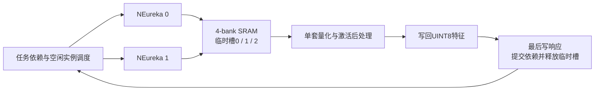

# 双卷积与后处理三槽流水设计

本阶段在 CNN 实验入口增加第三个 INT32 临时槽，让两套真实 NEureka 和一套量化/激活后处理可同时占用不同条带。新增 `quant_triple_scheduler`，原两槽模块和历史结果保留；生产 CPU/UART、顶层六模块、第三方卷积核心及 SRAM 仲裁算法不修改。



图中临时槽没有固定绑定某个卷积实例。它们用于保存INT32中间结果；输入、权重和UINT8特征同样位于SRAM的其他区域，图中只突出本次改变的交接关系。

## 槽与配置寻址

| 槽 | 首地址 | 容量 | 使用者 |
|---|---:|---:|---|
| 0 | 0x38000 | 8 KiB | 动态分配给条带 |
| 1 | 0x3A000 | 8 KiB | 动态分配给条带 |
| 2 | 0x3C000 | 8 KiB | 动态分配给条带 |

容量是静态预留，不代表每条带都写满。本测试每条带原始结果最多3072字节。三个槽均在现有256 KiB SRAM范围内；有效特征、权重、输入数据的布局不变。

每个任务的配置表由4组扩到6组，每组24个32位字：

```text
config_address = task_config_base + slot_id × 192 + channel_group × 96
slot_id = 0, 1, 2
channel_group = 0, 1
```

生成器复用上一阶段输入和金标准，只重新布局配置表并修改槽目的地址。配置区从0x34000开始，14任务共8064字节，末端为0x35F80（不含），不覆盖0x38000起的临时槽。

新增 `slot_limit[1:0]`，在start时锁存：2用于同程序两槽对照、3启用全部三槽，其他值报错。槽ID扩为2位，`slot_states[8:0]`按每槽3位打包，高位槽2、低位槽0。

## 生命周期和调度

状态编码保持0空闲、1待卷积、2卷积中、3待后处理、4后处理中；两个通道组之间仍保留条带/实例所有权。所有依赖必须已提交后处理结果，才可给新条带分配空槽。空闲卷积实例接受已就绪条带，两个实例都空闲时轮换选择；同一条带的两个通道组不迁移。

后处理接收两个通道组已写完的槽；其最后一次输出写响应到达后，才设置任务完成位并释放槽。后续卷积仍读取真实 UINT8 特征，不注入中间金标准。三个执行单元同时忙时，必须各使用不同槽。

第三槽解除此前“三个条带只能占两个槽”的限制，但不保证三者全程都有任务可执行，也不保证两倍/三倍吞吐。依赖、计算时长、后处理速率和4-bank共享带宽仍会影响进度。当前仅一个后处理实例，不含新增残差网络或多后处理派发。

## 等待信号的精确定义

| 信号 | 为1的条件 | 解读限制 |
|---|---|---|
| wait_slot | 有未分配且依赖满足的任务，但没有空槽 | 此时卷积也可能全忙，并非每拍都能通过增槽节省 |
| wait_dependency | 还有未分配任务，但这些任务没有一个依赖满足 | 不代表整个CNN空闲，上游可以正在执行 |
| wait_engine | 已有分配槽的就绪条带，但没有可接新条带的启用实例 | 不包括已占用实例内部两个通道组的衔接 |
| wait_post | 已有卷积完成的槽等待后处理，后处理尚不可接新任务 | 可能与正在计算/写回重叠 |
| mem_wait0/1 | 对应卷积客户端有请求通过测试限速门，但未获得SRAM接受 | 包括同实例九路内部的bank冲突，不能全部归因于另一个实例 |
| mem_wait_post | 后处理请求有效但未获得SRAM接受 | 当前不包含人为限速后处理 |

计数单位为周期，每个类别每拍最多加1；不同类别可同时为1，**不能相加当作总停顿时间或直接解释成性能损失百分比**。总完成周期和两槽同条件对照用于评价本例效果。

`triple_active`表示两个NEureka核心都忙且都处于MATRIXVEC计算阶段，同时后处理busy；`triple_write`在此基础上要求后处理发生实际写握手。前者不声称所有PE每拍都有有效乘加，后者提供了有效写回重叠的直接证据。

## 验证与恢复

用同一编译程序验证三槽、两槽、三槽限速＋清除复位重启；每项使用相同输入、权重、尺度和14个条带。逐条带检查INT32及UINT8结果、依赖/标签/实例绑定、槽独占、不可写区和最终输出文件一致性。三槽必须观察到第三槽重复使用和真实三方写回重叠；两槽不得出现这种三方占用或使用槽2，槽2整个区域应保持原值。

本测试平台将访存限速计数与测量周期分开，预热阶段也推进限速计数，修正旧双实例测试组合选项的预热问题。压力用例等待真实三方写回重叠后清除；清除复位后重装内存和任务表，验证完整批次。不是断点续算，也不修复/改写旧测试记录。

运行 `scripts/run_mobilefacenet_triple.py --data build/mobilefacenet_triple_data`；已编译源码及头文件哈希匹配时可加`--reuse`。缓存 `.neureka_triple_build`；不要拿历史双实例程序冒充本次三槽结果。输入生成 `scripts/gen_mobilefacenet_triple.py build/mobilefacenet_triple_data`，波形打包 `scripts/prepare_mobilefacenet_triple.py <运行目录>`。

实际结果及耗时见 [三槽交付说明](../deliverables/mobilefacenet_triple/README.md)。输入仍为SRAM预加载的两张人脸局部三层网络；完整112×112硬件推理、流式UART、循环输入行缓冲、CPU命令和整网精度尚未实现。
