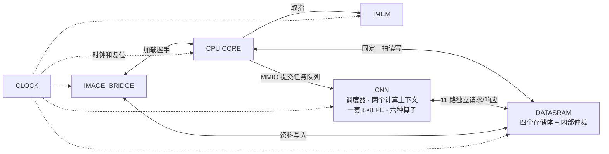

# 六模块 SoC：搬运计算重叠与多加速器共享存储

新入口为 `rtl/overlap/face_soc_overlap_top.sv`，编译清单为 `rtl/filelists/system_overlap.f`。原始 CNN、CPU 和旧 SoC 入口保留。本版本面向 RTL 仿真，采用 Gemmini 的访问/执行解耦思路，以及 SNAX 的多引擎共享多存储体思路；没有直接移植这两个项目的完整 RTL、ISA 或软件栈。

## 顶层仍然只有六个模块

| 大模块 | 本版实现 | 作用 |
|---|---|---|
| CPU CORE | cpu_core_autoload | 原 RV32I CPU，提交队列、查询状态、核对结果 |
| CNN | mobilefacenet_overlap_top | 队列、依赖调度、双上下文、共享 8×8 阵列、六种独立算子 |
| DATASRAM | datasram_banked | 默认四个交错存储体、各存储体仲裁、字节写使能 |
| IMEM | imem_rom | 保存 CPU 程序 |
| CLOCK | clock_unit | 时钟直通、复位同步释放 |
| IMAGE_BRIDGE | image_bridge_autoload | 原主动 UART 加载及 CRC 校验 |



外部仍是原来的 7 个信号。CPU 的 Control 和生产 Datapath 不改；CPU 与桥之间仍用 load_req/load_complete/load_error。LED busy 仍表示桥忙；它不表示 CNN 队列忙。

## CNN 内部如何重叠

每个计算上下文有两个操作数缓冲区，以及一个独立结果缓冲区：

```text
加载器 -> 操作数缓冲 A/B -> 原共享 PE 阵列 -> 结果快照 -> 写回器
独立读端口                                             独立写端口
```

加载器准备下一块时，阵列可以计算当前块；当前块结果保存到结果缓冲后，写回可以与下一块计算同时进行。空/满位阻止覆盖尚未计算的操作数。结果缓冲没写完时，后续最终结果会等待，不能覆盖。多次 K 归约仍在同一上下文对应的 PE 中累加，只有最后一块归约结果进入写回缓冲。

两套上下文继续按行划分同一套 64 个 PE。新增第二套操作数缓冲和结果快照的主要数据容量约为每上下文 864 字节，共约 1.7 KiB；这是 RTL 数组容量估算，不是综合面积。没有新增 PE 或复制整个 CNN。

`ENABLE_OVERLAP=0` 关闭每个上下文内部的搬运/计算/写回重叠，用于对照。不同上下文和不同算子依然可以并发，因此该配置不是“整个 SoC 全部串行”。

## 多加速器如何连接内存

原 CNN 已经有双计算上下文和六个算子单元，也有任务预取及依赖检查。此次保留这些能力，重点去掉其后所有引擎共用的单事务访存瓶颈：

| 访存通道 | 使用者 |
|---|---|
| 0 | 任务描述符读取 |
| 1、2 | 上下文 0 加载、写回 |
| 3、4 | 上下文 1 加载、写回 |
| 5～10 | ReLU6、ADD、ReLU、PReLU、MaxPool、Requant |

默认按 32 位字交错：bank = word_offset % 4。总 SRAM 容量不变。不同存储体同周期可接受不同请求，同一存储体一次只接受一个请求。CNN/桥在每个存储体内部轮询仲裁；CPU 为保持原固定一拍接口，优先占用自身访问的存储体，因此 CPU 持续访问同一存储体时可能阻塞其他访问该存储体的客户端。

请求通过 valid/ready 接受。接受后返回对应客户端的 response，读数据随 response 有效；写操作也返回完成响应。每个客户端最多保持一个未完成访问。字节写使用写使能，取消旧 CNN 路径中的读改写。CPU/桥/CNN 共享一个实际数组，不是多份不一致的存储副本。

读后写、写后读、写后写的跨任务冲突仍由原调度器检查，包含正在运行的任务和更老的待发任务。无冲突任务可以越过暂时不能运行的任务。预取窗口默认四项，最多八个执行单元在途；依赖未解除的后续网络层仍须等待。

## 软件和复位约定

- 原 MMIO 保留：队列基址 +0x08、任务数量 +0x18、启动写 CONTROL=0x3D、STATUS +0x04。任务描述符仍为 32 字节，队列基址需 32 字节对齐。
- CPU 一次提交多个任务后，硬件负责发射和依赖等待；无需 CPU 每个算子启动后等到完成再启动下一个。
- CONTROL 写 bit1 进行 CNN 软复位，清空调度/缓冲/未消费响应，停止后续请求。已经写进 SRAM 的结果不会回滚；重新执行被中断任务前，软件须恢复受影响的输入/输出。
- CNN 非法地址或非对齐字访问触发存储故障，需系统复位恢复。软复位不清除该故障。桥的 IO error 保留。
- 任务队列完成必须等待所有执行单元和访存响应排空；内存空闲检测经过一拍记录，避免启动与描述符清空之间的组合逻辑环。

## 仿真入口与任务

项目根目录运行：

```powershell
.\scripts\run_overlap_sim.ps1 -Waves
.\scripts\run_overlap_sim.ps1 -Cases overlap,restart -Seed 2
```

包装脚本默认用已有 Ubuntu-22.04 WSL；可用 -Distro 更改。内部入口是 `python3 scripts/run_overlap_integration.py --simulator verilator --waves`。Linux 需有 C++20 编译器和 make。本机使用项目内 Verilator 5.38.0，不修改系统安装；首次换机器时可在 WSL 中运行 `python3 scripts/install_local_verilator.py`。脚本从 PyPI 下载固定版本并核验 SHA256。已有 XSim 的环境可用 --simulator xsim，但本次验收工具是 Verilator。

每次运行新建 build/runs 时间戳目录，保留源文件哈希、输入资料、独立 Python 参考结果、编译日志、运行日志、任务发射/完成时间表和 result.json。--waves 生成 VCD。测试通过真实 CPU/IMEM/主动 UART 加载完整 8192 字节资料，再由 CPU 提交 19 个任务并校验最终内存校验和；测试平台额外逐字检查整个加载区域，包括结果、输入、权重、描述符和保护字节。

19 个任务包括 1×1/3×3 卷积、3×3/7×7 深度卷积、矩阵乘、ReLU/ReLU6、ADD、PReLU、池化、INT32 重量化；覆盖不满 tile 的尾块、多块归约、非对齐字节地址、INT32 输出和输出量较大的写回。独立算子与依赖任务混排；最后四个依赖任务采用不同执行单元，核对 RAW/WAR/WAW 的发射顺序。另有存储协议测试，以及分别在加载、乘加、写回阶段软复位后重新提交任务的恢复测试。

## GTKWave 看什么

运行 `python scripts/prepare_overlap_gtkwave.py build/runs/<通过的运行目录>` 后，打开 `deliverables/gtkwave_overlap/open_gtkwave.cmd`。其中 31 根信号均来自真实 VCD，完整源路径和哈希记录在 provenance.json。GTKWave 用于看波形，Verilator/XSim 用于执行 RTL。

- pe_fire_map 中的每个 1 表示对应 PE 本周期实际执行乘加；unit_busy 只表示任务在途，不能单独作为计算并行的证据。
- ctx0/1_ld_valid 与 ld_ready 同时为 1 表示读请求真正被接受。
- ctx0/1_st_valid 与 st_ready 同时为 1 表示写请求真正被接受。
- own_load_compute_count / own_store_compute_count 只累计同一个上下文的访存与 PE 运算重叠周期；同一周期两个上下文都满足时仅计一个周期。
- bank_grants 配合 bank_requests 看同周期被接受的客户端数量。单 bank 对照最多一路，四 bank 对照最多四路。
- events.csv 和 manifest.json 对照任务编号、算子、发射/完成时间。预设窗口定位第一次写回与计算重叠。

## 当前适用范围

这是片上 SRAM 到操作数缓冲的流式搬运和共享存储多引擎实现。尚未加入 DDR/AXI 突发 DMA、缓存一致性、多核 CPU、Snitch/RISC-V 自定义指令或 Gemmini 的完整软件栈。加速的是资料加载完成后的任务队列执行；UART 加载仍保留原顺序流程，小任务演示的整机时间可能主要花在 UART。完整 MobileFaceNet 权重、端到端识别精度和综合后的面积/频率不在此次验收范围。

参考：[Gemmini](https://github.com/ucb-bar/gemmini)、[SNAX](https://github.com/KULeuven-MICAS/snax_cluster)。
