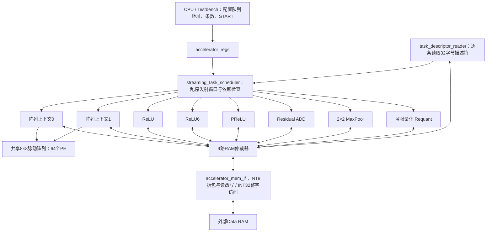

# 多算子并行加速器

本版保留 32 bit MMIO、32 bit RAM master、32 字节任务描述符。只允许任务队列启动。
运行 python scripts/operator_wave.py --open 可查看混合算子的真实仿真波形；逐行解释及实际时间表在 build/operator_vectors/guide.md。

## 模块关系

六个标量算子分别实例化 tensor_operator_engine，具有各自的FSM、参数寄存器和RAM请求。
它们不是一个需要依次执行的公共标量引擎。Conv、Depthwise、MatMul继续共享一套阵列，不复制PE。
加速器没有CPU、人脸检测或身份比较模块。

## 调度规则

- 每读完一条描述符就放入发射窗口；第一条无需等待整个队列读完。
- 每周期最多派发一条任务，选择窗口中最早的、数据和资源都已就绪的任务。
- 目标单元忙时，允许后面的独立任务先执行。例如任务0 ReLU在运行、任务1 ReLU等待，任务2 ADD可以先启动。
- 必须检查与所有在途任务以及更早的待派发任务之间的RAW、WAR、WAW。不能越过更早任务去读旧结果或覆盖它还未读取的数据。
- 按32bit RAM字对齐进行保守冲突检查，保护INT8读改写及阵列缓存。只读共享允许。
- 默认窗口容量4，可通过 TASK_PREFETCH_DEPTH 扩展。窗口外尚未读取的任务不会被调度；窗口满时取任务暂停。
- 最多8条任务在途：2条阵列任务＋6种标量任务各1条。同一种标量算子一次只执行一条。
- 阵列任务按连续PE行分配，整条任务占有这些行，任务内部继续做分块。
- 完成顺序可以不同于任务顺序。queue_completed是完成总数，dispatch_id和unit_task_ids才是原始任务编号。

busy包含读数、计算、等待和写回。多个busy同时为1说明并发在途，不代表每个单元每拍都计算。
只有一条外部RAM端口，9个客户端轮询仲裁，一次只允许一个未完成事务。阵列计算与其他算子的RAM访问可以重叠。
compute波形表示真正执行算术的时钟沿，避免把RAM等待误认为并行算术。

## 任务格式（ABI版本1）

CONTROL写0x3D启动。MMIO +0x08为任务表地址，+0x18为任务条数。
任务表必须32字节对齐；MMIO的原单层参数位置仍读0、写无效。
STATUS bit0 BUSY、bit1 DONE、bit2 ERROR。DONE表示整个队列结束。

每条描述符8个little-endian字：

|字|内容|
|---|---|
|0|[15:8]=1版本号；[7:0]=算子；[31:16]=0|
|1|INPUT_ADDR|
|2|OUTPUT_ADDR|
|3|WEIGHT_ADDR：卷积权重、矩阵A或ADD第二输入|
|4|BIAS_ADDR：阵列bias或标量参数表，标量0表示默认参数|
|5|[31:16]=height；[15:0]=width|
|6|[31:16]=output_channels；[15:0]=input_channels|
|7|LAYER_PARAM|

|编号|算子|执行单元|
|---|---|---|
|0|普通Conv，1×1或3×3|阵列|
|1|Depthwise，3×3或7×7，CI=CO|阵列|
|2|ReLU6|独立ReLU6单元|
|3|Residual ADD，同shape、不广播|独立ADD单元|
|6|ReLU|独立ReLU单元|
|7|PReLU|独立PReLU单元|
|8|MaxPool，2×2、stride2、无padding|独立MaxPool单元|
|9|MatMul|阵列，复用1×1取数和分块|
|10|Requant|独立量化单元|

4、5和其他编号保留，不执行COPY/FINAL_OUTPUT；不改变元素顺序的Flatten/Reshape由软件作为地址别名处理。
输入输出区域不允许重叠；输出也不能覆盖参数、权重或任何任务描述符。输入及权重INT8地址可以不对齐。

### LAYER_PARAM

|位|含义|
|---|---|
|[3:0]|kernel；标量为0，MaxPool为2|
|[7:4]|stride；标量为0，MaxPool为2|
|[11:8]|padding；标量必须0|
|[19:12]|最终算术右移quant_shift，0..255|
|[20]|仅Requant：输入为INT32；默认INT8|
|[21]|仅标量：每通道一条参数记录；默认所有通道共用一条|
|[22]|仅标量：比例乘法后右移使用最近舍入，恰好一半向远离0方向；默认算术截断|
|[23]|仅阵列任务：输出原始INT32；此时quant_shift必须0，OUTPUT_ADDR必须4字节对齐|
|[31:24]|保留0|

阵列任务[22:20]必须0。标量任务[31:23]必须0。旧的卷积描述符（高位0）数值行为不变。
旧的融合激活标志不再使用，须显式生成激活任务；软件打包器会拒绝融合标志。

### 矩阵布局

C[M,N] = A[M,K] × B[K,N] + bias[M]，全部row-major：
A起始地址使用WEIGHT_ADDR，B使用INPUT_ADDR，C使用OUTPUT_ADDR。
width=N，height=1，input_channels=K，output_channels=M，kernel=1，stride=1，padding=0。
Bias为M个INT32；无bias也需提供全0区域。M/N/K可小于8、大于8或非8倍数。
默认结果为右移饱和INT8；bit23为1时写INT32，可接Requant任务。

### 标量参数表

BIAS_ADDR非0时指向6个32bit字（24字节）的记录，4字节对齐。
per_channel=1时按CHW的通道顺序连续存放C条记录，否则仅存1条：

|字|名称|含义|
|---|---|---|
|0|ma|有符号INT32，A或PReLU负半轴的乘数|
|1|mb|有符号INT32，ADD的B乘数|
|2|sa|A乘法后的右移量，0..63|
|3|sb|B乘法后的右移量，0..63|
|4|offset|有符号INT32，在最终quant_shift之前相加|
|5|limit|ReLU6的量化上限，0..127；不是固定实数6|

默认记录：(1,1,0,0,0,96)。PReLU必须显式提供参数表。
INT8输入代表对称量化值；这里没有单独的输入zero-point字段。非对称输入必须先转换，不能直接当作兼容。

令 scale(x,m,s) 表示INT64乘积按舍入模式右移：
- ADD：raw=scale(A,ma,sa)+scale(B,mb,sb)。
- PReLU：x<0时raw=scale(x,ma,sa)，否则raw=x。例如ma=1、sa=2代表负半轴斜率1/4。
- Requant：raw=scale(x,ma,sa)，支持INT8或INT32输入。
- ReLU/ReLU6：raw=x。
- MaxPool：raw=四个signed INT8输入的最大值；奇数高/宽的最后一行/列丢弃。

接着 temp=(raw+offset) >>> quant_shift。ReLU夹到非负；ReLU6再夹到limit；全部最后饱和到[-128,127]。
阵列累加仍是signed INT32，溢出按32bit回绕。选择INT32输出后不会经过INT8饱和。

## 复位、错误与暂停

软复位取消所有上下文、待派发任务及PE状态，排空已经向外部RAM呈现的事务；等待BUSY清零再重启。
已完成的RAM写入不回滚。单元遇到非法参数记录后停止新派发，其他已派发任务排空后置ERROR。
非法描述符是队列屏障：其前面的待派发任务仍可继续，后面的任务不越过它。
运行时错误可能在较晚发现，此前独立的更年轻任务可能已经完成；不提供精确异常回滚。

RAM未ready时请求保持稳定；每个单元等待自己的响应后推进。外部没有逐单元暂停引脚。
阵列保留分区使能和暂停行为。STOP/RESET不是可恢复暂停。

## 软件与验证

python scripts/verify_all.py：完整RTL、整数参考、依赖和结构验证。
py -3.11 scripts/verify_all.py --onnx：另跑ONNX软件测试和三个导出模型的RTL队列。
python scripts/operator_wave.py --open：生成并打开多算子并发波形。

ONNX导出支持现有Conv/DW、离线BN融合、受限Gemm/MatMul、显式Relu/Clip[0,6]、PRelu、Add和2×2 MaxPool。
目前仍限定静态单输入单输出、CHW、末端128维；不是通用PyTorch运行时。具体不支持的布局和算子明确报错。
导出默认采用对称、2的幂比例量化；可以直接配置描述符和参数表使用更一般的整数比例。

测试数据为确定性合成数据和未训练ONNX小网络。整数一致性不等于真实人脸识别准确率。
本版进行RTL仿真和Yosys结构检查，尚未做FPGA器件映射、布局布线、Fmax或训练模型准确率验证。
