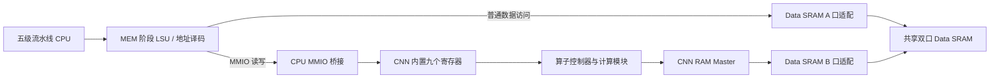

# 五级流水线 CPU 与 MobileFaceNet 加速器对接说明

| 项目 | 内容 |
|---|---|
| 文档编号 | CPU-MFN-IF-Z1 |
| 版本 / 日期 | v0.1 / 2026-09-14 |
| 发送方 | CNN / MobileFaceNet 加速器侧 |
| 接收方 | CPU Datapath 负责人、CPU Control Path 负责人、系统集成负责人 |
| 对接对象 | 32 位五级流水线 CPU（IF / ID / EX / MEM / WB） |
| 加速器版本 | `mobilefacenet/` 新版，顶层 `mobilefacenet_accelerator_top` |
| 文档状态 | 接口提案，供三方确认；尚未共同冻结 |
| 实现依据 | 新版 RTL、README、现有验证报告，以及 Datapath 发出的协作需求 v0.1 |

本文中“当前实现”表示现有加速器 RTL 的行为；“建议”表示本次提出的系统连接方案；“待确认”表示需要 CPU 与加速器双方共同决定。本文不表示完整 CPU—CNN 系统已经完成联调。

## 1. 对接结论与范围

建议采用“CPU 通过 MMIO 配置和启动，CNN 自行访问共享 Data SRAM，CPU 轮询状态并读取结果”的连接方式。

当前新版加速器已经包含九个 MMIO 寄存器。建议保留这套寄存器，CPU Datapath 侧实现地址译码、LSU 读数据选择和必要的访问桥接，不再重复维护一套 CNN 配置/状态寄存器。

当前一次 START 执行一个完整算子任务；任务之间由 CPU 软件调度。加速器不自动读取网络描述符、不自动切换下一层，也不能同时执行多个算子。普通卷积与深度卷积有各自的计算模块，但一次只启用其中一个。

输出写入 `OUTPUT_ADDR` 指定的 Data SRAM 区域。寄存器中保存的是地址、配置和状态，不保存完整特征向量。最终 128 维输出为 128 个有符号 INT8，共 128 字节。

本次对接不要求修改 CPU 指令集，使用 RV32I 的普通 Load/Store 指令即可。当前加速器没有中断输出，首版采用轮询。

## 2. 建议系统结构和职责



| 责任方 | 建议负责内容 |
|---|---|
| CPU Datapath | LSU、SRAM/MMIO 地址译码、CPU MMIO 桥、Load 回读路径、CPU A 口连接、系统顶层连线 |
| CPU Control | 有效指令门控、Load/Store 控制、停顿与清空规则、Load-use 与前递；若引入可变等待，负责对应控制升级 |
| CNN 侧 | 新版真实 RTL、内置寄存器、算子执行、现有 RAM Master、数据格式与测试向量、CNN 侧问题修复 |
| 系统集成方，三方指定 | 双口 SRAM wrapper、B 口握手适配器、公共地址图、复位分发、系统级测试 |
| CPU 软件/测试程序负责人，三方指定 | SRAM 数据装载、逐算子配置与启动、轮询、结果比对、网络层间调度 |

如果 CPU 侧必须外置九个寄存器，应另行定义加速器 core 接口并修改 RTL。现有顶层不能直接当成“八组 32 位配置输入 + 一组 32 位状态输出”使用。

## 3. 当前支持的算子

| OP_TYPE | 算子 | 参数约束 / 作用 |
|---|---|---|
| 0 | NORMAL_CONV | 普通 1×1 或 3×3 卷积；支持多输入和多输出通道 |
| 1 | DEPTHWISE_CONV | 深度 3×3 或 7×7 卷积；输入输出通道相等，multiplier=1 |
| 2 | RELU6 | 独立 ReLU6；输入输出形状相同，可先右移 |
| 3 | ADD | 同形状、同量化尺度的两个输入逐元素相加；第二输入通过 WEIGHT_ADDR 指定 |
| 4 | COPY | 复制输入张量到另一块 SRAM 区域 |
| 5 | FINAL_OUTPUT | 将 1×1×128 特征复制到指定输出区；不自动降维 |

普通卷积、深度卷积和 ADD 可附带 ReLU/ReLU6 激活。COPY 和 FINAL_OUTPUT 属于数据搬运操作。

当前没有 Pool、PReLU 或独立 BN 算子。BN 可由离线工具在满足条件时折叠进卷积参数；不支持的网络结构不能仅通过修改寄存器获得支持。

卷积输出尺寸由硬件计算，软件需按同样规则分配内存：

```text
OW = floor((W + 2 × padding - kernel) / stride) + 1
OH = floor((H + 2 × padding - kernel) / stride) + 1
输出字节数 = OW × OH × 输出通道数
```

宽高、输入输出通道必须大于零，输出尺寸必须有效，地址和长度不能溢出 32 位地址空间。非卷积算子的输入输出通道必须相等。

## 4. 加速器真实顶层接口

顶层文件：`mobilefacenet/rtl/mobilefacenet_accelerator_top.sv`。

| 信号 | 相对 CNN 的方向 | 位宽 | 当前语义 |
|---|---|---|---|
| clk | 输入 | 1 | 上升沿时钟 |
| rst_n | 输入 | 1 | 低有效异步硬复位 |
| mmio_addr | 输入 | 32 | 完整字节地址，包含 MMIO 基地址 |
| mmio_wdata | 输入 | 32 | 32 位寄存器写数据 |
| mmio_we | 输入 | 1 | MMIO 写请求 |
| mmio_re | 输入 | 1 | MMIO 读请求 |
| mmio_rdata | 输出 | 32 | 组合读取结果 |
| mmio_ready | 输出 | 1 | 合法地址存在读写请求时为 1 |
| mem_addr | 输出 | 32 | 4 字节对齐的 RAM 字节地址，不是字索引 |
| mem_wdata | 输出 | 32 | 完整 32 位 RAM 写数据 |
| mem_read | 输出 | 1 | RAM 读请求，等待时保持 |
| mem_write | 输出 | 1 | RAM 写请求，等待时保持，与 mem_read 互斥 |
| mem_rdata | 输入 | 32 | 读完成握手沿之前有效的返回数据 |
| mem_ready | 输入 | 1 | 当前请求在本次上升沿完成 |

顶层参数：`BASE_ADDR=32'h40000000`；`RELU6_MAX=32'sd96`。

当前 MMIO 没有字节写使能；RAM Master 没有 byte-enable、事务 ID、独立响应有效、错误响应或超时输入。首版建议 CPU 和 CNN 使用同一时钟域。

## 5. 九个 MMIO 寄存器

以下是当前默认映射，完整系统地址图仍需双方确认。修改基地址可通过顶层 `BASE_ADDR` 参数完成，偏移保持不变。

| 默认地址 | 偏移 | 名称 | 硬复位值 | 定义 |
|---|---|---|---|---|
| 0x40000000 | 0x00 | CONTROL | 0 | [0] START；[1] RESET；[5:2] OP_TYPE |
| 0x40000004 | 0x04 | STATUS | 0 | [0] BUSY；[1] DONE；[2] ERROR，只读 |
| 0x40000008 | 0x08 | INPUT_ADDR | 0 | 输入张量字节首地址 |
| 0x4000000C | 0x0C | OUTPUT_ADDR | 0 | 输出张量字节首地址 |
| 0x40000010 | 0x10 | WEIGHT_ADDR | 0 | 卷积权重地址；ADD 时为输入 B 地址 |
| 0x40000014 | 0x14 | BIAS_ADDR | 0 | 卷积 bias 地址，4 字节对齐 |
| 0x40000018 | 0x18 | FEATURE_SIZE | 0x00700070 | [15:0] 输入宽度；[31:16] 输入高度，默认 112×112 |
| 0x4000001C | 0x1C | CHANNELS | 0x00010003 | [15:0] 输入通道；[31:16] 输出通道 |
| 0x40000020 | 0x20 | LAYER_PARAM | 0x00100113 | 算子参数，见下表 |

当前仅译码上述九个 4 字节对齐地址，对应寄存器字节区间 `BASE_ADDR` 至 `BASE_ADDR+0x23`。其他地址或未对齐访问返回 `mmio_ready=0`、`mmio_rdata=0`，不产生 CNN ERROR。系统可保留更大窗口，但桥接层必须处理窗口中的空洞，不能无限等待。

### 5.1 LAYER_PARAM 位域

| 位 | 含义 | 当前约束 |
|---|---|---|
| [3:0] | kernel_size | 普通卷积 1/3；DW 3/7；非卷积填 0 |
| [7:4] | stride | 卷积 1～15；非卷积填 0 |
| [11:8] | padding | 卷积 0～15，四边相同；非卷积填 0 |
| [19:12] | quant_shift | 0～255，INT32 算术右移位数 |
| [20] | relu_enable | 启用 ReLU |
| [21] | relu6_enable | 启用 ReLU6，不是 Pool |
| [22] | residual_enable | 仅 ADD 允许置 1；不会让卷积自动执行残差相加，ADD 运算由 OP_TYPE=3 选择 |
| [31:23] | 保留 | 必须为 0 |

RELU6 模式强制启用 ReLU6；ReLU 与 ReLU6 同时启用时，ReLU6 优先。COPY / FINAL_OUTPUT 要求整个 LAYER_PARAM 为 0。

```c
feature_size = (height << 16) | width;
channels = (output_channels << 16) | input_channels;
layer_param = kernel | (stride << 4) | (padding << 8)
            | (quant_shift << 12) | (relu << 20)
            | (relu6 << 21) | (residual << 22);
control_start = (op_type << 2) | 1;
```

上述参与移位的变量应使用无符号 32 位类型，并在软件侧先检查范围，避免越界字段互相覆盖。

### 5.2 启动、状态和复位语义

1. 每个 `mmio_we && mmio_ready` 上升沿接收一次写入。START 和 RESET 写 1 产生内部单周期脉冲，读回为 0；OP_TYPE 保存并可读回。
2. 启动写入必须同时包含算子编号。例如普通卷积写 1、DW 写 5、ReLU6 写 9、ADD 写 13、COPY 写 17、FINAL_OUTPUT 写 21。仅写 1 会选择普通卷积。
3. 合法接受 START 后锁存本次配置并清旧 DONE/ERROR；后续检查参数。参数非法时置 ERROR，不执行该任务的 RAM 访问。
4. START、BUSY 或 RESET 锁定期间，七个配置寄存器的写入被应答但忽略。运行期间再次 START 被拒绝并置粘滞 ERROR，当前任务继续。
5. DONE/ERROR 保持到下一次成功接受 START 或软复位。写 STATUS 无效，不支持写 1 清除。
6. 常见状态：运行中 1、正常完成 2、参数错误后空闲 4、重复启动后原任务完成 6。软件按位判断，不应只把 STATUS==2 作为唯一退出条件。
7. CONTROL 同时写 START 和 RESET 时，RESET 优先。软复位清状态、终止计算、保留配置及 OP_TYPE；已提交的 RAM 写入不回滚。
8. 已呈现的 RAM 请求在软复位后仍需完成握手，排空前 BUSY 保持为 1。等待 BUSY=0 后才能重新配置启动。
9. 硬复位恢复寄存器默认值。当前 RTL 为异步低有效，与 Datapath 提案中的同步低有效存在差异，见第 12 节。

## 6. 五级流水线 CPU 的访问要求

### 6.1 流水级分工

| 阶段 | 与本接口有关的工作 |
|---|---|
| IF | 正常取指，无需 CNN 专用取指行为 |
| ID | 译码 LW/SW，读取基址与待写数据寄存器 |
| EX | 计算有效地址；完成相关前递，包含 Store 数据依赖 |
| MEM | 地址译码并发起一次 SRAM 或 MMIO 事务；MMIO Store 副作用在此生效 |
| WB | 将 MMIO Load 结果通过正常 Load 写回路径写入目的寄存器 |

建议首版 MMIO 仅允许 4 字节对齐的 LW/SW。SB/SH 不能直接传给当前 CNN 顶层，否则可能形成错误的整字写入；其他访问宽度和未映射地址由 CPU/桥接层按共同确定的策略处理。

MMIO Load 必须参加正常 load-use 停顿和前递判断。例如 `LW STATUS` 后立即用分支检查结果，控制逻辑必须使用本次真实读取值。

### 6.2 有效性、清空与重复访问

- 只有有效且未被取消的 MEM 阶段访存指令可以产生外部请求；气泡不得写寄存器或启动 CNN。
- 地址译码应互斥，CNN MMIO 写不能同时写入普通 Data SRAM。
- 一条有效 SW 必须只提交一次。若 MEM 级保持多个周期，桥接层需记录该事务是否已提交，不能每周期重复拉高写请求。
- 不能只按地址是否变化来去重：连续两条 SW 可以访问同一地址，它们是两笔独立事务。
- EX 重定向通常取消年轻指令，不应误取消已在 MEM 阶段的更老有效 Store。具体门控应服从 CPU 已确认的流水线年龄和 flush 定义。
- CPU 接受 START 写后即可继续执行指令或轮询，不需要为了等待整层计算结束而全局冻结流水线。

### 6.3 MMIO 边沿时序

| 时刻 | 写访问 | 读访问 |
|---|---|---|
| E0 上升沿后至 E1 前 | MEM 级保持合法地址、wdata、we=1 | MEM 级保持合法地址、re=1，组合 rdata 稳定 |
| E1 上升沿 | ready=1，CNN 接收本次写入 | ready=1，CPU 按既定 Load 时序锁存 rdata |
| E1 上升沿后 | 撤销请求，或切换到下一条有效事务 | 撤销请求，或切换到下一条有效事务 |

E0/E1 为相邻时钟沿，具体能否在此周期满足建立时间，需要系统综合和时序验证。当前合法 MMIO 地址不主动插入等待；若 CPU 使用统一固定 Load 延迟，可在 CPU 桥中寄存 MMIO 读结果，使其与 SRAM 路径对齐。

第一版 C1 据对接文档描述没有全局可变延迟等待接口。因此首版 CPU A 口与 MMIO 路径应按双方明确的固定时延实现。同步 SRAM 的实际读延迟必须和 MEM/WB 捕获时刻匹配，不能仅凭“普通五级流水线”假设已兼容。

## 7. CNN RAM Master 与 Data SRAM B 口

### 7.1 当前握手协议

当前同一时刻最多一笔未完成访问。请求类型、地址和写数据在 `mem_ready=0` 期间必须稳定；`mem_read && mem_ready` 或 `mem_write && mem_ready` 在上升沿完成一次事务。读数据必须在该完成沿之前有效。

```text
时钟上升沿          E0          E1          E2          E3
mem_read            1           1           1           0
mem_addr            A           A           A           —
mem_ready           0           0           1           —
mem_rdata           —           —          DATA         —
动作               等待        等待        完成         空闲
```

表格显示各采样沿看到的值。写事务遵循相同握手规则，只在完成沿提交一次写入。不得在等待的每一拍重复写 SRAM。

### 7.2 同步 SRAM 适配建议

CNN 的握手口与 CPU 的固定延迟口可以通过双口 SRAM 各自的适配逻辑共存。CNN 存在 `mem_ready` 不代表必须给 CPU C1 增加同名端口。

建议 B 口适配器按以下方式工作：

1. 识别一个新请求，锁存地址、类型和写数据，并只向 SRAM 提交一次底层访问。
2. 读请求在 SRAM 输出数据已经稳定后，再提供 `mem_ready=1`，使 CNN 能在后续完成沿采样正确数据。
3. 例如 SRAM 在 E0 接收读地址、E0 之后输出读数据，则 CNN 可在 E1 完成握手。若配置额外输出寄存器，完成沿需相应后移。
4. 写请求必须把 ready 与实际写提交语义对应起来。握手完成后不得将同一保持请求重新识别为新事务。
5. 若 SRAM 使用字索引，应从完整字节地址减去共同确认的 SRAM 基地址，再取字偏移；不能把 `mem_addr` 原样当作字索引。

同步 SRAM 数据尚未有效时，不能把 `mem_ready` 直接常量接 1。SRAM 容量、基地址、实际延迟、同址冲突行为与适配器负责人均待确认。

### 7.3 字节写与共享区域约束

加速器 RAM Master 没有字节写使能。每写一个 INT8，当前硬件执行“读完整 32 位字 → 替换目标字节 → 写回完整字”。

- 输出区必须可读可写，容量覆盖首尾涉及的完整 32 位字。
- CNN 运行期间，CPU 不得修改 CNN 正在使用的输入、权重或 bias。
- CPU 不得并发修改输出覆盖的任何 32 位字，包括输出首尾字中的相邻字节；双口 SRAM 本身不能解决读改写丢失更新。
- CPU 可按共同约定访问不冲突的其他区域；结果应在 DONE=1、BUSY=0、ERROR=0 后读取。
- 如果未来增加缓存，应另行定义缓存维护与一致性方案；首版建议共享数据区按无缓存、顺序访问处理。

RAM 接口没有错误/超时返回。如果 RAM 永远不给 ready，CNN 将持续等待，软复位也无法保证排空。系统软件应有轮询超时，但超时返回不意味着硬件已停止，故障恢复方案需系统侧明确。

## 8. 数据格式与 128 维输出

| 数据 | 位宽 / 格式 | SRAM 布局 |
|---|---|---|
| 输入 / 输出激活 | signed INT8，零点 0 | CHW，即 [channel][y][x] 连续字节 |
| 普通卷积权重 | signed INT8 | OIHW，即 [oc][ic][ky][kx] |
| DW 权重 | signed INT8 | [channel][ky][kx] |
| Bias | signed INT32，小端 | 每个输出通道 4 字节，首地址 4 字节对齐 |
| 最终特征 | 128 个 signed INT8 | 从 OUTPUT_ADDR 开始连续 128 字节 |

地址均为字节地址，一个 32 位字的最低地址对应 [7:0]。

```text
input[c][y][x]         = INPUT_ADDR + ((c × H + y) × W + x)
weight[oc][ic][ky][kx] = WEIGHT_ADDR + (((oc × IC + ic) × K + ky) × K + kx)
dw_weight[c][ky][kx]  = WEIGHT_ADDR + ((c × K + ky) × K + kx)
bias[oc]              = BIAS_ADDR + 4 × oc
output[oc][y][x]       = OUTPUT_ADDR + ((oc × OH + y) × OW + x)
```

计算顺序：INT8 乘法、INT32 累加（溢出按 32 位回绕）→ 算术右移 → 可选 ReLU/ReLU6 → 饱和到 [-128,127]。ADD 先符号扩展再相加，然后执行右移和激活。Bias 应处于对应累加域尺度。

默认 `RELU6_MAX=96`，在输出 scale=1/16 时对应实数 6；这个阈值是顶层参数，不是每层 MMIO 可写值。使用其他输出尺度时必须检查模型与硬件阈值一致性。软件还需保存各层量化尺度，硬件不会随输出附带尺度元数据。

FINAL_OUTPUT 要求 W=H=1、IC=OC=128、LAYER_PARAM=0。它只复制已有特征，不会把任意特征图自动转换成 128 维；前面的卷积等任务必须先产生正确形状。

最终特征不包含 L2 归一化、余弦相似度、身份库比对或分类判断。输入的人脸检测、裁剪、对齐和预处理也由外部完成。

## 9. CPU 配置流程与例子

### 9.1 标准流程

1. 确认 BUSY=0，确保没有未完成的取消/复位排空。
2. 在有效 SRAM 区域装载输入、权重和 bias；分配与仍需读取的数据不重叠的输出区。无 bias 的卷积也应准备零值 bias 数组，不能假设硬件不读取 BIAS_ADDR。
3. 写地址、FEATURE_SIZE、CHANNELS 和 LAYER_PARAM。
4. 确保数据和配置写入已经生效，再写 `(OP_TYPE << 2) | 1` 到 CONTROL。
5. 轮询 STATUS，并设置软件超时。ERROR 优先报告；正常完成要求 DONE=1 且 BUSY=0。出现错误后，后续调度必须等待空闲或执行复位恢复。
6. 正常完成后读取结果，或把本次输出作为下一层输入，重新配置下一任务。

系统须保证“装载数据 → 写配置 → START → 完成后读结果”的顺序。如果 CPU 第一版把 FENCE 当作 NOP，则不能依赖它修复潜在的写缓冲或缓存乱序；首版互连应直接保证所需顺序。

### 9.2 32×32×16 深度卷积配置

目标：DW3、stride=1、padding=1、quant_shift=4、ReLU6，输出仍为 32×32×16。

| 寄存器 | 写入值 |
|---|---|
| INPUT_ADDR | 系统分配的输入地址 |
| OUTPUT_ADDR | 系统分配的独立输出地址 |
| WEIGHT_ADDR | 16×3×3=144 字节的 DW 权重地址 |
| BIAS_ADDR | 16×4=64 字节的 bias 地址 |
| FEATURE_SIZE | 0x00200020 |
| CHANNELS | 0x00100010 |
| LAYER_PARAM | 0x00204113 |
| CONTROL，最后写 | 0x00000005 |

输入和输出各需 16384 字节。以上地址不预设数值，由公共 SRAM 地址图分配。

### 9.3 最终 128 维输出配置

| 寄存器 | 写入值 |
|---|---|
| INPUT_ADDR | 已算出的 1×1×128 特征首地址 |
| OUTPUT_ADDR | 独立的最终输出区地址，至少 128 字节 |
| WEIGHT_ADDR / BIAS_ADDR | 本算子不使用，可写 0 |
| FEATURE_SIZE | 0x00010001 |
| CHANNELS | 0x00800080 |
| LAYER_PARAM | 0 |
| CONTROL，最后写 | 0x00000015 |

成功完成后，CPU 可用 128 次 LB 读取有符号分量，或用 32 次 LW 读取后按小端拆包。FINAL_OUTPUT 不是读取最后一层结果的必经步骤：若无需复制，CPU 可直接读取最后一层卷积的输出区。

## 10. 建议联调步骤与验收

| 阶段 | 测试内容 | 通过条件 |
|---|---|---|
| A：寄存器连接 | LW/SW 回读、默认值、无效指令门控、连续同址 SW、流水线保持 | 地址/数据正确，一条 Store 只提交一次，无气泡副作用 |
| B：可选 CNN stub | 启动后按约定周期给 busy/done，注入 error | CPU 轮询、load-use、分支退出与超时路径正确；stub 周期为测试约定 |
| C：B 口连接 | 真实 CNN 执行 COPY，SRAM 插入等待 | 请求等待时稳定、每笔只提交一次、相邻字节保持 |
| D：最小计算 | 3×3 单通道输入 1～9，九个权重为 1，bias=0，stride=1、pad=0、shift=0、无激活 | 输出单个 INT8 值 45，STATUS 正常完成 |
| E：算子覆盖 | Conv1/3、DW3/7、ReLU6、ADD、COPY、FINAL | 全部输出字节等于参考值，输出区外未被修改 |
| F：异常恢复 | 重复 START、非法参数、运行中写配置、软复位、长等待 | 状态符合第 5 节，复位后排空完成才能重启 |
| G：多层调度 | CPU 连续配置多层，保持残差输入有效 | 中间层输出实际用于下一层；最终 128 字节与 Golden 一致 |
| H：FPGA 实现 | 综合、资源、时序、存储器映射、上板程序 | 根据选定器件和时钟另行验收 |

阶段 D 所需配置：FEATURE_SIZE=0x00030003、CHANNELS=0x00010001、LAYER_PARAM=0x00000013、CONTROL=1。输入、权重、bias 和输出应放在不重叠的有效区域。

联调不能只看 DONE 或波形；必须比较 SRAM 真实输出，并检查写入范围。系统测试应覆盖“LW STATUS 后立即分支”和“Store 数据需要前递”等五级流水线场景。

## 11. 当前可交付资料与验证边界

| 内容 | 工程内位置 / 状态 |
|---|---|
| 新版真实顶层 | `mobilefacenet/rtl/mobilefacenet_accelerator_top.sv` |
| MMIO 寄存器 | `mobilefacenet/rtl/accelerator_regs.sv` |
| CNN RAM Master | `mobilefacenet/rtl/accelerator_mem_if.sv` |
| 算子参数合法性 / 地址生成 | `mobilefacenet/rtl/address_generator.sv` |
| 新版 RTL 文件清单 | `mobilefacenet/rtl/files.f`，其中路径相对 mobilefacenet 目录，集成时调整编译工作目录或路径前缀 |
| 端到端测试 | `mobilefacenet/tb/tb_mobilefacenet.sv` |
| 仿真 RAM 模型 | `mobilefacenet/tb/model_data_ram.sv`，不是 FPGA 双口 SRAM wrapper |
| 新版使用说明 | `mobilefacenet/README.md` |
| 已有验证记录 | `mobilefacenet/docs/verification.md`、`mobilefacenet/build/verification.json` |
| 简化 CNN stub | 待按共同冻结接口整理；不能把仿真 RAM 模型当作 CNN stub |
| CPU MMIO 桥、双口 SRAM wrapper、B 口适配器 | 本次系统集成待实现/确认 |

依据现有 2026-09-12 验证记录及当前机器报告：14 个 RTL testbench、34 个合成任务逐层比对、9 个 ONNX 测试图任务比对及 7 个软件自检查已通过，两个最终输出均为 128 字节且比对一致。该结论引用已有记录，本次编写文档未重新执行仿真。

现有测试使用确定性测试网络和未训练 ONNX 测试图。尚不能据此宣称真实训练模型的识别精度、完整 CPU 联调通过或 FPGA 时序收敛。

原 `rtl/` 与新版 `mobilefacenet/rtl/` 含有同名模块，编译时必须只选择对应版本，不得混用两套文件清单。

## 12. 与 Datapath 协作需求的差异及待确认项

| 编号 | 对方文档 / 尚待决定的内容 | 新版现状 | 本次建议 / 需回复事项 |
|---|---|---|---|
| C-01 | Datapath 计划实现九个寄存器并向 CNN 输出配置 | CNN 已内置寄存器，顶层是 MMIO 总线 | 保留 CNN 内置寄存器；CPU 只做译码和桥接，双方确认归属 |
| C-02 | 九个固定 32 位外部接口 | 当前是九个地址映射寄存器，不是九组顶层端口 | 按第 4 节真实顶层连接；如必须外置寄存器，另开接口修订 |
| C-03 | IMAGE_SIZE / CNN_PARAM 命名 | 新版称 FEATURE_SIZE / LAYER_PARAM，偏移分别为 0x18 / 0x20 | 文档、软件头文件统一新名称与语义 |
| C-04 | 希望 CNN_PARAM 包含 op_type、pool_mode | OP_TYPE 在 CONTROL[5:2]；参数 bit21 为 ReLU6；无 Pool | 按新版位域冻结，不沿用原版 Pool 配置 |
| C-05 | 全局上升沿同步低有效复位 | CNN 当前异步低有效复位 | 三方选定统一方案；若要求 CNN 内部全部同步复位，需修改 RTL 并回归，不能视为已兼容 |
| C-06 | MMIO 基地址待定 | 默认 0x40000000，可参数化 | 确认默认地址是否保留、窗口大小及无效访问处理 |
| C-07 | 双口 SRAM 容量与时序待定 | CNN 只有握手 Master，无 SRAM 本体 | 指定容量/基地址/读延迟，确认 CPU A 口、CNN B 口及适配器负责人 |
| C-08 | 需要 byte-enable、响应有效等完整说明 | 无 byte-enable，整字读改写；ready 即完成，无独立外部响应有效 | 按第 7 节协议适配；若要新增端口，单独版本化 |
| C-09 | CPU C1 无可变延迟等待 | CNN 可等待 RAM ready | CPU 维持已确认固定延迟；B 口独立握手适配，不直接把 CNN busy 用作全局 stall |
| C-10 | 最终输出和数据格式待定 | CHW INT8、128 维特征，无归一化/身份比较 | 接受第 8 节格式，指定后处理与真实模型负责人 |
| C-11 | CNN stub / 真实 RTL 交付安排 | 真实 RTL 和测试材料已有，专用 stub 待整理 | 确认是否需要 stub、文件交付方式与日期 |
| C-12 | 程序启动和结束判据 | 不由 CNN 定义 | CPU 侧确认 PC 复位地址、IMEM、程序装载、tohost 或其他结束判据 |

C1/D1 的正式冻结、CPU 内部译码编码和共享 package 由 CPU Control 与 Datapath 负责人处理；CNN 侧参与涉及复位、地址图、访存时序和系统软件的共同确认。

## 13. 请 CPU 侧回复的确认清单

1. 是否接受保留 CNN 内置九个寄存器，由 CPU 实现 MMIO 译码和桥接？
2. 是否接受本版顶层端口、六种算子和寄存器位域？如有差异，请列出信号名/地址偏移及期望修改。
3. CPU 的 MEM 阶段访存及 Load 写回固定延迟具体是多少？如何保证停顿期间一条 Store 只提交一次？
4. MMIO 是否首版限定为对齐 LW/SW？其他访问的处理策略是什么？
5. Data SRAM 的基地址、容量、双口结构、读延迟、冲突约束分别是什么？谁负责 wrapper 与 B 口适配？
6. MMIO 是否采用 0x40000000 基地址？系统保留窗口和空洞访问如何处理？
7. 采用哪种共同复位方案？软复位排空和 SRAM 故障恢复由谁负责？
8. 谁负责逐层配置程序、数据装载、结果检查和最终特征后处理？
9. 是否需要先交 CNN stub？第一轮联调的文件清单、负责人和日期是什么？

以上项目确认后，将共同结论、变更记录和适用 RTL 版本补入下一版文档，再冻结为 CPU—CNN 联调基线。
