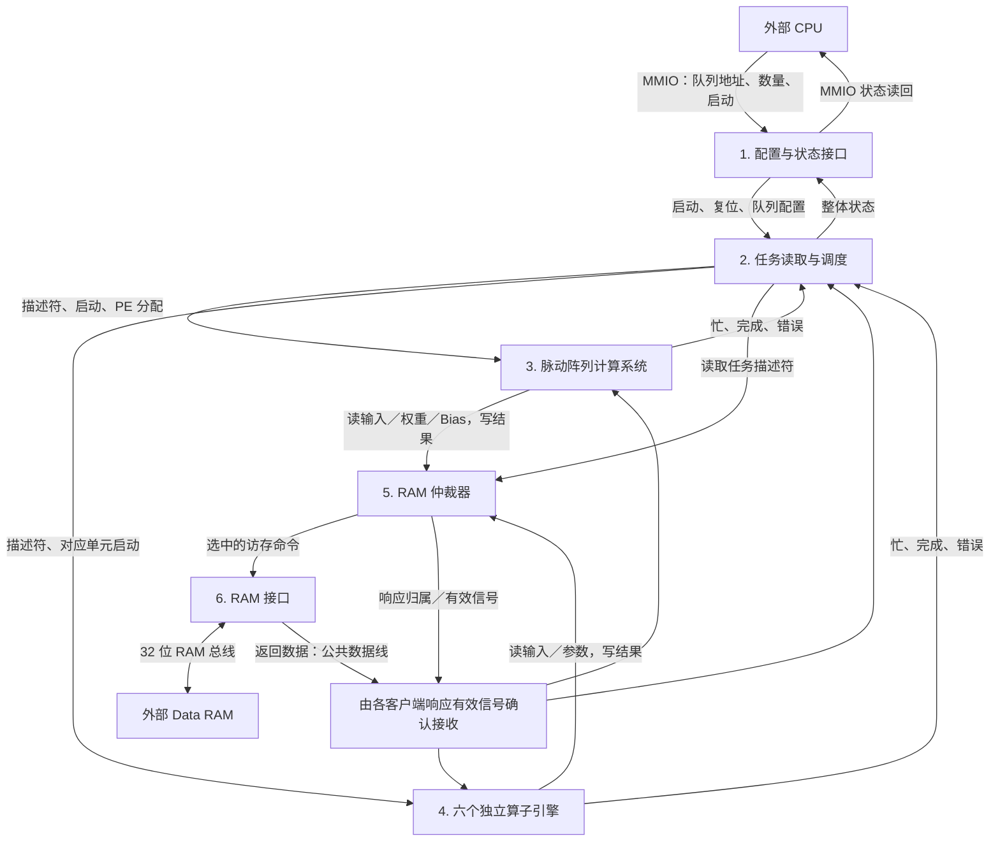

# 加速器大模块输入输出与数据／控制分类

本文按当前 `rtl/mobilefacenet_accelerator_top.sv` 及其连接的 RTL 整理，核对日期：2026-10-06。

当前版本采用**任务队列启动、两个计算上下文共享一套 8×8 脉动阵列、六个独立算子引擎**。CPU 和 Data RAM 都在加速器外部，本项目不实现 CPU。

这里的“外部”指加速器模块边界之外，不一定是芯片外部。RAM 可以位于 CPU 子系统内部；对应的源码交付、接线和调用方法见 [CPU 内部 RAM 对接说明](cpu_internal_ram_integration.md)。

## 1. 先区分“控制”和“数据”

- **控制信息**：告诉模块做什么、什么时候做、去哪里取数据。例如启动、完成、算子类型、地址、尺寸、任务描述符。
- **计算数据**：实际参与运算的输入特征、权重、Bias、中间结果和最终结果。
- **数据通路**：搬运或计算这些数值的电路。

不能只看信号位宽判断类别：32 位地址属于控制信息，32 位计算结果属于数据；任务描述符虽然也是从 RAM 读出的二进制内容，但它在执行系统中承担配置和控制作用。

所有模块都有 `clk` 和 `rst_n`。`clk` 是时钟，`rst_n=0` 表示硬件复位；下面各内部模块的表格不重复列出这两个公共输入。各表的“输入／输出”均相对于当前介绍的模块。

所有时序模块的 `clk/rst_n` 都由顶层同名端口接入，最终来自外部时钟和复位源；仿真时由 Testbench 驱动。表中的“来源／去向”按照 **发送者 → 中间连接 → 接收者** 阅读。提到“顶层观察线”时，表示内部信号，可在仿真中查看，并不表示增加了一个外部输出端口。

## 2. 六个大模块及连接关系

这里按功能分成六个大模块，并不代表只有六个 RTL 文件。

| 编号 | 大模块 | 主要 RTL | 分类 | 主要工作 |
| --- | --- | --- | --- | --- |
| 1 | CPU 配置与状态接口 | `accelerator_regs.sv` | 控制 | 接收队列地址、任务数和启动命令，返回整体状态 |
| 2 | 任务读取与调度系统 | `streaming_task_scheduler.sv`、`task_descriptor_reader.sv`、`task_descriptor_info.sv` | 控制为主 | 读取描述符、检查参数和依赖、分配执行单元与 PE 行 |
| 3 | 脉动阵列计算系统 | `systolic_conv_context.sv` ×2、`systolic_shared_array8.sv` 等 | 数据计算＋局部控制 | 取卷积窗口和权重、分块、供数、乘加、输出转换和写回 |
| 4 | 独立算子计算系统 | `tensor_operator_engine.sv` ×6 及内部运算模块 | 数据计算＋局部控制 | 执行激活、残差加法、池化和重新量化 |
| 5 | RAM 访问仲裁器 | `accelerator_mem_arbiter.sv` | 控制＋请求数据选择 | 从多个访存请求中选一个，记录响应归属 |
| 6 | RAM 接口与数据转换 | `accelerator_mem_if.sv` | 数据搬运＋握手控制 | 驱动外部 RAM，完成 INT8 字节提取和字节写入 |



图中的阵列计算系统包含缓冲、地址生成和局部控制，不只是 64 个 PE。返回数据线实际直接连接各客户端；仲裁器负责标记哪一个客户端可以接收。

### 六个大模块的来源与去向速查

| 大模块 | 输入从哪里来 | 输出送到哪里 |
| --- | --- | --- |
| 配置与状态接口 `regs` | CPU／Testbench 发来 MMIO 请求；调度器和顶层汇总逻辑提供状态 | 队列配置和启动送调度器；软件复位送相关内部模块；读回数据和确认送 CPU／Testbench |
| 任务读取与调度 `task_queue` | 配置来自 `regs`；描述符内容来自 RAM 接口；访存确认来自仲裁器；执行状态来自八个执行位置 | 描述符、启动和分区信息送计算系统；读取请求送仲裁器；队列状态送 `regs`／顶层汇总逻辑 |
| 脉动阵列计算系统 | 任务配置、启动和 PE 分配来自调度器；输入／权重／Bias 来自 RAM 接口；访存确认来自仲裁器 | 计算结果和读写请求送仲裁器，最终写 RAM；任务状态送调度器 |
| 六个独立算子引擎 | 任务配置和启动来自调度器；特征和参数来自 RAM 接口；访存确认来自仲裁器 | 结果和读写请求送仲裁器，最终写 RAM；任务状态送调度器 |
| RAM 仲裁器 `arbiter` | 请求来自任务读取器及八个执行位置；接受／完成信号来自 RAM 接口 | 选中的命令送 RAM 接口；接受／响应有效信号返回对应请求者 |
| RAM 接口 `memory_interface` | 命令来自仲裁器；读数据和 RAM 完成信号来自外部 Data RAM | 外部读写信号送 RAM；内部响应有效送仲裁器；返回数据直接广播给任务读取器和八个执行位置 |

### 图像从哪里进来，最终结果到哪里去

**实际图像、特征和权重从外部 Data RAM 读入，计算结果也写回外部 Data RAM。**CPU 通过 MMIO 提供的是队列控制信息，不是把图像逐字节写进加速器寄存器。

```text
任务控制：CPU／Testbench → 顶层 MMIO → regs → task_queue → 被选中的计算引擎

读取请求：计算引擎 → arbiter → memory_interface → 外部 Data RAM
读取数据：外部 Data RAM → 顶层 mem_rdata → memory_interface
         → 内部 bus_rdata → 发出请求的计算引擎
读取有效：memory_interface → arbiter → 发出请求的计算引擎

结果写回：计算引擎 cmd_wdata → arbiter → memory_interface
         → 顶层 mem_wdata → 外部 Data RAM 的任务 OUTPUT_ADDR 区域

完成通知：计算引擎 → task_queue → regs.STATUS → CPU／Testbench 读取
```

外部 CPU 或数据加载机制需要事先把图像、权重、参数和描述符准备在 RAM 中。仿真里由 Testbench／仿真 RAM 初始化完成这一步。**CPU 写 RAM、CPU 读取最终结果所需的系统侧连接不在本加速器顶层内实现**；这里暴露的是加速器自己访问 RAM 的主接口。

例如最终任务输出 128 个 INT8 特征时，结果存放于该任务 `OUTPUT_ADDR` 到 `OUTPUT_ADDR+127` 的 RAM 字节中。CPU 后续通过自己的存储器访问路径读取它们，不通过 `mmio_rdata` 读取特征向量。`mmio_rdata` 只返回寄存器配置或状态。

## 3. 大模块一：CPU 配置与状态接口

对应 `accelerator_regs.sv`，顶层实例名 `regs`。

### 输入

| 信号 | 位宽 | 类别 | 来源／去向（实际连接路径） | 含义／来源 |
| --- | --- | --- | --- | --- |
| `mmio_addr` | 32 | 控制 | 外部 CPU／Testbench → 顶层同名端口 → `regs` | CPU 本次访问的寄存器地址 |
| `mmio_wdata` | 32 | 控制配置 | 外部 CPU／Testbench → 顶层同名端口 → `regs` | CPU 要写入的控制字、队列地址或任务数 |
| `mmio_we` | 1 | 控制 | 外部 CPU／Testbench → 顶层同名端口 → `regs` | CPU 发出写请求 |
| `mmio_re` | 1 | 控制 | 外部 CPU／Testbench → 顶层同名端口 → `regs` | CPU 发出读请求 |
| `accelerator_busy` | 1 | 状态 | 顶层汇总 `task_queue.active`、八个单元 `busy`、仲裁器与 RAM 接口非空闲状态 → `regs` | 整体是否仍有任务或访存活动 |
| `accelerator_done` | 1 | 状态 | `task_queue.done` → 顶层 `queue_done`／`done` → `regs` | 整个队列完成的通知 |
| `accelerator_error` | 1 | 状态 | `task_queue.error` → 顶层 `queue_error`／`error` → `regs` | 队列执行错误通知 |

### 输出

| 信号 | 位宽 | 类别 | 来源／去向（实际连接路径） | 含义／去向 |
| --- | --- | --- | --- | --- |
| `mmio_rdata` | 32 | 控制／状态读回 | `regs` → 顶层 `mmio_rdata` → 外部 CPU／Testbench | 返回 CPU 所读寄存器的内容 |
| `mmio_ready` | 1 | 握手控制 | `regs` → 顶层 `mmio_ready` → 外部 CPU／Testbench | 本次地址被选中，MMIO 请求可被接受 |
| `accelerator_start` | 1 | 控制 | `regs` → 顶层 `start` → `task_queue.start` | 单周期启动脉冲，交给任务调度器 |
| `accelerator_reset` | 1 | 控制 | `regs` → 顶层 `reset` → 调度器、两个阵列上下文、共享阵列、六个独立引擎、仲裁器和 RAM 接口 | 软件复位脉冲 |
| `op_type` | 4 | 控制 | `regs` → 顶层 `op` → `task_queue.op_type` | 当前应选择队列模式 `15`，不是当前层的算子类型 |
| `input_addr` | 32 | 控制配置 | `regs` → 顶层 `ia` → `task_queue.input_addr` | 旧名称保留，当前含义是**任务队列起始地址** |
| `feature_size` | 32 | 控制配置 | `regs` → 顶层 `fs` → `task_queue.feature_size` | 旧名称保留，当前含义是**任务总数** |
| `output_addr`、`weight_addr`、`bias_addr`、`channels`、`layer_param` | 各 32 | 保留 | `regs` → 顶层保留线 `oa/wa/ba/ch/lp`；当前无任务执行模块使用这些线 | 当前不配置任务，复位后保持为零 |

### 当前有效 MMIO

当前是 **4 个有效控制／状态寄存器＋5 个保留地址槽位**，不能再理解为 CPU 通过 9 个寄存器逐层配置算子。

| 地址 | 当前含义 | 用途 |
| --- | --- | --- |
| `0x4000_0000` | CONTROL | bit0 START，bit1 RESET，bits5:2 模式；队列启动写 `0x3D` |
| `0x4000_0004` | STATUS | bit0 BUSY、bit1 DONE、bit2 ERROR |
| `0x4000_0008` | QUEUE_BASE | 队列起始地址，对应 RTL 的 `input_addr` |
| `0x4000_0018` | TASK_COUNT | 任务数量，对应 RTL 的 `feature_size` |
| `0x4000_000C`、`0x4000_0010`、`0x4000_0014`、`0x4000_001C`、`0x4000_0020` | 保留 | 读零，写入忽略 |

每一层的输入地址、输出地址、权重地址和尺寸都放在 RAM 中的任务描述符里。START／RESET 读回为零；DONE／ERROR 会被记录，新的有效启动或软件复位会清除旧状态。忙时重复 START 会设置 ERROR，忙时不能修改队列配置。

## 4. 大模块二：任务读取与调度系统

对应 `streaming_task_scheduler.sv`，顶层实例名 `task_queue`。内部调用描述符读取和合法性检查模块。

### 输入

| 信号 | 位宽 | 类别 | 来源／去向（实际连接路径） | 含义 |
| --- | --- | --- | --- | --- |
| `start`、`soft_reset` | 各 1 | 控制 | `regs.accelerator_start/accelerator_reset` → 顶层 `start/reset` → `task_queue` | 启动队列／清除调度状态 |
| `op_type` | 4 | 控制 | `regs.op_type` → 顶层 `op` → `task_queue` | 队列模式编号，要求为 15 |
| `input_addr`、`feature_size` | 各 32 | 控制配置 | `regs.input_addr/feature_size` → 顶层 `ia/fs` → `task_queue` | 队列地址、任务总数 |
| `exec_busy`、`exec_done`、`exec_error` | 各 8 | 状态 | 两个阵列上下文＋六个独立引擎 → 顶层 `unit_busy/unit_done/unit_error` → `task_queue` | 八个执行位置各自的忙、完成和错误状态 |
| `mem_idle` | 1 | 状态 | `memory_interface.idle` 与 `arbiter.idle` 在顶层取逻辑与 → `task_queue` | 顶层提供的 RAM 接口与仲裁器均空闲标志 |
| `fetch_ready` | 1 | 握手控制 | `arbiter.ready[0]` → 顶层 `fetch_ready` → `task_queue` | 描述符读取请求已可被接受 |
| `fetch_rsp_valid` | 1 | 握手控制 | `arbiter.response[0]` → 顶层 `fetch_response` → `task_queue` | 描述符读取响应有效 |
| `fetch_rsp_data` | 32 | 任务配置内容 | 外部 RAM → `memory_interface.rsp_rdata` → 顶层 `bus_rdata` → `task_queue` | 从 RAM 返回的一字描述符内容 |

### 输出

| 信号 | 位宽 | 类别 | 来源／去向（实际连接路径） | 含义 |
| --- | --- | --- | --- | --- |
| `fetch_valid`、`fetch_addr` | 1、32 | 访存控制 | `task_queue` → `arbiter` 客户端 0 的 `valid`、`addr` → RAM 接口 → 外部 RAM | 发出描述符读取请求和地址 |
| `task_descriptor` | 256 | 控制配置 | `task_queue` → 顶层 `descriptor`；拆字段送两个阵列上下文，完整描述符送六个独立引擎 | 本次准备派发的完整 32 字节任务 |
| `context_start` | 8 | 控制 | `task_queue` → 顶层 `unit_start[7:0]` → 对应执行单元 `start` | 启动被选中的执行单元；顶层接到 `unit_start` |
| `exec_start` | 1 | 控制／观察 | `task_queue` → 顶层 `exec_start` 观察线；当前不直接驱动执行单元 | 本周期是否派发了一个任务 |
| `active`、`done`、`error` | 各 1 | 状态 | `active` → 顶层忙状态汇总和两个阵列上下文；`done/error` → `regs` 状态输入 | 队列活动、整个队列完成、队列错误 |
| `allocated` | 8 | 资源控制 | `task_queue` → 顶层 `unit_allocated`；低两位再送共享阵列 `allocated`，其余位用于观察 | 八个执行位置的占用情况 |
| `base0`、`base1` | 各 3 | PE 分配控制 | `task_queue` → 顶层 `row_base0/row_base1` → 共享阵列 `base0/base1` | 两个阵列上下文分区的起始行 |
| `rows0`、`rows1` | 各 4 | PE 分配控制 | `task_queue` → 顶层 `row_count0/row_count1` → 共享阵列 `rows0/rows1` | 两个上下文各自占用的行数 |
| `dispatch_rows` | 4 | 配置 | `task_queue` → 顶层 `dispatch_rows` → 两个阵列上下文 `row_capacity`，被启动者锁存 | 当前被启动的阵列任务可使用多少行 PE |
| `queue_base`、`queue_end` | 32、64 | 地址保护控制 | `task_queue` → 顶层同名线 → 两个阵列上下文的地址保护输入 | 描述符区域范围，结束地址不包含在区域内 |
| `completed`、`fetched`、`dispatched`、`buffered` | 各 32 | 观察状态 | `task_queue` → 顶层 `queue_completed/queue_fetched/queue_dispatched/queue_buffered`，供波形／Testbench 观察 | 已完成、已读取、已派发、当前缓冲的任务数 |
| `dispatch_id` | 32 | 观察状态 | `task_queue` → 顶层 `dispatch_id`，供波形／Testbench 观察 | 当前派发任务在原队列中的编号 |
| `task_id0`、`task_id1` | 各 32 | 观察状态 | `task_queue` → 顶层同名线，供波形／Testbench 观察 | 两个阵列上下文对应的任务编号 |
| `unit_task_ids` | 256 | 观察状态 | `task_queue` → 顶层同名线，供波形／Testbench 观察 | 八个执行位置的任务编号，每个 32 位 |
| `debug_state` | 4 | 观察状态 | `task_queue` → 顶层 `queue_state`，供波形／Testbench 观察 | 调度器 FSM 状态 |
| `hazard_wait`、`resource_wait` | 各 1 | 观察状态 | `task_queue` → 顶层同名线，供波形／Testbench 观察 | 窗口内存在因依赖或资源不足而等待的合法任务；不等于所有任务都无法派发 |

### 调度规则

一条描述符读取完整后，只要资源空闲且不存在与更早任务的读写冲突，就可以派发，无须等整个队列读取完。

默认最多缓存 4 条待派发任务，由顶层 `TASK_PREFETCH_DEPTH` 参数调整。每个时钟最多派发一条，选择窗口内最早的可执行任务。后面的独立任务可以绕过等待资源的任务，但不能破坏数据依赖。尚未读取到窗口内的任务不能提前调度。

八个执行位置如下：

| `unit_*` 位编号 | 执行位置 | 支持算子 |
| --- | --- | --- |
| 0 | 阵列上下文 0 | Conv、Depthwise、MatMul |
| 1 | 阵列上下文 1 | Conv、Depthwise、MatMul |
| 2 | 独立 ReLU6 引擎 | ReLU6 |
| 3 | 独立 ADD 引擎 | 残差加法 |
| 4 | 独立 ReLU 引擎 | ReLU |
| 5 | 独立 PReLU 引擎 | PReLU |
| 6 | 独立 MaxPool 引擎 | 2×2、stride 2 池化 |
| 7 | 独立 Requant 引擎 | 重新量化 |

两个阵列上下文共享同一套 64 个 PE，按连续行分配，分区保留到该任务结束。它们不是两套独立 8×8 阵列。六个独立算子各有一个执行引擎，例如两条 ReLU 任务需要先后使用同一个 ReLU 引擎。

## 5. 大模块三：脉动阵列计算系统

它是一个组合功能块，包括两个 `systolic_conv_context`、一个 `systolic_shared_array8`，以及窗口地址生成、读缓存、分块缓冲、供数控制、量化和输出缓冲。

下面先描述整个功能块对外的连接，再描述其内部阵列连接，避免把两者混在一起。

### 功能块输入

| 信号／信息 | 位宽 | 类别 | 来源／去向（实际连接路径） | 含义 |
| --- | --- | --- | --- | --- |
| `start` | 每上下文 1 | 控制 | `task_queue.context_start[1:0]` → 顶层 `context_start` → 两个上下文各自的 `start` | 调度器启动当前上下文 |
| `clear` | 1 | 控制 | `regs.accelerator_reset` → 顶层 `reset` → 两个上下文及共享阵列 | 软件复位／清除 |
| `op` | 每上下文 4 | 配置 | `task_queue.task_descriptor` → 顶层取出 `task_op` 并映射 MatMul → 上下文 `op` | 普通卷积或 Depthwise；顶层将 MatMul 映射为普通卷积路径 |
| `ia`、`oa`、`wa`、`ba` | 各 32 | 地址配置 | `task_queue.task_descriptor` → 顶层 `task_ia/task_oa/task_wa/task_ba` → 两个上下文 | 输入、输出、权重／矩阵 A、Bias 的 RAM 地址 |
| `fs`、`ch`、`lp` | 各 32 | 配置 | `task_queue.task_descriptor` → 顶层 `task_fs/task_ch/task_lp` → 两个上下文 | 尺寸、通道数、卷积与量化参数 |
| `row_capacity` | 每上下文 4 | 配置 | `task_queue.dispatch_rows` → 两个上下文 `row_capacity` | 启动时锁存的可用 PE 行数 |
| `allocated`、行起点、行数 | 2、各 3、各 4 | 分区控制 | `task_queue` 的分配输出 → 顶层连线 → 共享阵列 `allocated/base0/base1/rows0/rows1` | 为物理阵列确定两个上下文各自的 PE 范围 |
| `queue_active`、`queue_base`、`queue_end` | 1、32、64 | 地址保护控制 | `task_queue.active/queue_base/queue_end` → 两个上下文 | 防止输出覆盖任务描述符区域 |
| `cmd_ready` | 每上下文 1 | 握手控制 | `arbiter.ready[1]`／`ready[2]` → 上下文 0／1 | 对应上下文的访存命令可被接受 |
| `rsp_valid`、`rsp_data` | 每上下文 1、公共 32 | 控制＋数据 | 有效信号：`arbiter.response[1/2]` → 上下文 0／1；数据：`memory_interface.rsp_rdata` → `bus_rdata` → 两个上下文 | 返回响应及输入／权重／Bias 数据，写响应只表示写入完成 |

### 功能块输出

| 信号 | 位宽 | 类别 | 来源／去向（实际连接路径） | 含义 |
| --- | --- | --- | --- | --- |
| `busy`、`done`、`error` | 每上下文各 1 | 状态 | 两个上下文 → 顶层 `unit_busy/unit_done/unit_error` 的位 0、1 → `task_queue`；busy 也参与整体忙状态汇总 | 当前任务的执行状态 |
| `cmd_valid`、`cmd_write`、`cmd_byte` | 每上下文各 1 | 访存控制 | 上下文 0／1 → `arbiter` 客户端 1／2 → `memory_interface` | 请求有效、读写选择、字节／整字访问选择 |
| `cmd_addr` | 每上下文 32 | 地址控制 | 上下文 0／1 → `arbiter` 客户端 1／2 → `memory_interface` → 外部 RAM 地址端 | 当前取数或写结果的地址 |
| `cmd_wdata` | 每上下文 32 | 计算数据 | 上下文 0／1 → `arbiter` 客户端 1／2 → `memory_interface` 字节合并或整字写 → 外部 RAM | 准备写回的结果 |
| `array_running` | 每上下文 1 | 观察状态 | 两个上下文 → 顶层 `ctx_running`／`array_running`，供波形观察 | 当前阵列分块运行状态，不等于每个 PE 都在有效乘加 |
| `pe_fire_map` | 64 | 观察状态 | 共享阵列 `fire_map` → 顶层 `pe_fire_map`，供波形观察 | 物理阵列中各 PE 的有效计算情况 |
| `pe_mask0`、`pe_mask1` | 各 8 | 观察状态 | 共享阵列 `mask0/mask1` → 顶层 `pe_mask0/pe_mask1`，供波形观察 | 两个上下文占用的物理行掩码 |

### 上下文与阵列之间的内部连接

下表位宽均为单个上下文的逻辑接口，顶层会将两个上下文的输入拼接后送入共享阵列。

| 信号 | 方向 | 位宽 | 类别 | 作用 |
| --- | --- | --- | --- | --- |
| `array_clear` | 上下文 → 阵列 | 1 | 控制 | 清除该上下文相关阵列状态 |
| `array_ce` | 上下文 → 阵列 | 1 | 控制 | 允许该上下文的阵列推进一拍 |
| `array_load` | 上下文 → 阵列 | 1 | 控制 | 装载累加初值 |
| `array_dw` | 上下文 → 阵列 | 1 | 控制 | 选择 Depthwise 映射 |
| `initial_sums` | 上下文 → 阵列 | 2048 | 数据 | 64 个 INT32 初值，来自 Bias 或上一归约分块的部分和 |
| `a_edge`、`b_edge` | 上下文 → 阵列 | 各 64 | 数据 | 两组各 8 个 INT8 边界数据，用于普通卷积／矩阵乘法 |
| `a_valid`、`b_valid` | 上下文 → 阵列 | 各 8 | 控制 | 对应各路边界数据是否有效 |
| `dw_weights` | 上下文 → 阵列 | 64 | 数据 | Depthwise 各逻辑行的权重 |
| `dw_inputs` | 上下文 → 阵列 | 512 | 数据 | Depthwise 各逻辑 PE 的输入数据 |
| `dw_valid` | 上下文 → 阵列 | 64 | 控制 | Depthwise 各逻辑 PE 的数据有效标志 |
| `sums` | 阵列 → 上下文 | 2048 | 数据 | 64 个 INT32 累加结果 |

实际工作顺序是：锁存任务配置 → 算地址 → 从 RAM 加载当前分块的 Bias、权重和窗口数据 → 缓冲装满后启动阵列 → 按时序供数 → 收集部分和或最终结果 → 写 RAM。

`start` 启动的是整个任务；`array_ce` 控制阵列逐拍推进；具体 PE 是否有效乘加还取决于有效信号。等 RAM 数据期间，任务可以保持 BUSY，但阵列不一定在计算。

默认输出经过算术右移并饱和到 signed INT8。任务 `lp[23]=1` 可选择原始 INT32 输出，此时要求输出地址对齐且 `quant_shift=0`。ReLU、PReLU 等激活不在这里隐式执行，而是独立任务。

## 6. 大模块四：独立算子计算系统

顶层实例化六个 `tensor_operator_engine`，每个实例的 `OPCODE` 参数固定为一种算子。它们拥有各自的 FSM、数据寄存器和忙状态。

### 每个引擎的接口

| 方向 | 信号 | 位宽 | 类别 | 来源／去向（实际连接路径） | 含义 |
| --- | --- | --- | --- | --- | --- |
| 输入 | `clear`、`start` | 各 1 | 控制 | `clear` 来自 `regs` 的软件复位；`start` 来自 `task_queue` 的对应 `unit_start[u]` | 清除状态／启动当前任务 |
| 输入 | `descriptor` | 256 | 配置 | `task_queue.task_descriptor` → 顶层 `descriptor` → 该引擎 | 当前任务的地址、尺寸、通道和参数 |
| 输入 | `cmd_ready` | 1 | 握手控制 | `arbiter.ready[u+1]` → 该引擎，其中执行单元编号 u 为 2～7 | 访存请求可被接受 |
| 输入 | `rsp_valid` | 1 | 握手控制 | `arbiter.response[u+1]` → 该引擎 | 该引擎的访存响应有效 |
| 输入 | `rsp_data` | 32 | 数据 | 外部 RAM → `memory_interface.rsp_rdata` → 顶层 `bus_rdata` → 该引擎 | RAM 返回的输入数值或参数 |
| 输出 | `busy`、`done`、`error` | 各 1 | 状态 | 该引擎 → 顶层 `unit_busy/unit_done/unit_error[u]` → `task_queue`；busy 也参与整体忙状态汇总 | 向调度器报告执行情况 |
| 输出 | `cmd_valid` | 1 | 访存控制 | 该引擎 → `arbiter.valid[u+1]` | 访存命令有效 |
| 输出 | `cmd_write` | 1 | 访存控制 | 该引擎 → `arbiter.write[u+1]` | 0 表示读，1 表示写 |
| 输出 | `cmd_byte` | 1 | 访存控制 | 该引擎 → `arbiter.byte_access[u+1]` | 1 表示字节访问，0 表示 32 位整字访问 |
| 输出 | `cmd_addr` | 32 | 地址控制 | 该引擎 → 仲裁器对应地址槽 → `memory_interface` → 外部 RAM | 输入、参数或输出的 RAM 地址 |
| 输出 | `cmd_wdata` | 32 | 计算数据 | 该引擎 → 仲裁器对应写数据槽 → `memory_interface` 字节合并 → 外部 RAM | 写回结果；字节写使用低 8 位 |

### 六种算子处理什么数据

| 算子 | 输入数据 | 主要计算 | 当前输出 |
| --- | --- | --- | --- |
| ReLU6 | INT8 特征 | 限制到 0 至配置上限；上限默认 96，不直接固定为整数 6 | INT8 |
| ADD | 两路同形状 INT8 特征 | 支持对两路分别缩放后相加 | INT8 |
| ReLU | INT8 特征 | 负数归零 | INT8 |
| PReLU | INT8 特征＋斜率参数 | 负数乘配置斜率，非负数保留 | INT8 |
| MaxPool | INT8 特征 | 2×2、stride 2，取有符号最大值；无 padding，奇数边缘按向下取整处理 | INT8 |
| Requant | INT8 或 INT32 特征＋缩放参数 | 整数缩放、偏移、右移、饱和 | INT8 |

上表概括主要运算；完整缩放、舍入和参数记录格式见 [当前多算子架构与完整协议](heterogeneous_ops.md)。参数记录由任务的 `BIAS_ADDR` 指向，ADD 的第二输入由 `WEIGHT_ADDR` 指向。

**当前阵列与这些独立引擎通过 RAM 交换中间结果。**例如 Conv → ReLU：卷积任务写完输出 RAM 后，调度器才允许依赖它的 ReLU 任务读取该区域。当前没有阵列结果直接旁路给激活单元的通路。

如果另一个 ADD 任务处理不同的数据，它可以和当前卷积同时处于运行状态；但它们访问 RAM 时仍需经过同一个仲裁器。

## 7. 大模块五：RAM 访问仲裁器

对应 `accelerator_mem_arbiter.sv`，顶层实例名 `arbiter`。生产顶层设置 `CLIENTS=9`。

这 **9 个客户端**是 1 个任务读取端口＋2 个阵列上下文端口＋6 个独立算子端口，与 MMIO 地址槽位数量没有关系。

### 输入

| 信号 | 当前位宽 | 类别 | 来源／去向（实际连接路径） | 含义 |
| --- | --- | --- | --- | --- |
| `clear` | 1 | 控制 | `regs.accelerator_reset` → 顶层 `reset` → `arbiter` | 清除仲裁状态 |
| `valid` | 9 | 控制 | 客户端 0：`task_queue.fetch_valid`；客户端 1～8：八个执行单元 `cmd_valid` | 哪些客户端发出了请求 |
| `write`、`byte_access` | 各 9 | 控制 | 客户端 0 在顶层固定为读整字；客户端 1～8 来自八个执行单元 `cmd_write/cmd_byte` | 各请求的读写、字节访问选择 |
| `addr` | 288＝9×32 | 地址控制 | 客户端 0 来自 `task_queue.fetch_addr`；客户端 1～8 来自八个执行单元 `cmd_addr` | 各客户端的访问地址 |
| `wdata` | 288＝9×32 | 数据 | 客户端 0 在顶层固定为 0；客户端 1～8 来自八个执行单元 `cmd_wdata` | 各客户端准备写入的数据 |
| `cmd_ready` | 1 | 握手控制 | `memory_interface.cmd_ready` → 顶层 `bus_ready` → `arbiter` | 下游 RAM 接口可以接受命令 |
| `rsp_valid` | 1 | 握手控制 | `memory_interface.rsp_valid` → 顶层 `bus_response` → `arbiter` | 下游命令完成，产生响应 |

### 输出

| 信号 | 当前位宽 | 类别 | 来源／去向（实际连接路径） | 含义 |
| --- | --- | --- | --- | --- |
| `ready` | 9 | 握手控制 | 位 0 → `task_queue.fetch_ready`；位 1～8 → 八个执行单元 `cmd_ready` | 通知被选中的客户端命令可被接受 |
| `response` | 9 | 握手控制 | 位 0 → `task_queue.fetch_rsp_valid`；位 1～8 → 八个执行单元 `rsp_valid` | 标记本次完成响应属于哪一个客户端 |
| `cmd_valid`、`cmd_write`、`cmd_byte` | 各 1 | 控制 | `arbiter` → 顶层 `bus_valid/bus_write/bus_byte` → `memory_interface` 同类命令输入 | 送给 RAM 接口的单路命令控制 |
| `cmd_addr` | 32 | 地址控制 | `arbiter` → 顶层 `bus_addr` → `memory_interface.cmd_addr` | 选中的地址 |
| `cmd_wdata` | 32 | 数据 | `arbiter` → 顶层 `bus_wdata` → `memory_interface.cmd_wdata` | 选中的写数据 |
| `idle` | 1 | 状态 | `arbiter` → 顶层 `arb_idle` → 调度器空闲条件、MMIO 整体忙状态汇总 | 仲裁器没有等待完成的事务 |
| `owner` | 4 | 状态／归属 | `arbiter` → 顶层 `bus_owner`／`fetch_phase` 观察逻辑，供波形／Testbench 使用 | 当前／最近接受的事务所属客户端；需结合事务状态观察 |

客户端编号 0 为描述符读取器，编号 1～8 分别对应执行单元 0～7。采用轮转仲裁，一次只保留一个未完成事务；事务完成前不会把总线转给其他客户端，包括字节写的“先读后写”全过程。

读数据 `bus_rdata` 从 RAM 接口直接广播到客户端，**不经过仲裁器的数据输出端口**。只有 `response[i]=1` 的客户端才应接收此次响应。

## 8. 大模块六：RAM 接口与数据转换

对应 `accelerator_mem_if.sv`，顶层实例名 `memory_interface`。

### 输入

| 信号 | 位宽 | 类别 | 来源／去向（实际连接路径） | 含义 |
| --- | --- | --- | --- | --- |
| `cancel` | 1 | 控制 | `regs.accelerator_reset` → 顶层 `reset` → `memory_interface.cancel` | 软件复位时取消内部命令，处理已发出的外部事务 |
| `cmd_valid` | 1 | 控制 | `arbiter.cmd_valid` → 顶层 `bus_valid` → `memory_interface` | 仲裁器送来的命令有效 |
| `cmd_write` | 1 | 控制 | `arbiter.cmd_write` → 顶层 `bus_write` → `memory_interface` | 0 为读，1 为写 |
| `cmd_byte` | 1 | 控制 | `arbiter.cmd_byte` → 顶层 `bus_byte` → `memory_interface` | 1 为单字节访问，0 为整字访问 |
| `cmd_addr` | 32 | 地址控制 | `arbiter.cmd_addr` → 顶层 `bus_addr` → `memory_interface` | 字节地址；低两位决定字内位置 |
| `cmd_wdata` | 32 | 数据 | `arbiter.cmd_wdata` → 顶层 `bus_wdata` → `memory_interface` | 要写入的数据，字节写只使用低 8 位 |
| `mem_rdata` | 32 | 数据 | 外部 Data RAM／仿真 RAM 模型 → 顶层 `mem_rdata` → `memory_interface` | 外部 RAM 返回的一整个 32 位字 |
| `mem_ready` | 1 | 握手控制 | 外部 Data RAM／仿真 RAM 模型 → 顶层 `mem_ready` → `memory_interface` | RAM 确认当前读／写事务完成 |

### 输出

| 信号 | 位宽 | 类别 | 来源／去向（实际连接路径） | 含义 |
| --- | --- | --- | --- | --- |
| `cmd_ready` | 1 | 握手控制 | `memory_interface` → 顶层 `bus_ready` → `arbiter.cmd_ready` | 可以接受新的内部命令 |
| `rsp_valid` | 1 | 握手控制 | `memory_interface` → 顶层 `bus_response` → `arbiter.rsp_valid`，再由仲裁器分发有效信号 | 一条内部命令完成，响应有效 |
| `rsp_rdata` | 32 | 数据 | `memory_interface` → 顶层 `bus_rdata` → 任务读取器、两个阵列上下文和六个独立引擎；直接广播，不经过仲裁器数据端口 | 返回读数据；写完成时为零 |
| `idle` | 1 | 状态 | `memory_interface` → 顶层 `mem_idle` → 调度器空闲条件、MMIO 整体忙状态汇总 | RAM 接口空闲 |
| `mem_addr` | 32 | 地址控制 | `memory_interface` → 顶层 `mem_addr` → 外部 Data RAM／仿真 RAM 地址端 | 发给外部 RAM 的 4 字节对齐地址 |
| `mem_wdata` | 32 | 数据 | `memory_interface` → 顶层 `mem_wdata` → 外部 Data RAM／仿真 RAM 写数据端 | 写给外部 RAM 的完整 32 位字 |
| `mem_read`、`mem_write` | 各 1 | 控制 | `memory_interface` → 顶层 `mem_read/mem_write` → 外部 Data RAM／仿真 RAM 控制端 | 外部读请求、外部写请求 |

### 三种握手不要混淆

1. 时钟上升沿 `cmd_valid && cmd_ready`：内部命令被接受，随后开始访问 RAM。
2. 时钟上升沿 `(mem_read || mem_write) && mem_ready`：当前外部 RAM 传输完成。等待时，请求、地址和写数据保持稳定。
3. `rsp_valid=1`：内部命令完成，可以通知原客户端。字节写要经历外部读和外部写两次传输，才产生一次最终响应。

### 32 位 RAM 如何处理 INT8

采用小端排列：较低地址的字节放在 32 位字的低位。

读 INT8 时，先读取包含该字节的 32 位字，再根据地址低两位选出对应 8 位并符号扩展到 32 位。例如字节 `0xFE` 表示 signed INT8 的 `-2`，返回内部的值是 `0xFFFF_FFFE`。

写 INT8 时，由于外部没有字节写使能端口，先读出原来的 32 位字，只替换目标字节，再写回完整的 32 位字，从而保留另外三个字节。这称为“读—修改—写”。因此波形上看到 `mem_read`，也可能是在为写一个 INT8 结果做准备。

软件复位不会撤销已经完成的 RAM 写入。接口会处理已经发出的外部传输并抑制其内部响应；若字节写的读取阶段尚未完成，则取消后续写入阶段。外部 RAM 仍需按约定返回 `mem_ready`。

## 9. 整个加速器顶层输入输出

顶层模块：`mobilefacenet_accelerator_top`。

### 所有输入

| 信号 | 位宽 | 来自哪里 | 分类 | 来源／去向（实际连接路径） | 作用 |
| --- | --- | --- | --- | --- | --- |
| `clk` | 1 | 外部时钟 | 时序控制 | 外部时钟源／Testbench → 顶层 `clk` → 全部时序模块 | 驱动同步电路 |
| `rst_n` | 1 | 外部复位 | 控制 | 外部复位源／Testbench → 顶层 `rst_n` → 全部时序模块 | 低电平硬件复位 |
| `mmio_addr` | 32 | CPU／测试程序 | 地址控制 | 外部 CPU／Testbench → 顶层 → `regs.mmio_addr` | 选择要访问的控制寄存器 |
| `mmio_wdata` | 32 | CPU／测试程序 | 配置 | 外部 CPU／Testbench → 顶层 → `regs.mmio_wdata` | 写控制字、队列地址、任务数 |
| `mmio_we` | 1 | CPU／测试程序 | 控制 | 外部 CPU／Testbench → 顶层 → `regs.mmio_we` | MMIO 写请求 |
| `mmio_re` | 1 | CPU／测试程序 | 控制 | 外部 CPU／Testbench → 顶层 → `regs.mmio_re` | MMIO 读请求 |
| `mem_rdata` | 32 | 外部 Data RAM | 数据／任务内容 | 外部 RAM／仿真 RAM 模型 → 顶层 → `memory_interface.mem_rdata` | 返回描述符、输入、权重、Bias 或参数 |
| `mem_ready` | 1 | 外部 Data RAM | 握手控制 | 外部 RAM／仿真 RAM 模型 → 顶层 → `memory_interface.mem_ready` | 外部 RAM 传输完成 |

### 所有输出

| 信号 | 位宽 | 送到哪里 | 分类 | 来源／去向（实际连接路径） | 作用 |
| --- | --- | --- | --- | --- | --- |
| `mmio_rdata` | 32 | CPU／测试程序 | 配置／状态读回 | `regs.mmio_rdata` → 顶层 → 外部 CPU／Testbench | 返回 MMIO 读取结果 |
| `mmio_ready` | 1 | CPU／测试程序 | 握手控制 | `regs.mmio_ready` → 顶层 → 外部 CPU／Testbench | 确认有效的 MMIO 请求 |
| `mem_addr` | 32 | 外部 Data RAM | 地址控制 | `memory_interface.mem_addr` → 顶层 → 外部 RAM 地址端 | 指定本次 RAM 访问地址 |
| `mem_wdata` | 32 | 外部 Data RAM | 计算数据 | `memory_interface.mem_wdata` → 顶层 → 外部 RAM 写数据端 | 写回结果或字节更新后的完整字 |
| `mem_read` | 1 | 外部 Data RAM | 控制 | `memory_interface.mem_read` → 顶层 → 外部 RAM 读控制端 | 发出 RAM 读请求 |
| `mem_write` | 1 | 外部 Data RAM | 控制 | `memory_interface.mem_write` → 顶层 → 外部 RAM 写控制端 | 发出 RAM 写请求 |

顶层共 8 个输入端口、6 个输出端口。除时钟／复位外，分为两类接口：**MMIO 从接口**接收 CPU 控制；**Memory Master 接口**主动访问 RAM。

顶层参数 `BASE_ADDR` 默认是 `0x4000_0000`，`TASK_PREFETCH_DEPTH` 默认是 4。

顶层没有单独的外部 `start`、`done`、中断或“128 维特征输出”端口：启动和状态通过 MMIO，最终特征写入最后一条相关任务的 `OUTPUT_ADDR`，CPU 再从 RAM 读取。

## 10. 用一个例子串起来

假设 RAM 中有三条任务：任务 0 做卷积，输出到区域 B；任务 1 对 B 做 ReLU，输出到 C；任务 2 对另一组不相关数据做 ADD，输出到 F。

1. CPU／测试程序预先写好输入、权重、参数和任务描述符，配置队列地址、任务数，再写 CONTROL 启动。
2. 配置接口产生启动脉冲；调度器经仲裁器和 RAM 接口读取任务 0 的描述符。
3. 任务 0 完整且可执行后，调度器分配阵列上下文和 PE 行，发出对应 `unit_start`。
4. 阵列上下文自动读取窗口、权重和 Bias，装入缓冲，随后驱动阵列乘加；调度器可以继续读取后续描述符。
5. 任务 1 依赖任务 0 的输出，所以等待。任务 2 如果已进入调度窗口、ADD 引擎空闲且没有其他依赖，可以先启动。
6. 卷积和 ADD 可以同时运行，但各自的 RAM 请求轮流通过同一个接口。它们不保证每一拍都在计算。
7. 卷积写回完成并报告任务完成后，任务 1 才能启动，从 B 读数，做 ReLU，再写 C。
8. 所有任务及相关访存结束后，队列报告完成；CPU 通过 STATUS 看到 DONE，再按任务约定读取结果。

观察整体时序时，优先看 `unit_start`、`unit_busy`、`unit_done`、`dispatch_id`、`unit_task_ids`，以及 `mem_read`、`mem_write`、`mem_ready`、`bus_owner`。观察阵列是否实际乘加，则进一步看 `array_ce`、数据有效信号和 `pe_fire_map`。

## 11. 对照源代码

- [顶层连接](../rtl/mobilefacenet_accelerator_top.sv)
- [MMIO 接口](../rtl/accelerator_regs.sv)
- [任务读取与调度](../rtl/streaming_task_scheduler.sv)
- [阵列计算上下文](../rtl/systolic_conv_context.sv)
- [共享 8×8 阵列](../rtl/systolic_shared_array8.sv)
- [独立算子引擎](../rtl/tensor_operator_engine.sv)
- [访存仲裁器](../rtl/accelerator_mem_arbiter.sv)
- [RAM 接口](../rtl/accelerator_mem_if.sv)
- [完整算子和任务协议](heterogeneous_ops.md)

本文是接口与结构说明，未修改 RTL，也不新增仿真或性能验证结论。
