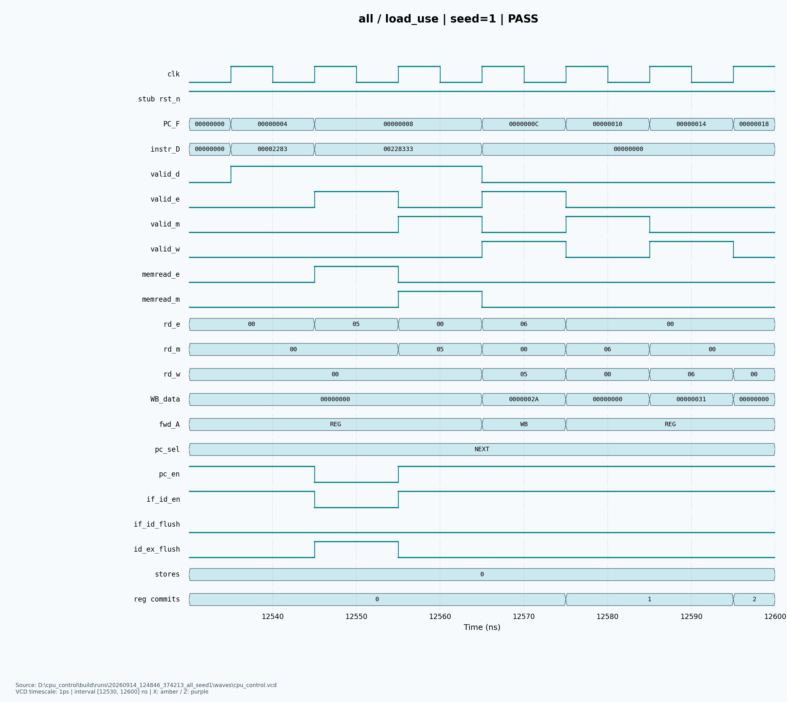

# CPU_CONTROL — RV32I 五级流水线 C1 / D1 对齐

依据用户提供的 FACE-SOC-SPEC-001 v0.1、CPU_CONTROL 实施任务书和架构图，实现 CPU_CONTROL 的组合 RTL、独立自检测试、验证用 Datapath stub、中文教程和真实 VCD 波形图片。

**范围与兼容状态：**Datapath 在 D1 中原则接受 C1，Control 项目已按 D1 对齐，保留 48 个端口和原编码。存储器时序、系统复位及公共地址仍待三方冻结。当前没有真实 Datapath，不能将 stub 测试称为真实 CPU/CNN 联调。见 [D1 原文](docs/inputs/CPU-DP-IF-D1.md) 和 [逐项对齐记录](docs/control_reply_to_D1.md)。

## 直接运行

在项目根目录：

```powershell
python scripts/run_tests.py --test all --seed 1 --random-cases 1000 --waves --plot
```

本机自动选择已验证的 Vivado XSim 2026.1。Icarus 为优先可选入口，本机未安装。无需 RISC-V 工具链即可运行 Control 测试。先检查工具可用性：`python scripts/run_tests.py --check-tools`。

## 文件入口

| 需要做什么 | 入口 |
|---|---|
| 从零学会运行、改参数和定位失败 | [中文测试教程](docs/README_TEST.md) |
| 查看生产 Control 顶层 | [cpu_control.sv](../../rtl/cpu_control/cpu_control.sv) |
| 查看主自检 TB | [tb_cpu_control.sv](../../tb/unit/tb_cpu_control.sv) |
| 修改测试默认值 | [tb_config.svh](../../tb/config/tb_config.svh) 的 USER EDIT 区域 |
| 查看指令与完整控制字段 | [译码表](docs/decode_table.csv)、[编码说明](docs/module_map.md) |
| 与 Datapath 负责人核对接口 | [逐端口契约](docs/cpu_control_interface.md)、[接线样例](../../tb/integration/cpu_control_link_example.sv) |
| 查看原规格缺口及采用状态 | [接口审计](docs/interface_audit.md)、[变更记录](docs/interface_change_log.md) |
| 理解前递、暂停和采样边沿 | [冒险规则](docs/hazard_forward_table.md)、[内存时序契约](docs/memory_timing_contract.md) |
| 收到真实 Datapath 后接入 | [连接检查清单](docs/datapath_connection_checklist.md) |
| CNN 参数写入与轮询顺序 | [C 软件示例](../../sw/drivers/cnn_driver_example.c) |
| 本次实际测试与尚未验证事项 | [验证报告](docs/verification_report.md) |

## 本次真实波形

[译码 PNG](docs/figures/decode.png) · [前递 PNG](docs/figures/forwarding.png) · [Load-use PNG](docs/figures/load_use.png) · [分支冲刷 PNG](docs/figures/branch_flush.png)

每张都有同名 SVG。图片由真实 RTL 仿真 VCD 生成，不是示意图。重新运行后在终端打印的 RUN_DIR/figures 查看新图，交付图来源见验证报告与 [来源记录](docs/figures/provenance.json)。



## 已验证与边界

D1 对齐后已运行完整回归：种子 1、1,000 条随机译码、128 个约束随机前递状态，1,244 个场景、30,463 项检查全部通过。新增非零 RESET_PC/同步复位与安全 NOP 连续执行检查。波形已更新为本次产物。之前的种子 2026、绘图解析器及负向测试作为历史结果保留，实际明细见 [验证报告](docs/verification_report.md)。

不包含生产 Datapath、CNN/DMA、完整识别程序、M 扩展、trap/CSR 或可变访存延迟支持。CNN Driver 是软件，不给 Control 新增 STATUS/CONTROL 端口。Verilator lint、FPGA 综合/时序和真实系统联调未执行。
