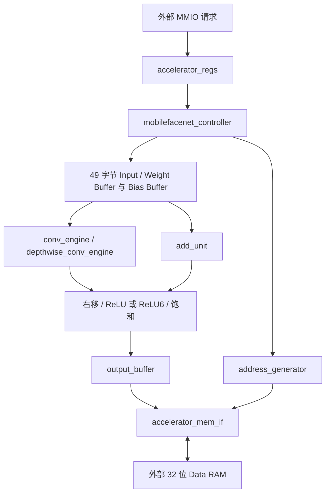

# MobileFaceNet 算子加速器

基于原 CNN 工程复用 MMIO、MAC、缓冲和 RAM 接口，并新增普通卷积 / Depthwise 双执行路径和算子控制器。顶层是 `mobilefacenet_accelerator_top`。**一次 START 执行一个算子，外部程序按网络顺序配置寄存器。** 没有 CPU、SoC、驱动、人脸检测或特征比较模块。

本目录独立编译，原 `rtl/`、`tb/` 中的 CNN 版本保留。两个版本包含同名基础模块，**不要把两个目录的 RTL 混在同一文件列表中**。新 RTL 列表见 [rtl/files.f](rtl/files.f)。

已实现用户要求的 ReLU / ReLU6 算子基线；实际 MobileFaceNet 有不同变体，一些使用 PReLU。导入器不会将 PReLU 替换成 ReLU6。尚未提供训练模型，当前验证使用确定性测试网络，不能据此宣称真实人脸识别精度或任意 MobileFaceNet 模型都兼容。

## 运行

以下命令均在工程根目录 `D:\code\FPGA1` 运行。需要 Python 3.10+、NumPy、Icarus Verilog；ONNX 导入需要 ONNX；结构检查需要 Yosys。本机脚本可找到已有 OSS CAD Suite，其他电脑将工具加入 PATH 或设置 `IVERILOG`、`VVP`、`YOSYS`。

```powershell
# 安装 Python 依赖；本机已经有 NumPy，ONNX 隔离安装在 mobilefacenet/.deps
python -m pip install -r mobilefacenet/requirements.txt

# RTL 全部测试：按模块开发顺序运行，最后执行 34 个算子任务
python mobilefacenet/scripts/run_tests.py

# 一次复现全部：Python + RTL + ONNX 导出后 RTL 比对 + Yosys 结构检查
python mobilefacenet/scripts/verify_all.py

# 单独调试某一步
python mobilefacenet/scripts/run_tests.py accelerator_regs
python mobilefacenet/scripts/run_tests.py conv_engine depthwise_conv_engine conv1x1
python mobilefacenet/scripts/run_tests.py mobilefacenet --task-limit 3
python mobilefacenet/scripts/test_reference.py
python mobilefacenet/scripts/check_structure.py
```

失败会非零退出并报告算子名称、输出字节位置、实际值和期望值。`LAYER PASS` 表示该层实际 RAM 输出全部与 Python Golden 相等，并检查没有写坏输出范围以外的字节；不是仅观察 DONE。完整验证输出 [build/verification.json](build/verification.json)，仿真日志保存在 `build/*.log`。

## 数据与算子约定

| 项目 | 实现 |
|---|---|
| 激活 | signed INT8，CHW 连续字节，N 固定为 1 |
| 普通卷积权重 | signed INT8，OIHW，即 `[oc][ic][ky][kx]` |
| DW 权重 | signed INT8，`[c][ky][kx]`，对应 ONNX `[c][1][ky][kx]` |
| Bias | little-endian signed INT32，每输出通道一个，基地址需 4 字节对齐 |
| MAC | INT8×INT8 → INT16 符号扩展 → INT32 累加；溢出按 32 位回绕 |
| 量化 | INT32 算术右移 → 可选 ReLU/ReLU6 → 饱和到 [-128,127] |
| ReLU6 | 在输出量化整数域限幅；顶层参数 `RELU6_MAX=96`，对应 scale=1/16 时的实数 6 |
| 最终输出 | 128 个 INT8，连续 128 字节；不做 L2 归一化或余弦相似度 |
| Padding | 四边相同的零填充；stride 两个方向相同 |
| 缓冲 | 每次一个通道的 K×K 分块，输入 / 权重各 49 字节；没有缓存整张图 |

所有激活的零点为 0。ADD 两个输入必须同 shape、同量化尺度；先符号扩展再相加，避免 INT8 提前溢出。`quant_shift` 范围 0…255，大移位负数得到 -1，非负数得到 0。ReLU6 与 ReLU 同时启用时，ReLU6 优先。

## 9 个 MMIO 寄存器

| 地址 | 名称 | 含义 |
|---|---|---|
| 0x40000000 | CONTROL | [0] START；[1] RESET；[5:2] OP_TYPE |
| 0x40000004 | STATUS | [0] BUSY；[1] DONE；[2] ERROR，只读 |
| 0x40000008 | INPUT_ADDR | 当前算子输入的字节地址 |
| 0x4000000C | OUTPUT_ADDR | 当前算子输出的字节地址 |
| 0x40000010 | WEIGHT_ADDR | 卷积权重；ADD 时为输入 B |
| 0x40000014 | BIAS_ADDR | 卷积 Bias 的字节地址 |
| 0x40000018 | FEATURE_SIZE | [15:0] width；[31:16] height |
| 0x4000001C | CHANNELS | [15:0] input_channels；[31:16] output_channels |
| 0x40000020 | LAYER_PARAM | 见下表 |

| LAYER_PARAM 位 | 含义 |
|---|---|
| [3:0] | kernel_size |
| [7:4] | stride，卷积时 1…15 |
| [11:8] | padding，0…15 |
| [19:12] | quant_shift |
| [20] | relu_enable |
| [21] | relu6_enable |
| [22] | residual_enable：仅 ADD 模式允许置 1；不是卷积后自动加残差 |
| [31:23] | 保留，必须写 0 |

| OP_TYPE | 算子 | 参数要求 |
|---|---|---|
| 0 | NORMAL_CONV | K=1 或 3，多输入 / 输出通道 |
| 1 | DEPTHWISE_CONV | K=3 或 7，输入通道=输出通道，multiplier=1 |
| 2 | RELU6 | 输入 / 输出 shape 相同；强制 ReLU6，可右移 |
| 3 | ADD | 输入 A 在 INPUT_ADDR、输入 B 在 WEIGHT_ADDR；可右移与激活 |
| 4 | COPY | 按字节复制；LAYER_PARAM=0 |
| 5 | FINAL_OUTPUT | width=height=1，输入 / 输出通道均为 128；LAYER_PARAM=0 |

非卷积算子的 kernel / stride / padding 字段必须写 0，输入 / 输出通道相等。Flatten / Reshape 不改变 CHW 内存次序，不需要专用运算单元；导出器只修改 shape 元数据，最后由 FINAL_OUTPUT 复制到指定地址。独立 ReLU6 可直接调用；普通 ReLU 通过卷积 / ADD 的激活位调用。

控制语义：

- MMIO 仅译码这 9 个对齐地址；有读写请求时 `mmio_ready=1`。未选中地址 ready=0、rdata=0，外部互连自行处理地址未命中。
- 每个 `mmio_we && mmio_ready` 上升沿是一次写入。START / RESET 产生脉冲、读回为 0；OP_TYPE 保存并读回。启动写值为 `(op_type << 2) | 1`，例如 Depthwise 写 5、ADD 写 13、FINAL_OUTPUT 写 21。不能在写 START=1 时遗漏原本要用的 OP_TYPE。
- 接受 START 时锁存本次配置并清除旧 DONE / ERROR。执行期间配置写入被忽略；再次 START 被拒绝并置 ERROR，原任务继续。此时原任务完成后的 STATUS 可以是 6（DONE+ERROR）。
- 正常运行 STATUS=1，正常结束 STATUS=2，非法参数 STATUS=4。DONE / ERROR 保持到下次接受 START 或 RESET。STATUS 写入没有效果。
- RESET 优先于 START，清除状态并取消当前任务，保留配置。已经发到 RAM 的事务必须等 ready 后才释放，总 BUSY 在排空前仍为 1；已提交的 RAM 写入不会回滚。等 BUSY=0 后再重启。
- 硬复位 `rst_n` 低有效；系统集成时 RAM 与主设备应遵守共同复位契约。

为避免覆盖未读取的数据，当前版本拒绝所有原地输出：输出不能与输入、卷积权重/Bias、ADD 输入 B 区域重叠。地址范围使用 64 位中间计算检查 32 位地址回绕。输入/权重可以不对齐，Bias 必须对齐。没有 RAM 容量寄存器，实际 RAM 容量由外部系统保证。

## 模块边界



控制器只运行一个算子，不知道网络共有多少层。普通卷积按输出通道、输出 y/x、输入通道、kernel tap 顺序执行；DW 固定输入通道为当前输出通道，累加 K² 项；普通卷积累加 CI×K² 项。每个输出重新装入 bias。

输入/权重缓冲先装满当前通道窗口，再向引擎发送样本。padding 位置直接写零、不发输入 RAM 请求。两个引擎各有一个 MAC 和累加器，一次只启用其中一个。缓冲采用独立地址/写使能接口，后续可以替换成 3/7 行缓存，第一版未实现行缓存复用。

外部 RAM 接口只有 `mem_addr/mem_wdata/mem_read/mem_write/mem_rdata/mem_ready`，没有 AXI。请求在上升沿 `ready=1` 时完成，等待时请求类型、地址和写数据必须保持稳定，读数据在完成沿有效。

32 位 RAM 字是 little-endian：地址最低两位选择 4 个 INT8 中的一个并符号扩展。因为没有 byte-enable，写一个 INT8 时先读整个字、替换对应 8 位、再写完整字，保留相邻三个字节；此为 pack/unpack 的第一版实现。暂未加入一次读取后复用另外三个字节的缓存。读改写期间外部系统不能并发修改同一个字。

## ONNX 模型与离线导出

```powershell
# 先查看原始各层类型、shape、K/S/P/通道
python mobilefacenet/scripts/export_onnx.py D:/models/face.onnx --inspect-only --out mobilefacenet/build/my_model

# 导出量化参数、任务配置与逐层 Golden
python mobilefacenet/scripts/export_onnx.py D:/models/face.onnx --input-npy D:/models/face_input.npy --out mobilefacenet/build/my_model

# 导出命令会打印 RAM 大小，按该数值传给仿真；此处仅为示例
python mobilefacenet/scripts/run_tests.py mobilefacenet --tasks mobilefacenet/build/my_model/tasks.txt --ram-bytes 262144

# 独立重新执行整数参考模型
python mobilefacenet/scripts/reference.py mobilefacenet/build/my_model
```

输入 `.npy` 是已完成模型所需预处理的 float32 CHW 或 NCHW（batch=1）数据；RGB 通道顺序、归一化与人脸裁剪必须与模型一致。本工程不做人脸检测、对齐或训练。没有 `--input-npy` 时明确使用全零输入，仅用于导出流程 smoke test。

支持静态 N=1、Conv、符合约束的 Depthwise、Conv 后单消费者推理 BN 融合、可融合 ReLU/Clip(0,6)、独立 Clip(0,6)、无广播 Add、Identity、保持顺序的 Flatten/静态 Reshape，以及可降低为 1×1 Conv 的 Gemm / 常量权重 MatMul。原始每层信息保存在 `model_layers.json`；实际硬件任务（融合后）保存在 `layer_config.json`。

PReLU、非对称 padding、dilation、其他分组卷积、DW multiplier>1、动态 shape、训练 BN、不可融合的独立 BN/ReLU、任意转置以及 L2 normalization 等均明确拒绝。`--inspect-only` 仅列出模型，不代表已通过全部兼容性检查；正式导出才会检查 shape、尺度和内存映射。

PyTorch 模型应先使用其原始架构和权重，以 `eval()` 状态导出静态 ONNX，再由本工具读取；不猜测仅含 state_dict 的 `.pth` 对应什么网络。

BN 融合在浮点域完成，再量化：

```text
a[c]  = gamma[c] / sqrt(running_var[c] + epsilon)
W'[c] = a[c] * W[c]
b'[c] = beta[c] + a[c] * (b[c] - running_mean[c])
```

量化的 scale 都是 2 的幂，零点为 0。默认输入/输出 `frac=4`（scale=1/16）。每层自动选择不过量程的权重 frac，计算：

```text
W_int8 = round(W_fused * 2^weight_frac)
b_int32 = round(b_fused * 2^(input_frac + weight_frac))
quant_shift = input_frac + weight_frac - output_frac
```

默认量化是可验证的基础部署方案，不是校准或量化感知训练。使用真实数据验证精度；必要时通过 `--quant-plan plan.json` 指定融合前 Conv / Add 的原始节点名称对应尺度，例如：

```json
{"project": {"weight_frac": 7, "output_frac": 4}}
```

需要左移的尺度、Bias 超 INT32、指定权重尺度导致越界、残差输入尺度不一致都会报错。ReLU6 层必须满足 `6 * 2^output_frac == RELU6_MAX`；此版统一使用 96，不能逐层变更上限。

导出产物：

| 文件 | 内容 |
|---|---|
| weight.bin / bias.bin | 各层融合、量化后的紧凑参数；Bias little-endian INT32 |
| input.bin | 实际仿真输入 INT8 |
| layer_config.json | 每层 MMIO 配置、shape、尺度、参数偏移及 RAM 映射 |
| model_layers.json | 原始 ONNX 节点信息，包括被融合节点 |
| ram_init.bin / ram_init.hex | 完整 / 稀疏 RAM 初始化镜像 |
| tasks.txt | 通用 testbench 逐层 MMIO 调度数据 |
| layer_NNN.golden.hex | 每个硬件任务的 Python INT8 期望输出 |
| features.golden.bin | 最终 128 字节参考特征 |

导出器按张量最后使用位置回收 Feature RAM：线性网络复用两个区域，残差仍存活时增加区域，避免过早覆盖 skip。Flatten / Identity 等别名共享同一块物理数据，不会破坏活跃性。RAM 初始化仅在首层加载，此后 RTL 层间数据来自真实写回；Golden 文件只供比较，不填入 DUT RAM。

测试任务的路径采用空白分隔，导出目录不要含空格。`ram_bytes` 为仿真需要的容量，下游集成必须把四个地址寄存器映射到实际可访问的 RAM。

## 波形怎么看

**想自己改输入并核对曲线：**修改 [examples/custom_input.json](examples/custom_input.json)，运行 `python mobilefacenet/scripts/custom_wave.py`。程序会给出每次乘加的预期值、实际值、时间与对应波形图片，默认输入1～9、权重全1，输出45。详见[自定义输入实验](docs/custom_wave.md)。

已有 VCD 时，可直接运行 `python mobilefacenet/scripts/view_wave.py` 打开 GTKWave，并自动预选关键信号。如果窗口未出现，运行 `python mobilefacenet/scripts/view_wave.py --image` 将真实 VCD 转成图片（需要 Pillow）。图片位于 `mobilefacenet/build/wave_overview.png` 和 `wave_mac_detail.png`，分别显示第一个普通卷积任务和第一个输出点的累加细节。脚本不会覆盖已有 VCD；没有 VCD 时才自动生成第一任务的波形。

先跑小任务，避免一开始打开数百万周期：

```powershell
python mobilefacenet/scripts/run_tests.py mobilefacenet --task-limit 1 --waves
# 有 GTKWave 时打开 VCD；VVP 是仿真程序，不是波形
gtkwave mobilefacenet/build/mobilefacenet.vcd
```

在 DUT 中选择 `start`、`core_busy`、`done`、`error`、`state`、`mem_read`、`mem_write`、`mem_ready`、`mem_addr`、`mem_wdata`、`tap`、`av`、`wv`、`normal_result`、`depthwise_result`、`out_value`。查看 signed 激活时切换成有符号十进制。

按三个问题检查：启动后是否进入 busy？RAM 等待期间地址/请求是否稳定？每次写入的输出字节是否与该任务 Golden 相同？DONE 是内部单周期信号，MMIO 的 DONE 是保持状态；左侧数值是当前光标时刻，不代表整段仿真。缓冲在第一次写入前可以是 X，但有效采样和写回不能包含 X；testbench 对未知值也会报错。

完整接口与模块级测试数据见 [docs/modules.md](docs/modules.md)，验证范围与限制见 [docs/verification.md](docs/verification.md)。

实现未做器件映射和时序收敛；可变地址计算包含乘除法，逐字节读改写和重复装载窗口会较慢。优先保证本版的算术、地址、握手和层间结果，再优化行缓存、权重复用或地址增量计算。
