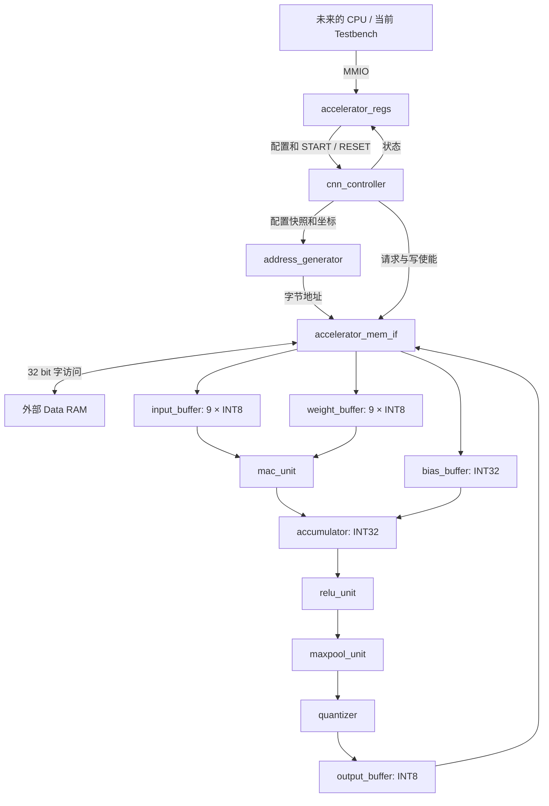

# 接口与集成说明

## 1. 顶层和数据通路

顶层代码：[`rtl/cnn_accelerator_top.v`](../rtl/cnn_accelerator_top.v)。所有 RTL 模块都有独立文件；没有 CPU 或 SoC 模块。



### 顶层端口

| 端口 | 方向 / 位宽 | 语义 |
|---|---|---|
| `clk` | 输入 1 | 全模块上升沿时钟 |
| `rst_n` | 输入 1 | 低有效异步硬复位；集成时应同步释放 |
| `mmio_addr` | 输入 32 | 完整字节地址，包含基地址 |
| `mmio_wdata` | 输入 32 | 完整寄存器写数据，没有字节写使能 |
| `mmio_we/mmio_re` | 输入各 1 | 写 / 读请求 |
| `mmio_rdata` | 输出 32 | 组合读数据 |
| `mmio_ready` | 输出 1 | 命中合法寄存器且有请求时为 1 |
| `mem_addr` | 输出 32 | 对齐到 4 字节的物理 RAM 字地址 |
| `mem_wdata` | 输出 32 | 完整 RAM 字写数据 |
| `mem_read/mem_write` | 输出各 1 | RAM 请求，互斥，保持到握手 |
| `mem_rdata` | 输入 32 | RAM 在读握手上升沿提供的数据 |
| `mem_ready` | 输入 1 | 本次 RAM 请求在当前上升沿完成 |

`BASE_ADDR` 参数默认 `32'h4000_0000`。顶层没有调试口、CPU 数据投喂口、DMA 描述符或复杂总线端口。

## 2. 九个 MMIO 寄存器

| 地址 | 名称 | 复位值 | 访问 / 定义 |
|---|---|---|---|
| `0x4000_0000` | CONTROL | `0` | 写 bit0 START，bit1 RESET；读恒为 0 |
| `0x4000_0004` | STATUS | `0` | 只读：bit0 BUSY，bit1 DONE，bit2 ERROR |
| `0x4000_0008` | INPUT_ADDR | `0` | 输入激活的字节首地址 |
| `0x4000_000C` | OUTPUT_ADDR | `0` | 输出激活的字节首地址 |
| `0x4000_0010` | WEIGHT_ADDR | `0` | 权重的字节首地址 |
| `0x4000_0014` | BIAS_ADDR | `0` | Bias 首地址，必须 4 字节对齐 |
| `0x4000_0018` | IMAGE_SIZE | `0x00E0_00E0` | `[15:0]` width；`[31:16]` height；默认 224×224 |
| `0x4000_001C` | CHANNELS | `0x0001_0003` | `[15:0]` IC；`[31:16]` OC；默认 RGB → 1 通道 |
| `0x4000_0020` | CNN_PARAM | `0x0010_0113` | kernel=3，stride=1，pad=1，shift=0，ReLU=1，Pool=0 |

`CNN_PARAM` 位域：`[3:0] kernel`，`[7:4] stride`，`[11:8] padding`，`[19:12] quant_shift`，bit20 ReLU，bit21 Pool。`[31:22]` 必须为零。

### MMIO 时序与状态语义

1. 请求方提供地址、读写信号和写数据；`mmio_ready=1` 的上升沿接收一次请求。每个这样的时钟沿都是一次独立传输，发起方必须在完成后撤销请求或切换到下一笔。
2. 读数据是组合输出，无读副作用。若同时 `we/re=1`，写在时钟沿生效，读返回该时刻可见值；建议桥接逻辑保持读写互斥。
3. 未命中、非 4 字节对齐地址：`ready=0`、`rdata=0`，不产生加速器 ERROR。后续总线桥应自行处理未映射访问。
4. CONTROL 写 1 产生 START 单周期脉冲。已接收的 START 立即反映为 BUSY，随后 FSM 使用配置快照。
5. START/BUSY/RESET 期间，7 个配置寄存器写入被应答但忽略；配置读始终可用。完成后可以为下一次计算重配。
6. BUSY 期间再次 START：忽略启动，置粘滞 ERROR；当前计算继续。可能最终读到 `DONE=1,ERROR=1`。单元测试覆盖此行为。
7. DONE / ERROR 保持到下一次**成功接受的** START 或 CONTROL.RESET。写 STATUS 没有效果；不是 W1C。
8. CONTROL 同时写 START 和 RESET 时 RESET 优先，START 不产生。保留 CONTROL 位忽略。
9. 硬复位恢复配置默认值；CONTROL.RESET 清状态、终止计算，但保留 7 个配置寄存器。

## 3. RAM 布局与地址

所有地址均为字节地址。一个 RAM 字内：最低地址对应 `[7:0]`，随后对应 `[15:8]`、`[23:16]`、`[31:24]`。

### 输入 / 输出：HWC

```text
input[y][x][ic]  → INPUT_ADDR  + ((y * W  + x) * IC + ic)
output[y][x][oc] → OUTPUT_ADDR + ((y * OW + x) * OC + oc)
weight[oc][ky][kx][ic] → WEIGHT_ADDR + (((oc * 3 + ky) * 3 + kx) * IC + ic)
bias[oc] → BIAS_ADDR + 4 * oc
```

输入 / 权重为有符号 INT8。Bias 为小端有符号 INT32。这里实现常见 CNN 的 **cross-correlation**：权重不进行 180° 翻转。

```text
CW = floor((W + 2 * padding - 3) / stride) + 1
CH = floor((H + 2 * padding - 3) / stride) + 1
OW = pool_enable ? floor(CW / 2) : CW
OH = pool_enable ? floor(CH / 2) : CH
输出长度 = OW * OH * OC 字节
```

Padding 为四边对称零填充；越界样本直接写入 input_buffer 为 0，不访问 RAM。池化的窗口固定 2×2、stride=2、不填充；卷积宽高为奇数时，最后一列 / 行丢弃。

输入、权重、输出允许不对齐字节首地址。读访问对齐到包含该字节的 RAM 字，按地址低两位选取并符号扩展。一次物理读提供四个 INT8 字节，本版使用当前请求需要的一个 lane；尚未缓存剩余三个 lane，因此邻近样本可能重复读取同一个字。

由于接口没有 `wstrb`，每个输出字节执行：读目标对齐字 → 替换目标 lane → 写回完整字。第一个 / 最后一个输出字里的其他字节都保留。**OUTPUT_ADDR 指向的区域必须可读也可写**；映射必须覆盖首尾涉及的完整 32 位字。

### RAM 握手

```text
时钟区间       A       B       C       D
mem_read       1       1       1       0
mem_addr       X       X       X       -
mem_ready      0       0       1       -
上升沿动作     等待    等待    完成    -
```

`read/write/addr/wdata` 在等待期间全部稳定。RAM 必须只在 `request && ready` 上升沿提交一次事务；不能在每个等待周期都写入。`ready` 在没有请求时可以为任意值。

第一版只有一笔未完成内部命令；响应为单周期脉冲，Controller 保证消费。内部命令支持 INT8 / INT32 读取、INT8 / INT32 写入；CNN 只使用 INT8 读写和 INT32 Bias 读取。

后续 CPU 和本模块共享 RAM 时，需要外部仲裁器。尤其字节读改写期间，CPU 不得并发修改同一个 RAM 字，否则可能发生丢失更新。完成前由加速器独占输出所涉及的字；计算期间输入、权重和 Bias 不应被修改。本工程不实现仲裁器或缓存一致性。

## 4. FSM 和缓存策略

实际 FSM 为建议流程增加了参数检查、Bias 初始化和请求等待状态：

```text
IDLE → VALIDATE → LOAD_BIAS / WAIT_BIAS → INIT_ACC
     → LOAD_INPUT / WAIT_INPUT：填充一个 IC 的 9 个样本
     → LOAD_WEIGHT / WAIT_WEIGHT：填充同一 IC 的 9 个权重
     → CONV：连续 9 次 MAC
         未完成 IC → LOAD_INPUT，继续累加
         完成全部 IC → RELU → POOL
             Pool 还有样本 → LOAD_BIAS，计算下一个卷积位置
             Pool 完成或旁路 → QUANTIZE
     → WRITE_BACK / WAIT_WRITE
         还有输出 → LOAD_BIAS
         最后输出 → DONE → IDLE
VALIDATE 非法 → ERROR → IDLE
```

每个最终输出以 `oc → x → y` 的顺序遍历，匹配 HWC 存储顺序。启用池化时，对该输出通道依次计算池化窗口的左上、右上、左下、右下四个卷积值。每个值先 ReLU，再送到池化最大值寄存器。关闭池化时，用 `first=1` 装入唯一卷积结果，完成旁路。

Bias 先加载以初始化累加器；不同 IC 之间不重复加载 Bias。下一个卷积空间位置才重新初始化。

输入缓存 9×INT8，权重缓存 9×INT8，Bias / 累加 / Pool 各一个 INT32，输出缓存一个 INT8。相邻窗口、不同输出通道之间暂不复用数据，权重也按需重读。这是窗口级串行功能基线，未实现行缓存或完整图像缓存。

小缓存使用同步写、异步读。后续替换为同步 BRAM 时应同时调整 Controller 的读延迟，不能只替换存储原语而保持原时序不变。

## 5. 算术

- 乘法：signed INT8 × signed INT8，先得到 signed INT16，再符号扩展到 INT32。
- 累加：`bias + Σproduct`，保存低 32 位；溢出按 INT32 二进制补码回绕，不做累加饱和，不产生 ERROR。
- ReLU：启用时负数置零，否则透传 INT32。
- Pool：INT32 有符号比较；第一个样本直接装入，保证全负值池化正确。
- 量化：`value >>> quant_shift`，算术右移，无舍入，负数向负无穷取整。
- ReLU 开启：饱和至 `[0,127]`；关闭：饱和至 `[-128,127]`。
- `quant_shift` 支持整个 8 位范围 0–255；大于等于 32 时，正数得到 0，负数得到 -1，再按 ReLU 规则饱和。

## 6. 参数检查、复位与集成边界

以下条件启动后置 ERROR，且不访问 RAM：

- W/H/IC/OC 为零；kernel 不是 3；stride 为零。
- 卷积或池化后的宽 / 高不为正。
- CNN_PARAM 保留位非零，或 Bias 首地址未按 4 字节对齐。
- 输入 / 权重 / Bias / 输出区域超出 32 位地址空间。
- 输出字节范围与输入、权重或 Bias 任一范围重叠；不支持原地计算。

地址计算和区域检查使用 64 位中间量，允许最后一个有效字节恰为 `0xFFFF_FFFF`。Controller 不包含图像寻址乘除公式。

CONTROL.RESET 到来时，FSM 和计算寄存器清空。Memory IF 对已经呈现在外部接口的请求继续保持，直到 `mem_ready`，但丢弃响应。字节写的读阶段若被取消，不再启动写阶段；已经呈现的写请求仍须完成。BUSY 在排空请求后下降，DONE / ERROR 清零。软复位不会回滚已经写出的输出；该次输出应视为未完成。

硬复位可直接撤销请求，外部 RAM / 仲裁器必须与加速器共享该复位或明确支持取消。本接口没有事务 ID。

简单 RAM 接口没有错误输入，也没有超时机制。如果 RAM 永不返回 ready，则当前传输持续等待，软复位也需等待其排空。未来若需要超时或总线错误上报，应扩展协议；不能仅凭现有 ready 区分慢 RAM 与失效 RAM。

未连接 CPU、没有驱动、不做 DMA 虚拟地址转换；后续 CPU 必须配置可访问的 RAM 物理字节地址。当前未完成目标 FPGA 的面积、频率或板上验证。可配置尺寸的组合地址运算包含乘除法，应在后续性能版本中按需改为增量地址或启动阶段预计算。
