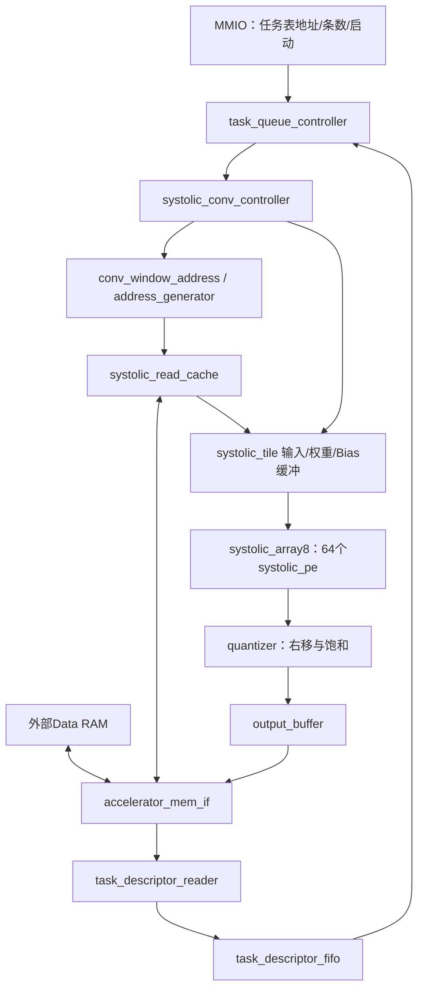

# 纯阵列版本

分支：codex/array-only。改动前源码、测试、脚本、文档、示例及未提交修改已备份到 build/checkpoints/before_array_only_20260923.zip。

## 模块关系

systolic_conv_controller 只负责调度和控制，不是另一个卷积乘加单元。
普通卷积、Depthwise共用阵列；Depthwise使用独立通道映射，不用大量零权重模拟普通卷积。
控制、地址生成、缓冲、量化和RAM接口负责供数与结果写回，仍需保留。

## 当前支持范围

|配置|行为|
|---|---|
|描述符 OP 0|普通1×1/3×3 Conv|
|描述符 OP 1|3×3/7×7 Depthwise，输入输出通道数相等|
|CONTROL OP 15|唯一有效启动命令，提交任务队列|
|CONTROL OP 0～14 + START|拒绝，STATUS.ERROR置位，不访存、不启动阵列|
|描述符 OP 2～255|非法任务，STATUS.ERROR置位|
|LAYER_PARAM[19:12]|quant_shift，INT32算术右移后饱和到-128～127|
|LAYER_PARAM[31:20]|必须为0；拒绝ReLU、ReLU6、residual及保留标志|
|Bias / MAC|signed INT32；溢出按32bit回绕|
|128维输出|最后一层Conv直接写OUTPUT_ADDR，共128字节|

顶层删除 USE_SYSTOLIC、RELU6_MAX 参数，不再有标量/激活通路选择。
MMIO和RAM引脚、寄存器地址、描述符布局保持不变。所有算子参数只能由FIFO中的描述符提供。
MMIO的OUTPUT_ADDR、WEIGHT_ADDR、BIAS_ADDR、CHANNELS、LAYER_PARAM现在保留为读0、写无效。
当前不具备独立执行完整MobileFaceNet所需的激活和残差功能。

## 描述符与启动

每条任务仍是32字节、8个little-endian 32bit字：

|字|内容|
|---|---|
|0|[15:8]版本1，[7:0]算子0或1，[31:16]保留0|
|1|INPUT_ADDR|
|2|OUTPUT_ADDR|
|3|WEIGHT_ADDR|
|4|BIAS_ADDR|
|5|FEATURE_SIZE：高16位height、低16位width|
|6|CHANNELS：高16位output_channels、低16位input_channels|
|7|LAYER_PARAM：kernel、stride、padding、quant_shift|

队列模式：MMIO INPUT_ADDR指向32字节对齐的描述符表，FEATURE_SIZE为任务条数，CONTROL写(15<<2)|1。
单任务也必须建立一条描述符，MMIO FEATURE_SIZE写1、CONTROL写0x3D。
数据布局沿用CHW，权重OIHW/Depthwise CKK；输入权重INT8，Bias INT32。

## 时序

默认先读取最多4条描述符，再逐条执行；缓冲队列为空时补取下一批。
不同任务不同时计算。上一任务完成且内存接口空闲后，才派发下一任务。
同一块按装载、阵列计算、量化、写回顺序进行，没有取数与计算的双缓冲重叠。
阵列内部多个PE可同拍乘加和传递数据，有效PE数受传播时序和尾块大小影响。

## 验证与限制

verify_all.py执行13个RTL testbench，包括PE全部65536组INT8乘法、分块矩阵、DW、暂停复位、地址、量化、RAM握手、队列。
queue_only测试验证30次旧直接启动均被拒绝、保留寄存器无效，以及单任务队列和复位重启。
另有21层独立/连续算子测试，以及队列深度1、3、4下的9层任务链，对照整数参考。
非法算子和激活标志在运算访问之前报错；读取任务表本身可以产生RAM访问。
结构检查见 build/array_only_structure.json，通用综合见 build/array_only_synthesis/。
结构检查还确认各任务参数直接连接描述符FIFO，队列控制器已无单层MMIO配置输入。
build/array_only_synthesis/中的旧通用综合结果需重新运行synthesize_systolic.py后才对应最新RTL。
未做器件映射、布局布线、时序收敛或真实模型识别精度验证。
