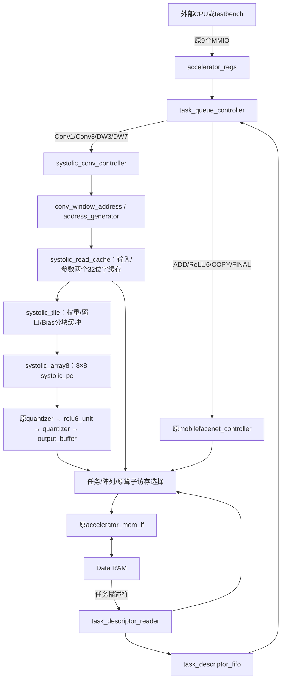

# 8×8 脉动阵列与卷积集成

开发分支：`codex/systolic8`。原有工作区修改已保存于提交 `00eb8e3`。顶层仍为 `mobilefacenet_accelerator_top`，增加编译期参数 `USE_SYSTOLIC`，默认1；设为0即选择保存的串行计算路径。没有增加MMIO寄存器、任务字、外部端口、CPU或SoC。

## 模块关系



图中的CPU只表示外部调用方，工程没有实现CPU。队列仍默认按4条描述符一批读取，运算期间不同时预取下一批。`OP_TYPE=15`、32字节描述符v1、所有地址及参数字段沿用原格式。

## 每个PE及数值行为

`systolic_pe`包含一个signed INT8×INT8乘法器、一个INT32累加寄存器、A/B转发寄存器及两个valid寄存器。计算为 `sum ← wrap_int32(sum + sign_extend(a*b))`。Bias为INT32，首个K块装载一次；后续K块继续累加，最后才进行量化。溢出按模2^32回绕，不做INT32饱和。

普通模式中A从左向右传，B从上向下传；两者各移动一格/有效时钟，两个valid都为1才乘加。累加结果留在原PE，不随数据移动。阵列结果总线为2048位，`(row*8+column)*32 +: 32`是该单元的INT32结果。

```text
             B0↓    B1↓    …    B7↓
    A0 →    PE00 → PE01 → … → PE07
              ↓      ↓          ↓
    A1 →    PE10 → PE11 → … → PE17
              ⋮      ⋮          ⋮
    A7 →    PE70 → PE71 → … → PE77
```

原数值流程保持：INT32算术右移 → 可选ReLU/ReLU6（整数上限默认96）→ [-128,127]饱和 → signed INT8写RAM。没有浮点、额外零点或每通道乘数。MAC和后处理之间不提前截断到INT8。

## 普通矩阵乘法的边界时序

一个tile计算 `C[R,N] += A[R,K] × B[K,N]`，R/N/K有效大小各为1～8。每个PE(row,col)对应一个输出。输入buffer必须在start前填好；busy时写buffer被忽略。start在空闲且ce=1的上升沿接受，锁存模式、维度、accumulate。调用方保证这些维度合法；卷积任务由地址生成器先拒绝零尺寸等非法参数。

接受start之后先进行1个初始化周期，再进行RUN。以下t只计算RUN中ce=1的周期，第一周期为t=0：

| 边界输入 | 送入的数据 | valid条件 |
|---|---|---|
| 左侧第r行 | A[r,t-r] | r<R且0≤t-r<K |
| 顶部第c列 | B[t-c,c] | c<N且0≤t-c<K |

同一个归约项k在PE(r,c)相遇的周期为`t=k+r+c`。K=8时运行t=0～21，共22个有效RUN周期；此实现小行/列尾块也固定保留14周期填充/排空，因此一般为K+14周期。最后一个RUN沿后sum更新、done置1、busy置0；调用方在后续上升沿消费结果。初始化另占1周期，start握手另计，不能把K+14当成完整任务延迟。

`accumulate=0`时初始化sum为每行Bias（每列相同）；`accumulate=1`时保留上个K块的sum。结果读取只允许有效行列，其他单元的值不参与输出。新M/N块必须使用accumulate=0。小于8的维度通过valid禁止无效PE计算，取数器也不会读取无效行列。

## 分块、卷积窗口与输出顺序

普通卷积映射：

一般矩阵乘法也可按1×1卷积驱动整套分块控制器：A为[M,K,1,1]权重、B为[K,1,N]输入，输出为[M,1,N]。外部输出仍遵循项目的INT8量化约定；需要检查量化前INT32时，使用tile的sums接口和矩阵testbench。整矩阵分块循环已在硬件卷积控制器中实现，不要求CPU为每个8×8块分别START。

```text
M = output_channels
N = output_height * output_width
K = input_channels * kernel_size * kernel_size
A[oc,k] = weight[oc,ic,ky,kx]
B[k,pos] = input[ic, oy*stride+ky-padding, ox*stride+kx-padding]
```

`conv_window_address`将归约索引拆为ic/ky/kx，将pos拆为oy/ox，复用原地址生成器的64位范围检查和CHW/OIHW布局。padding在本地提供0，不发RAM读取。1×1和3×3使用同一取数/阵列路径，不在外部RAM生成im2col展开图。

遍历顺序：输出通道块mb → 空间块nb → 归约块kb；每块最多8行×8列×8项。`nr=min(8,M-mb)`、`nc=min(8,N-nb)`、`nk=min(8,K-kb)`。因此例如M=9、N=10、K=17会覆盖2×2个输出块，每块归约分8+8+1，Bias只加一次。

K块全部算完后，读取该结果块：row0的有效col依次输出，再row1，直至nr行结束，然后处理下一空间块。写回地址仍为 `OUTPUT_ADDR+(oc*OH+oy)*OW+ox`；**RAM写事务的时间顺序不是全图CHW顺序，但完成后的RAM布局完全一致**。每个输出字节恰写一次，INT8的读改写由原Memory IF保护相邻字节。

## Depthwise独立通道映射

Depthwise使用同一64个PE，但采用独立通道供数模式：行r对应通道mb+r，列c对应空间位置nb+c，K仅为KY*KX（9或49），不含输入通道归约。

```text
PE[r,c].sum += input[channel_r, window(position_c,k)] * weight[channel_r,k]
```

每个有效周期给64个PE分别提供自己的激活，8个通道权重各沿对应行广播。该模式绕过正常A/B邻居转发输入，直接进入PE；各PE的累加器和乘法器仍是原64个。无跨通道加和，无构造通道对角矩阵、无大量零权重。K=9分8+1；K=49分六个8加1；每个归约块的RUN周期为nk，不需正常模式的14周期波前延迟。

## Buffer与32位RAM供数

| 存储 | 容量 | 用途 |
|---|---:|---|
| A分块buffer | 64字节 | [8通道][8归约项]权重 |
| B分块buffer | 512字节 | [8通道][8位置][8归约项]窗口；普通模式仅使用第0行的64字节 |
| Bias buffer | 32字节 | 8个通道的INT32 Bias |
| PE累加寄存器 | 256字节 | 64个INT32部分和 |
| 读缓存有效数据 | 8字节 | 输入与参数各1个32位字，另有tag/valid |

分块buffer采用可综合寄存器bank与选择逻辑，不假定FPGA BRAM有64个读口。先按RAM带宽装满当前分块，再从内部bank并行给阵列送数；未做双缓冲加载/计算重叠，不缓存整张图。

普通模式的K块固定最多8项，因此满8×8块也只在22个RUN周期内完成512次MAC，RUN阶段的理想平均利用率为8/22≈36.4%，计入加载和写回后还会更低。64个PE是物理并行规模，不代表目前每周期持续完成64次MAC。DW直接供数模式没有该波前排空开销；后续可扩大K缓冲或连续供数来提高普通模式利用率。

读取32位字后保留全部4个INT8字节，后续同字地址命中时本地解包，输入和权重使用不同缓存bank。每个新算子及RESET使缓存失效，防止任务间读取旧数据。当前权重/窗口可在多个PE间复用，但不同输出块仍可能重新读取；不能把64个PE解释为整层自动加速64倍。

## 暂停、握手与复位

- PE和tile的`ce=0`冻结数据转发、valid、sum、控制状态和计数，buffer写入也暂停；恢复后从原位置继续。done若在暂停时为1也保持，所以消费者只应在ce=1时接受一次。
- `rst_n=0`异步复位控制、sum、valid；`clear=1`在上升沿清空这些状态，优先于ce。clear或rst_n不要求物理清空A/B存储，恢复前必须重写有效数据和Bias。
- 顶层没有新增pause端口。等待RAM时阵列尚未RUN；RUN阶段内部bank已备齐，无需等待外部RAM。PE接口的ce为以后仲裁/双缓冲扩展保留。
- MMIO软RESET取消正在加载、计算或写回的任务并清空阵列；原Memory IF继续排空已呈现的事务。已完成写入不回滚，BUSY须等RAM排空后才清零。
- 配置在START时锁存，忙时MMIO写保护和重复START语义不变。队列层级done只推进队列，全部任务成功后才置STATUS.DONE。
- 每个任务输出都不得覆盖整个描述符表（含尚未预取的任务）以及原输入/权重/Bias区域。非法参数在发起算子数据访问前报错。

## 验证与复现

```powershell
# 开发顺序：单PE、分块矩阵和读缓存
python mobilefacenet/scripts/run_tests.py systolic_pe systolic_matmul systolic_read_cache

# 新旧路径用相同数据验证；保存每项结果、周期和RAM访问次数
python mobilefacenet/scripts/verify_systolic.py

# 同一综合流程比较两种编译配置，不需要上板
python mobilefacenet/scripts/synthesize_systolic.py

# 两者均通过后，整理可保存的逐项CSV、资源统计与报告
python mobilefacenet/scripts/report_systolic.py
```

`build/systolic_report/verification.json`只有所有验证通过才标为passed。`*_comparison.csv`逐项列出expected/actual；`performance.csv`保留每个任务的旧/新周期和RAM读写次数；`synthesis_summary.json`保存技术无关门级综合统计。测试平台对RAM使用相同3周期等待设置；周期为仿真时钟计数，不是毫秒实测速度。直接MMIO任务统计包括轮询/收尾开销，队列逐层统计从dispatch到exec_done，队列TOTAL另含取描述符和启动/收尾；只在同类行间比较。

旧的`custom_wave.py`和`custom_queue.py`刻意保留串行教学视图，以便原9步乘加对照表继续使用，不作为阵列验证证据。实际阵列测试默认不传`--serial`；在`run_tests.py mobilefacenet/task_queue`后加`--serial`仅用于基线比较。

## 验证范围与限制

没有给定FPGA型号与目标频率，因此综合使用相同的Yosys技术无关流程：`synth -flatten -noabc`和`check -assert`。其单比特通用门/触发器数量不是器件LUT、DSP或BRAM数量，未进行布局布线、静态时序收敛或板级测试。

当前没有真实训练MobileFaceNet模型输入；验证包含独立算子、残差链、112×112测试链、ONNX未训练测试图以及任务队列。没有真实识别精度、全模型延迟或功耗结论。地址生成的可变乘除法、分块buffer的组合读选择和串行RAM仍可能限制实际频率/资源，后续应根据目标器件再优化。
