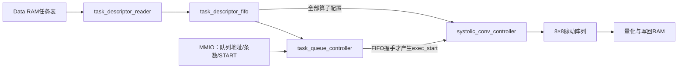

# RAM任务队列：唯一算子提交入口

当前版本只支持通过队列执行普通Conv和Depthwise。CPU或测试程序先准备RAM中的数据、权重、Bias和任务表，再提交整个队列。
即使只有一个算子，也要使用一条任务的队列。已移除旧的MMIO单算子直通路径。

## CPU只提交队列

保留9个地址，但CPU不再通过这些寄存器写入单层配置：

|MMIO地址|名称|当前用途|
|---|---|---|
|0x40000000|CONTROL|写0x3D启动队列；写2复位|
|0x40000004|STATUS|bit0 BUSY，bit1 DONE，bit2 ERROR|
|0x40000008|INPUT_ADDR / QUEUE_BASE|任务表字节地址，必须32字节对齐|
|0x4000000C|原OUTPUT_ADDR|保留：读0、写无效|
|0x40000010|原WEIGHT_ADDR|保留：读0、写无效|
|0x40000014|原BIAS_ADDR|保留：读0、写无效|
|0x40000018|FEATURE_SIZE / TASK_COUNT|完整32位值表示条数，必须大于0|
|0x4000001C|原CHANNELS|保留：读0、写无效|
|0x40000020|原LAYER_PARAM|保留：读0、写无效|

QUEUE_BASE和TASK_COUNT复位值为0。CONTROL的START和RESET为脉冲，读回这两位为0。
CONTROL[5:2]仍保留命令编码；只有15与START一起写入时有效，即0x3D。
旧的CONTROL=1、5等直接启动请求会置ERROR，不访问RAM、不启动阵列。
RESET优先于START；只写命令编码、不写START不会执行任何任务。

```text
CPU/测试程序先把输入、参数和描述符表放入RAM
MMIO[0x40000008] = queue_base
MMIO[0x40000018] = task_count  // 单任务填1
MMIO[0x40000000] = 0x3D
等待 STATUS.BUSY=0
检查 STATUS.DONE=1 且 STATUS.ERROR=0
```

队列是启动前准备好的有限连续表，不是允许运行期间追加任务的环形队列。

## 每条任务的布局

固定32字节，8个little-endian 32bit字；第i条位于queue_base+i*32。

|字节偏移|内容|
|---|---|
|+0x00|HEADER：[7:0]算子编号，[15:8]版本1，[31:16]保留0|
|+0x04|输入Feature Map字节地址|
|+0x08|输出Feature Map字节地址|
|+0x0C|权重字节地址|
|+0x10|Bias字节地址|
|+0x14|低16位width，高16位height|
|+0x18|低16位input_channels，高16位output_channels|
|+0x1C|kernel、stride、padding、quant_shift；[31:20]必须0|

普通Conv的HEADER是0x100，Depthwise是0x101。HEADER不是CONTROL，不含START/RESET。
描述符算子只允许0或1，15也不能作为任务表内的计算算子。
最后128个特征写到末层描述符的OUTPUT_ADDR，与已保留的MMIO OUTPUT_ADDR位置无关。

## 硬件路径和时序



默认TASK_PREFETCH_DEPTH=4，FIFO缓存最多4条待执行描述符。
每条描述符需要8次32bit读取；RAM仍使用原ready握手，不增加复杂总线。

```text
取0、1、2、3 → 依次执行0、1、2、3
取4、5、6、7 → 依次执行4、5、6、7
取8         → 执行8 → 队列DONE
```

不同任务不同时运行，当前也不边执行边预取下一批。FIFO深度可改，已验证1、3、4。
单任务同样经历读取8字、FIFO入队、派发、计算、写回、队列完成，不存在特殊快速旁路。
每层内部done仅通知队列控制器，所有任务成功后才置MMIO DONE。

|queue_state|含义|
|---|---|
|0|空闲，等待队列启动；旧直接模式转ERROR|
|1|检查任务表地址和数量|
|2|读取当前批描述符|
|3|检查队首任务，FIFO握手并产生exec_start|
|4|等待当前算子done/error|
|5|等待执行器和内存接口空闲，更新完成计数|
|6|整个队列完成|
|7|队列出错|

## 异常和复位

- 非法直接启动、队列地址未对齐、条数0或地址溢出：ERROR，不访存。
- 描述符版本、算子、保留位或算子参数非法：停止执行后续任务，已完成输出保留。预取可能已读到后续描述符。
- 输出不得覆盖整个任务表，包括尚未预取的任务。
- BUSY期间配置锁定，重复START置ERROR且不会重复启动；正在运行的队列继续完成。
- RESET清空FIFO、取消计算；已向RAM发出的事务需要等待ready排空，已发生写入不回滚。等BUSY清零后可重新提交。
- RAM没有响应超时。运行中不要修改任务表或正在使用的数据。

## 验证和部署

在项目根目录运行：

```powershell
python mobilefacenet/scripts/run_tests.py queue_only
python mobilefacenet/scripts/verify_all.py
python mobilefacenet/scripts/accelerator_wave.py --open --view timing
```

queue_only覆盖全部旧直接启动编码、保留寄存器无效、一条任务经FIFO执行、复位重启。
完整回归包含13个testbench、21层算子比较和深度1/3/4的9任务链。
原mobilefacenet测试名称和tasks.txt输入格式保留，但testbench现在将每层写入RAM中的单条描述符再提交队列，不再直接配置算子寄存器。

ONNX导出层条目提供descriptor_header，不再提供旧的逐层control_start。
queue_config.json中的control_start仍为61，表示唯一队列启动命令。

```powershell
python mobilefacenet/scripts/pack_queue.py mobilefacenet/build/my_model
python mobilefacenet/scripts/run_tests.py task_queue --queue-dir mobilefacenet/build/my_model --ram-bytes 262144
```

按queue_config.json里的ram_bytes设置实际仿真RAM容量。
打包器选择不与数据重叠的位置，生成queue.bin、queue_ram.hex、queue_config.json。
当前硬件不支持激活和残差，不能直接运行带这些算子的完整MobileFaceNet。
