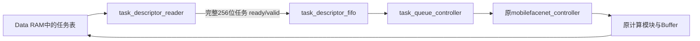

# RAM任务队列（描述符格式v1）

队列模式由CPU或testbench启动一次，随后加速器从同一块Data RAM读取任务配置，按顺序执行全部算子。计算模块和RAM接口不变，没有增加CPU、SoC、DMA、脉动阵列或上板逻辑。

本版是启动前准备好的**有限连续任务表**，运行期间任务内容和数量固定。它不是允许CPU边运行边追加的环形队列。

## CPU如何启动

保留原有9个MMIO地址，新增CONTROL的OP_TYPE=15作为队列启动命令：

| MMIO地址 | 队列模式的用途 |
|---|---|
| 0x40000008 INPUT_ADDR | 任务表起始字节地址，必须32字节对齐 |
| 0x40000018 FEATURE_SIZE | **整个32位值表示任务数量**，不是宽高打包 |
| 0x40000000 CONTROL | 写0x3D，即OP_TYPE=15且START=1 |
| 0x40000004 STATUS | BUSY覆盖整个队列，全部成功才置DONE，失败置ERROR |

其他配置寄存器在队列模式中不作为算子配置使用，各层配置从描述符读取。START/RESET仍是脉冲，STATUS仍是只读的sticky状态。RESET写CONTROL=2。

```text
CPU/测试程序先把输入、参数、任务表放入RAM
INPUT_ADDR  = queue_base
FEATURE_SIZE = task_count
CONTROL      = 0x3D
等待 BUSY=0
检查 DONE=1、ERROR=0
```

OP_TYPE=0…5的原单算子模式保持兼容。现有自定义输入实验、旧的单层测试无需改动。MMIO OP_TYPE的6…14暂保留；15表示队列提交，不是可放进任务表的计算算子。

## 一条任务的内存布局

每条固定32字节，8个32位字，little-endian。第i条地址=`queue_base+i*32`。

| 字节偏移 | 内容 |
|---|---|
| +0x00 | HEADER：[7:0]算子编号、[15:8]格式版本1、[31:16]保留为0 |
| +0x04 | 输入字节地址 INPUT_ADDR |
| +0x08 | 输出字节地址 OUTPUT_ADDR |
| +0x0C | 权重地址，ADD时为第二输入地址 |
| +0x10 | Bias地址 |
| +0x14 | FEATURE_SIZE：[15:0]宽、[31:16]高 |
| +0x18 | CHANNELS：[15:0]输入通道、[31:16]输出通道 |
| +0x1C | LAYER_PARAM：沿用原kernel/stride/padding/量化/激活定义 |

HEADER的例子：普通卷积0x00000100、Depthwise 0x00000101、ADD 0x00000103、FINAL_OUTPUT 0x00000105。**HEADER不是MMIO的CONTROL值，不含START或RESET位。**

描述符预留8位算子编码，但本版计算硬件仍只接受0…5。扩大编码空间不代表已经实现256种算子。其他版本或非零保留位会明确报错，避免静默解释错误。

每层可以有不同输入/输出地址、尺寸、通道和量化设置。最终特征写入最后任务描述符的OUTPUT_ADDR；队列模式不会自动把它复制到MMIO OUTPUT_ADDR寄存器中。

## 多任务预取如何预留



顶层参数 `TASK_PREFETCH_DEPTH` 默认4，表示最多缓存4条待执行任务，FIFO数据容量为4×32=128字节。另有读取器的一条任务组装暂存，以及当前执行任务的锁存配置。深度必须>=1，已验证1、3、4，包括非2的幂深度。

对于9个任务、深度4：

```text
取任务0、1、2、3 → 缓冲达到4条 → 顺序执行0、1、2、3
取任务4、5、6、7 → 缓冲达到4条 → 顺序执行4、5、6、7
取任务8         → 剩余不足4条也能执行 → DONE
```

因此，本版已经支持按批缓存多个任务。外部RAM仍然一次读取一个32位字，每条任务读8次；没有新增突发协议，也没有在算子执行期间并发预取。任务读取和算子访存分阶段共用原来的Memory Master，切换时没有未完成事务。

以后可替换描述符读取器，使其一次突发读取多条，再按ready/valid送入FIFO；也可增加响应归属跟踪和仲裁，实现“执行当前批时预取下一批”。FIFO满时会反压，不应丢任务。上述改进不需要改普通卷积和Depthwise计算模块。

## 完成、异常与复位

- 每个算子内部done只通知队列控制器，不会提前置MMIO DONE；整个队列执行成功后才置DONE。
- 队列运行期间，包括取描述符、批间切换和等待RAM，BUSY保持1。配置写入被锁定。
- 忙时再次START被拒绝并置ERROR，当前队列继续执行；成功结束后可以得到STATUS=6（DONE+ERROR），与原忙时保护语义一致。
- 空队列、任务表未对齐、任务表范围超出32位地址空间：ERROR，不访问RAM。
- 描述符版本、算子编号、保留位或某层参数非法：停止于该任务，不执行后面的任务。预取可能已读取后续描述符，但不会执行它们；已完成任务的RAM结果保留。
- 每一层输出都不得覆盖**整个任务表**，包括尚未预取的任务。原来的输入/权重/Bias输出重叠检查仍然保留。
- RESET取消队列、清空预取FIFO，同时复位算子控制器。已经呈现给RAM的事务仍须等ready后排空；已发生的写入不回滚。等待STATUS.BUSY清零后，可重新准备输入并启动。
- 本版不对外部RAM响应设置超时，实际RAM大小由集成方保证。CPU不能在运行中修改任务表及加速器正在使用的数据。

## 仿真

在工程根目录运行：

```powershell
# 独立FIFO与描述符读取器
python mobilefacenet/scripts/run_tests.py task_descriptor_fifo task_descriptor_reader

# 一次START执行9个任务，逐层与Python比对
python mobilefacenet/scripts/run_tests.py task_queue

# 验证不同任务预取容量
python mobilefacenet/scripts/run_tests.py task_queue --prefetch-depth 1
python mobilefacenet/scripts/run_tests.py task_queue --prefetch-depth 3
python mobilefacenet/scripts/run_tests.py task_queue --prefetch-depth 4

# 队列模式波形
python mobilefacenet/scripts/run_tests.py task_queue --waves
python mobilefacenet/scripts/view_wave.py --vcd mobilefacenet/build/task_queue.vcd --scope tb_task_queue.dut

# 完整新旧模式回归、ONNX队列与结构检查
python mobilefacenet/scripts/verify_all.py
```

默认9任务测试包含：Conv1、COPY保存残差、DW3、ADD、ReLU6、Conv3、DW7、Conv1输出128通道、FINAL_OUTPUT。只在启动前装入一次RAM，后续任务直接读取前面任务实际写回的结果；Golden数据只用于比对。测试还检查每层之外的RAM字节没有被破坏。

自动检查包括：读描述符地址顺序、每条恰好8次整字读取、首次执行前已填满预取批、尾批处理、层级DONE不外泄、无重复/乱序执行、版本/范围/参数错误、任务表保护、忙时START、读取/写入阶段复位与重新启动。

内部调试信号：`queue_state`为队列状态，`state`仍为原算子状态；`queue_fetched`为完整取回的任务数，`queue_completed`为成功完成数，`queue_buffered`为等待执行的任务数。当前任务不是成功完成任务，因此在计算时completed尚未增加。

| queue_state | 含义 |
|---|---|
| 0 | 空闲，允许旧单算子路径直通 |
| 1 | 检查任务表地址与数量 |
| 2 | 读取并填充当前预取批 |
| 3 | 检查队首描述符并启动算子 |
| 4 | 等待算子done/error |
| 5 | 等待执行器与Memory IF完全空闲，更新完成计数 |
| 6 | 整个队列完成 |
| 7 | 队列出错 |

## ONNX部署数据

ONNX导出器现在会自动额外生成 `queue.bin`、`queue_ram.bin`、`queue_ram.hex`、`queue_config.json`。原来的逐层MMIO任务文件仍保留。

对已有导出目录也可单独打包：

```powershell
python mobilefacenet/scripts/pack_queue.py mobilefacenet/build/my_model
python mobilefacenet/scripts/run_tests.py task_queue --queue-dir mobilefacenet/build/my_model --ram-bytes 262144
```

最后一个RAM容量只是示例，按 `queue_config.json` 的ram_bytes填写。打包器自动选择不与输入、输出、权重、Bias重叠的32字节对齐位置；`--base 0x...`可以显式指定，重叠或地址溢出会报错。任务描述符和数据位于同一RAM镜像。

队列测试产生的最终128字节为 `build/queue_features.bin`；`verify_all.py`还会保留不同预取深度和ONNX队列的日志、结果和SHA-256到 `build/verification.json`。本版仍使用测试模型验证功能，未增加真实训练模型或识别精度结论。
